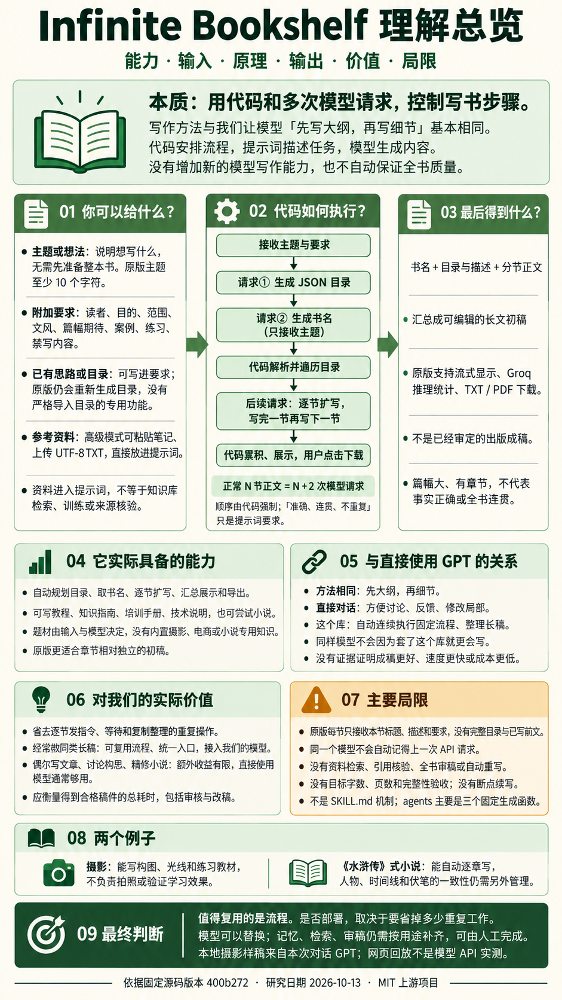

# GitHub 项目研究索引

> 研究 GitHub 项目的能力、实现原理、输入输出、应用价值与实践意义，记录源码证据、复现实验和使用边界，并集中提供研究文档与网页演示入口。

这里是研究总仓库。每个子项目拥有独立编号、研究文档、图片与实践代码；本页提供按编号排列的索引和简要介绍。

[项目目录](./projects/) · [新增项目指南](./CONTRIBUTING.md) · [研究模板](./templates/project/) · [Web 部署约定](./docs/deployment.md)

## 项目索引

<!-- PROJECT_INDEX:START -->
当前收录 **1** 个项目，按三位编号升序排列。

| 编号 | 项目 / 研究摘要 | 目标源库 | 研究状态 | 相关入口 |
| --- | --- | --- | --- | --- |
| **001** | **[Infinite Bookshelf：写书流程、能力与价值研究](./projects/001-infinite-bookshelf/README.md)**<br><br>**能力：** 把主题展开为目录、书名和分节长文初稿，顺序生成并汇总展示。<br>**原理：** 代码组织多次模型请求，先目录、再书名、逐节正文；写作方法与手动让模型先出大纲再写细节相同。<br>**输入：** 主题；可补充读者、目标、范围和风格要求，高级模式可加入笔记或 TXT 资料。<br>**输出：** 书名、目录、各节正文，以及可导出的 TXT/PDF 初稿，供人工编辑和审核。<br>**价值：** 减少重复请求与整理，复用写作流程，并可修改接口接入自有模型；没有提高模型本身能力。<br>**意义与场景：** 适合重复起草较独立的教程和培训材料；偶尔写作额外价值有限，复杂小说需补前文与人工审核。<br>**边界与验证：** 不能自动保证质量。本研究提供源码证据、总览图与摄影等可读样稿；样稿是保存内容，未验证真实模型 API 的质量、速度和费用优势。<br><br>AI 写作 · 长文生成 · 模型可替换 · 源码研究 | [infinite-bookshelf](https://github.com/Bklieger/infinite-bookshelf)<br>Bklieger | 已完成 | [研究文档](./projects/001-infinite-bookshelf/README.md)<br>[在线演示](https://yydshly.github.io/1013_codex_project/001-infinite-bookshelf/) |

## 项目引导图

引导图独立展示在索引表外。点击图片进入研究文档，图片说明保留其内容与来源。

### 001 · Infinite Bookshelf：写书流程、能力与价值研究

[](./projects/001-infinite-bookshelf/README.md)

图片说明与来源：本次研究解释图：输入、流程、输出、能力、价值与局限；非原版运行截图

[查看原图](./projects/001-infinite-bookshelf/assets/03-understanding-overview.png) · [研究文档](./projects/001-infinite-bookshelf/README.md) · [在线演示](https://yydshly.github.io/1013_codex_project/001-infinite-bookshelf/)

<!-- PROJECT_INDEX:END -->

## 收录与阅读方式

- **先看索引**：了解项目用途、研究进度与演示入口。
- **再读子项目**：查看选择理由、环境配置、源码分析、截图说明与研究结论。
- **保留来源**：记录原仓库、研究时的版本或 commit，以及上游许可证。
- **积累实践**：将实验代码放在对应子项目中，区分上游功能与本仓库的改动。

研究状态：`待研究` → `研究中` → `已复现` → `已完成`，停止维护的项目标记为 `已归档`。状态可按实际进度调整。

## 目录结构

```text
1013_codex_project/
├── README.md                 # 对外总览：索引、分项摘要、源库和导航
├── AGENTS.md                 # 后续研究与维护的工作约定
├── projects/                 # 001-xxx、002-xxx…，每个目录一个研究项目
├── templates/project/        # 子项目文档、元信息和图片占位模板
├── docs/deployment.md        # 多个 Web 演示的路径与部署约定
├── scripts/                  # 创建子项目、生成并校验索引
├── tests/                    # 索引与创建工具的行为检查
└── .github/workflows/        # 自动检查项目结构与索引同步
```

## 添加第一个项目

需要 Python 3.10 或更高版本，无需安装第三方依赖。将下面的示例名称和原仓库地址替换为实际项目：

```bash
python scripts/new_project.py example-project --name "项目名称" --source "https://github.com/owner/repository" --summary "这个项目解决什么问题，以及本次研究的重点。"
```

工具会分配下一个编号，创建 `projects/001-example-project/`，复制研究模板，并更新本页索引。

后续修改子项目的 `project.json` 后，执行：

```bash
python scripts/update_index.py
python scripts/update_index.py --check
```

编号从 `001` 开始，保持稳定，不随研究状态变化而重排。图片放在各子项目的 `assets/` 中，Web 演示代码放在各子项目的 `web/` 中。详细规则见 [新增项目指南](./CONTRIBUTING.md)。

## Web 演示

预留同一站点下的独立路径，例如 `/1013_codex_project/001-example-project/`。每个子项目可选择适合自己的技术栈；有可访问的演示后，将实际地址写入 `project.json` 的 `demo_url`，索引便会显示入口。

静态演示通过 GitHub Actions 汇集到 [GitHub Pages 站点](https://yydshly.github.io/1013_codex_project/)，各子项目使用独立路径。线上页面展示研究说明与可公开的样稿；需要模型接口或私密凭据的功能使用单独后端。发布步骤和验证范围见 [Web 部署约定](./docs/deployment.md)。

## 来源与使用

各子项目应注明原作者、原仓库、研究版本和许可证。引用的源码、图片及其他素材遵循各自的上游许可；本仓库目前未设置统一开源许可证。
