# GitHub 项目研究索引

> 研究 GitHub 项目的能力、实现原理、输入输出、应用价值与实践意义，记录源码证据、复现实验和使用边界，并集中提供研究文档与网页演示入口。

这里是研究总仓库。每个子项目拥有独立编号、研究文档、图片与实践代码；本页提供按编号排列的索引和简要介绍。

没有公开源码的产品可作为公开资料研究收录，来源登记真实官网，并明确区分官方声明、实现推导与运行验证；不填写虚构的源码版本或许可证。

[项目目录](./projects/) · [新增项目指南](./CONTRIBUTING.md) · [研究模板](./templates/project/) · [Web 部署约定](./docs/deployment.md)

## 项目索引

<!-- PROJECT_INDEX:START -->
当前收录 **15** 个项目，按三位编号升序排列。

| 编号 | 项目 / 研究摘要 | 研究来源 | 研究状态 | 相关入口 |
| --- | --- | --- | --- | --- |
| **001** | **[Infinite Bookshelf：写书流程、能力与价值研究](./projects/001-infinite-bookshelf/README.md)**<br><br>**能力：** 把主题展开为目录、书名和分节长文初稿，顺序生成并汇总展示。<br>**原理：** 代码组织多次模型请求，先目录、再书名、逐节正文；写作方法与手动让模型先出大纲再写细节相同。<br>**输入：** 主题；可补充读者、目标、范围和风格要求，高级模式可加入笔记或 TXT 资料。<br>**输出：** 书名、目录、各节正文，以及可导出的 TXT/PDF 初稿，供人工编辑和审核。<br>**价值：** 减少重复请求与整理，复用写作流程，并可修改接口接入自有模型；没有提高模型本身能力。<br>**意义与场景：** 适合重复起草较独立的教程和培训材料；偶尔写作额外价值有限，复杂小说需补前文与人工审核。<br>**边界与验证：** 不能自动保证质量。本研究提供源码证据、总览图与摄影等可读样稿；样稿是保存内容，未验证真实模型 API 的质量、速度和费用优势。<br><br>AI 写作 · 长文生成 · 模型可替换 · 源码研究 | [infinite-bookshelf](https://github.com/Bklieger/infinite-bookshelf)<br>Bklieger | 已完成 | [研究文档](./projects/001-infinite-bookshelf/README.md)<br>[在线演示](https://yydshly.github.io/1013_codex_project/001-infinite-bookshelf/) |
| **002** | **[Production Agentic RAG Course：论文助手与工程架构研究](./projects/002-production-agentic-rag-course/README.md)**<br><br>**定位：** 以 arXiv AI 论文为默认资料的课程与参考工程，展示从资料采集到检索问答、运行维护的完整 RAG 链路；论文是示例领域。<br>**能力：** 源码包含定时采集论文、PDF 解析、章节或词数切块、关键词与向量混合检索、普通流式问答和论文来源链接，以及普通问答缓存、追踪和多个入口；Agentic 增加领域判断、相关性检查、改写与重试。<br>**原理：** 先获取并整理文件，解析正文、切分片段、生成语义向量并建立搜索索引；提问时融合关键词与向量检索，把相关片段与问题一起交给模型，再回看原文核对。RAG 为本次请求补充资料，无需为这条链路重新训练模型。<br>**架构：** PostgreSQL 保存正文与元信息，OpenSearch 保存片段、向量和检索字段；Docling 解析 PDF，Jina API 生成向量，Ollama 生成回答。Airflow 调度采集，Redis 缓存普通问答，Langfuse 追踪；FastAPI、Gradio、Telegram 提供入口。<br>**输入：** 默认采集 arXiv 的 cs.AI 论文和 PDF，问答输入为问题与检索参数。自有农业资料、手册或研究笔记需要新增来源或导入入口，保留题名、作者、年份、来源、版本、原文位置和领域字段。<br>**输出：** 建库得到可检索的片段、向量与元信息；搜索返回相关资料，普通问答返回模型回答和论文来源链接，供人工核查。本研究另提供中文导读、完整理解图、可下载使用路线、源码证据与复现清单。<br>**价值：** 主要参考价值是完整 RAG 的搭建方法、组件分工、数据衔接和评测思路，可为自己的知识系统提供实现基础；减少重复找资料与整理的效果，需要通过检索质量、核查时间、耗时和成本验证。<br>**对你的意义：** 把你收集的论文、种植资料、试验记录与 GitHub 项目研究逐步积累为能查找、能回答、能追溯依据的知识系统；同时形成判断 AI 项目质量的方法，并为后续研究对比、专题报告和写作提供资料基础。<br>**可扩展场景：** 上游默认用于 AI 论文研究；适配后可用于农业论文与种植手册问答、产品手册与技术规范查询、固定版本的 GitHub 项目研究对比，再探索资料助手、专题报告和与项目 001 长文写作的衔接。<br>**扩展方向：** 新资料入口、去重与定期更新，中文、扫描件、表格和实验条件提取，本地向量模型与私有部署，权限、版本和领域筛选，以及普通 RAG 与 Agentic 的对比评测。以上均为后续实现与验证方向。<br>**使用路线：** 先选明确主题，准备一批可靠文档和 10 个真实问题；获取资源、保留来源、整理文档、解析切块、建索引、检索问答并核对引用。先跑通普通 RAG、保存运行基线和验证记录，再扩展 Agentic 或其他应用。<br>**边界与验证：** 已完成核心源码研究和导读页验证，尚未运行上游。知识覆盖由已入库资料决定，来源链接需核对是否支持结论；默认领域规则需调整，Jina 向量化调用外部 API。Agentic 参数、模型接入、来源与追踪闭环，以及解析、检索、回答、更新、缓存和故障恢复仍待复现。<br><br>RAG · LangGraph · 混合检索 · AI 工程 | [production-agentic-rag-course](https://github.com/jamwithai/production-agentic-rag-course)<br>jamwithai | 研究中 | [研究文档](./projects/002-production-agentic-rag-course/README.md)<br>[在线演示](https://yydshly.github.io/1013_codex_project/002-production-agentic-rag-course/) |
| **004** | **[Leak Check：个人信息泄漏查询与关联原理研究](./projects/004-leak-check/README.md)**<br><br>**搜索能力：** 支持输入手机号、邮箱、身份证号或 QQ 号，查询匹配记录并通过共同标识关联其他记录；姓名、地址和公司等是返回字段，不能作为当前搜索入口。<br>**原理：** 识别输入格式，在本地 SQLite 既有数据库的对应字段中精确匹配；默认直接查询后再关联一轮，汇总、去重并脱敏返回。本质是数据库查询与数据处理的封装。<br>**输出：** 返回脱敏的姓名、联系方式、账号、地址、公司等字段列表及来源标签；字段与来源分别聚合，未保留逐条对应关系。<br>**数据前提：** 只能查到数据库已收录的内容，不自动发现或采集泄漏数据。仓库附示例库，未附作者线上完整数据库；空库无匹配结果，查不到也不能证明未泄漏。<br>**对我们的价值：** 价值不大，主要可参考常规数据库操作、有限关联与脱敏接口的实现；缺少核心数据，不能仅凭源码复现作者线上服务的查询效果。<br>**研究结论：** 基础源码理解与文档整理已完成，沿用本次生成的引导图，保留参考即可，不继续深入研究；尚未运行上游或验证真实数据与性能。<br><br>数据库查询 · 信息泄漏 · SQLite · 关联查询 · 脱敏 | [leak-check](https://github.com/garinasset/leak-check)<br>garinasset | 已完成 | [研究文档](./projects/004-leak-check/README.md)<br>演示未部署 |
| **005** | **[WireGuard Install：自建 VPN、原理与应用研究](./projects/005-wireguard-install/README.md)**<br><br>**库的能力：** 帮助你在自己的 Linux 服务器上搭建 WireGuard VPN：自动安装、生成密钥与接入配置、设置转发和 NAT、启动服务，并添加或撤销设备。客户端使用现成的 WireGuard 应用。<br>**底层原理：** 客户端把整个原始 IP 包认证加密，封装到外层 IP / UDP / WireGuard 消息中；服务端验证、解密和解封装，再由 Linux 路由与 NAT 转发。内部可以承载 TCP 或 UDP，HTTPS 的 TLS 加密继续存在。<br>**两端职责：** 两端都是密钥认证的 peer。客户端按系统路由选取流量、加密发送和解密返回；本项目的 Linux 服务端登记客户端公钥与内部 IP，处理隧道并作为集中出口网关。<br>**部署方法：** 准备受支持的 Linux、root 权限和可达 UDP 端口，运行安装器并设置服务器地址、端口与 DNS；将生成的配置或二维码导入设备，检查握手和实际业务。云安全组、上游端口映射和内网返回路径按环境配置。<br>**输入与输出：** 输入是服务器环境、可达地址、端口、DNS 和设备名称；输出是服务端接口与网络规则、每台设备的密钥和配置文件 / 二维码。导出材料含客户端私钥，属于接入凭据。<br>**个人价值：** 减少重复手配，掌握自己的出口和设备授权，方便多台手机电脑接入，并学习虚拟接口、加密隧道、路由和 NAT。需要承担服务器、流量费用、系统更新、凭据管理和排错。<br>**使用场景：** 适合个人自建集中出口、在不可信网络保护到网关的路径、实验室与小团队密钥接入；访问家庭或办公室内网、指定网段分流还需补充路由、返回路径、DNS 与防火墙策略。<br>**可扩展方向：** 可进一步设计分流与内网接入、逐设备访问策略、配置分发与密钥生命周期、Web 管理 / API、监控审计、部署自动化和多网关冗余；这些是后续设计，安装器未提供完整实现。<br>**边界与验证：** 源码、配置字段与官方协议已核对，中文网页已部署，线上资源与交互已验证；真实 VPN 连接、抓包、DNS / IPv6 与容量未实测。安装器无 TCP 回退或自动穿透中继平台，不保证速度、匿名性或平台断线阻断。<br><br>WireGuard · VPN · UDP · 加密隧道 · Linux | [wireguard-install](https://github.com/hwdsl2/wireguard-install)<br>hwdsl2 | 研究中 | [研究文档](./projects/005-wireguard-install/README.md)<br>[在线演示](https://yydshly.github.io/1013_codex_project/005-wireguard-install/) |
| **006** | **[Jev SEO：网页质量检查规则与自有模型审查框架](./projects/006-jev-seo/README.md)**<br><br>**核心定位：** 核心是针对公开网页前端可见质量的检查规则与内容评估标准，侧重 SEO、页面结构、抓取设置、链接与内容。适合作为网页质量检查的基础框架；采集提供事实，模型处理语义，报告提供整改依据。<br>**必须补充：** 还需要另外补充实际交互、手机布局、无障碍、业务功能和后端检查。viewport 存在不等于手机布局正常，响应正常不等于表单、权限或后端业务正确；本库不提供完整的应用质量认证。<br>**能力：** 采集部署网址，提取 HTML、标题、正文与链接，执行 52 条固定规则，按 19 个评估维度使用自有模型判断内容并生成带证据的报告。<br>**原理：** 采集页面快照 → 解析事实 → 固定规则与模型评估 → 指纹、格式及原文校验 → 整改排序与人工复核。规则未触发和模型未知都不能证明整站通过。<br>**参考与提取：** 固定上游 commit，保留采集、解析、规则和问题标准；新增项目路径范围、中文正文保留、兼容接口、聊天材料导入、证据与任务校验；未移植 DataForSEO 和专用概率体系。<br>**规则与定制：** 完整列出 52 条规则的触发、修复、上下文与来源，以及 19 个模型维度的选项和档位。固定规则需扩展执行代码，语义规则需扩展问题与报告映射；网页 JSON 是手册，不是扫描配置，经验阈值不能机械当作合格线。<br>**输入与输出：** 输入部署后公开可访问的网址与范围，内容判断另需聊天会话或模型接口。输出页面事实、规则问题、模型引文、审查覆盖、整改清单和 JSON/Markdown/本地 HTML。<br>**模型替换：** 当前聊天模型通过导出材料、审查、导入完成；自有模型通过 OpenAI 兼容 Chat Completions 自动评估。两种路径均校验输出与引文，允许未知，判断需要人工复核。<br>**使用场景：** 自己的 GitHub Pages、上线自查、文章与知识库、产品服务介绍、改版迁移、模型比较、便于检索引用的内容研究，以及记录网页症状后转入独立后端根因排查。<br>**价值：** 把检查目标、证据、判断标准和修复建议组织成可复用清单，将审查经验与模型供应商分开；减少重复核查并把建议定位到网址与原文，按影响和工作量安排整改。实际质量、效率和成本要通过真实样本验证。<br>**对我们的意义：** 将规则作为自己网页的基础检查标准，按作品集、产品页、文章或文档用途调整；用相同材料比较模型，再逐步补齐交互、移动端、无障碍、业务与后端测试，形成自己的质量检查流程。<br>**边界与验证：** 27 项离线实验测试通过，聊天样例 3 任务/28 判断跑通；导读网页已发布，资源与提交一致，公网规则检索与回跳验证，手机展示本地验证。真实网站审查、自有接口、PageSpeed 与采集器动态渲染未实测；不检查后端源码或真实排名，规则未触发和模型未知不代表整站通过。<br><br>网页质量 · SEO · 规则检查 · 模型替换 · 证据校验 | [jev-seo](https://github.com/AgriciDaniel/jev-seo)<br>AgriciDaniel | 研究中 | [研究文档](./projects/006-jev-seo/README.md)<br>[在线演示](https://yydshly.github.io/1013_codex_project/006-jev-seo/) |
| **007** | **[Hermes Jev Skills：多模型路由与判断标准研究](./projects/007-hermes-jev-skills/README.md)**<br><br>**库的能力：** 提供 Python 工具、CLI、技能、Hermes 插件和路由面板，把模型路由、技能选择、检索与证据判断、消息分类和候选动作选择接入 Agent。<br>**Jev 的作用：** Jev 是 TypeSafe 的云端决策模型，按输入状态、问题和标准返回有限选择、评分或是否概率；生成正文、修改代码和执行动作由主模型与工具完成。<br>**所在位置：** 位于工作流的判断环节：宿主组织状态与候选 → Jev 判断 → 本地策略校验、约束与回退 → 执行模型或工具；库不包含 Jev 权重和训练实现。<br>**路由原理：** 默认询问难度、工作类型和出错代价，本地代码结合阈值、模型池、上下文、图像能力和用户固定模型选择具体模型；Hermes 换模型不自动换供应商连接。<br>**输入与输出：** 输入是必要背景、明确问题与有限选项；输出是结构化判断。默认路由只看到脱敏且截断的当前请求及粗略特征，不能据此理解未提供的完整项目。<br>**我们的理解：** 值得借鉴的是按能力拆分任务，分开判断、选择、执行与验收。图中的个人架构和 A/B 策略是扩展设计，不是上游默认实现的逐项复刻。<br>**标准怎么设：** 先定义成果如何通过，再拆出背景是否足够、是否只改表达、是否需综合推理、是否存在行为依赖和错误代价；用真实 A/B 任务验证模型映射与阈值。<br>**何时使用：** 固定阶段、硬字段和可穷举分支优先规则；反复出现且会改变后续动作的语义判断，再比较 Jev 与便宜小模型；替代需要适配、合法值校验和回退。<br>**可扩展基础：** 可观察的状态、有限合法选项、明确判断标准、确定的执行方式、失败回退和结果验收齐备时，可扩展到证据充分性、技能选择、重试升级和交付检查。<br>**对我的意义：** 书籍写作按阶段配置模型；导览播放与同步保留代码，新联动需求再判断；RAG 判断证据覆盖；Leak Check 精确流程保留规则。先验证已有材料整理能否稳定交给便宜执行模型。<br>**价值怎么证实：** 比较固定模型、规则、规则 + Jev、规则 + 小模型四条完整流程，查看最终通过率、误降级、判断与重试升级总费用、耗时、返工和维护；路由标签准确不等于成果合格。<br>**边界与验证：** 源码职责与默认策略已核对，中文网页、完整理解图与评测表已部署，线上资源及交互已验证；未调用真实 Jev 或执行模型，未证明个人任务中的准确率与费用优势。<br><br>多模型路由 · 有限决策 · 判断标准 · 模型替换 · 评测 | [hermes-jev-skills](https://github.com/kerpopule/hermes-jev-skills)<br>kerpopule | 研究中 | [研究文档](./projects/007-hermes-jev-skills/README.md)<br>[在线演示](https://yydshly.github.io/1013_codex_project/007-hermes-jev-skills/#understanding) |
| **008** | **[shadPS4：PS4 模拟原理、系统知识与实践价值研究](./projects/008-shadps4/README.md)**<br><br>**定位：** 运行在电脑操作系统上的 C++ PS4 模拟器核心；PS4 是含硬件与系统的设备，手柄是输入设备，常用图形启动器由独立 QtLauncher 提供。<br>**能力：** 加载兼容 PS4 游戏或公开自制程序，安排游戏内存与执行入口，提供不同程度的系统库、图形转换、输入音视频和调试支持；借助主机系统与驱动使用实际 CPU / GPU，完整性依内容与版本。<br>**原理：** 加载与链接 → x86-64 主机大量原生执行及差异修补；系统兼容层处理 PS4 请求，PM4 命令解析与 GCN → IR → SPIR-V 着色器重编译组织 Vulkan 绘图，同时管理数据同步、资源与缓存。<br>**输入输出：** 输入游戏转储或自制可执行程序、所需模块、配置和玩家操作；输出运行画面、声音及调试日志。网页教学动画由浏览器绘制，不执行 PS4 游戏。<br>**研究展示：** 提供十一章中文导读，完整 SVG / PNG 一图总览与简化流程、三个请求流程与两类失败示例、缓存教学、理解核对、官方案例链接及二十二列实测记录表。<br>**实际验证：** 官方 v0.19.0 Windows 包摘要核对与 CLI 帮助通过；OpenOrbis v0.5.3 Hello World 真实执行，graphics 显示 CPU 生成的 Mandelbrot 分形，保存目标窗口截图、日志和可复现脚本。<br>**验证边界：** 已验证公开 homebrew 的 CPU / 部分 HLE、帧缓冲和 Vulkan 呈现，未证明 GCN 着色器重编译、商业游戏、3D 性能、音频或长时间稳定性；没有实体 PS4 主机对照。<br>**价值：** 使用价值是为部分 PS4 内容提供电脑运行路径；知识价值是把体系结构、操作系统、编译器、图形与并发联系起来；工程价值是理解跨平台行为兼容、证据诊断和回归验证。<br>**对你的意义：** 补充研究库的系统工程样本，建立概念 → 调用链 → 源码 → 最小实测 → 局限的研究方法，提升项目能力判断与问题定位；可探索源码和日志助手，对日常 AI / 资料自动化的直接收益较少。<br>**扩展方向：** 按难度从中文知识索引、兼容性回归工作台、日志分析助手，到着色器调试、系统库与同步修复、图形兼容和缓存优化；均明确验收条件，属于后续提议。<br>**复现环境：** Windows 11、i9-13980HX、16GB 内存、RTX 4070 Laptop、NVIDIA 576.28 / Vulkan 1.4.303；本次使用进程级 NVIDIA 驱动筛选，未使用 Sony 系统模块。源码研究提交与运行包提交分别记录。<br>**网页状态：** GitHub Pages 中文网页已发布并核验：十九个公网地址可访问，首页十二项摘要完整保留并沿用指定总览图，十一项浏览器检查通过；原生公开样例结果与网页教学分别记录。<br><br>PS4 模拟器 · 系统兼容 · 原生执行 · GPU · 编译器 · 公开示例实测 | [shadPS4](https://github.com/shadps4-emu/shadPS4)<br>shadps4-emu | 研究中 | [研究文档](./projects/008-shadps4/README.md)<br>[在线演示](https://yydshly.github.io/1013_codex_project/008-shadps4/) |
| **009** | **[cmux：一个人控制多个 Agent 的工作台与实现原理](./projects/009-cmux/README.md)**<br><br>**本质：** 把多个现有 Agent 会话放进一个工作台，分屏展示、独立交互、定向控制，让它们并行工作，使一个人能够同时管理和控制多个 Agent。<br>**能力：** 多窗口、工作区与分屏，双向终端输入输出，Hooks 状态与通知，CLI / Socket 控制，WebKit 浏览器自动化，Agent 收件箱、团队适配、事件规则与会话恢复。<br>**架构：** Swift、AppKit 与 SwiftUI 管理界面和会话；libghostty 经 PTY 承载 Shell / Agent，WebKit 承载浏览器；稳定 Surface 身份连接控制、状态和消息，模型与工具调用由 Agent 执行。<br>**原理：** 输入输出经 PTY 与终端协议显示；状态由 Hooks、OSC 或 CLI 上报；操作经 Unix Socket 路由；协作文本先进入消息存储，再由接收方 Hook 在支持的时机交付。<br>**多 Agent 协作：** 各 Agent 保留自己的模型、工具和上下文；人可在其他任务执行时给指定会话提示、回应问题、查看结果。Claude teams 等集成把已有团队操作映射为原生分屏，任务如何拆分和验收仍需明确策略。<br>**接入方式：** 先安装并在终端启动现有 Agent CLI，由 Agent 自己登录和配置模型；再按支持情况接入 Hooks、通知、CLI / Socket 控制、消息与团队适配。能运行 CLI 不等于所有增强能力都已支持。<br>**输入与输出：** 输入包括任务提示、会话目标、Hook 事件、终端字节、控制请求与协作消息；输出包括可操作终端 / 网页、会话状态与提醒、控制结果、消息状态和恢复信息，执行成果仍由 Agent 产出。<br>**使用场景：** 多个库或项目并行研究，代码实现与浏览器检查，长时间运行与远程开发，以及在既有 CLI 上建立可观察、可交互的个人工作流。<br>**个人价值：** 把一个人的注意力集中到分派、回应与验收，减少找窗口、漏看提醒、等待和重复搬运材料，便于组织更多独立任务；学习模型无关的承载和控制分层。当前 Windows 先参考架构，直接使用原生桌面端需要 Mac；质量、耗时与费用收益须实测。<br>**可扩展方向：** 从多会话控制扩展到任务契约、角色分派、依赖与限并发、失败重试升级、模型路由、共享材料、worktree / 合并、交付检查和费用统计；按需要增加 Windows 或远程宿主。已有事件、规则、消息可作基础，通用 fan-out 聚合在研究版本中仍是提案。<br>**实现思路：** 复用现有 Agent CLI 和模型，先承接独立进程与终端输入输出，再用稳定会话身份关联展示、状态、提醒、控制和消息；最后在上层补任务、隔离、依赖与验收，逐步形成可复用工作流。原型容易，可靠终端、交付与恢复仍需工程。<br>**边界与验证：** 分屏不自动规划任务，Workspace 不等于文件隔离，read / idle 不等于验收通过；不同 Agent 的消息唤醒与恢复能力不同。已完成固定源码研究、完整理解图与教学网页检查；未运行上游 macOS、真实 Agent / 模型或云移动链路。<br><br>多 Agent · 原生终端 · PTY · Hooks · 会话管理 · 消息投递 · 工作台架构 | [cmux](https://github.com/manaflow-ai/cmux)<br>manaflow-ai | 研究中 | [研究文档](./projects/009-cmux/README.md)<br>[在线演示](https://yydshly.github.io/1013_codex_project/009-cmux/#understanding) |
| **010** | **[Vibe42：Agent远程控制能力、原理与价值研究](./projects/010-vibe42/README.md)**<br><br>**能力：** 从手机、平板或浏览器远程操作Mac/Linux电脑中的Agent：发送文字和按键、处理终端中的确认请求、查看输出与状态、浏览编辑或传输文件；官方另列Mac远程桌面、多设备与团队访问，完整范围仍待运行验证。<br>**本质：** 为已有开发环境提供跨设备操作与观察入口。Vibe42送达输入、呈现结果并组织连接与通知；Agent自身负责理解任务、选择模型、决定工具调用和产生实际成果，原有代码、工具与环境继续在目标端使用。<br>**原理：** 目标电脑运行Companion；控制设备先配对、授权和选会话，文字/按键经设备间加密直连或必要的密文中继送达电脑，写入PTY伪终端。交互式Agent读取输入并执行，终端输出返回控制端渲染，状态事件可触发系统推送。<br>**架构与连续性：** 控制客户端、账号与设备平台、连接中继、电脑接入服务、终端会话与原生Agent分别承担职责。Linux说明要求tmux；手机观察界面与活进程分离，但主机需持续运行，显示恢复、进程存活和Agent原生历史应分别验收。<br>**输入：** 人的任务文字、按键、窗口尺寸、确认操作、文件请求与桌面输入，以及程序报告的状态。通用终端兼容不能单独证明原生任务ID、历史读取、精确中断或结构化审批能力。<br>**输出：** 可操作的终端文字、颜色与光标、文件和成果、支持的桌面画面及状态提醒。实际代码改动、测试报告和研究产物来自目标端程序；done、退出码或连接恢复均需结合业务目标与产物判断。<br>**价值：** 离开电脑后仍可查看任务进度、及时处理等待回答或确认的环节、接手原有Agent环境，并从移动端核查成果；减少回到电脑前和重新接入环境的等待。工程上可学习身份、传输、会话、渲染、通知和执行的分工；效率、成本、延迟与可靠性收益须用真实任务测量。<br>**对我们的意义：** 为GitHub项目研究、构建测试、资料处理与长任务提供移动观察和人工接手入口，保持成果留在熟悉的项目目录；研究证据、版本、测试与产物验收仍由自己的流程管理，不能仅靠提醒替代研究质量检查。<br>**使用场景：** 外出查看或接手编程任务；手机处理终端中的待确认问题；观察构建、测试和研究长任务；在多台已授权电脑之间切换；阅读日志、核查文件成果或通过支持的Mac桌面交互。成立条件包括主机在线、服务运行、网络可达、权限明确和选对会话。<br>**可扩展场景：** 可探索RAG建库和论文资料处理的移动观察、批量GitHub研究与成果复核、CI/测试失败后的人工接手、多电脑研究工作台和团队协作入口。需要另外实现或接入相应任务、日志、产物与权限系统；这些不是已验证的Vibe42内置工作流。<br>**扩展实现：** 从单主机PTY与持续会话闭环，逐步增加设备授权、内容加密、直连/中继、故障诊断、输出补齐与通知；再探索借鉴Agenvo的原生任务/历史/审批适配、任务与产物验收、细粒度团队权限及更多平台。自建部署为独立系统方案，Vibe42源码与自托管能力尚未确认。<br>**信任与边界：** 官方称工作内容端到端加密、中继无内容密钥且不留存内容；平台仍保存必要账号、设备、连接与推送元数据。Agent自身的模型请求另看其配置。Noise具体模式、穿透算法、Mac会话、完整通知管道、撤销和性能未独立验证。<br>**产品对比：** 按12个维度对照Agenvo、cmux和WireGuard Install：Vibe42侧重人的跨设备远程交互，Agenvo侧重原生Agent接口桥接，cmux侧重多会话工作台，WireGuard侧重网络可达与传输；已有远程/移动交集和不同信任边界分别说明。<br>**理解网页：** 完整理解图PNG/SVG贯通能力、本质、原理、场景、扩展与意义；同一底图可放大、点击7个节点，并逐步追踪输入执行、结果返回和状态提醒3条路径；保留14个详细专题、证据筛选、对比与下载。所有交互是教学示意，不接入真实Agent。<br>**来源与版本：** 2026-10-14公开资料研究，登记21项官方或标准来源及固定源码对比基线。官方下载元数据标注0.11.0，仅是版本观察；本次未发现Vibe42公开核心源库，源码commit和源码许可证保持未知。<br>**验证：** 完整图、原理交互、下载、桌面与手机布局及索引已经本地验收；原产品安装、配对、网络、安全、恢复、通知、文件与桌面行为尚未实测。研究网页的公网发布按独立记录核对，不把发布静态页面视为产品复现。<br>**平台与入口：** 官方Companion支持Mac/Linux，Windows可用浏览器作控制端；研究网页为无账号、无模型服务的静态页面，已通过GitHub Pages发布并实际核验公开资源、完整索引摘要、下载和手机交互；正式入口见演示链接，发布记录与真实产品待验证清单分别保存。<br><br>远程工作台 · Agent · PTY · 会话管理 · 端到端加密 · 产品对比 | [Vibe42 官网](https://vibe42.ai/)<br>产品网站 · 公开资料研究 | 研究中 | [研究文档](./projects/010-vibe42/README.md)<br>[在线演示](https://yydshly.github.io/1013_codex_project/010-vibe42/) |
| **011** | **[OpenMontage：视频制作能力、流程组合与核心价值研究](./projects/011-openmontage/README.md)**<br><br>**本质：** 供 AI 编程助手使用的视频制作技能、流程与工具系统。外部助手负责理解和调度；库提供制作知识、阶段职责、成果格式、工具接口与状态管理；素材模型和本地工具负责实际生成、处理和渲染。<br>**能力：** 覆盖主题研究、方案、脚本与分镜，图片/视频/配音和音乐素材，参考视频分析与真实镜头检索，已有视频裁剪、字幕、混音、调色、转码，以及程序化画面、时间线合成、预算、检查和导出。本研究归纳 34 项能力。<br>**原理：** 助手读取 YAML 中的阶段顺序、输入输出、允许工具和确认要求，再按 Markdown 技能完成工作；研究简报、脚本、分镜、素材清单和剪辑决策以 JSON 等文件交接，执行工具生成媒体，检查点记录进度并校验部分前置条件。<br>**模型与工具：** 助手模型研究、写作、设计镜头和编写代码；专门的图像、视频、TTS 模型生成素材；CLIP 等算法检索画面；FFmpeg、Remotion、HyperFrames 加工和渲染。规则检查结构和部分媒体要求，事实、听感和视觉质量仍需实际复核。<br>**输入：** 可以从主题、文档资料、创作脚本、参考视频、图片、已有长视频、口播、录屏或播客开始；还应说明受众、时长、语言、比例、风格、预算和交付目标，并确认当前可用的工具、依赖、素材和服务。<br>**输出：** 按制作路径得到视频、旁白/音轨、字幕相关材料、元信息与导出包；同时保留研究、方案、脚本、分镜、素材清单、剪辑决策、渲染/检查报告和状态费用记录，作为复核、修改及后续制作的依据。<br>**制作流程：** 固定版本有 12 条制作流程：知识讲解、动态图形、虚拟讲解员、角色动画、预告/氛围片、长片拆短、真实素材蒙太奇、混合制作、翻译配音、播客再利用、软件录屏演示与真人讲述剪辑；另有框架测试流程。<br>**制作路径：** 三类路径可组合：调用模型生成画面和声音；搜索/建库并检索真实镜头；由助手编写布局、图表、文字与动画代码，再逐帧渲染。既有素材也可单独加工，不需要每次从头生成。<br>**真实素材检索：** 素材库保留片段、缩略图、标签、来源和向量；CLIP ViT-B/32 以 512 维图文向量和多帧均值表示镜头，融合画面/标签相似度并做筛选与多样性选择。匹配画面不能证明事件、地点、人物或事实。<br>**程序化与媒体处理：** Remotion/HyperFrames 可制作动态图表、原理动画、分屏和画中画；FFmpeg 等处理裁剪、拼接、变速、抽帧、字幕、声音与转码。特殊布局或批量任务可写自定义代码，需要验证资源、字体、时间线与实际结果。<br>**工具与预算：** 注册表发现能力与可用状态，选择器按任务约束筛选并进行七维评分；缺少实测数据时含经验默认值。费用经过估算、预留与核算，默认 warn 记录超预算警告，cap 阻断超预算预留；约束取决于调用链正确接入。<br>**核心价值：** 最值得复用的是阶段职责与结构化成果交接：把开放创作组织成可检查、可修改、可保存和可复用的过程，使工具选择有依据、返工有入口。其次是按能力替换执行工具和记录状态费用；实际省时、成本和质量优势尚未比较。<br>**对你的意义：** 把本仓库核对过的 GitHub 研究、真实截图、原理图与录屏转成 60–90 秒中文解说，制作 RAG、网络或 Agent 流程动画，也可复用口播和访谈。阶段、成果、工具与验收的分工同样可借鉴到报告、研究和实验任务。<br>**适用场景：** 适合项目解读、知识讲解、软件操作演示、课程/科普图解、品牌或产品短片、播客视频化、长内容拆短、口播整理与语言版本制作。重复栏目和复杂交接更能体现流程价值；每条路径仍需确认环境与实际成片。<br>**可扩展场景：** 可探索知识库/RAG 资料到专题解说或课程视频、自有截图录屏素材库、中文发音与字幕规则、统一栏目模板、新生成模型和工具、实测质量评分、材料失效与外部任务恢复，以及多渠道交付。与写作、RAG 或 BaoCut 的衔接需适配格式、接口和验收，尚未集成。<br>**产品对比：** 以 OpenMontage 为基准对比 BaoCut 等 10 个已研究项目。OpenMontage 强调制作流程与阶段成果，BaoCut 强调当前可编辑作品、人机接手、事务和撤销；其余项目分别负责检索、审查、有限判断、模型接入、运行、调查和会话入口，不作为性能排名。<br>**边界与验证：** 固定源码和文档已核对，研究网页、教学交互和原理图另有本地验证。上游完整安装、真实视频、付费接口、GPU 模型、中文效果、角色连续性、费用和效率尚未实测；部分流程为 beta，3D 只确认入口，抽检与 schema 不能替代完整验收。<br>**版本与网页：** 研究 commit 为 e45f5b12bd46440b04f3675af9a77d0718e6a254，上游 AGPL-3.0。完整中文网页已部署并验证，保留能力图、34 项目录、12 条流程、产品对比与来源；网页为静态研究与教学演示，不连接模型或上游制作。<br><br>视频制作 · Agent · Skills · 流程组合 · Remotion · 素材检索 | [OpenMontage](https://github.com/calesthio/OpenMontage)<br>calesthio | 研究中 | [研究文档](./projects/011-openmontage/README.md)<br>[在线演示](https://yydshly.github.io/1013_codex_project/011-openmontage/) |
| **012** | **[tchMaterial Parser：小学教材批量下载与整理研究](./projects/012-tchmaterial-parser/README.md)**<br><br>**定位与本质：** 不同版本小学课本与配套资料的桌面下载器，集中完成获取和整理。资源提供方是国家中小学智慧教育平台；GitHub 存放程序代码，本地目录保存用户选择的文件。上游也覆盖初中、高中，本研究聚焦小学。<br>**能力：** 按教材名称与分类路径搜索、批量勾选或按行粘贴受支持的页面链接；集中管理下载进度、速度、停止、错误和失败重试，按标题命名、按学段 / 学科 / 版本归档，并可有条件地写入 PDF 章节书签。<br>**资料范围：** 获取教材 PDF、教材关联音频，以及部分课程、专题或备课页面关联的导学案、课件、教学设计、PPT 和 Word。默认浏览目录主要加载电子教材；其他解析能力不意味着所有资源均进入列表或任意页面都可下载。<br>**下载源：** 页面入口为 basic.smartedu.cn；目录和资源详情主要来自 s-file-1 / s-file-2.ykt.cbern.com.cn；文件常见于 r1 / r2 / r3-ndr-private.ykt.cbern.com.cn，也保留元信息中的其他完整地址。这些是同一平台的不同节点，不是任意教育网站通用采集。<br>**原理：** 链接提取资源编号 → 请求平台 JSON 元信息 → 选择源文档或音频播放地址 → 按需使用本地登录凭据生成 HMAC-SHA256 认证签名 → 分块下载临时文件 → 命名、分类、按条件写书签并保存。解析的是链接与资源信息，没有理解教材正文。<br>**输入：** 教材选择或一个 / 多个资源页面链接、保存目录和下载选项；部分文件需要有效登录凭据。先依据学校用书选择年级、学科、册次、出版社与修订版次，凭据仅在本地上游工具设置。<br>**输出：** 用户电脑上的 PDF、音频和实际关联教学文件，自动生成标题文件名和适用分类目录，以及本次运行内的下载状态与错误。书签需要有效目录与页码映射；不输出知识点索引、向量库或 AI 问答系统。<br>**整理与可靠性：** 有限并发、临时文件保存、条件大小检查、部分错误重试，以及同名目标存在时跳过。重试当前从头开始，跳过不是版本 / 哈希验证；任务历史未持久化，平台接口、凭据和文件权限仍决定成功率。<br>**比直接下载方便：** 多本、多学科、多版本和配套资料可集中选择、排队、命名、分类、查看失败并补齐。只获取一两本时官网通常足够；安装、凭据配置和接口维护有成本，工具不省去教材版本确认与文件抽查，也没有实测固定的提速比例。<br>**价值与意义：** 将重复获取、命名、建目录、失败记录与补齐组织为可重复流程，降低批量整理负担，方便离线阅读、教学准备与本地资料积累。收益来自操作便利，不改变教材质量或覆盖范围；长期可用还需要补上来源、版次和日期记录。<br>**当前使用场景：** 家长按学校版本准备小学整学期多科资料；学生离线阅读、复习和听力；教师获取受支持的备课关联文件；研究者收集同年级同学科不同版本供人工比较。课程授课顺序与进度仍以学校和教师安排为准。<br>**对你的价值：** 作为不同版本小学资料的批量获取入口，以及认证、任务调度、文件保存和错误处理的源码学习案例。可与已有 RAG 研究形成文件入口的衔接，但正文提取、切块、检索与引用回答仍需另外实现和验证。<br>**可扩展场景：** 进一步建立可追溯的家庭 / 教师资料库与版本更新台账，支持章节检索、人工版本对照、备课材料库、配套音频转写，以及带教材版本和原文页码引用的学习问答。以上均为扩展设计，不是当前自动完成的产品功能。<br>**扩展实现路线：** 先增加资源 ID、来源、版次、日期、校验值和原始 / 书签文件登记；再补持久任务、断点续传、缓存、更新识别及更多资源目录；随后正文提取 / OCR、音频转写、切块与检索，最后增加 RAG 和辅助比较。新网站需单独适配接口与授权。<br>**学校用书与版权：** 核对年级、学科、册次、出版社 / 版别、修订版次、封面版权页和目录；同书名不保证同教材，ISBN 也只是辅助。代码为 MIT，教材版权另属权利人；上游要求个人学习与教学参考，不用于商业用途或二次分发。<br>**研究与验证：** 固定源码 244170e 已核对；中文网页已发布到仓库 Pages，静态资源、完整摘要、原图下载及交互已验证，保留公开小学元数据样本和发布记录。网页不执行真实下载或模型请求；上游安装、登录后下载、全部教材覆盖、音频书签和未来 RAG 效果尚未实测。<br><br>小学教材 · 批量下载 · 自动整理 · 源码研究 | [tchMaterial-parser](https://github.com/happycola233/tchMaterial-parser)<br>happycola233 | 研究中 | [研究文档](./projects/012-tchmaterial-parser/README.md)<br>[在线演示](https://yydshly.github.io/1013_codex_project/012-tchmaterial-parser/) |
| **013** | **[Claude Managed Agents：多 Agent 编排、运行管理与参考价值研究](./projects/013-claude-managed-agents/README.md)**<br><br>**定位：** Anthropic 面向开发者提供的 Claude Managed Agents 托管 API 服务；本次研究动态工作流与子 Agent 协作。新闻是讨论入口，官方文档是行为依据；未公开完整调度源码，不能将其直接等同于 Claude Code 内部功能或可下载的开源库。<br>**能力：** 本质是多 Agent 的编排与运行管理：配置角色与工具，把任务分派给独立上下文中的执行 Agent，支持并行、阶段、结果交接、分支、循环及失败处理；通过事件观察线程与流程，管理权限、预算和生命周期。它提供组织执行的能力，具体业务成果由模型、工具与任务设计决定。<br>**原理：** 主 Agent 根据目标、资料和指令使用模型进行规划，编写编排程序；服务端后台运行程序，按阶段启动工作线程，传入上下文，收集结果并选择后续或修订。普通子 Agent 则由主 Agent 委派与继续跟进。各线程对话独立，沙箱文件共享，文件协作仍需约束。<br>**输入：** 业务目标、参考资料或代码、Agent 的模型与职责、可用工具、运行环境，以及任务边界、接口、依赖、预算和验收条件。对大型任务，先明确最小交付、共同规格和接口；例如海底世界先约定坐标、单位、事件和可玩的最小区域。<br>**输出：** 研究报告、代码模块或其他业务成果，以及阶段与线程事件、工具操作、失败信息和用量。接收结果后仍要核对来源、检查实际产物与集成行为；工作流 completed 只表示程序运行结束，不保证每个任务成功或最终成果通过验收。<br>**核心价值：** 把大型目标组织成可执行、可交接、可验收的工作，减少持续分派、等待和汇总的人工操作，并把规划与运行管理的职责分开。上千规模体现容量；最值得借鉴的是任务拆分、依赖调度、状态管理和结果验收的架构思路，数量本身不能证明更聪明、更快或更便宜。<br>**对我们的意义：** 将本仓库的 GitHub 项目研究标准做成重复使用的流程：独立分析与复现、核查版本和源码依据、整理实验及未验证项，再由单一步骤汇总文档和更新索引。把人的精力放到目标、判断与验收；减少重复操作的效果仍需用真实研究任务测量。<br>**适用场景：** 独立并行的多项目研究、文档分析和批量检查；依赖清楚的大型开发任务；通过稳定接口协作的模块化迁移与集成。海底世界按规格、基座、环境／玩家／鱼群、互动／任务、集成修复组织。小任务、强共享状态或需要频繁交换未稳定上下文的任务应先验证单 Agent。<br>**规模上限：** 1000 是单次工作流生命周期内累计启动 Agent 的上限，不是 1000 并发。当前文档列出单流程同时工作的线程数为 64，默认生命周期 24 小时、同会话最多 10 个开放流程；这些作用域不同，部分数值不是长期 API 保证。普通子线程还受独立限制，不能混用数字。<br>**拆分判断：** 主要依赖主模型结合目标、资料、指令与工程约束规划。我们的判断方法是功能边界、数据依赖、修改冲突和交付验收：先统一规格，再拆成有明确输入输出的阶段与任务。框架提供执行和管理机制，公开资料没有披露保证最优架构或最佳任务拆分的通用算法。<br>**任务接口：** 每份任务单明确六项：能力与职责、输入、输出、依赖约束、完成标准和失败规则。Agent 是执行单元，任务是一次委派，模块是成果对象；一个模块可以经历开发、复核、修复和集成多个任务，一个 Agent 也可处理不同阶段，三者不必一一对应。<br>**黑盒边界：** 内部模型生成与模块实现可以按黑盒使用，主 Agent 不必干涉每一步。外部必须能观察状态、错误、工具操作、文件改动和验收证据；接口兼容不等于业务正确。写入范围和操作权限需要程序、工具或环境落实，提示词声明不能替代强制隔离。<br>**下发与控制：** 普通子 Agent 接收主 Agent 的任务和后续消息；动态工作流由编排程序安排线程、交接结果和选择后续。工具策略控制调用，预算控制消耗，事件显示状态；工作流内部线程不能按普通子 Agent 任意跟进或单独停止。停止流程需确认结束事件，程序结束后仍要验收产物。<br>**可扩展场景：** 可参考扩展为批量项目研究流水线、RAG 支撑的证据整理、大型产品与海底世界模块开发、模型路由与专家分工、跨项目迁移、独立质量复核、人工确认及运行看板、版本更新后的增量重跑。网页逐项说明工作流程、输入输出、实现前提和验收指标；这些是后续设计方向，未自动接入现有项目。<br>**扩展前提：** 稳定任务契约和依赖图、统一来源与版本字段、明确工具权限和目录归属、可恢复状态及可观察失败、单 Agent 基线与评测任务集。新增模型、RAG、运行看板或人工复核都需要真实接口与测试，不能只加角色名称；扩大规模前确认协调、费用和复核成本有收益。<br>**自建路线：** 先做结构化任务与固定调度器，用三个同类任务、独立结果目录和单一汇总步骤验证闭环；随后补依赖、重试、恢复、权限、预算和证据复核，最后考虑动态规划、编排程序与多模型。网页提供自建 JSON 任务格式示例，但没有执行器，也不是官方 API 配置。<br>**资料深度：** 新闻帮助了解能力，官方文档指导服务配置和运行行为；两者不能替代完整调度源码、故障实验与自己的工程设计。概念归纳可以简洁，可靠拆分、共享文件协作、失败恢复、观测和价值评测仍有工程深度。本次依据公开行为研究，未审计闭源内部实现。<br>**边界与验证：** 截至 2026-10-14 核对官方资料，提供 17 章中文导读、18 项完整摘要、沿用的 SVG／PNG 总览、海底世界依赖交互、三种并行流程及任务格式示例。网页验证与上游能力验证分别记录：教学数据不调用真实 Agent，未运行 3D 世界，质量、速度、成本收益及底层完整实现未实测。<br><br>多 Agent · 任务拆分 · 运行管理 · 模块化开发 · 任务接口 · 官方资料研究 | [Claude Managed Agents 官方文档](https://platform.claude.com/docs/en/managed-agents/overview)<br>产品网站 · 公开资料研究 | 研究中 | [研究文档](./projects/013-claude-managed-agents/README.md)<br>[在线演示](https://yydshly.github.io/1013_codex_project/013-claude-managed-agents/) |
| **014** | **[BaoCut：可编辑视频、人机协作与设计模块研究](./projects/014-baocut/README.md)**<br><br>**定位：** BaoCut 是以可编辑视频为中心的 AI 创作工作台，提供本地 Runtime、视频引擎、智能体与可视化编辑器。视频是持续编辑的对象，成片、字幕和音频是它的导出结果。<br>**核心理解：** 底层负责实际执行，模型理解目标并调用工具，人在 UI 中查看、试听、直接调整与撤销，再用对话继续优化。双方围绕当前项目接着修改，最终效果由人验收。<br>**视频能力：** 语音转写与时间信息、按模型支持区分说话人、原文/译文/双语字幕、翻译与跨语言配音、人声分离、口播去停顿和重录、脚本与旁白编排、图片生成、HTML 动效帧烘焙、章节/摘要/标题/文章和短视频衍生。<br>**执行原理：** Node Runtime 承接客户端与工具请求，模型侧组织任务；计算由模型/媒体 Worker 和任务调度执行，视频修改由 Rust VideoEngine/VideoStore 校验、事务提交与持久化，并产生版本、回执和事件，界面再展示当前状态。<br>**人机协作：** 人通过 UI、智能体通过工具接口进入共同的视频编辑入口，使用命令、事务、版本检查与撤销。用户可修改具体句子或镜头，再要求 AI 只改指定范围；可靠保留人工内容仍需真实端到端验证。<br>**模型与接入：** 桌面、CLI、MCP 和 Web 连接同一个本地 Runtime；工具目录共用，但不同入口暴露范围不同。智能体引擎和本地/在线模型可按支持情况选择，模型提供理解与生成，视频引擎负责确定的编辑操作。<br>**输入：** 视频、音频、图片、文稿或创作简报，加上语言、长度、风格、素材与修改范围要求；后续还可提供 UI 调整、时间段引用和设计稿/设计系统的位置标注。<br>**输出：** 可编辑视频项目、文稿、译文、字幕层、音轨与动态图形，以及 MP4、SRT/WebVTT、音频和便携 .baocut 包；新增设计稿、设计系统及 HTML/PDF。便携包可续改，但不含原视频完整事务与撤销历史。<br>**新增设计模块：** 固定提交 7aa049e8 接入设计画布与设计系统，并连接智能体指导、检查/素材工具、会话卡片、工作区和标注。画布保留画板与 HTML 结构；设计系统保存颜色、字体、间距、组件、素材和用法规范。<br>**新增模块价值：** 设计作品可直接改文字和样式，也可对元素、区域或规范条目写批注，让 AI 针对位置继续修改；后续设计稿可以引用规范与组件。视频 UI 协作原本已有，设计模块有自己的文件与宿主桥接机制。<br>**实际价值：** 将批量处理、结果查看、人工接手、明确反馈和局部修改连成连续流程，减少成果搬运与反馈定位的过程，保留可继续编辑的作品和视觉规范。是否提高质量、减少返工或节约总费用，需要实际任务对照。<br>**对我们的意义：** 可用于探索把学习笔记和 GitHub 项目理解制作成解说作品；也能研究工具执行、可视化状态、修改范围、版本与回执、撤销和人工验收如何组织成可靠的 AI 创作系统。<br>**使用场景：** 已有口播与教程整理、跨语言内容发布、从简报制作产品说明或知识讲解、内容衍生与短视频、视觉设计稿与品牌规范整理。素材、事实、译文、声音和最终效果仍需人工核对。<br>**可扩展场景：** 可进一步组织项目研究解说、学习课程、多语言内容版本、长素材再利用、品牌一致的内容生产、CLI/MCP 批量制作、带引用的文稿知识库和其他可编辑产物的协作界面；网页逐项说明能力组合与实现前提。<br>**扩展实现前提：** 补任务清单、素材和版本登记、脚本与模板、术语与音色配置、重试和回执记录、品牌参数映射与人工检查点。知识库另需切块检索和引用层；设计稿到视频时间线的自动转换还需单独适配。<br>**评估方法：** 选固定真实素材与相同目标，对照人工流程和 AI 协作；检查局部修改范围、人工改动是否保留、撤销恢复、成片质量、事实和字幕准确性、总耗时、调用费用与返工成本。<br>**来源与许可：** 研究固定 commit 7aa049e82e1367da013b7aba80f0b79033fa04ad；上游为 BaoCut Community License 1.0 的源码可用许可。编辑器有 Claude Design 相关前端重建移植来源，图标字体分发许可仍待确认，具体用途以 LICENSE 为准。<br>**边界与验证：** 已核对固定版本项目与架构文档；中文网页已部署，公开资源、原引导图、协作教学交互、下载和手机布局已验证。网页不执行真实视频引擎或模型，未复现上游、未证明效果与成本优势，也未证明设计稿自动进入视频时间线。<br><br>AI 视频 · 可视化编辑 · 人机协作 · 设计系统 · 源码研究 | [baocut](https://github.com/JimLiu/baocut)<br>JimLiu | 研究中 | [研究文档](./projects/014-baocut/README.md)<br>[在线演示](https://yydshly.github.io/1013_codex_project/014-baocut/) |
| **015** | **[REA：逆向工具管理、软件调查与证据组织](./projects/015-rea/README.md)**<br><br>**本质与定位：** REA 是面向 AI 的软件调查中间层：管理逆向工具的选择、调用、目标身份和会话，适配不同引擎或材料格式，同时实现自己的解析、关系追踪与比较。它通过 CLI / MCP 把这些动作交给助手；“管理工具”在这里指接入和组织调查能力，安装所需外部引擎仍需分别完成。<br>**能力是什么：** 读取原生二进制的函数、汇编和伪代码；分析 JavaScript / Electron 的模块、路由与 IPC；处理 .NET、Android、Flutter / HarmonyOS、固件和资源；观察浏览器、进程与运行现场；读取崩溃、网络、信号、WASM、EVM 和 SQLite 等材料。本导读用 18 个模块覆盖 37 项阅读分类，平台和动作范围分别核对。<br>**原理是什么：** CLI 和 MCP 共享应用层流程：先识别材料与目标，再选择合适的提供者；外部引擎反汇编 / 反编译，REA 内置解析器处理语法与格式，观察工具提供运行记录。应用层构建关系或比较结果，并连同来源、位置、身份、覆盖和未知返回 Evidence；AI 根据结果选择下一次查询，调查因此可以反复推进。<br>**价值是什么：** 把分散的软件分析能力变成助手可调用、结果可回查的一套工作方式。对我们而言，可补充发布包和运行材料的研究、减少跨工具搬运、解释跨层功能，并积累结论、源码位置、实验和失败原因。定位是否更快、解释是否更准、整体成本是否下降，需要与直接读源码或手工分析做同条件对照。<br>**可扩展场景：** 可继续建设研究证据库、中文导读与 RAG 检索，开展源码 / 发布包对照、双版本变化研究、旧格式兼容与局部实现验证；也可为新架构或专有格式增加提供者，或把 REA 接入 Agent 工作台。网页展开八种建议场景，逐项列出材料、模块、实施方式、产物和验收；这些整合尚未实现。<br>**输入与输出：** 输入一个明确问题、对应版本的程序 / 安装包 / 脚本 / 记录或观察目标，以及主机、引擎、范围和场景参数。输出函数与代码、模块与资源结构、调用或跨层关系、观察或比较材料，以及目标哈希、工具版本、来源位置、限制和未知。解释与局部实现由助手完成，可靠性再由人和实验检查。<br>**工具怎样分工：** Ghidra / Hopper / IDA 面向机器码；Babel AST / ASAR 与 Wakaru 面向脚本和产物；JADX / Apktool / adb 面向 Android；CDP / Playwright / V8 Inspector / Frida 面向现场观察或受控执行；Binwalk / Unblob、pwntools、TShark、sigrok、WABT、EVMole 等分别处理固件、ELF、网络、信号和特定字节码。REA 把这些不同结果连接到同一调查问题。<br>**完整流程怎样串起：** 以导出按钮为例：限定版本与问题，盘点安装包和脚本，定位按钮入口，再追到 preload / IPC / 主进程和文件 API；遇到原生边界才补原生查询，静态材料不够时再补运行或网络记录。保存证据和未知，解释一条功能链，编写局部实现，最后用相同输入比较输出、异常与边界；按需要返回前一步。<br>**证据与验证：** Evidence 保留材料身份、参数、提供者、原始与归一化结果、位置、关系、coverage、limits 与未知，并区分 observed、derived、inferred 的依据性质。哈希用于绑定材料；静态可达、实际执行、运行关联和因果解释分别判断。一个函数或一批样本通过，只支持所检查范围，完整软件重建仍需更广的行为验证。<br>**已有使用场景：** 适合研究软件某个功能的内部实现、查找旧格式与接口、解释版本变化、定位故障、恢复局部算法以及保存旧软件。原生、Electron 和网站三组六步教学解释同一调查方法。公开 Notion、DX-Ball 和 TH04 案例可供阅读，但本仓库未重跑这些案例；网站前端记录也无法直接提供服务端内部源码。<br>**与其他项目如何组合：** REA 提供软件材料查询；RAG 提供已存资料检索；FCC 适配真实模型请求；Jev 指引帮助选择动作；Managed Agents 组织任务运行；cmux / Vibe42 提供人操作会话的入口。可以按需要组合，但要明确主机访问、工具协议、模型能力、状态、材料格式与验收。职责上的互补关系不表示已有现成接口。<br>**从哪里开始：** 先选择一个有源码可对照的 JavaScript / Electron 小应用，只调查搜索、复制或导出中的一个功能。固定源码、产物和环境，先只读产物并记录推断，再打开源码核查；需要时补观察，最后做小范围输出对照。记录定位时间、错误、遗漏、人工复核、配置成本与模型用量，再决定是否扩展工具链。<br>**已有产品的差异：** Jev SEO 围绕网页标准审查，shadPS4 围绕兼容环境执行，FCC 围绕模型接口接入；REA 围绕未知的软件问题取材料和追关系。RAG、Jev 指引、任务编排、会话工作台与视频创作分别解决其他层的问题。网页保留十项职责、输入、机制、输出和验收对比，未做同任务的质量、耗时或费用横评。<br>**研究成果与成立条件：** 固定 REA commit ebaaa79c，保留 MIT 许可，完成文档和核心源码核对；网页含十四项理解摘要、原有十三章、18 模块总图、37 项分类、三组六步教学、十项产品对比和八种扩展建议。沿用本次讨论的高清 PNG / SVG。真实 REA、引擎和复现尚未运行；Node、JDK、平台与商业引擎条件各有要求，网页发布只交付静态研究内容。<br><br>软件分析 · 逆向工程 · MCP · AI 工具调用 · 证据与验证 | [rea](https://github.com/morluto/rea)<br>morluto | 研究中 | [研究文档](./projects/015-rea/README.md)<br>[在线演示](https://yydshly.github.io/1013_codex_project/015-rea/) |
| **016** | **[Free Claude Code：统一模型入口与协议适配研究](./projects/016-free-claude-code/README.md)**<br><br>**定位与本质：** 在 Agent 和真实模型之间增加网关，由稳定的共用 API 入口、协议适配与配置路由降低客户端对具体服务的依赖，实现接入解耦。通常运行在本机，模型仍在供应商或本地推理服务运行。<br>**职责：** Agent 组织任务、管理上下文并按权限执行工具；FCC 适配接口、路由、重试和管理配置；真实模型理解问题、生成回答和工具调用。模型调用工具的指令由 Agent 执行，结果再进入下一轮请求。<br>**原理：** Agent 指向代理 URL；入口接收与校验请求，路由解析实际目标，适配消息、工具、图像、推理及流式字段，再带真实地址与凭据调用服务。响应转回客户端，Agent 执行工具并把结果再次交给模型；兼容原生协议可透传。<br>**能力：** 集中管理云端、本地和自定义服务的地址、凭据、模型 ID 与协议；支持模型目录、消息与工具格式转换、流式输出、兼容的图像和推理字段、直接模型选择、档位映射、有序备用及辅助请求优化。另有编程工具、IDE、浏览器与消息集成，文档列出的外部集成未逐一实测。<br>**输入输出：** 输入包括任务上下文、工具定义、模型与路由配置、真实服务地址及凭据；输出为适配后的回答、工具调用、流式事件和运行记录。库不训练模型，工具和知识质量由实际执行框架、模型及资料共同决定。<br>**免费与成本：** 免费来自供应商提供的额度或本地推理方案，付费 API 和订阅仍受各自计费与使用范围约束。不能把 Claude Code 工具等同于 Claude 模型，不能将宣传额度或最高节省比例当作个人保证。<br>**场景：** 适合经常换模型的编程工作、同任务模型对比、低成本实验、本地模型接入和服务故障备选。单一工具已原生支持唯一所需模型时，新增代理的收益应与维护成本一起评估。<br>**价值：** 把 Agent 的工作方式与模型服务分别选择：客户端保留任务组织与工具环境，网关集中处理服务商、地址、鉴权、模型映射和协议差异，减少重复接入与迁移，并给同任务模型比较、低成本实验和故障备选提供统一入口。接口可替换不代表能力等价；收益应以任务完成率、返工、耗时、真实费用及维护负担衡量。<br>**对你的意义：** 学习判断、连接、调用、执行和验收的分工，建立可替换的模型接入与评测基础；与 007 判断路由、001 写作、006 审查及 002 RAG 的生成环节探索组合，协议、资料与执行流程仍需独立适配和验证。<br>**可扩展场景：** 可探索多模型编程工作台、长文与专题报告生成、农业资料或技术文档问答、网页内容审查、云端与本地推理选择，以及小团队共用模型入口。FCC 提供模型接入基础；任务判断、知识导入与检索、工作流、工具权限、用户身份、预算和结果验收仍需上层系统建设，现有 Chat Completions 客户端也需核对入站协议。<br>**同类定位：** FreeLLMAPI 与 FCC 同属模型网关，旧版本前者侧重动态评分、额度和调用状态，FCC 侧重编程 Agent 接入兼容与恢复；Jev 判断任务，Agenvo 连接原生 Agent，cmux / Vibe42 承载会话操作。比较依据固定研究版本，未统一实测。<br>**技术扩展方向：** 先利用已有自定义接口配置跑通一个 Agent 与两个模型；再新增任务语义判断、模型能力与预算约束、真实用量与结果记录、固定任务评测、知识库工具、团队身份及隔离、兼容回归和恢复审计。配置式档位路由与故障切换不等于自动判断最优模型；新增方向不能记作上游现成功能。<br>**使用路线：** 选择一个 Agent、两个允许使用的模型服务和五类真实任务；先跑通请求与工具闭环，再测试协议、上下文、失败恢复和成本，保留配置、模型版本、任务结果及人工核查记录。<br>**图示与网页：** 完整理解 PNG / SVG 与独立底层模块图可放大、滚动和下载；正文补充适配解耦范围、旧项目对比、六步请求模拟、使用路线、能力条件与证据。图为原创解释，交互不调用模型。<br>**边界与验证：** 固定研究版本为 74d4ccf，许可证为 AGPL-3.0-only；已核对核心源码，中文网页已发布并核对公开资源与提交一致性。网页是静态研究导读和教学模拟，不发送模型请求；真实 Agent 接入、免费额度、模型质量、恢复效果、费用及上游运行仍待实测。<br><br>Agent · 模型网关 · 适配解耦 · 协议转换 · 多模型 · 源码研究 | [free-claude-code](https://github.com/Alishahryar1/free-claude-code)<br>Alishahryar1 | 研究中 | [研究文档](./projects/016-free-claude-code/README.md)<br>[在线演示](https://yydshly.github.io/1013_codex_project/016-free-claude-code/) |

## 项目引导图

引导图独立展示在索引表外。点击图片进入研究文档，图片说明保留其内容与来源。

### 001 · Infinite Bookshelf：写书流程、能力与价值研究

[](./projects/001-infinite-bookshelf/README.md)

图片说明与来源：本次研究解释图：输入、流程、输出、能力、价值与局限；非原版运行截图

[查看原图](./projects/001-infinite-bookshelf/assets/03-understanding-overview.png) · [研究文档](./projects/001-infinite-bookshelf/README.md) · [在线演示](https://yydshly.github.io/1013_codex_project/001-infinite-bookshelf/)

### 002 · Production Agentic RAG Course：论文助手与工程架构研究

[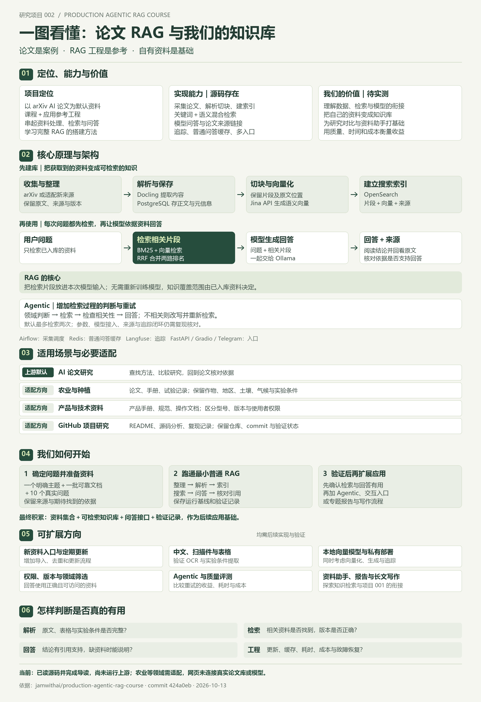](./projects/002-production-agentic-rag-course/README.md)

图片说明与来源：本仓库理解总览图：定位、价值、能力、原理与架构、场景、使用路线、扩展与验证；直接绘制，非上游运行截图

[查看原图](./projects/002-production-agentic-rag-course/assets/04-rag-understanding.png) · [研究文档](./projects/002-production-agentic-rag-course/README.md) · [在线演示](https://yydshly.github.io/1013_codex_project/002-production-agentic-rag-course/)

### 004 · Leak Check：个人信息泄漏查询与关联原理研究

[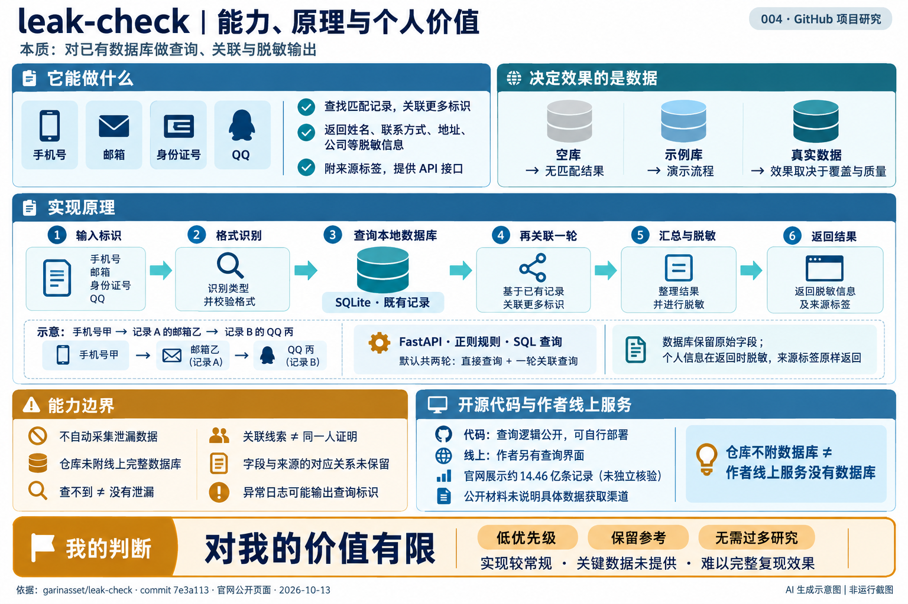](./projects/004-leak-check/README.md)

图片说明与来源：本次生成的能力、数据库查询原理与个人价值汇总图；AI 信息图，非运行截图，源码依据见项目 README

[查看原图](./projects/004-leak-check/assets/research-summary.png) · [研究文档](./projects/004-leak-check/README.md)

### 005 · WireGuard Install：自建 VPN、原理与应用研究

[](./projects/005-wireguard-install/README.md)

图片说明与来源：本次研究原创理解总览图：自建 VPN 的部署、两端 IP 隧道与 UDP 加密封装、网关转发、使用场景及个人价值；依据固定源码与官方协议绘制，非运行实测

[查看原图](./projects/005-wireguard-install/assets/understanding-map.svg) · [研究文档](./projects/005-wireguard-install/README.md) · [在线演示](https://yydshly.github.io/1013_codex_project/005-wireguard-install/)

### 006 · Jev SEO：网页质量检查规则与自有模型审查框架

[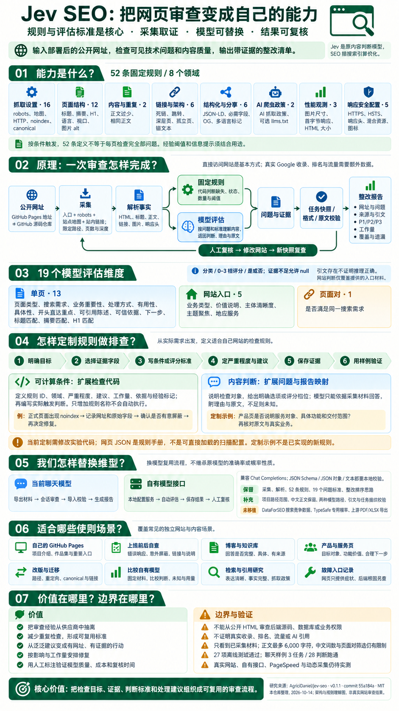](./projects/006-jev-seo/README.md)

图片说明与来源：本仓库基于固定源码研究、使用 imagegen 生成的理解总览图：能力、原理、52 条规则与 19 个模型维度、定制排查、模型替换、场景、价值与边界；2026-10-14，非上游或真实网站实测截图

[查看原图](./projects/006-jev-seo/assets/04-jev-seo-understanding.png) · [研究文档](./projects/006-jev-seo/README.md) · [在线演示](https://yydshly.github.io/1013_codex_project/006-jev-seo/)

### 007 · Hermes Jev Skills：多模型路由与判断标准研究

[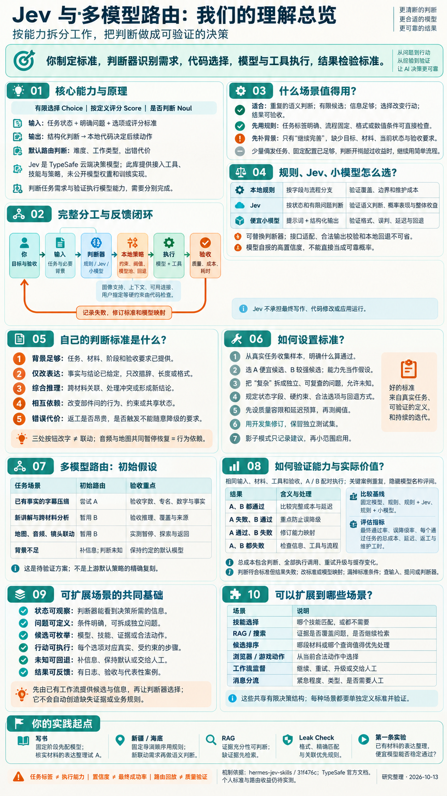](./projects/007-hermes-jev-skills/README.md)

图片说明与来源：本次讨论的 Jev 与多模型路由总览图：能力、原理、场景、标准与扩展；AI 生成研究说明，非上游截图，个人方案待验证

[查看原图](./projects/007-hermes-jev-skills/assets/04-understanding-overview.png) · [研究文档](./projects/007-hermes-jev-skills/README.md) · [在线演示](https://yydshly.github.io/1013_codex_project/007-hermes-jev-skills/#understanding)

### 008 · shadPS4：PS4 模拟原理、系统知识与实践价值研究

[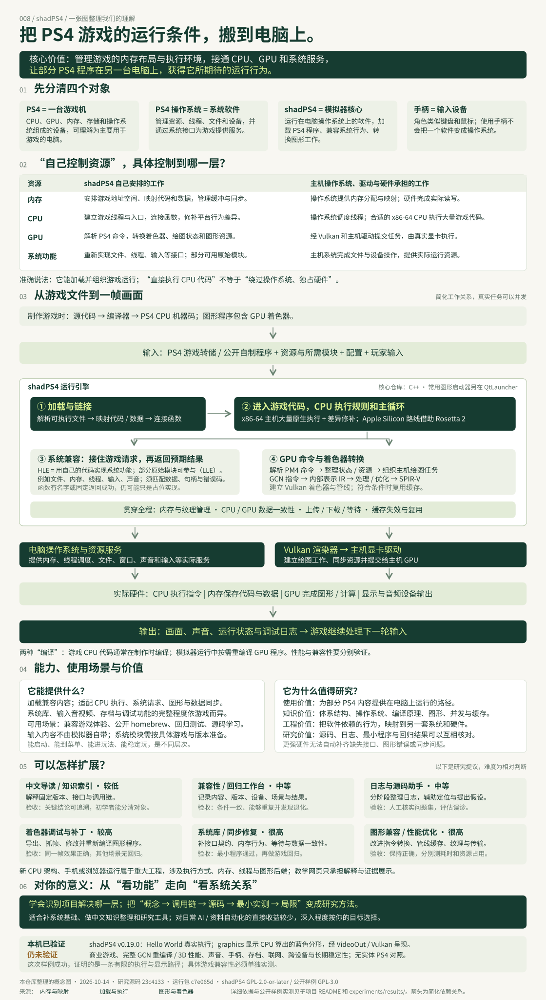](./projects/008-shadps4/README.md)

图片说明与来源：本仓库整理的 shadPS4 全面理解图：资源控制边界、能力、加载与执行原理、价值、扩展方向、个人意义及公开样例实测范围；非上游截图。

[查看原图](./projects/008-shadps4/assets/comprehensive-map.svg) · [研究文档](./projects/008-shadps4/README.md) · [在线演示](https://yydshly.github.io/1013_codex_project/008-shadps4/)

### 009 · cmux：一个人控制多个 Agent 的工作台与实现原理

[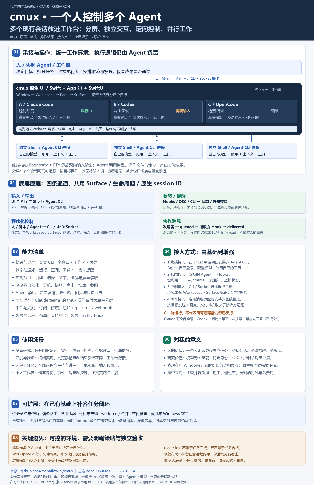](./projects/009-cmux/README.md)

图片说明与来源：本仓库完整理解总图：承接现有 Agent，统一 UI 展示与交互，多会话定向控制；汇总分工、架构与四条通道、能力、效果、接入、场景、个人价值、扩展及边界，原创绘制，非上游运行截图

[查看原图](./projects/009-cmux/assets/07-complete-understanding.png) · [研究文档](./projects/009-cmux/README.md) · [在线演示](https://yydshly.github.io/1013_codex_project/009-cmux/#understanding)

### 010 · Vibe42：Agent远程控制能力、原理与价值研究

[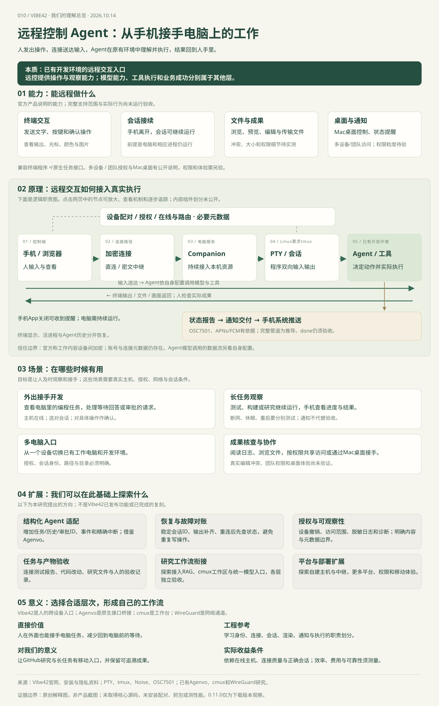](./projects/010-vibe42/README.md)

图片说明与来源：本研究原创完整理解图：远程控制Agent的能力、本质、配对与加密连接、Companion、PTY会话、原生Agent执行、结果与通知、使用场景、建议扩展、意义和验证边界；非上游运行截图。网页使用同一底图支持原理放大、七个节点讲解和三条路径逐步追踪。

[查看原图](./projects/010-vibe42/assets/understanding-overview.svg) · [研究文档](./projects/010-vibe42/README.md) · [在线演示](https://yydshly.github.io/1013_codex_project/010-vibe42/)

### 011 · OpenMontage：视频制作能力、流程组合与核心价值研究

[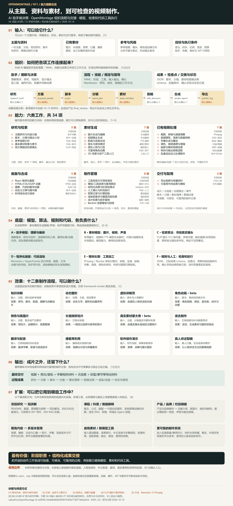](./projects/011-openmontage/README.md)

图片说明与来源：本研究原创完整能力总览：输入、八阶段交接、六类34项能力、模型/检索/代码/规则分工、12条制作流程的效果、最终与过程输出、扩展场景和核心价值；据固定源码绘制，非上游运行截图，扩展与实测边界单独标明。

[查看原图](./projects/011-openmontage/assets/ability-map.png) · [研究文档](./projects/011-openmontage/README.md) · [在线演示](https://yydshly.github.io/1013_codex_project/011-openmontage/)

### 012 · tchMaterial Parser：小学教材批量下载与整理研究

[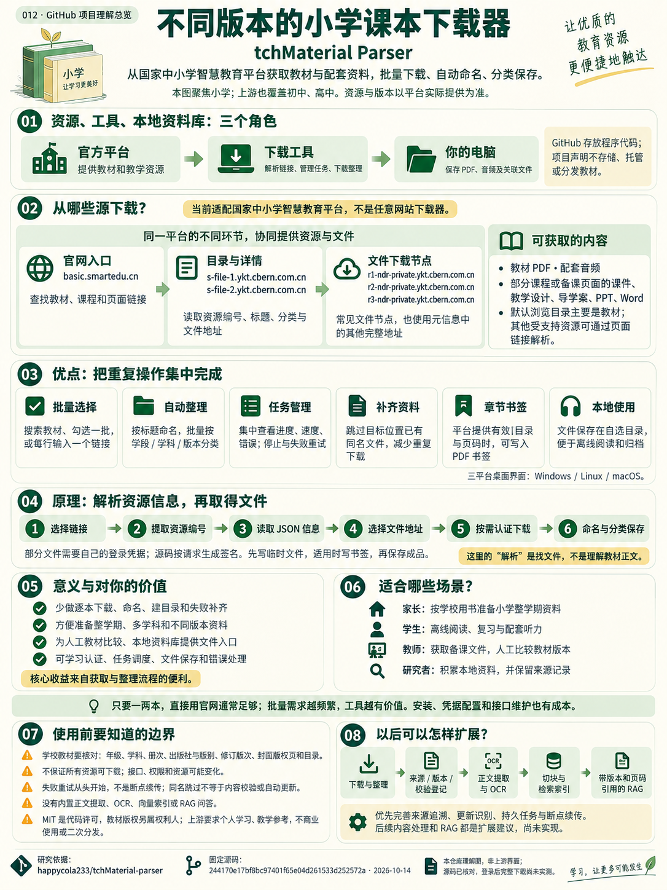](./projects/012-tchmaterial-parser/README.md)

图片说明与来源：本仓库根据固定源码使用 imagegen 制作的全面理解图：不同版本小学课本下载器、官方来源与节点、优点、原理、价值、场景、边界及扩展；非上游界面或下载实测截图

[查看原图](./projects/012-tchmaterial-parser/assets/understanding-summary.png) · [研究文档](./projects/012-tchmaterial-parser/README.md) · [在线演示](https://yydshly.github.io/1013_codex_project/012-tchmaterial-parser/)

### 013 · Claude Managed Agents：多 Agent 编排、运行管理与参考价值研究

[](./projects/013-claude-managed-agents/README.md)

图片说明与来源：沿用本次讨论整理的完整理解总览图（2400 × 5200）：1000 累计启动上限、主 Agent 规划拆分、任务接口、黑盒边界、下发控制、海底世界与参考价值。本仓库原创解释图，非产品运行截图。

[查看原图](./projects/013-claude-managed-agents/assets/understanding-overview.png) · [研究文档](./projects/013-claude-managed-agents/README.md) · [在线演示](https://yydshly.github.io/1013_codex_project/013-claude-managed-agents/)

### 014 · BaoCut：可编辑视频、人机协作与设计模块研究

[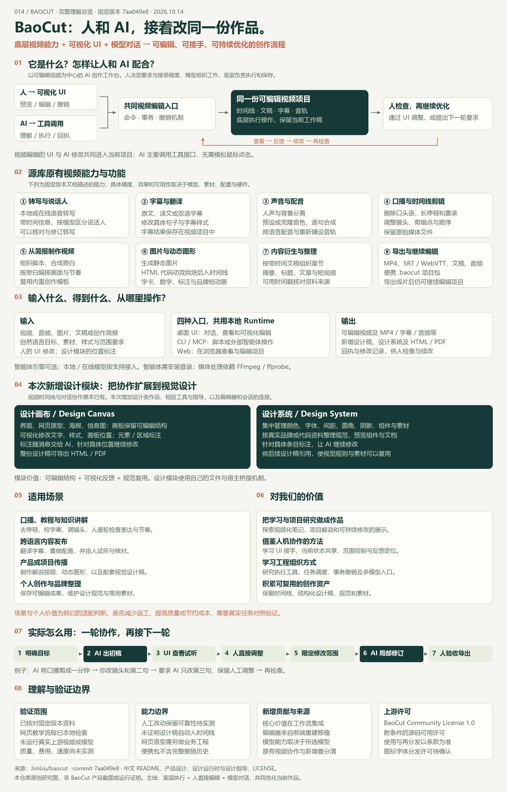](./projects/014-baocut/README.md)

图片说明与来源：本仓库原创完整理解图：BaoCut 的定位、人机协作原理、八类视频功能、输入输出与入口、新增设计模块、使用场景、个人研究价值和验证边界；非上游产品截图

[查看原图](./projects/014-baocut/assets/understanding-comprehensive.png) · [研究文档](./projects/014-baocut/README.md) · [在线演示](https://yydshly.github.io/1013_codex_project/014-baocut/)

### 015 · REA：逆向工具管理、软件调查与证据组织

[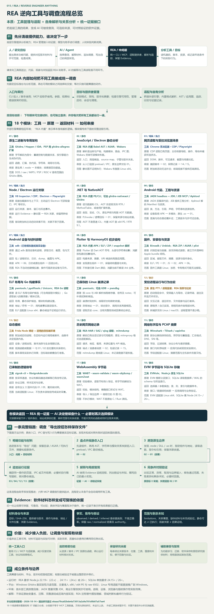](./projects/015-rea/README.md)

图片说明与来源：本仓库原创完整工具与流程总图：REA 管理和适配逆向工具，18 模块覆盖 37 项阅读分类，汇总各工具原理、材料交接、AI 调查、Evidence、价值和边界；固定 ebaaa79c，非上游运行截图。

[查看原图](./projects/015-rea/assets/toolchain-overview.png) · [研究文档](./projects/015-rea/README.md) · [在线演示](https://yydshly.github.io/1013_codex_project/015-rea/)

### 016 · Free Claude Code：统一模型入口与协议适配研究

[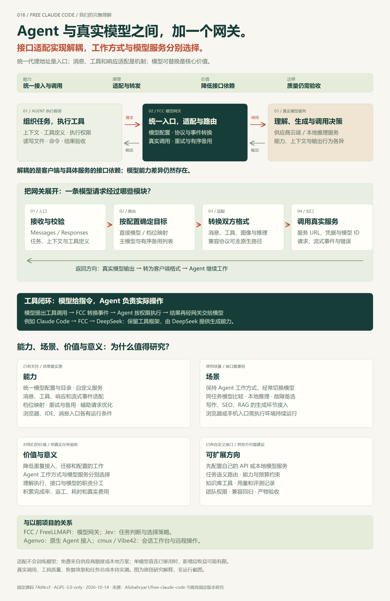](./projects/016-free-claude-code/README.md)

图片说明与来源：本研究原创完整理解图：Agent 与真实模型之间的网关、接口适配解耦、底层模块、工具闭环、能力、场景、价值、意义、扩展、同类定位与验证边界；由 SVG 渲染为 PNG，非上游运行截图。

[查看原图](./projects/016-free-claude-code/assets/understanding-overview.png) · [研究文档](./projects/016-free-claude-code/README.md) · [在线演示](https://yydshly.github.io/1013_codex_project/016-free-claude-code/)

<!-- PROJECT_INDEX:END -->

## 收录与阅读方式

- **先看索引**：了解项目用途、研究进度与演示入口。
- **再读子项目**：查看选择理由、环境配置、源码分析、截图说明与研究结论。
- **保留来源**：记录原仓库、研究时的版本或 commit，以及上游许可证。
- **积累实践**：将实验代码放在对应子项目中，区分上游功能与本仓库的改动。

研究状态：`待研究` → `研究中` → `已复现` → `已完成`，停止维护的项目标记为 `已归档`。状态可按实际进度调整。

## 目录结构

```text
1013_codex_project/
├── README.md                 # 对外总览：索引、分项摘要、源库和导航
├── AGENTS.md                 # 后续研究与维护的工作约定
├── projects/                 # 001-xxx、002-xxx…，每个目录一个研究项目
├── templates/project/        # 子项目文档、元信息和图片占位模板
├── docs/deployment.md        # 多个 Web 演示的路径与部署约定
├── scripts/                  # 创建子项目、生成并校验索引
├── tests/                    # 索引与创建工具的行为检查
└── .github/workflows/        # 自动检查项目结构与索引同步
```

## 添加第一个项目

需要 Python 3.10 或更高版本，无需安装第三方依赖。将下面的示例名称和原仓库地址替换为实际项目：

```bash
python scripts/new_project.py example-project --name "项目名称" --source "https://github.com/owner/repository" --summary "这个项目解决什么问题，以及本次研究的重点。"
```

工具会分配下一个编号，创建 `projects/001-example-project/`，复制研究模板，并更新本页索引。

后续修改子项目的 `project.json` 后，执行：

```bash
python scripts/update_index.py
python scripts/update_index.py --check
```

编号从 `001` 开始，保持稳定，不随研究状态变化而重排。图片放在各子项目的 `assets/` 中，Web 演示代码放在各子项目的 `web/` 中。详细规则见 [新增项目指南](./CONTRIBUTING.md)。

## Web 演示

预留同一站点下的独立路径，例如 `/1013_codex_project/001-example-project/`。每个子项目可选择适合自己的技术栈；有可访问的演示后，将实际地址写入 `project.json` 的 `demo_url`，索引便会显示入口。

静态演示通过 GitHub Actions 汇集到 [GitHub Pages 站点](https://yydshly.github.io/1013_codex_project/)，各子项目使用独立路径。线上页面展示研究说明与可公开的样稿；需要模型接口或私密凭据的功能使用单独后端。发布步骤和验证范围见 [Web 部署约定](./docs/deployment.md)。

## 来源与使用

各子项目应注明原作者、原仓库、研究版本和许可证。引用的源码、图片及其他素材遵循各自的上游许可；本仓库目前未设置统一开源许可证。
