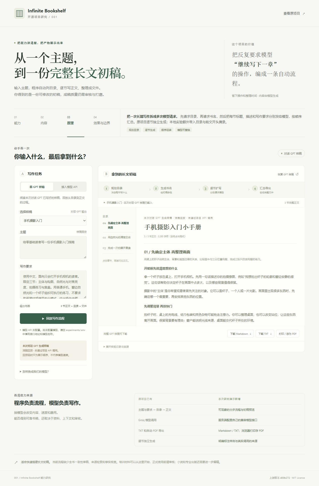
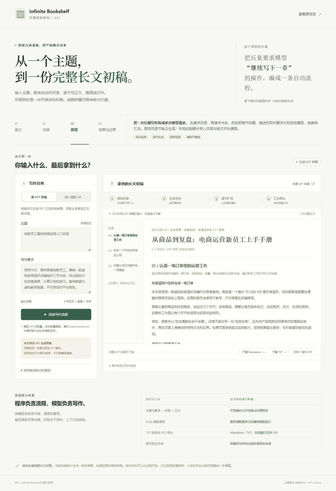

# 001 · Infinite Bookshelf：写书流程、能力与价值研究

**核心只是用代码组织多次模型请求，控制写书流程。** 输入主题，可补充读者、目标、范围和风格要求，高级模式还可加入笔记或 TXT 资料；程序依次请求目录、书名和各节正文，再汇总展示，导出待人工编辑的 TXT/PDF 初稿。实际写作由被调用的模型完成，它没有增加新的模型能力，也没有自动保证全书质量。

如果你已经会让模型“先出大纲，再逐章扩写”，你已经掌握了它的主要写作方法。项目的价值是省去重复请求、等待、汇总和下载，并把流程接入软件、复用于不同主题或自有模型。较独立的教程、培训材料适合用它快速起草；复杂小说需要补充人物、情节与前文状态管理，再进行人工审核。偶尔写作时额外价值有限，频繁生成同类长文时，是否值得部署取决于节省的操作与整理时间能否覆盖配置和修改成本。

本研究从能力、原理、输入输出、实际效果、应用价值与局限展开，提供固定版本源码证据、一图总览、摄影和电商的完整可阅读样稿，以及可替换模型的本地适配演示。保存样稿、上游历史成品、适配代码验证与真实模型效果分别标明，避免把流程回放视为模型性能或质量测试。

它不是通过一个 `SKILL.md` 限制模型思路。原版采用固定提示词函数和 Python 执行流程：**提示词规定每次要写什么，代码规定先后顺序与循环，模型生成内容，质量仍需要审核。**

[返回总索引](../../README.md#项目索引) · [原仓库](https://github.com/Bklieger/infinite-bookshelf) · [源码证据表](./references/source-map.md) · [实验与模型配置](./experiments/README.md) · [演示说明](./web/README.md)

[线上研究与演示](https://yydshly.github.io/1013_codex_project/001-infinite-bookshelf/) · [直接阅读摄影样稿](https://yydshly.github.io/1013_codex_project/001-infinite-bookshelf/?sample=photography#workbench) · [站点总览](https://yydshly.github.io/1013_codex_project/)。线上版本提供完整导读、一图总览、样稿阅读、回放和下载；生成新主题需另接模型服务。2026-10-13 已核验公开地址、资源与样稿内容，记录见 [发布验证](./experiments/results/verification.md#公网静态发布验证)。

## 一张图汇总我们的理解


来源：依据本项目固定源码研究，由内置 imagegen 工具于 2026-10-13 生成的解释图，不是应用截图或模型 API 测试结果。[PNG 原图](./assets/03-understanding-overview.png)为 941×1672 像素；[最终文案与生成提示词](./assets/03-understanding-overview.prompt.txt)已保留。网页顶端也加入可收起的总览图、原图查看和下载入口；下方各节提供可复制的完整文字。

## 1. 代码、提示词和模型各负责什么

| 组成 | 实际职责 | 不能由此推导出的能力 |
| --- | --- | --- |
| Python 代码 | 先后调用目录、书名和正文函数；遍历目录；完成一节后进入下一节；累积输出 | 不决定模型内部如何思考，也不自动判断书稿好不好 |
| 固定提示词 | 要求目录全面、正文有结构、遵守附加要求；规定所需格式 | “不要重复”“事实准确”是要求，不能当作已经核验 |
| 被调用的大模型 | 设计章节、取书名、生成解释、例子、代码与正文 | 能力取决于模型及其收到的上下文，不来自此库本身 |
| 页面与导出代码 | 展示进度、让用户阅读结果、下载文本与 PDF | 文件整齐、篇幅长，不代表内容可靠或已经达到出版标准 |

源代码把目录、书名、正文函数放在 `agents/` 中。这里的三个函数执行预设任务，没有自主研究、规划工具使用、编辑审稿或纠错闭环。库内没有模型权重和训练流程。换成不同模型后，内容、速度和费用都会随模型改变。

## 2. 输入什么，得到什么

最低限度提供**主题**即可启动基础流程，原版表单要求主题不少于 10 个字符。更有用的输入是“主题＋读者＋目标＋范围＋风格＋参考材料”，例如：

> 给零基础读者写一份手机摄影入门指南。只用手机、杯子和窗边自然光；解释常见问题，给出能执行的练习，不推荐购买器材，不编造练习后效果。

| 输入 | 是否必需 | 对结果的作用 |
| --- | --- | --- |
| 主题 | 基础流程必需 | 决定写什么；只有主题时，其余安排主要由模型自行补齐 |
| 读者与目的 | 可写进附加要求 | 控制解释深度与任务方向，例如入门学习或员工培训 |
| 覆盖范围、篇幅、风格 | 可写进附加要求；高级模式提供部分表单 | 帮助收敛内容，但原版没有验证篇幅、页数或完整性 |
| 案例、已有笔记、TXT 资料 | 高级模式可选 | 直接进入提示词，给模型提供材料；不是知识库检索 |

正常结果是**书名、JSON 目录、各节正文以及可导出的整份初稿**。它既能写一个领域的介绍，也能写围绕同一主题的教程、指南或手册；并未内置“摄影专家能力”或某个固定领域的专业知识系统。主题可以改变，领域知识主要来自模型与用户提供的材料。

只给“摄影”会留出大量范围选择；给“手机摄影、零基础、窗边拍杯子、三节、有练习”则更容易得到明确材料。原版没有强制三节，当前本地演示的三节是本次实验选择。

### 它究竟能做什么

| 输入 / 功能 | 最终得到什么 | 上游实现 |
| --- | --- | --- |
| 主题和附加要求 | 书名、目录、每节描述、各节正文 | 基础模式 |
| 指定读者、案例、代码等要求 | 模型围绕这些要求组织内容 | 附加指令 |
| 文风、难度、已有笔记、TXT 文件 | 根据这些材料扩写长文 | 高级模式；材料直接进入提示词 |
| 分节连续生成 | 不用手动逐章输入“继续写” | 顺序遍历目录 |
| 边生成边显示 | 逐步出现正文、代码、表格等 Markdown 内容 | 流式生成与 Streamlit 页面 |
| 导出整份材料 | 含 Markdown 内容的 TXT、排版 PDF | 下载模块与 WeasyPrint |
| 查看推理统计 | tokens、推理时间、生成速度等指标 | Groq 返回的统计字段 |

适合教程、知识介绍、培训材料等非虚构初稿。高级模式没有知识库检索：上传笔记之后，程序把文本拼进提示词，再交给模型写。

## 3. 看实际效果

### 原作者公开的成品

固定研究版本附有两份完整生成结果，可以直接打开阅读全文：

| 样本 | 能直接看到的效果 | 本次读取结果 |
| --- | --- | --- |
| [大语言模型基础](https://github.com/Bklieger/infinite-bookshelf/blob/400b272175945d35eaefa68aefe9106fa9d7e467/Example_1.md) | 从 NLP 到大语言模型的长篇说明，分章展开概念 | 75,136 个字符，16 个 Markdown 标题行 |
| [Java 数据结构与算法](https://github.com/Bklieger/infinite-bookshelf/blob/400b272175945d35eaefa68aefe9106fa9d7e467/Example_2.md) | 数据结构和算法的解释、代码与示例 | 175,125 个字符，53 个 Markdown 标题行 |

统计口径是 UTF-8 解码后 `len(text)` 和以 `#` 开头的 Markdown 标题行数，包含空格与换行，不能当作字数、章节数或 PDF 页数。它们是上游作者提供的历史样本，本次没有重新生成，也没有核验全部知识与代码。

### 摄影示例：本次对话 GPT 生成的完整教材样稿

按用户要求，增加 [《手机摄影入门小手册》完整样稿](./experiments/results/gpt-photography-book.md)，共 **3 节、3,280 个正文字符**。启动本地服务后，可 [直接打开摄影演示](http://127.0.0.1:8765/?sample=photography)，或在页面切换样稿。

| 目录 | 实际写出的内容 | 读者可以做什么 |
| --- | --- | --- |
| 先确定主体 再整理画面 | 主体、背景、画面边缘与居中 / 三分构图比较 | 给同一个杯子拍三种构图，写出选片理由 |
| 用自然光拍清楚主体 | 窗光、对焦与亮度区别、模糊和色偏排查 | 比较自动亮度与调整版本，再比较光向 |
| 完成一次拍摄并复盘 | 短时练习顺序、检查清单、单问题重拍 | 交付选中照片、比较照片和改进计划 |

**这份书稿由当前对话 GPT 生成并保存，网页回放保存内容，未通过项目模型 API 调用。** 这是文字教材与练习设计的实际产物；本次没有拍摄真实照片，不能评估照着教材练习后的摄影进步，也没有测模型速度或费用。

点按对焦与曝光、三分法、主体背景、稳定与运动模糊、窗边光和混光等基础概念已用 Apple、Adobe、Nikon 官方资料人工核对，并逐节审读可执行性。资料与范围见 [摄影核验记录](./references/photography-notes.md)。这些核查是本次研究补充的步骤，上游项目不会自动执行。样稿可以帮助理解“输入主题后能得到什么”，不能证明这个库比手动使用相同模型写作更好。



截图为 2026-10-13 的本地浏览器实拍。摄影样稿载入、回放、两种样稿切换、停止恢复与 MD / TXT 下载已验证，见 [页面验证记录](./experiments/results/verification.md#摄影样稿增补验证)。

### 先前的电商入门样稿

本子项目用“给新员工看的电商运营入门手册”展示具体结果：[直接阅读完整样稿](./experiments/results/gpt-demo-book.md)，共 3 节、2,987 个正文字符。**样稿由本次对话 GPT 生成，页面读取保存结果并回放流程；没有通过项目 API 调用这个 GPT。** 阅读样稿可以评估内容组织与可读性，页面回放可以观察目录、正文和导出如何衔接，不能用回放速度评估模型推理速度。

样稿贯穿一家虚构的保温杯店铺：第一节建立订单工作地图，第二节给出商品上架验收清单，第三节计算转化比例并设计复盘练习。可以看到统一案例、表格、清单和章间衔接。它是一份参考成品，不能据此保证上游自动流水线生成的书稿会同样连贯。



**截图来源：** 本仓库 `web/` 本地演示页于 2026-10-13 的实际浏览器截图。画面为本次对话 GPT 生成样稿的流程回放，未通过项目 API 调用；不是上游 Streamlit 应用截图。

演示包含两种用途：

1. **样稿回放：** 无需密钥，阅读完整中文内容，回放目录 → 书名 → 逐节正文，使用章节导航，下载 MD / TXT 或打印为 PDF。
2. **连接我们的模型：** 本地配置接口后，按同一写作流程生成新内容。真实接口的质量、速度和费用需要单独记录。

启动本地演示，在仓库根目录执行：

```powershell
python projects/001-infinite-bookshelf/experiments/server.py
```

随后打开 <http://127.0.0.1:8765/>。更多操作见 [Web 演示说明](./web/README.md)。静态阅读演示已发布到 GitHub Pages，`demo_url` 填写的是经过 HTTP 验证的实际地址；本地模型服务不会随网页公开发布。

## 4. 原版如何安排执行顺序和提示词

想看固定模板、用户变量和实际执行控制，可阅读 [原版提示词与执行顺序说明](./references/prompts-and-control.md)。其中区分提示词的内容要求、JSON 格式约束，以及代码强制执行的顺序和循环。


上图是便于理解的概览。按源码，精确顺序如下：[基础主流程](https://github.com/Bklieger/infinite-bookshelf/blob/400b272175945d35eaefa68aefe9106fa9d7e467/main.py#L97)

1. 校验主题长度，通过后准备模型客户端。
2. 调用模型生成目录，等待完整目录字符串。
3. 另发一次请求生成书名，输入只有主题。
4. 此时才解析目录 JSON，建立书稿对象并展示目录。目录如果无法解析，书名请求仍已发生。
5. 按 JSON 键的顺序递归遍历目录：值为字典就继续进入该分支，值为字符串就对该节发出正文请求。程序不按教学逻辑再排序，也没有并行写章。
6. 每节生成的文本片段追加到对应小节并显示；完成这节后，才写下一节。
7. 用户另按下载按钮时，将已经积累的正文合并为文本或转换为 PDF。导出不是一次新的模型写作请求。

| 模型请求 | 固定提示词的主要意思 | 实际交给模型的变量 | 返回结果 |
| --- | --- | --- | --- |
| 目录 | 生成全面目录；基础模式省略前言、总结等开头结尾，最多一层嵌套，各节清晰且不重叠 | 主题、附加要求 | 标题对应描述，或对应下一级标题对象的 JSON |
| 书名 | 取一个吸引人的名字，只输出名字、不解释；系统提示要求 7–25 words | 只有主题；不传目录与附加要求 | 书名文本 |
| 正文 | 以专业作者身份扩写本节，要求长、全面、有结构，遵守附加要求，只输出正文 | 本节标题＋描述、附加要求 | 流式正文，可含 Markdown |

上表是源码意译；具体模板见 [目录函数](https://github.com/Bklieger/infinite-bookshelf/blob/400b272175945d35eaefa68aefe9106fa9d7e467/infinite_bookshelf/agents/structure_writer.py#L19)、[书名函数](https://github.com/Bklieger/infinite-bookshelf/blob/400b272175945d35eaefa68aefe9106fa9d7e467/infinite_bookshelf/agents/title_writer.py#L8)、[正文函数](https://github.com/Bklieger/infinite-bookshelf/blob/400b272175945d35eaefa68aefe9106fa9d7e467/infinite_bookshelf/agents/section_writer.py#L8)。书名的用户模板对词数的表述有歧义，程序也不做词数校验，不能把该要求当作中文字符标准。

原版正文请求**没有完整目录、此前章节正文或对话历史**。原始主题也不直接传入正文函数，主题信息主要通过本节标题、描述和附加要求体现。调用同一个模型不会让下一次独立请求自动记住上一章；程序必须显式传入上下文。

若目录有 N 个需要扩写的小节，通常需要 **N + 2 次模型调用**。各节顺序执行，文本总长度可以超过单次输出限制。目录和正文请求各设置最多 8,000 tokens，这是单次输出上限；高级模式提示词中的“300 页以上”只是一项要求，程序没有页数控制或校验。[目录生成](https://github.com/Bklieger/infinite-bookshelf/blob/400b272175945d35eaefa68aefe9106fa9d7e467/infinite_bookshelf/agents/structure_writer.py#L19)、[正文生成](https://github.com/Bklieger/infinite-bookshelf/blob/400b272175945d35eaefa68aefe9106fa9d7e467/infinite_bookshelf/agents/section_writer.py#L8)

### 它究竟控制了什么

| 控制 | 怎样实现 | 实际边界 |
| --- | --- | --- |
| 执行顺序 | 函数调用、循环、递归；写完一节再写下一节 | 是程序执行的顺序，不是对模型内部思考过程的控制 |
| 目录格式 | 请求 JSON 模式并用 `json.loads()` 解析 | 能要求可解析格式，不等于目录合理或内容完整 |
| 每次输出上限 | 目录与正文最多 8,000 tokens；书名最多 100 tokens | 限制单次输出，不保证字数、页数或章节不会被截断 |
| 内容与文风 | 提示词要求清晰、不重复、准确、符合读者 | 是模型尝试遵守的语义要求；没有自动验收与重写 |

目录与正文 `temperature=0.3`，书名为 0.7，影响生成变化程度，不能保证每次结果一致。高级模式额外拼入文风、难度、笔记、UTF-8 TXT 和例子、衔接、准确等要求；没有检索、引文核验或全书审稿。

因此，把它理解为“用提示词安排写作思路，再用代码自动执行”是合适的；把它理解为增强模型能力、保证内容质量或自动出版系统则缺少依据。

## 5. 库里有哪些内容

| 上游文件 / 目录 | 职责 |
| --- | --- |
| `main.py` | 基础模式入口，连接 Groq 并安排生成步骤 |
| `pages/advanced.py` | 高级模式，把文风、难度和参考笔记组合进提示词 |
| `infinite_bookshelf/agents/` | 三个模型调用函数：目录、书名、正文 |
| `infinite_bookshelf/ui/book.py` | 存储目录和正文，更新页面，汇总 Markdown |
| `infinite_bookshelf/ui/components/` | 输入表单、模型选择、统计和下载按钮 |
| `infinite_bookshelf/inference/stats.py` | 累加并显示 Groq 推理统计 |
| `infinite_bookshelf/tools/` | 文本输出，以及 Markdown → HTML → PDF |
| `Example_1.md`、`Example_2.md` | 原作者提供的生成书稿 |

这是一个 Python + Streamlit 应用。没有内置模型权重、训练流程、数据库、检索系统或完整出版编辑系统。代码位置与证据见 [源码证据表](./references/source-map.md)。

## 6. 与直接使用 ChatGPT 相比，增加了什么

假设使用同一个模型、相近提示词和相同材料，用户手动“先出大纲，再逐章扩写”，能够完成相同类型的任务。本次没有做控制变量的质量对比，也没有证据证明这个库让模型写得更好。

| 方面 | 手动在对话中写作 | 这个项目 |
| --- | --- | --- |
| 列目录、扩写章节 | 发指令即可实现，可随时追问与改方案 | 将常见步骤固定为预设流程 |
| 连续执行 | 用户逐次安排下一节 | 程序遍历目录，自动发下一次请求 |
| 调整方向 | 能在目录、章节之间随时讨论、改变重点 | 原版缺少生成途中的编辑审批流程，通常连续写完 |
| 上下文 | 可引用同一对话中保留的设定与前文，仍受上下文范围影响 | 原版正文请求不传前文和完整目录 |
| 整理与文件 | 用户整理内容或借助对话工具 | 内置累积展示、TXT 与 PDF 下载 |
| 内容可靠性 | 仍需核查、审稿 | 同样需要核查，程序未增加质量保证 |
| 批量重复任务 | 需要重复安排操作 | 更容易把重复过程固定并接入其他应用；原版仍不是完整批处理平台 |

这里的优势主要是**减少操作、方便接入程序、可修改流程**，不足是**额外部署维护、流程固定、原版章节上下文弱**。认真写一本书，应比较从输入到合格稿件的总时间，把生成后的修改和核查也算进去。

### 摄影和《水浒传》式小说分别说明了什么

摄影入门材料可以拆成“构图、光线、练习与复盘”几个相对独立的知识小节。这个库能自动把主题变成目录、逐节写文字教程，并汇总成手册。**摄影知识仍来自模型与资料，练习是否有效仍需要真实实践。** 它不会因此自动拍摄照片、理解你的实际拍摄成果或证明教学效果。

如果想自己写一部《水浒传》式群像长篇，列目录只是第一步。人物性格与关系、事件先后、伏笔、地点、战斗结果、人物知道什么、后续因果，都需要持续维护。原版每节不带完整目录和前文，缺少人物档案、情节状态、伏笔跟踪与全书一致性审稿，难以承担这些控制。它可能生成许多章节文字，但“章节都写出来”不能等同于“写出一部连贯小说”。这是一项基于实现结构的适用性判断，本次没有用原版生成并审读完整长篇小说。

## 7. 价值与效果边界

它省下的是列目录之后反复发指令、等待下一节、复制整理、导出文件的操作。经常制作结构类似的初稿，可以把这些步骤变成固定流程；对开发者，这也是容易理解和修改的长文生成示例。

它没有证明自己的成稿质量高于相同模型的手动写作。最终质量仍取决于模型、输入资料、章节设计和人工编辑。认真写一本书时，应比较“得到合格书稿需要多久”，把生成后改稿的时间也算进去。

当前上游流程的主要限制：

- **章节缺少共享上下文。** 正文请求不带完整目录和已写前文，容易重复概念、改变术语或出现衔接问题。[调用位置](https://github.com/Bklieger/infinite-bookshelf/blob/400b272175945d35eaefa68aefe9106fa9d7e467/main.py#L129)
- **没有检索与引用核验。** 高级模式把参考笔记直接传给模型，没有分块检索、资料溯源和事实检查。[参考材料处理](https://github.com/Bklieger/infinite-bookshelf/blob/400b272175945d35eaefa68aefe9106fa9d7e467/pages/advanced.py#L89)
- **没有全书审稿。** 正文生成之后直接整理展示，缺少质量评估与重写循环。
- **速度与篇幅没有实测保证。** README 的“几秒生成整本书”是作者描述，本次没有复现这个性能指标。作者也明确提醒内容可能有错误或占位信息。[上游限制](https://github.com/Bklieger/infinite-bookshelf/blob/400b272175945d35eaefa68aefe9106fa9d7e467/README.md#L120)

## 8. 适合哪些主题与场景

它没有硬编码一个写作领域，也不是“所有方向同样擅长”。能力上可以接收多种主题，适用程度取决于章节能否独立展开、事实是否容易核查，以及对全书连贯性的要求。以下是依据源码机制的判断，并非各领域效果评测。

| 场景 | 适用程度与理由 | 仍需要的工作 |
| --- | --- | --- |
| 入门指南、知识概述 | 比较适合做初稿，知识点可按主题拆节 | 检查概念、重复、遗漏与教学顺序 |
| 员工培训、操作手册 | 有已有流程与规范时，可扩写解释、清单和例子 | 确认符合本单位实际流程与最新规则 |
| 摄影等技能教材 | 可生成文字说明、任务步骤与练习设计 | 配上真实作品，实践并核验教学效果 |
| 批量、结构相近的长文 | 自动执行和汇总的收益可能较明显 | 增加失败恢复、版本管理、审核与质量抽检 |
| 群像小说、长篇叙事 | 原版适配较弱，跨章节状态和伏笔依赖强 | 人物/事件状态、完整规划、共享上下文和编辑审稿 |
| 学术研究、新闻调查、实时行业报告 | 原版没有资料检索与引用核验，不适合直接当成可信成品 | 可靠资料来源、引文溯源、事实检查与专业审核 |

所谓“适合某个领域”，是指**这种领域的内容适合被拆成小节生成**，不表示库获得了该领域的专门模型能力。

## 9. 内部模型可以换成我们的模型吗

**可以。编排流程不依赖某个模型的权重。** 如果我们的服务提供兼容的聊天生成 API，就能保留“目录 → 书名 → 分节正文”的方法，换掉实际生成内容的服务。

上游需要处理四处耦合：Groq 客户端、模型 ID、Groq 专属统计字段，以及书名函数写死的模型。尤其是 `generate_book_title()` 虽然接收 `model` 参数，实际请求始终使用 Maverick，界面里修改书名模型不会生效。[书名函数](https://github.com/Bklieger/infinite-bookshelf/blob/400b272175945d35eaefa68aefe9106fa9d7e467/infinite_bookshelf/agents/title_writer.py#L8)

本次在 `experiments/` 独立重写最小实现，在 `web/` 展示结果。正文请求加入**完整目录与前文章节开头摘录**：每个已写章节取开头 600 个字符，并非另一次模型摘要或全书审稿。这是本子项目的改动，一致性效果尚未实测。

接口通过本地 `experiments/.env` 或环境变量配置：

| 变量 | 用途 |
| --- | --- |
| `BOOKSHELF_BASE_URL` | 兼容聊天生成 API 的服务地址 |
| `BOOKSHELF_MODEL` | 我们实际使用的模型名称 |
| `BOOKSHELF_API_KEY` | 服务需要时提供的密钥，保存在本地服务端 |
| `BOOKSHELF_API_KEY_ENV` | 可引用本机另一个密钥环境变量的名称 |

本地实现每次调用采用非流式响应；浏览器按目录、书名和逐节结果收到进度事件，与上游逐 token 流式生成不同。目录先请求 JSON 模式，服务不支持该参数时尝试降级。配置步骤与兼容范围见 [实验说明](./experiments/README.md)。

直接用当前对话的 GPT 可以产出并保存示例书稿；让本地项目每次点击都调用模型，仍需要可供程序访问的接口。对话生成样稿与接口运行结果应分别记录。

## 10. 值得部署使用吗

**如果主要是偶尔写一篇文章、商量一本书的大纲，或需要反复互动修改，优先直接在模型对话中完成即可；这个库的额外价值有限。** 如果经常按相近结构制作长文初稿，想一次发起、逐节自动执行并统一导出，或者需要把写作接入自己的应用，才值得复用这套流程。

不需要原样部署整个项目，才能获得“先大纲、再分节扩写”的方法。可以保留可用的流程与导出部分、接入我们的模型，逐步加入实际需要的功能。正式使用前，应选择代表性任务，对比手动对话与自动流程的总耗时、核查修改量、成本和失败率；本次尚未执行这样的对比。

如果目标是可靠的正式手册、长篇小说或出版稿，下一步价值较大的改造是明确资料来源、共享章节上下文、维护一致性、支持中途编辑、增加验收与重写，而不是单纯增加模型调用次数。调用越多意味着可能生成更长文本，也会增加等待、上下文开销和故障点；不保证质量提高。

### 上游目前不适合直接原样运行的原因

截至 **2026-10-13**，上游模型列表已过时。Groq 官方记录 Maverick 于 2026-03-09 停用；Scout 于 2026-07-17 对免费与开发者账户停用，部分企业合同账户例外。列表中的 DeepSeek R1 Distill 与旧 Kimi K2 也分别于 2025-10-02、2025-10-10 停用。[Groq 模型停用公告](https://console.groq.com/docs/deprecations)

基础模式与书名函数写死 Maverick；普通账户照原代码运行预计会失败，需要先替换接口或模型。本次没有实际调用这些已停用 ID。上游 README 仍描述大小模型搭配，实际基础入口已统一使用 Maverick；研究以固定 commit 源码为准。

## 11. 原版、本地演示与验证范围

| 对象 | 内容来源与执行方式 | 能据此确认什么 |
| --- | --- | --- |
| 原版项目 | 固定 commit 的源码、作者历史书稿 | 可以分析已有流程与样本；本次未完整运行原版 |
| 当前对话 GPT 样稿 | 对话生成后保存为 JSON / Markdown | 可以看和下载真实文字产物；不能作为项目 API 运行证明 |
| 样稿回放网页 | 读取保存文字，按阶段显示 | 可以理解顺序和阅读产物；回放延时不是推理速度 |
| 本地模型适配版 | 配置兼容 API 后，多次请求所选模型 | 合约用伪服务测试通过；真实模型的质量、用量、速度尚未实测 |

本轮网页整理将原理结论放到最顶部，并按“职责 → 提示词与控制 → 输入输出 → 实际样稿 → 直接 ChatGPT 对比 → 场景 → 部署判断 → 证据”组织全部理解。对应页面入口为 [原理](http://127.0.0.1:8765/#principle)、[提示词与执行控制](http://127.0.0.1:8765/#prompts)、[输入输出](http://127.0.0.1:8765/#input-output)、[样稿工作台](http://127.0.0.1:8765/#workbench)、[对比](http://127.0.0.1:8765/#gpt-comparison)、[场景](http://127.0.0.1:8765/#scenarios)、[部署判断](http://127.0.0.1:8765/#deployment)、[证据](http://127.0.0.1:8765/#evidence)。需要先启动本地服务；这些是本地网页入口，并非已发布的公网地址。

| 信息 | 记录 |
| --- | --- |
| 原仓库 | [Bklieger/infinite-bookshelf](https://github.com/Bklieger/infinite-bookshelf) |
| 固定研究 commit | [`400b272175945d35eaefa68aefe9106fa9d7e467`](https://github.com/Bklieger/infinite-bookshelf/tree/400b272175945d35eaefa68aefe9106fa9d7e467) |
| 上游许可证 | MIT，Copyright (c) 2024 Benjamin Klieger；[保留的原文](./assets/upstream-LICENSE.md) |
| 研究日期 | 2026-10-13（Asia/Shanghai） |
| 本地环境 | Windows、PowerShell、Python 3.10.11 |
| 上游关键依赖 | Streamlit 1.37.0、Groq 0.6.0、WeasyPrint 62.3；[依赖清单](https://github.com/Bklieger/infinite-bookshelf/blob/400b272175945d35eaefa68aefe9106fa9d7e467/requirements.txt) |
| 复现范围 | 固定版本源码分析、历史样本读取、本地独立演示；未完整运行上游 Streamlit 应用 |
| 当前状态 | 研究整理、本地演示与公网静态发布完成；原版完整复现和模型 API 实测未执行 |

| 项目 | 验证状态 | 说明 |
| --- | --- | --- |
| 能力、流程、模型调用与导出路径 | 已核对源码 | 固定 commit 文件与行号见证据表 |
| 上游两个书稿样本 | 已读取 | 有完整正文；质量未全面审稿 |
| Groq 模型停用状态 | 已查官方公告 | 按本次研究日期记录 |
| 本次 GPT 中文样稿 | 对话生成结果 | 页面回放保存内容，不是项目 API 调用证明 |
| 摄影教材基础概念与练习 | 已人工审读 | 官方资料核对范围见摄影记录；未进行真实拍摄与学员效果验证 |
| 本地接口合约 | 16 项测试通过 | 使用本机伪服务验证流程、参数、统计与错误处理；不是真实推理 |
| 先前本地页面交互 | 已实际展示并截图 | 回放、停止恢复、MD/TXT 下载通过；[验证记录](./experiments/results/verification.md)。`assets/01-demo.jpg`、`assets/02-photography-demo.jpg` 是先前页面实拍，不代表本轮新增全部说明已经做浏览器验证 |
| 我们的真实模型接口 | 未验证 | 待配置接口地址、模型名与本地密钥 |
| 上游 PDF 与生成速度 | 未验证 | 未运行原应用，未测中文 PDF 字体和排版 |
| 公网演示 | 已发布并核验 | 页面、图片、脚本、样稿 JSON 与提交内容一致；[发布记录](./experiments/results/verification.md#公网静态发布验证)；新版浏览器交互未重测 |

## 研究结论

**它的核心是流程自动化，价值主要是减少重复调用与整理操作。** 对已经会用模型先列大纲再扩写的人，写作方法本身没有明显新增价值。频繁生产结构相近的初稿或需要接入软件时，流程和导出部分有复用意义；偶尔写作则没有专门部署的必要。

本子项目通过源码说明、完整样稿和流程回放帮助理解能力边界，没有证明原版优于直接调用相同模型。真实模型接入后的耗时、用量、质量和故障记录继续写入 [实验说明](./experiments/README.md)。
