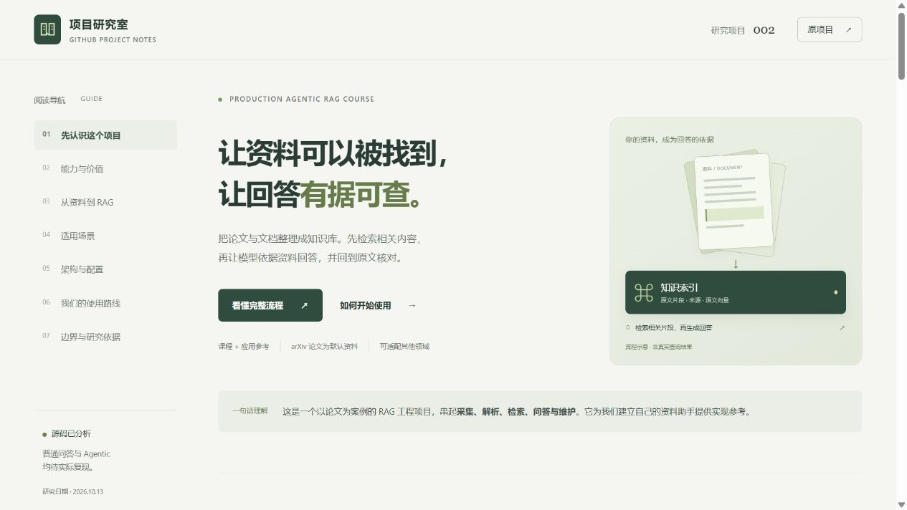
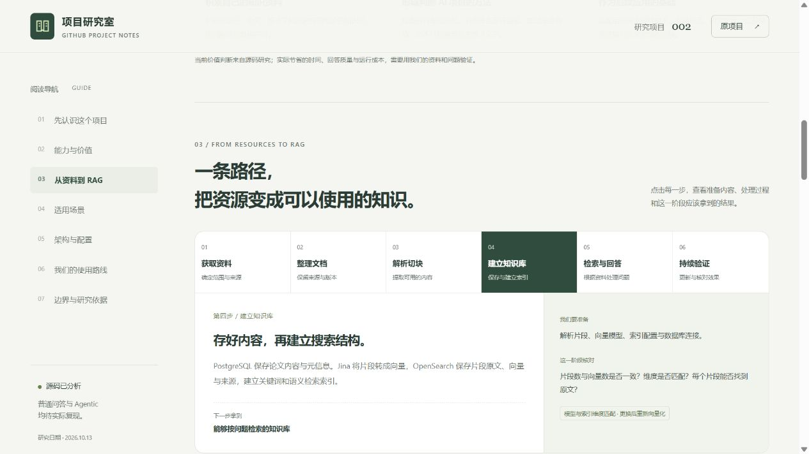
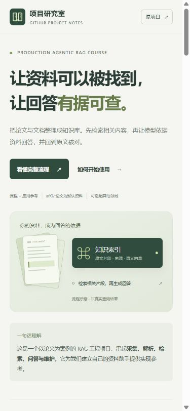
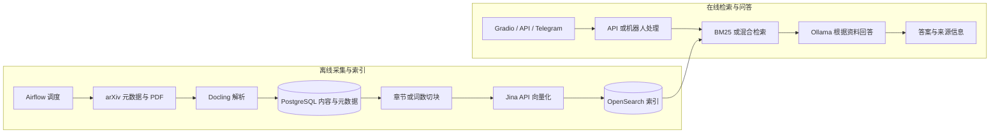
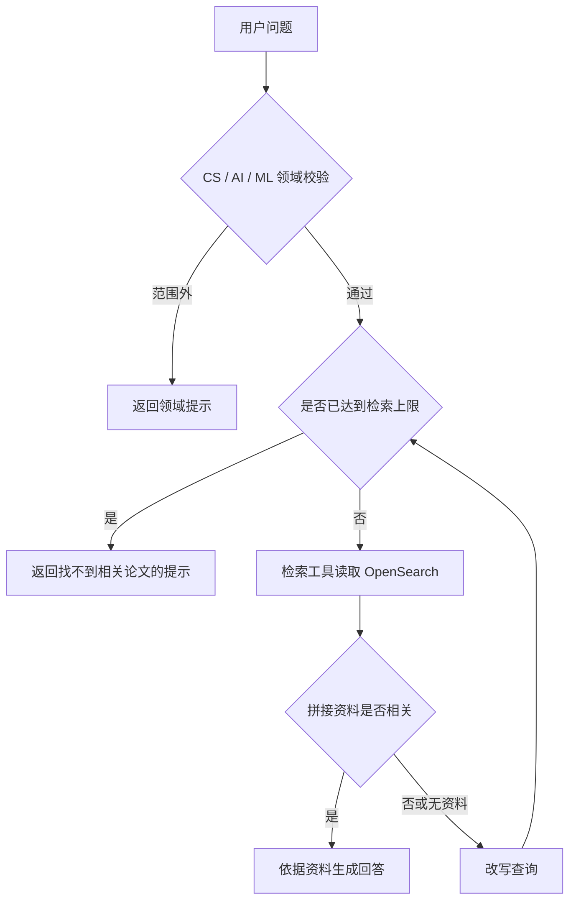

# 002 · Production Agentic RAG Course：论文助手与工程架构研究

**通过搭建一个自动收集论文、搜索资料并回答研究问题的助手，学习完整的 RAG 应用工程。** 上游以 arXiv 论文为知识来源，依次实现数据采集、PDF 解析、混合检索、模型问答、监控缓存和自适应检索工作流。

本研究关注它实际具备的能力、可复用的架构与尚未闭合的实现。当前已完成核心源码阅读、复现计划与可交互中文导读页，**尚未启动上游服务，也未验证回答质量、性能或稳定性**。

[返回总索引](../../README.md#项目索引) · [在线导读与理解图](https://yydshly.github.io/1013_codex_project/002-production-agentic-rag-course/#understanding) · [共识与一图总览源文件](./web/index.html#understanding) · [原仓库](https://github.com/jamwithai/production-agentic-rag-course) · [固定版本源码证据](./references/source-map.md) · [复现与验收清单](./experiments/README.md) · [网页使用说明](./web/README.md)

## 我们的共同理解

**论文是它的默认应用场景，搭建完整 RAG 的方法和工程架构是我们主要参考的价值。** 以此为基础，把自己的资料逐步做成能查询、能回答、能追溯依据的知识系统；实际收益用检索质量、核查时间与成本验证。

先围绕明确问题获取可靠资料，保留来源、版本与原文位置，再解析、切块、建立索引。使用时先检索片段，再把问题与相关资料交给模型回答。知识覆盖由已入库资料决定；这条 RAG 链路无需重新训练模型。

农业论文、种植手册和试验记录可作为迁移方向，但需接入新来源、调整领域规则，并保留作物、地区、土壤、气候和实验条件。先跑通普通 RAG、核对原文和保存基线，再探索 Agentic、专题报告和与项目 001 长文写作的衔接。

### 完整理解摘要

| 维度 | 对这个项目的理解 |
| --- | --- |
| 定位与能力 | 以 arXiv AI 论文为默认资料的课程与参考工程。源码串起定时采集、PDF 解析、切块、索引、混合检索、普通流式问答、论文来源链接、缓存追踪和多个入口；Agentic 增加领域判断、相关性检查、查询改写与重试。 |
| 核心原理 | 建库时把文档解析为有来源的片段并生成向量，建立关键词与语义搜索索引。使用时先找相关资料，再把问题和片段交给模型生成回答，最后核对引用；为当前请求补充依据，无需为这条链路重新训练模型。 |
| 输入与输出 | 输入是已获取的资料、元信息、问题及检索参数；建库产生片段、向量和索引，搜索得到相关资料，普通问答得到模型回答与论文链接。内容覆盖由实际入库的资料决定。 |
| 架构分工 | Docling 解析，PostgreSQL 存正文与元信息，Jina API 生成向量，OpenSearch 检索，Ollama 回答；Airflow 调度、Redis 普通问答缓存和 Langfuse 追踪补齐运行过程。 |
| 主要价值 | 学习和复用完整 RAG 的方法、组件分工、数据衔接与评测思路，为自有知识系统提供基础。实际节省的检索与整理时间、回答质量和运行成本，需要测量。 |
| 对你的意义 | 将你收集的论文、种植资料、试验记录和本仓库项目研究逐步积累为能查找、能回答、能追溯依据的知识系统；为资料对比、研究判断、报告与写作提供可核验的依据。 |
| 可扩展场景 | 农业资料助手保留作物、地区、土壤、气候和实验条件；产品文档助手保留型号、版本和权限；项目研究助手保留仓库、commit 和验证状态。进一步探索专题报告和与项目 001 长文写作的衔接。 |
| 可扩展方向 | 新资料入口、去重与更新；中文、扫描件、表格、OCR 和实验条件提取；本地向量化与私有部署；权限、版本及领域筛选；普通 RAG 与 Agentic 对比评测。均需后续实现和验证。 |
| 我们的使用路线 | 选主题并准备一批可靠文档与 10 个真实问题，获取资源、记录来源和版本、整理文档、解析切块、建索引、检索问答和核对引用。先保存普通 RAG 基线，再逐步扩展。 |
| 成立条件与边界 | 当前已完成源码研究和前端导读，上游尚未运行。来源链接需逐条核对，默认领域限制需调整，Jina 向量化依赖外部 API；Agentic 和运行维护闭环有待复现。农业知识库、权限、本地向量化、报告与写作整合均未实现。 |


图片来源：2026-10-13 本仓库依据固定版本直接绘制，2400 × 3500；不是上游运行截图，也不代表农业或其他扩展已实现。图内区分源码存在、适配方向与待验证效果。可打开 [高清 PNG](./web/assets/rag-understanding.png)、[可缩放 SVG](./web/assets/rag-understanding.svg)，或在 [网页](./web/index.html#understanding) 阅读、下载与展开等价文字版。[认知与制作说明](./references/understanding-overview.md) 保留图的内容、来源与编辑方式。

## 项目概览

| 信息 | 记录 |
| --- | --- |
| 研究编号 | 002 |
| 原仓库 | [jamwithai/production-agentic-rag-course](https://github.com/jamwithai/production-agentic-rag-course) |
| 固定研究 commit | [424a0eb99edf841994f2a9a053912b489d2a94ff](https://github.com/jamwithai/production-agentic-rag-course/tree/424a0eb99edf841994f2a9a053912b489d2a94ff) |
| 上游许可证 | MIT，Copyright (c) 2025 Jam With AI；[保留的原文](./assets/upstream-LICENSE.md) |
| 研究日期 | 2026-10-13（Asia/Shanghai） |
| 当前状态 | 研究中；元信息为 researching，未达到“已复现” |
| 本次范围 | 课程与核心源码分析、架构说明、交互导读页及前端验证、后续验收计划 |
| 在线导读 | [已发布并验证](https://yydshly.github.io/1013_codex_project/002-production-agentic-rag-course/)；静态理解展示，未连接真实 RAG 后端 |



图片来源：2026-10-13 本仓库制作的中文导读页，本地浏览器实拍；依据上方固定上游版本整理。截图不是上游问答系统运行证明。本页架构图与网页中的流程示意均由本次源码阅读整理。

## 中文导读网页

页面汇总能力、价值、适用场景和“获取资料 → 整理文档 → 解析切块 → 建立知识库 → 检索与回答 → 持续验证”的使用路径，包含农业研究、技术资料与 GitHub 项目研究三种适配方案。

新增“共识与一图总览”章节，用三段共识和一张完整图说明定位、价值、能力、原理、场景、使用与扩展。可下载 PNG / SVG、打开原图，并展开详细文字版。

点击六步流程可查看每阶段的输入、产物与核对点；切换场景与搜索 / 问答模式可理解使用差异。准备清单保存在当前浏览器，并可下载包含共同理解的 Markdown 使用路线。所有问答内容都是流程示意，没有接入真实论文库或模型。

在仓库根目录启动静态预览：

```powershell
python -m http.server 8766 --bind 127.0.0.1 --directory projects/002-production-agentic-rag-course/web
```

随后访问 <http://127.0.0.1:8766/>。页面无第三方运行依赖；构建与部署说明、前端检查记录见 [web/README.md](./web/README.md)。静态导读已在 GitHub Pages 发布，并验证网页、脚本、总览 PNG / SVG 与首页引导图；详见 [公网发布验证](./experiments/results/publication-2026-10-13.md)。





以上两图同样来自本仓库导读页，日期为 2026-10-13；分别记录桌面流程面板与手机布局，均为理解展示，不是上游系统或农业知识库运行截图。

## 1. 项目描述与研究目标

上游把项目称为 arXiv Paper Curator。使用者提出 CS / AI / ML 研究问题，系统从已采集、已建立索引的论文片段中查找资料，再交给模型生成回答。覆盖范围取决于采集分类、论文数量和解析结果；一次问答检索的是本地索引，不会自动搜索整个互联网。

RAG 是“检索增强生成”：先找到资料，再让模型依据资料回答。Agentic 部分把领域判断、资料相关性检查和查询改写组织成有分支、可重试的工作流。图状态记录一次请求的执行过程，不等于已有跨请求的持久聊天记忆。[上游课程说明][course]、[实际工作流][workflow]

| 课程阶段 | 逐步加入的内容 |
| --- | --- |
| 第 1 周 | Docker、FastAPI、数据库、搜索引擎和任务调度基础设施 |
| 第 2 周 | arXiv 采集、PDF 解析与入库 |
| 第 3 周 | BM25 关键词检索 |
| 第 4 周 | 文档切块、向量化与混合检索 |
| 第 5 周 | Ollama 模型问答、流式响应与 Gradio 界面 |
| 第 6 周 | Langfuse 追踪与 Redis 缓存 |
| 第 7 周 | LangGraph 自适应检索工作流与 Telegram 入口 |

本次研究目标是理解各阶段的数据如何衔接，区分课程描述和当前实现，并为后续复现建立有证据、可比较的验收条件。

## 2. 能力与输出

下表的“源码存在”表示已读到相应实现，不代表已运行通过。

| 能力 | 输入与输出 | 当前实现及边界 |
| --- | --- | --- |
| 定时采集论文 | arXiv 分类 → 元数据、PDF、入库内容 | Airflow DAG 存在；默认分类为 cs.AI，调度为工作日；幂等性与成功率未测 |
| 解析和切块 | PDF → 文本、章节及检索片段 | Docling 解析，优先章节切块，再回退到词数与重叠切块；公式、表格与 OCR 质量未测 |
| 检索资料 | 问题与检索参数 → 论文片段、分数及元数据 | 有 BM25、向量和 RRF 混合搜索方法；实际接口暴露范围与质量待测 |
| 普通 RAG 问答 | 问题 → 回答、论文 PDF 链接 | /api/v1/ask 与 /api/v1/stream 已实现来源构造；链接存在不代表每条回答都得到原文支持 |
| 自适应检索 | 问题 → 领域判断、检索、相关性判断、改写与重试 | /api/v1/ask-agentic 有 LangGraph 工作流；默认最多检索两次；来源和参数链路有缺口 |
| 网页与移动入口 | 网页输入或 Telegram 消息 → 回答 | Gradio 调用普通 /stream；Telegram 直接检索并调用 Ollama，当前未进入 Agentic 工作流 |
| 追踪与缓存 | 请求 → 阶段记录或缓存答案 | Langfuse 追踪代码存在；Redis 为普通 RAG 的精确匹配缓存，Agentic 未接入同一缓存 |
| 用户反馈 | trace_id、评分、评论 → Langfuse 反馈 | /api/v1/feedback 存在；Agentic 服务未返回 trace_id，完整反馈闭环待验证 |

对应实现与行号见 [源码证据表](./references/source-map.md)。相关论文已入库后，可以用“这些论文提出了哪些改善 RAG 检索的方法？”作为问答案例；实际回答效果必须在复现后记录。

## 3. 价值与适用条件

| 价值 | 可以学到或复用什么 | 成立条件 |
| --- | --- | --- |
| 学习 AI 应用工程 | 从资料采集到回答输出、监控和缓存的完整链路 | 逐阶段理解和运行，不能只以容器启动成功作为完成标准 |
| 建立知识库问答原型 | 复用切块、索引、检索、问答和图编排的结构 | 替换数据入口、领域规则和配置，核对来源及参数传递 |
| 做检索与 Agent 实验 | 比较 BM25、向量、混合搜索及改写重试的收益 | 使用相同语料、标注问题、模型和硬件，分开统计质量与耗时 |
| 学习运维与排障 | 观察慢在哪一步、重复请求如何复用结果 | 实测追踪完整性、缓存失效、外部服务故障和恢复行为 |

初步判断：它适合作为 RAG 工程学习材料和二次开发参考。改造成企业文档或产品手册助手时，还需适配资料格式、语言、领域校验和访问控制。上游已有工程组件，但本次没有证据证明固定版本已经达到某个生产服务水平。

生成使用本地 Ollama；向量化客户端把论文文本和问题发往 Jina API。采用私有资料时，应把向量化服务也纳入部署选择，不能仅由“本地模型”推断整条链路离线。[向量化客户端][embeddings]

## 4. 架构与数据流

### 离线采集和在线问答



离线流程负责把资料准备为可搜索内容；在线流程读取既有索引。普通问答在执行检索前检查 Redis 缓存，未命中时再检索并生成回答。Langfuse 追踪包围相应阶段；是否完整上报需要实际验证。[采集 DAG][ingestion]、[搜索客户端][search]、[普通问答][ask]

| 组件 | 主要职责 | 固定版本依据 |
| --- | --- | --- |
| FastAPI | 健康检查、检索、普通 / 流式 / Agentic 问答与反馈 | src/main.py、src/routers/ |
| PostgreSQL | 论文元数据及解析内容 | Compose 主业务库使用 postgres:16-alpine |
| Docling | PDF 验证、文本与结构提取 | 默认最多 30 页、20 MB，OCR 默认关闭 |
| TextChunker | 章节保留、短章节合并、大章节切分和词数回退 | 词数切块默认 600 词、重叠 100 词 |
| Jina | 文档和问题向量化 | jina-embeddings-v3，1024 维 |
| OpenSearch | BM25、kNN 向量检索与 RRF 排名融合 | Compose 使用 2.19.0；RRF 按排名融合检索结果 |
| Ollama | 生成回答及 Agent 的结构化判定 | Compose 使用 0.11.2；默认模型 llama3.2:1b |
| Airflow | 调度采集、索引、报告等任务 | 固定 Dockerfile 使用 2.10.3 |
| Redis | 普通 RAG 精确匹配缓存 | 主缓存使用 redis:7-alpine；TTL 默认 6 小时 |
| Langfuse | 请求与阶段追踪、反馈 | 独立 PostgreSQL、Redis、ClickHouse、MinIO 支撑服务 |
| Gradio / Telegram | 使用入口 | 两者当前均走普通 RAG 路径 |

版本和默认值来自 [项目配置][settings]、[Compose][compose]、[Airflow Dockerfile][airflow-docker] 与对应代码；环境变量可能覆盖默认值。上游依赖声明多为范围约束，后续应以固定版本的 uv.lock 安装，并保存实际依赖版本和镜像摘要。

### Agentic 工作流



图由 LangGraph 编排，节点通过运行上下文取得搜索、向量化、模型和追踪依赖。默认 top_k 为 3，最多检索 2 次，领域分数阈值为 60；这些是工作流配置，不是每个 API 请求都已生效的参数。[工作流][workflow]、[图配置][graph-config]

相关性节点对拼接后的资料做一次 yes / no 判断，当前没有逐篇独立筛选、重排。reasoning_steps 是阶段描述，不能当作完整模型推理记录。每次请求重新初始化状态，图编译未配置持久化 checkpointer。[相关性节点][grading]、[工作流][workflow]

### 主要源码入口

| 目录 / 文件 | 阅读目的 |
| --- | --- |
| airflow/dags/arxiv_paper_ingestion.py | 离线任务依赖、调度与重试 |
| src/services/pdf_parser/、src/services/indexing/ | PDF 内容如何成为检索片段 |
| src/services/embeddings/、src/services/opensearch/ | 向量生成、索引及混合检索 |
| src/routers/ask.py | 普通问答、来源、流式和缓存路径 |
| src/services/agents/、src/routers/agentic_ask.py | 图状态、决策、重试与接口返回 |
| src/services/cache/、src/services/langfuse/ | 缓存键、TTL、追踪及反馈 |
| src/gradio_app.py、src/services/telegram/ | 实际使用入口与调用路径 |
| notebooks/week1/ 到 week7/、tests/ | 课程实验材料和已有测试 |

## 5. 已确认的差异与复现重点

以下是固定版本的静态发现，运行影响须通过验收确认；本次未修改上游代码。

| 编号 | 静态发现 | 后续应验证的影响 |
| --- | --- | --- |
| S01 | Agentic 路由仅传 query，未传 model、top_k、use_hybrid、categories；部分响应字段却按请求填写 | 实际模型、检索数量和方式是否与返回信息一致 |
| S02 | Agentic 初始化 relevant_sources 为空，已读节点未见填充；来源提取函数仍是占位 | 命中时 sources 是否为空；补齐后还要核对来源对象与响应 List[str] 的类型 |
| S03 | Agentic 服务未返回 trace_id；响应 schema 未声明 rewritten_query | 反馈能否定位原请求，查询改写是否能从接口观察 |
| S04 | 相关性判定失败时，以资料长度大于 50 作为相关；领域判定失败时默认分数 50 | 不相关的长文本是否误通过，模型故障是否被显示为领域外问题 |
| S05 | Telegram 直接执行普通 RAG，模型写死；Gradio 调用普通 /stream | 多入口是否符合预期，如何观察 Agentic 重试 |
| S06 | 缓存键没有语料版本，Agentic 没有普通 RAG 的缓存路径 | 新论文入库后旧回答何时失效，性能比较是否混入缓存收益 |
| S07 | README 描述 Airflow 3.0、Langfuse 主机端口 3000；构建为 2.10.3，主机端口 3001 | 容器构建、DAG 导入和监控访问应以实际配置验收 |
| S08 | pyproject.toml 限定 Python >=3.12,<3.13；PDF 配置默认 30 页，函数注释写 20 页 | 环境与解析边界按有效配置验证 |
| S09 | Agentic 节点调用 get_langchain_model，但工厂注入的 OllamaClient 未定义该方法 | 模型是否进入异常降级，领域内问题是否被误拒绝；客户端适配与真实模型调用需验收 |
| S10 | LangfuseSettings 的环境前缀为 LANGFUSE__ | 关闭追踪与其他设置按双下划线前缀核对实际生效值，避免照搬未生效的设置 |

逐项源码位置见 [固定版本证据表](./references/source-map.md)。上游 Agentic API 测试用模拟服务返回来源和答案，无法代替真实链路验证。自定义模型测试要求 model 被传入服务，与当前路由存在静态矛盾；是否报错仍以首次测试结果为准。[上游测试][api-tests]

## 6. 环境与当前验证记录

| 项目 | 记录 |
| --- | --- |
| 本次文档研究环境 | Windows、PowerShell、Python 3.10.11、uv 0.11.2 |
| Docker 检查 | 当前命令搜索未找到 docker；未检查其他安装位置或运行中的引擎 |
| 上游 Python 要求 | 3.12.x，来自固定 pyproject.toml；本次 Python 3.10 只用于本仓库项目工具 |
| 复现准备 | Docker / Compose、Python 3.12、uv、Ollama 模型；混合搜索需 Jina 配置 |
| 可选服务 | Langfuse 追踪和 Telegram；密钥只保存在本地配置中 |
| 资源参考 | README 建议至少 8 GB 内存、20 GB 空闲磁盘；本次未实测资源需求 |

| 核对事项 | 当前结果 | 证据或边界 |
| --- | --- | --- |
| 原仓库、固定版本、许可证 | 已核对 | 固定 commit 链接与保留的 MIT 原文 |
| 能力、架构与实现差异 | 已核对核心源码 | 29 项来源位置见证据表；不是运行通过证明 |
| 上游安装、容器构建与健康检查 | 未执行 | 待在单独环境中固定版本复现 |
| 采集、解析、索引、真实问答 | 未执行 | 待保存语料、问题、回答和来源 |
| 检索质量、重试收益、延迟、费用与故障恢复 | 未验证 | 不采用上游速度或效果描述作为本次结论 |
| Gradio、Telegram 与反馈闭环 | 未验证 | 尚无实际界面截图或通信记录 |
| 本仓库中文导读页 | 前端已验证 | 六步切换、三种场景、搜索 / 问答示意、清单保存与 Markdown 下载、手机布局；详见网页说明 |
| 本仓库理解总览图 | 展示已验证 | PNG / SVG、图像下载、文字版展开、共同理解路线导出、桌面和手机布局、静态子路径资源检查通过；不是上游运行证据 |
| 本仓库项目与索引 | 已通过 | 2026-10-13：索引同步与文档链接检查；32 项仓库测试中 31 项通过，1 项因 Windows 符号链接权限跳过；不代表上游运行通过 |
| 在线导读 | 静态页面已发布 | 公网页面、脚本、总览图和索引验证通过；源码 commit 81f224c，运行记录与范围见公网发布验证；未连接真实 RAG 服务 |

## 7. 后续复现与验收安排

完整步骤、用例和证据要求在 [复现与验收清单](./experiments/README.md)。按以下顺序推进：

1. 固定 Python、依赖和镜像环境，核对配置，保留首次构建及上游测试基线。
2. 跑通少量论文的采集 → 解析 → 切块 → 向量化 → 索引，检查各阶段数量与内容。
3. 跑通普通 RAG，验证来源、参数和无资料分支，再验证 Agentic 各分支。
4. 优先核对 S01–S04 的参数、来源、追踪和降级；修正实验与原始基线分别记录。
5. 用固定语料和标注问题比较检索质量、Agentic 收益、缓存及耗时。
6. 验证界面、移动入口、故障恢复和截图；有需要再设计独立 Web 展示。

## 本仓库的实践与待办

本次新增研究说明、证据表、许可证原文、复现计划和中文导读网页。web/ 使用独立 HTML、CSS、JavaScript 展示理解、适配场景和使用路线；没有引入完整上游源码、真实模型运行数据或第三方依赖。实验代码与结果说明放在 experiments/，展示代码放在 web/。上游 checkout、密钥、模型、缓存和容器数据保存在研究仓库之外。

- [x] 确认研究版本和上游许可证
- [x] 整理能力、价值与架构
- [x] 列出源码差异和后续验收要求
- [x] 制作中文交互导读页并验证前端、保存实际页面截图
- [x] 汇总共同理解，制作完整 PNG / SVG 总览图并接入网页与索引
- [ ] 准备环境并保存首次复现基线
- [ ] 完成采集、索引、普通与 Agentic 问答验收
- [ ] 比较质量、性能、缓存和故障恢复
- [ ] 添加实际截图、结果记录与研究结论
- [x] 发布静态中文导读，验证公网入口、完整摘要与总览图，并更新元信息
- [ ] 后续接入真实 RAG 服务，并分别验收检索、回答与应用效果

## 来源与致谢

课程与原实现归 Jam With AI。研究引用均固定在上述 commit；许可证原文见 [assets/upstream-LICENSE.md](./assets/upstream-LICENSE.md)。架构图、中文说明和验收计划由本仓库根据源码整理；上游课程定位、静态结论与未来实测结果分别记录。

[course]: https://github.com/jamwithai/production-agentic-rag-course/blob/424a0eb99edf841994f2a9a053912b489d2a94ff/README.md
[workflow]: https://github.com/jamwithai/production-agentic-rag-course/blob/424a0eb99edf841994f2a9a053912b489d2a94ff/src/services/agents/agentic_rag.py
[ingestion]: https://github.com/jamwithai/production-agentic-rag-course/blob/424a0eb99edf841994f2a9a053912b489d2a94ff/airflow/dags/arxiv_paper_ingestion.py
[search]: https://github.com/jamwithai/production-agentic-rag-course/blob/424a0eb99edf841994f2a9a053912b489d2a94ff/src/services/opensearch/client.py
[ask]: https://github.com/jamwithai/production-agentic-rag-course/blob/424a0eb99edf841994f2a9a053912b489d2a94ff/src/routers/ask.py
[settings]: https://github.com/jamwithai/production-agentic-rag-course/blob/424a0eb99edf841994f2a9a053912b489d2a94ff/src/config.py
[compose]: https://github.com/jamwithai/production-agentic-rag-course/blob/424a0eb99edf841994f2a9a053912b489d2a94ff/compose.yml
[airflow-docker]: https://github.com/jamwithai/production-agentic-rag-course/blob/424a0eb99edf841994f2a9a053912b489d2a94ff/airflow/Dockerfile
[embeddings]: https://github.com/jamwithai/production-agentic-rag-course/blob/424a0eb99edf841994f2a9a053912b489d2a94ff/src/services/embeddings/jina_client.py
[graph-config]: https://github.com/jamwithai/production-agentic-rag-course/blob/424a0eb99edf841994f2a9a053912b489d2a94ff/src/services/agents/config.py
[grading]: https://github.com/jamwithai/production-agentic-rag-course/blob/424a0eb99edf841994f2a9a053912b489d2a94ff/src/services/agents/nodes/grade_documents_node.py
[api-tests]: https://github.com/jamwithai/production-agentic-rag-course/blob/424a0eb99edf841994f2a9a053912b489d2a94ff/tests/api/routers/test_agentic_ask.py
