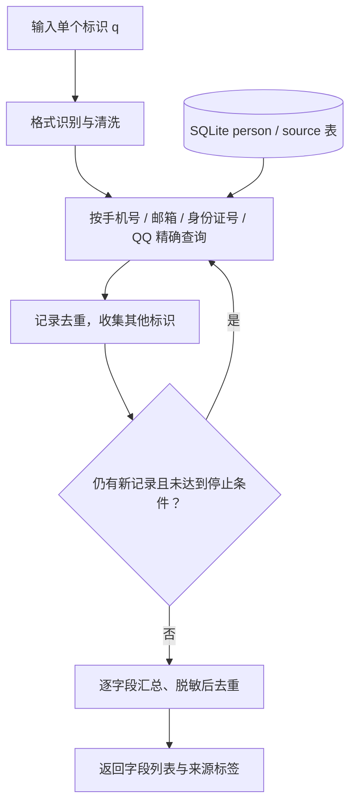

# 004 · Leak Check：个人信息泄漏查询与关联原理研究

**leak-check 的能力是：用一个已知的手机号、邮箱、身份证号或 QQ 号，查找数据库中的匹配及关联记录，并返回脱敏后的个人信息和来源标签。**

**它的本质是在对应的本地既有数据库中搜索，主要封装数据库查询、有限关联、字段聚合与脱敏。** 实现链路是：识别输入 → 精确查表 → 用命中记录中的其他标识再查一轮 → 逐字段汇总 → 遮盖敏感字符 → 返回 JSON。源码依据固定在 `7e3a113`。

**对我们的价值不大，保留参考即可，不需要继续深入研究。** 四类标识搜索依赖数据库已经收录的数据；仓库没有附作者线上完整数据库。我们能参考的是常规数据库操作与接口组织，不能仅靠这份代码获得线上服务的数据覆盖与查询效果。

[返回总索引](../../README.md#项目索引) · [原仓库](https://github.com/garinasset/leak-check) · [实验状态](./experiments/README.md) · [Web 演示说明](./web/README.md)


引导图沿用本次生成的汇总图，依据固定版本源码与作者公开页面整理，非运行截图；[生成说明](./assets/research-summary-prompt.txt)。图中的“对我的价值有限”对应本次共同研究结论：**对我们价值不大，保留参考即可。**

## 1. 它能做什么

### 1.1 用一个标识查找个人信息暴露线索

用户只需提供一个已知标识，程序会自动判断属于哪类输入，然后到配置的数据库中寻找匹配记录。

| 可以输入什么 | 数据库匹配字段 | 能获得什么 |
| --- | --- | --- |
| 手机号 | `person.phone` | 该号码所在记录，以及进一步关联出的其他记录 |
| 邮箱 | `person.email` | 该邮箱所在记录，以及通过其他标识连接的记录 |
| 身份证号 | `person.id` | 该证件号所在记录及关联记录 |
| QQ 号 | `person.qq` | 该账号所在记录及关联记录 |

姓名、地址、公司等字段用于返回信息，当前查询入口没有按这些字段搜索的分支。[输入识别][request]、[查询入口][api]

### 1.2 从一条记录找到更多相关线索

如果一条命中记录同时包含手机号和邮箱，程序会继续使用这个邮箱寻找其他记录。这样可以把分散在不同数据来源中的信息连接起来。能连接记录的字段只有身份证号、手机号、邮箱和 QQ 号。[关联查询][crud]

例如：用“手机号甲”找到记录 A，A 包含“邮箱乙”；再用邮箱乙找到记录 B，B 包含“QQ 丙”。程序可以把 A、B 中的信息一起整理出来。具体过程见第 2.4 节。

### 1.3 返回涉及哪些信息、出现在哪些来源

命中记录会被整理为下列字段，每个字段返回一个数组；没有收集到值的字段返回空数组。

| 信息类别 | 返回字段 |
| --- | --- |
| 身份与姓名 | `id`、`name`、`receiver`、`nickname` |
| 联系方式与账号 | `phone`、`email`、`qq`、`weibo` |
| 地址与其他信息 | `address`、`car`、`contact`、`company` |
| 数据来源标签 | `source` |

其中 `car` 是车辆相关文本字段，模型没有限定它必须是车牌号。个人信息经过字符遮盖，来源标签保持原样。返回内容是各字段汇总，不包含逐条记录的完整详情。[数据模型][database]、[响应结构][response]、[聚合输出][api]

### 1.4 作为接口接入网页或其他应用

核心查询路由是 `POST /dig/masking`，请求体只需填写 `q`。以下使用保留的示例域名说明请求格式：

```json
{"q": "demo@example.com"}
```

程序会识别为邮箱查询。返回结构如下，内容全部为虚构示意，不是上游服务的实际查询结果：

```json
{
  "id": [],
  "name": ["*明"],
  "receiver": [],
  "nickname": [],
  "phone": ["13*******89"],
  "email": ["de***@example.com"],
  "qq": ["**345"],
  "weibo": [],
  "address": ["上海****"],
  "car": [],
  "contact": [],
  "company": [],
  "source": ["合成数据集 A", "合成数据集 B"]
}
```

接口返回的是字段列表，没有单独的“已泄漏”布尔值、置信度或泄漏时间。`/leak-check` 是应用配置的代理前缀，实际访问地址需要结合部署方式理解。[路由与响应][api]、[响应模型][response]

### 1.5 能力依赖什么

查询处理器读取已有数据库。公开代码没有在收到请求后搜索互联网、抓取泄漏数据的流程。上游将检测范围定义为互联网上传播的“部分”数据；仓库提供开发用的 `example.db`，明确说明不提供真实数据拷贝。因此，实际能找到什么取决于运营者准备的数据库。[项目说明][readme]、[数据库查询][crud]、[安装脚本][install]

## 2. 这些能力如何实现

整体实现由 FastAPI、Pydantic、SQLModel Session / SQLAlchemy ORM 和 SQLite 串联。FastAPI 接收请求，Pydantic 识别和校验输入，数据库查询负责找记录，关联循环负责扩展，脱敏函数负责组织显示内容。



### 2.1 接收请求：确定查哪种字段

`main.py` 的 `get_person_by_dig` 接收请求体。请求模型 `ModelRequestQuery` 会先运行 `validate_and_detect`，根据 `q` 的格式自动填写 `type`。处理函数随后按 `phone`、`email`、`id`、`qq` 分支，把输入交给 `read_persons_by_dig`。[请求校验][request]、[接口分支][api]

### 2.2 格式识别：使用正则规则

识别顺序为手机号 → 邮箱 → 身份证号 → QQ 号。代码先去除输入中的部分分隔字符，再按规则匹配；不符合任何一种格式时，校验报错。

| 类型 | 主要识别规则 |
| --- | --- |
| 手机号 | 以 `1` 开头的 11 位数字，或带 `+` 的国际号码格式 |
| 邮箱 | 用户名、`@`、域名的正则格式 |
| 身份证号 | 大陆 18 位格式，或台湾所用的一种格式 |
| QQ 号 | 排除手机号后的 5–11 位数字 |

这一步负责把输入路由到正确字段，不核验证件校验位、号码实际存在与否或查询者身份。邮箱也被统一套用清洗结果，带连字符的邮箱可能被改写，见限制 L08。[校验器实现][request]

### 2.3 精确查表：读取已有记录

数据库包含两类表：`person` 保存个人信息与标识，`source` 保存来源标签；`person.source_id` 关联对应来源。默认工作数据库为 `sqlite:///db/leak-check.db`。[数据模型][database]、[数据库引擎][crud]

查询用 SQLAlchemy 构造精确匹配条件。例如邮箱查询对应：

```python
select(Person).where(Person.email.in_(email_set))
```

手机号、身份证号、QQ 号分别使用各自字段查询。`IN` 允许同一轮同时查询多个关联标识；这里按值匹配，没有模糊匹配或向量检索。[查询实现][crud]

### 2.4 关联扩展：直接查询，再用新标识查一轮

关联过程类似广度优先搜索：先找到当前标识所在的记录，再把这些记录里的其他标识作为下一轮查询入口。

以下是虚构数据，用于说明算法：

| 记录 | 手机号 | 邮箱 | QQ | 来源 |
| --- | --- | --- | --- | --- |
| A | 手机号甲 | 邮箱乙 | 空 | 数据集 A |
| B | 空 | 邮箱乙 | QQ 丙 | 数据集 B |
| C | 空 | 邮箱丁 | QQ 丙 | 数据集 C |

输入手机号甲后的处理顺序是：

1. **第一轮：**用手机号甲找到 A，保存 A，并收集邮箱乙。
2. **第二轮：**用邮箱乙找到 A 和 B；A 已收集过，按 `rowid` 去重，只新增 B。
3. **停止：**第二轮发现 QQ 丙，但默认最多两轮，不再用 QQ 丙查询 C。
4. **输出：**把 A、B 的各字段值汇总、脱敏，来源汇总为数据集 A、B。

实现中为身份证号、手机号、邮箱、QQ 分别维护当前轮的标识集合，并用字典保存已发现的记录。遇到没有新增记录、达到两轮上限或达到记录数停止条件时结束。[关联循环][crud]

| 参数 | 默认值 | 实际作用 |
| --- | --- | --- |
| `max_depth` | `2` | 最多两轮：直接查询，加一轮关联查询 |
| `max_records` | `64` | 一整轮处理完后检查是否停止，最终记录数可能超过 64 |
| `threshold` | `12` | 单字段当轮命中过多时打印异常日志，不影响是否收录记录 |

共同标识连接的是数据库记录。共享邮箱、号码复用或错误数据都可能把不同人的记录连起来，代码没有额外的身份归属判定。

### 2.5 字段聚合：把多条记录整理成数组

`main.py` 对每个字段分别遍历全部命中记录：从 A、B 等记录中取出姓名，组成姓名列表；取出手机号，组成手机号列表；其他字段同样处理。`source` 则通过 ORM 关系读取来源表，再独立去重。[聚合代码][api]

因此，最终结果是“收集到了哪些姓名、号码和来源”，不是一份逐条展示的原始记录表。输出中的姓名、手机号和来源数组没有保存彼此的一一对应关系。

### 2.6 脱敏：遮盖字符，再对显示值去重

`lib/masking.py` 的 `mask_value` 按字段调用对应规则，`mask_list` 负责去掉无效值、应用脱敏并用集合去重。以下示例均为虚构：[脱敏函数][masking]

| 字段 | 遮盖规则 | 示意 |
| --- | --- | --- |
| 手机号 | 前两位 + 七个星号 + 后两位 | `13*******89` |
| 邮箱 | 保留一至两个用户名字符及完整域名 | `demo@example.com` → `de***@example.com` |
| 身份证号 | 前两位 + 八个星号 + 后两位 | 中间内容遮盖，显示长度不一定等于原长度 |
| 姓名等文本 | 通常只保留末字 | `张小明` → `*明` |
| QQ / 微博 | 较长值保留末三位 | `12345` → `**345` |
| 地址 / 公司 | 保留短前缀 | `上海市示例地址` → `上海****` |

遮盖发生在返回阶段，数据库仍保存用于匹配和关联的原始字段。因为先脱敏再去重，不同原始值可能显示为同一个值；集合转换为列表也不保证稳定排序。处理后的字段交给响应模型，由接口返回 JSON。[脱敏实现][masking]、[响应构造][api]

## 3. 价值与成立条件

下表是本次基于源码的评估，不是线上效果测评。

| 价值 | 可以获得什么 | 成立条件 |
| --- | --- | --- |
| 个人信息暴露自查 | 了解哪些信息出现在已收录的数据中，为账户检查、防范诈骗等行动提供线索 | 数据有足够覆盖且来源可靠；正确理解无匹配和关联结果的含义 |
| 复用查询服务 | 把查询、关联与脱敏接口接入已有应用 | 已有可靠、适合使用的数据，并补齐访问控制、日志处理与容量验证 |
| 学习后端设计 | 观察输入校验、数据库查询、关联算法与结构化输出如何串联 | 用小型合成数据验证各分支，区分源码意图与实际表现 |
| 研究隐私设计 | 比较脱敏、日志、数据归属与来源追溯之间的关系 | 同时检查输出、存储和部署层，不能仅由脱敏输出判断整体隐私水平 |

结论：可复用的是数据库操作与轻量 API 的组织方式。作为泄漏查询服务，实际效果由数据覆盖、更新、关联准确性与可信度决定；仅有代码无法推断真实查询效果。

### 3.1 对本次研究的意义

**对我们价值不大，主要是数据库操作能力的封装。** 输入识别、SQL 精确查询、有限轮次的关联与输出脱敏都是较常规的实现；真正决定查询效果的完整数据没有随仓库提供。基础源码理解已经足够，保留能力与实现说明作为参考，不继续安装、性能测试或制作演示。该判断针对我们的研究目标；对于已有可靠数据的使用者，代码仍可作为查询接口参考。

### 3.2 开源代码与作者线上服务的区别

仓库附有 `example.db`，但未附作者线上完整数据库；本次没有检查示例库内容。作者另有[线上查询界面][online]，页面在 2026-10-13 展示约 14.46 亿条记录。这是网站展示值，未独立核验；公开代码的统计方式还有 L09 所述限制，不能据此确认实际行数或数据覆盖。

在本次检查的 README、源码与官网公开页面中，未找到具体泄漏事件清单、数据提供方、获取渠道或更新验证流程。不能由此推断数据来自爬取、购买或其他某种渠道。**仓库未附完整数据库，不代表作者线上服务没有数据库；线上服务的展示效果也不能等同于下载源码后的复现效果。**

## 4. 限制与需要核验的实现细节

| 编号 | 限制或发现 | 影响与证据 |
| --- | --- | --- |
| L01 | 数据覆盖决定效果，仓库未附线上完整数据库 | 查不到不代表未泄漏；没有覆盖范围、时效性与准确率的实测证据。[README][readme] |
| L02 | 共同标识关联不等于身份确认 | 共享邮箱、号码复用、录入错误可能连接不同人的记录；当前没有置信度或歧义消解。[关联代码][crud] |
| L03 | 字段和来源分别聚合 | 输出无法完整追溯每个字段来自哪条记录、哪个来源；脱敏后去重也可能合并不同原始值。[输出构造][api]、[脱敏][masking] |
| L04 | 异常日志可能打印查询和关联标识 | 某字段在一轮中命中超过默认 12 条时，代码打印参与该轮查询的标识集合；Linux 服务配置把输出交给系统日志。“不记录查询”的宣言仍需结合实际部署核验。[README][readme]、[查询日志][crud]、[服务配置][service] |
| L05 | 接口代码未见身份验证、查询者归属验证或限流 | 公开代码本身没有提供完整访问控制；线上是否另有代理层措施，本次未检查。CORS 允许任意来源不是身份验证。[接口代码][api] |
| L06 | 默认 64 条是整轮结束后的停止条件 | 查询先取出全部匹配结果并收集，再检查累计数，最终结果可能超过 64；它不是严格的返回数量或单轮数据库读取上限。[记录限制][crud] |
| L07 | “全走索引”需要实际数据库支持 | 查询注释声称分字段查询走索引，但公开建表 SQL 与 ORM 模型没有声明这些查询字段的索引；示例库和线上库是否另建索引尚未验证。[建表说明][readme]、[模型][database]、[查询][crud] |
| L08 | 通用清洗会改写带连字符的邮箱 | 识别邮箱后仍把删除空格、连字符和括号的 `cleaned` 值作为查询值，例如虚构的 `first-last@example.com` 会变为 `firstlast@example.com`；可能漏匹配或匹配另一标识。此项为源码推导，尚未运行回归验证。[请求校验][request] |
| L09 | 记录统计使用最大 `rowid` | `read_counts` 使用 `max(Person.rowid)`，不是 `COUNT(*)`；删除记录或空表时不能直接视为准确记录总数。[统计实现][crud] |

WAL、缓存、内存临时存储和 mmap 等 SQLite 设置已存在，但本次没有性能数据。不能根据配置或代码注释推断大规模数据、高并发查询已经满足某个服务水平。[SQLite 配置][crud]

## 5. 源码入口与证据

所有上游链接固定到研究 commit，后续升级应同时更新元信息和结论。

| 文件 | 主要职责 |
| --- | --- |
| [README.md][readme] | 项目定义、查询宣言、数据和建表说明 |
| [main.py][api] | FastAPI、CORS、查询路由、字段聚合与响应 |
| [models/request.py][request] | 输入格式识别与清洗 |
| [db/crud.py][crud] | SQLite 配置、Session、统计、两轮关联与日志 |
| [models/database.py][database] | `person` / `source` ORM 模型与关系 |
| [models/response.py][response] | 响应字段结构 |
| [lib/masking.py][masking] | 字符遮盖和脱敏后去重 |
| [pyproject.toml][dependencies] / [uv.lock][lock] | Python 要求、依赖声明与依赖锁文件 |
| [install.sh][install] / [服务配置][service] | 开发安装和 Linux 服务启动方式 |

## 6. 研究依据、环境与验证记录

| 信息 | 记录 |
| --- | --- |
| 研究编号 | `004` |
| 原仓库 | [garinasset/leak-check](https://github.com/garinasset/leak-check) |
| 固定研究 commit | [7e3a113b9cf616b142ad5236c547c2c9a9246607](https://github.com/garinasset/leak-check/tree/7e3a113b9cf616b142ad5236c547c2c9a9246607) |
| 上游版本声明 | `3.0.0`，来自 `main.py` 与 `pyproject.toml` |
| 上游代码许可证 | MIT，Copyright (c) 2026 garinasset；[保留的原文](./assets/upstream-LICENSE.txt) |
| 研究日期 | 2026-10-13（Asia/Shanghai） |
| 整理日期 | 2026-10-14（Asia/Shanghai） |
| 当前状态 | 基础文档研究已完成；保留参考，不继续深入研究；尚未运行上游服务 |
| 在线演示 | 未部署；`demo_url` 为空 |

上游 `LICENSE` 和 README 标注 MIT，`main.py` 的 API 文档元信息标注 CC BY 4.0。本仓库按代码许可证文件记录 MIT；数据库和线上服务内容的许可尚未核对。[许可证][license]、[API 元信息][api]

| 项目 | 本次记录 |
| --- | --- |
| 文档研究环境 | Windows、PowerShell；本仓库项目工具使用 Python 3.10.11 |
| 上游 Python 要求 | `>=3.14`；安装脚本安装 Python 3.14 |
| 上游依赖声明 | `fastapi[standard]>=0.135.2`、`sqlmodel>=0.0.37`；另有 pandas、openpyxl、psycopg2-binary、tqdm |
| 依赖复现方式 | 安装脚本使用 `uv sync --frozen`；实际环境版本尚未采集 |
| 当前查询数据库 | SQLite，工作路径 `db/leak-check.db` |
| 部署材料 | Bash 安装脚本与 Linux systemd 配置；本次未验证 Windows 上游部署 |

以上上游环境要求来自固定版本的[依赖声明][dependencies]、[锁文件][lock]、[安装脚本][install]和[服务配置][service]。本仓库 Python 3.10 能运行索引工具，不表示满足上游运行要求。

| 核对事项 | 当前结果 | 证据或边界 |
| --- | --- | --- |
| 原仓库、固定版本、代码许可证 | 已核对 | 固定 commit 链接及保留的 MIT 原文 |
| 能力、关联流程与脱敏规则 | 已核对核心源码 | 属于静态分析，不是运行通过证明 |
| 日志、记录限制、索引与输入清洗 | 已定位代码行为或待核验点 | 见 L04、L06–L09；未执行运行回归 |
| 上游安装、服务启动、示例库查询 | 未执行 | 复现计划见 `experiments/README.md` |
| 真实数据覆盖、归属准确率、更新频率 | 未验证 | 未查询个人信息，也未检查线上数据 |
| 查询延迟、并发、内存及异常恢复 | 未验证 | 尚无基准测试结果 |
| 线上访问控制和日志保存措施 | 未验证 | 公开源码不能证明线上部署措施 |
| 本仓库元信息与根索引 | 已建立；校验见本次交付 | 检查只覆盖研究仓库工具与结构 |
| 图片和 Web 演示 | 已整理研究信息图；未复现、未部署 | 图为 AI 生成示意，非运行截图；演示地址为空 |

## 7. 图片与研究取舍

研究信息图见本文开头，文件为 [assets/research-summary.png](./assets/research-summary.png)。图片由内置图片生成工具制作，依据固定研究版本源码与官网公开页面；完整提示词保存在[生成说明](./assets/research-summary-prompt.txt)。图中关联例子为虚构示意，不代表实际查询结果。模板占位图不再作为项目预览。

本次已足以判断能力、原理和对我们的价值，不再安排进一步复现。[实验状态](./experiments/README.md)记录未执行范围；如今后有明确数据与应用需求，再单独确定实验目标。

此次没有安装上游依赖、运行查询服务或引入真实个人信息数据。

## 研究结论与完成范围

**这是一个以既有数据库为前提的查询接口，主要能力是数据库操作，对我们价值不大。** 已说明四类搜索入口、默认两轮查询、字段聚合、脱敏与数据依赖，并保留源码证据和边界。基本理解完成后保留参考，不继续扩大研究范围。

- [x] 固定研究版本并核对代码许可证
- [x] 整理能力、原理、价值和限制
- [x] 完成元信息与根目录索引收录
- [x] 汇总一张研究信息图并明确低研究优先级
上游安装、运行查询、数据覆盖与性能测试、运行截图、Web 演示均未执行，也不属于本次后续安排。`completed` 表示基础文档研究完成，不表示已复现或验证线上效果。

## 来源与致谢

原项目和实现归 garinasset / 嘉林数据。源码引用固定在上述 commit，MIT 版权与许可原文保留于 [assets/upstream-LICENSE.txt](./assets/upstream-LICENSE.txt)。中文研究说明、流程图和虚构关联示例由本仓库根据源码整理；项目宣言、静态分析、研究判断与待实测事项分别记录。

[readme]: https://github.com/garinasset/leak-check/blob/7e3a113b9cf616b142ad5236c547c2c9a9246607/README.md
[api]: https://github.com/garinasset/leak-check/blob/7e3a113b9cf616b142ad5236c547c2c9a9246607/main.py
[request]: https://github.com/garinasset/leak-check/blob/7e3a113b9cf616b142ad5236c547c2c9a9246607/models/request.py
[crud]: https://github.com/garinasset/leak-check/blob/7e3a113b9cf616b142ad5236c547c2c9a9246607/db/crud.py
[database]: https://github.com/garinasset/leak-check/blob/7e3a113b9cf616b142ad5236c547c2c9a9246607/models/database.py
[response]: https://github.com/garinasset/leak-check/blob/7e3a113b9cf616b142ad5236c547c2c9a9246607/models/response.py
[masking]: https://github.com/garinasset/leak-check/blob/7e3a113b9cf616b142ad5236c547c2c9a9246607/lib/masking.py
[dependencies]: https://github.com/garinasset/leak-check/blob/7e3a113b9cf616b142ad5236c547c2c9a9246607/pyproject.toml
[lock]: https://github.com/garinasset/leak-check/blob/7e3a113b9cf616b142ad5236c547c2c9a9246607/uv.lock
[install]: https://github.com/garinasset/leak-check/blob/7e3a113b9cf616b142ad5236c547c2c9a9246607/install.sh
[service]: https://github.com/garinasset/leak-check/blob/7e3a113b9cf616b142ad5236c547c2c9a9246607/uvicorn-leak-check.service
[license]: https://github.com/garinasset/leak-check/blob/7e3a113b9cf616b142ad5236c547c2c9a9246607/LICENSE
[online]: https://leak-check.garinasset.com/
