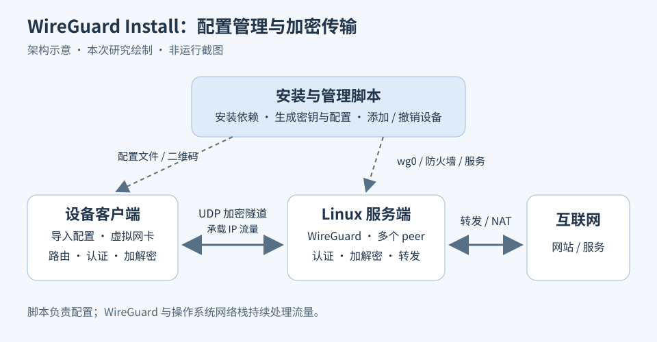
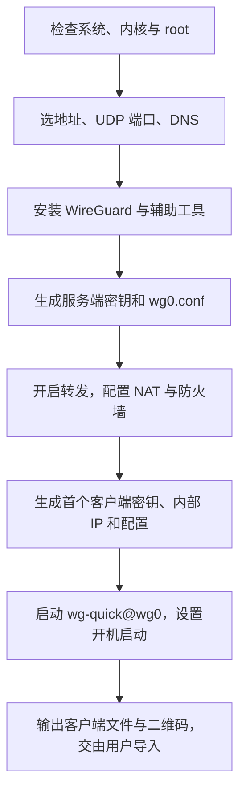
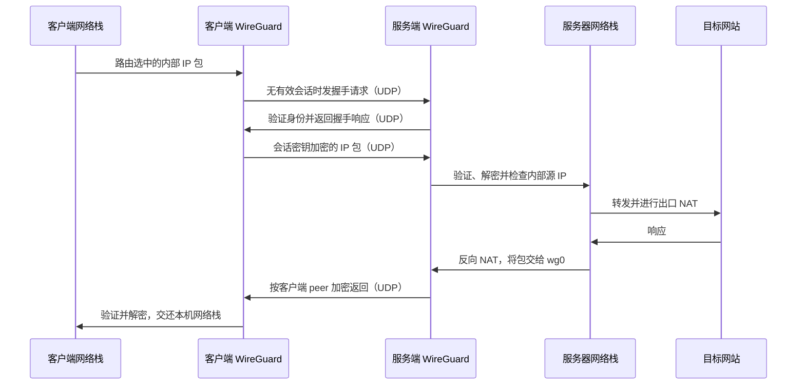
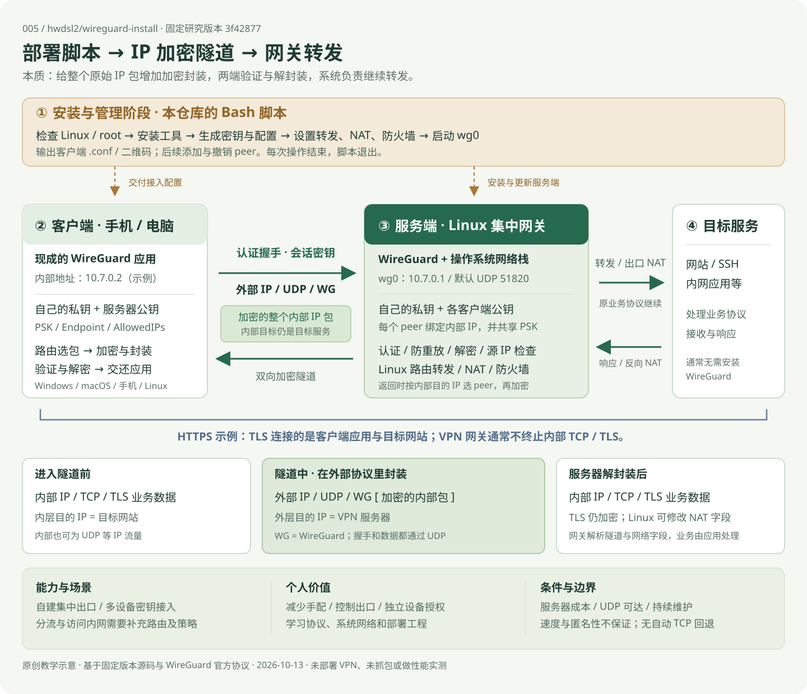

# 005 · WireGuard Install：自建 VPN、原理与应用研究

**这个库的能力是帮助你搭建自己的 VPN，并管理设备接入。** 它在 Linux 主机上安装 WireGuard、生成两端密钥与配置、设置转发和 NAT，再给手机和电脑上的现成 WireGuard 应用提供接入材料；本质是部署和设备配置管理脚本。

**WireGuard 本身是三层 IP 加密隧道：外层通过 UDP 传输，内部可以承载 TCP、UDP 等 IP 流量；双方凭密钥认证，握手后使用会话密钥加密数据。**

| 要回答的问题 | 我们的理解 |
| --- | --- |
| 能力是什么 | 在自己的服务器上自动搭建 WireGuard VPN，生成配置，添加和撤销设备 |
| 底层原理是什么 | 认证加密整个内部 IP 包，封装到外层 UDP；另一端解封装，再由 Linux 路由与 NAT 转发 |
| 如何部署 | 准备受支持的 Linux、root 和可达 UDP，运行安装器，导入设备配置，验证握手与真实业务 |
| 个人价值是什么 | 减少手配，掌握出口与设备授权，学习隧道和系统网络；相应承担主机费用、更新、凭据管理与排错 |
| 使用场景是什么 | 个人集中出口、多设备密钥接入、实验室；内网访问和网段分流需要额外配置 |
| 可扩展什么 | 分流、访问策略、配置分发、管理面板 / API、观测和多网关；均为需要后续实现与验证的方向 |

[返回总索引](../../README.md#项目索引) · [原 GitHub 仓库](https://github.com/hwdsl2/wireguard-install) · [在线理解网页](https://yydshly.github.io/1013_codex_project/005-wireguard-install/) · [本地网页源码](./web/index.html) · [实验计划](./experiments/) · [网页运行说明](./web/README.md) · [发布验证](./experiments/results/publication-2026-10-14.md)

## 1. 研究范围与来源

| 信息 | 内容 |
| --- | --- |
| 研究编号 | `005` |
| 原仓库 | [hwdsl2/wireguard-install][repo] |
| 固定研究版本 | `3f428774e61c95bca60d1e7b80f0c768ca2c6137` |
| 安装脚本许可证 | [MIT][license]，版权信息包含 Lin Song 和 Nyr |
| 研究日期 | 2026-10-13，Asia/Shanghai |
| 本地研究环境 | Windows / PowerShell，Python 3.10.11；读取源码、整理文档和检查索引 |
| 状态 | 研究中：完成静态分析，未进行 Linux 部署、客户端连接或性能实测 |
| 演示与截图 | 2026-10-14 已发布中文网页并验证资源与交互。下图为原创架构示意，网页实拍见后文 |

本次阅读固定版本的 README、核心安装脚本、客户端配置说明和许可证，并参照 WireGuard 官方协议、白皮书及工具手册。安装脚本的许可与 WireGuard 内核、各平台客户端的许可需分别理解。[项目说明][readme]、[WireGuard 官方来源][wg-overview]



图片来源：本次根据固定版本源码及官方协议绘制的架构示意。模板 `assets/cover.svg` 未作为实际截图使用。

## 2. 本质：三个层次共同组成可用 VPN

| 层次 | 负责什么 | 谁实现 |
| --- | --- | --- |
| 安装与管理 | 软件安装、生成配置、设备登记与撤销 | 本仓库的 `wireguard-install.sh` |
| 加密隧道 | 密钥认证、握手、加解密、peer 与隧道 IP 的绑定 | WireGuard 协议和各平台实现 |
| 系统网络 | 虚拟网卡、路由、DNS 设置、IP 转发、NAT 与防火墙 | 操作系统及其网络工具；部分由脚本和 `wg-quick` 配置 |

脚本完成安装或一次管理操作后退出。Linux 上持续处理流量的是 WireGuard 和系统网络栈；`wg-quick` 负责根据配置建立接口，systemd 负责启动管理。这个仓库的客户端材料是配置文件、二维码和操作说明，设备应用来自 WireGuard 官方发行渠道。[脚本入口][entry]、[服务启动][service]、[wg-quick 手册][wg-quick]、[客户端说明][clients]

WireGuard 协议中的双方都是 peer，具有对称的密钥和收发能力。本项目采用常见的集中网关部署：一台地址可达的 Linux 主机作为服务端，手机和电脑作为客户端主动连接它。部署角色决定服务器承担出口转发职责。[官方概念说明][wg-overview]

## 3. 仓库包含的能力

| 能力 | 实现方式与默认行为 | 范围 |
| --- | --- | --- |
| 自动或交互安装 | 默认配置自动安装，或询问服务器地址、端口、DNS、首个客户端名称 | Linux 主机上的部署流程 |
| 生成接入配置 | 生成密钥、客户端内部 IP、`.conf` 和包含同一配置的二维码 | 接入材料由服务端生成 |
| 客户端管理 | 添加、列出、移除客户端，重新显示二维码 | 管理已登记的配置身份 |
| 多设备接入 | 服务端为多个客户端分别维护 peer 配置 | 默认地址池可配置 253 个客户端，非并发性能指标 |
| IPv4 / IPv6 | 默认 IPv4 隧道，检测服务器公网 IPv6 条件后补充 IPv6 配置 | 双栈运行效果待实测 |
| DNS 配置 | 选择公共 DNS、系统 DNS 或自定义 DNS，并写入客户端配置 | 配置解析器地址，未部署独立 DNS 服务 |
| 网络与服务配置 | IP 转发、NAT、firewalld 或 iptables 规则、开机启动 | 服务器内部设置 |
| 网络参数调整 | 下载 sysctl 参数，满足条件时启用 TCP BBR 设置 | 参数修改不等于已验证的加速效果 |
| 卸载 | 删除相关配置、规则和软件 | 服务端维护操作 |

上述能力来自固定版本的脚本和使用说明。[功能说明][readme]、[配置与地址池][new-client]、[DNS 选择][dns]、[系统参数][sysctl]

服务端系统覆盖 Ubuntu、Debian、AlmaLinux、Rocky Linux、CentOS、RHEL、Fedora、openSUSE 等识别分支；README 还列出 Raspberry Pi OS。此版本要求 Ubuntu 至少 20.04、Debian 至少 12，相关 RHEL / CentOS 分支至少为 8。需要 root 和适用的内核、工具环境；脚本拒绝容器。它提供的服务器地址参数接受 IPv4 或域名；客户端双栈支持不能推导出安装器接受纯 IPv6 地址。[环境检查][checks]、[地址校验][args]

## 4. 服务端与客户端分别做什么

| 方面 | 服务端 | 客户端 |
| --- | --- | --- |
| 身份 | 持有自身私钥，登记每个客户端的公钥 | 持有自身私钥，预先信任服务器公钥 |
| 网络地址 | 默认 `10.7.0.1`，监听所选 UDP 端口 | 分配一个内部地址，知道服务器外部地址和端口 |
| 隧道接口 | Linux 上的 `wg0` | 平台 WireGuard 应用或工具建立的虚拟接口 |
| 发送数据 | 按目标内部 IP 选择客户端 peer，再加密发送 | 按系统路由把需经 VPN 的流量送入接口，再发给服务器 |
| 接收数据 | 验证、解密，并检查内部源 IP 是否属于该客户端 | 验证、解密，将内部包交还本机网络栈 |
| 出口 | Linux 开启转发，通过 NAT 访问外部网络 | 默认把互联网流量导向服务器 |
| 配置变更 | 管理员运行安装脚本更新 peer 和配置文件 | 用户导入或修改本地配置，启动或停止隧道 |
| 状态观察 | WireGuard 工具可查看握手、endpoint 和收发量 | 应用或工具可展示自身隧道状态，界面随平台而异 |

客户端应用支持 Windows、macOS、iOS、Android，Linux 也可以通过官方工具使用兼容配置。手机可以扫码，桌面应用可以导入文件。身份、路由和加密语义来自 WireGuard；各平台 DNS、启动和界面行为需独立验证。[客户端导入][clients]、[官方安装渠道][wg-install]、[接口配置手册][wg-man]

`--listclients` 读取服务端配置中的客户端名称，列出的是已配置身份；它不等于在线设备列表。在线诊断要结合最近握手、收发计数等信息。身份对应密钥，脚本所称“用户”并没有用户名密码登录系统。[名称列表实现][management]、[状态查看][wg-man]

## 5. 部署设计：先建立配置关系，再启动网络

部署需要操作者提供 Linux 主机和可达的 UDP 网络。服务器位于 NAT 后时还需要合适的上游端口转发；云安全组也要单独放行。脚本查询或填写公网 IP 只是确定连接地址，不会由此自动创建上游映射。[安装条件][readme]、[公网地址检测][endpoint]

部署流程为：



安装过程中写入的主要内容包括服务端配置 `/etc/wireguard/wg0.conf`、转发与网络参数的 sysctl 文件，以及防火墙规则。使用 iptables 分支时还生成 `wg-iptables.service` 管理持久规则；已有 firewalld 时采用相应规则接口。[服务端配置][server-config]、[防火墙][firewall]、[系统参数][sysctl]

### 5.1 两端配置如何对应

以下只解释字段关系，不包含可用密钥：

| 配置字段 | 服务端 | 客户端 | 作用 |
| --- | --- | --- | --- |
| `PrivateKey` | 服务端私钥 | 该客户端私钥 | 本端身份秘密，用于握手 |
| peer 的 `PublicKey` | 客户端公钥 | 服务端公钥 | 指定信任的对端 |
| `PresharedKey` | 与该客户端共享的额外密钥 | 同一份共享密钥 | 混入握手派生过程 |
| `Address` | 网关内部地址 | 客户端内部地址 | 赋给虚拟网卡 |
| `ListenPort` | 默认 UDP 51820 | 由平台实现处理本端端口 | 公网连接所需的服务器监听端口 |
| `Endpoint` | 从客户端认证包学习它的当前地址 | 服务器地址与端口 | 对端外部网络位置 |
| `AllowedIPs` | 对该 peer 默认绑定一个 `/32` IPv4，双栈时补充 `/128` IPv6 | 默认 `0.0.0.0/0, ::/0` | 隧道内 peer 与 IP 的对应关系 |
| `DNS` | 在生成客户端文件时写入选定值 | 平台客户端配置解析器 | 由客户端和系统应用 DNS 设置 |
| `PersistentKeepalive` | 默认未指定 | 脚本设置 25 秒 | 发认证空包，维持 NAT / 防火墙映射 |

密钥关系由脚本在服务端集中生成。客户端私钥随导出配置、二维码交付设备，服务端也保存了导出的客户端配置。因此二维码携带的是接入凭据。公钥互信由配置导入预先建立，运行时握手验证对方对对应私钥的持有。[配置生成][new-client]、[二维码输出][service]、[字段语义][wg-man]、[保活说明][wg-quickstart]

### 5.2 添加和撤销如何生效

添加时脚本写入新 peer，再通过 `wg addconf` 加到正在运行的 `wg0`。撤销时通过 `wg set ... peer ... remove` 移除运行状态中的 peer，再删除配置文件中相应段落和导出文件。这样同时处理即时授权和重启后的配置；源码采用局部更新来避免重启整个接口，实际连接影响尚未实测。[运行时添加][management]、[撤销实现][revoke]

## 6. 运行交互：握手、传输与返回

以客户端 A 的内部地址 `10.7.0.2` 为例：



已有有效会话时，业务包使用现有会话密钥，不为每个业务包重新握手。双方由协议定时器按需重试握手、更新会话密钥；服务器从认证成功的外部包学习客户端最新 endpoint，支持对端网络位置变化。[协议状态与握手][wg-protocol]、[地址漫游][wg-overview]

### 6.1 AllowedIPs 的两个方向

- **发送时：**系统路由先把包交到 WireGuard 接口；WireGuard 根据目标内部 IP 选择对应 peer。
- **接收时：**确认包属于某个已认证 peer 后，检查解密得到的内部源 IP 是否在该 peer 的 AllowedIPs 内。

所以服务端绑定 A 的公钥到 `10.7.0.2/32`，可以限制 A 以该内部 IP 作为来源。客户端的默认通配配置则让经系统路由选中的所有 IPv4 / IPv6 目的地址使用服务器 peer。IP 绑定本身不提供按网站、应用、部门或用户角色划分的权限；这些需求由路由和防火墙等上层配置实现。[Cryptokey Routing][wg-overview]、[路由创建][wg-quick]

## 7. 外层是 UDP，内层可以是 TCP 或 UDP

WireGuard 的握手与数据包都通过 UDP 发送。本仓库没有切换为 TCP 传输或自动 TCP 回退的选项。[协议说明][wg-protocol]、[脚本选项][readme]

以使用 TCP 的 HTTPS 请求为例，包的关系是：

```text
外层 IP / UDP / WireGuard 数据消息
                    └── 加密的内部 IP / TCP / TLS 数据
```

内部 UDP 应用同样可以被封装进这个隧道。两层有各自的任务：内部 TCP 继续处理自身的可靠性和排序；WireGuard 处理 IP 包的认证、加密和隧道传输，不提供 TCP 式的可靠字节流。可以由此理解采用 UDP 与内部 TCP 传输并不冲突。[三层隧道与数据封装][wg-paper]

改监听端口只改变 UDP 的端口号。例如改为 443 后使用的是 UDP/443，不会因此变为 TCP 或 HTTPS。若链路无法传送所选 UDP 流量，该部署无法正常通信；保活也不能替代不可达服务器所需的上游网络配置。

### 7.1 对“隧道、包装、中转解析”的完整理解

可以把运行本质概括为：**原始 IP 包经过认证加密，封装到外部 IP / UDP / WireGuard 消息中；对端验证、防重放、解密和解封装，再由操作系统继续处理。** 被包装的是整个内部 IP 包，TCP、UDP、TLS 与业务内容已经在其中。

| 位置 | 包的形态 | 目标地址与处理 |
| --- | --- | --- |
| 进入隧道前 | 内部 IP / TCP / TLS 数据（HTTPS 示例） | 内部目标是网站 |
| 隧道中 | 外部 IP / UDP / WG / 加密的内部 IP 包 | 外层目标是 VPN 服务器；内部目标仍是网站 |
| VPN 服务器解封装后 | 内部 IP / TCP / TLS 数据 | TLS 仍加密；Linux 依据内部目标转发，并可执行 NAT |

“解析”应按层理解：WireGuard 处理隧道消息、身份、完整性、计数器和内部源 IP；Linux 处理路由、防火墙与 NAT 所需的网络字段；客户端应用和目标服务处理 TLS、HTTP、SSH、DNS 等业务协议。正常 HTTPS 流程中，网关解开 WG 层，不持有网站 TLS 会话密钥。

因此存在两种通信关系：客户端 WireGuard 与服务端 WireGuard 的加密隧道，以及客户端应用与目标服务的业务通信。该集中网关通常不终止内部 TCP / TLS 连接；内部 TCP 自己处理排序和重传。普通 DNS 等明文业务在服务器解封装后仍是明文。业务连接与可见范围是基于协议封装层次和默认出口拓扑的工程解释，本次未抓包。[三层隧道][wg-paper]、[消息与密钥格式][wg-protocol]、[peer 和路由][wg-overview]

WireGuard 是三层 IP 隧道，不会自动形成支持以太网广播发现的二层局域网。HTTP / SOCKS 代理以代理协议转接应用请求或连接，行为取决于具体实现；本安装器采用操作系统路由选中的 IP 流量进入隧道。集中网关转发也应与自动发现、打洞协调及中继平台分别理解。

## 8. 加密、认证与密钥设计

| 机制 | 使用的设计 | 作用 |
| --- | --- | --- |
| 双向身份认证与密钥协商 | 基于 Noise IK 的握手，Curve25519 ECDH | 验证配置中的对端身份，协商密钥材料 |
| 业务数据保护 | ChaCha20-Poly1305 认证加密 | 保护内部 IP 包内容，检测篡改 |
| 哈希与密钥派生 | BLAKE2s、HKDF | 握手处理及派生收发密钥 |
| 额外共享秘密 | 协议可选 PSK，本脚本为每个客户端生成 | 在握手中增加共享秘密 |
| 防重放与密钥更新 | 握手时间戳、数据计数器及协议定时器 | 抵御旧包重放，轮换会话密钥，提供前向保密 |

长久保存在配置中的身份密钥与实际加密业务数据的会话密钥具有不同用途；公钥不是拿来直接逐包加密任意业务内容。会话收发密钥由握手派生。[密码学和消息格式][wg-protocol]、[协议白皮书][wg-paper]、[PSK 生成][new-client]

加密覆盖客户端到 VPN 服务器的隧道。服务器解开的是 WireGuard 这一层：如果内部业务还使用 HTTPS/TLS，应用内容继续由 TLS 保护；普通明文协议不会因为有 VPN 就自动获得服务器到目标服务的端到端加密。公网外层 IP、UDP 端口和包大小等信息仍属于路由传输所需或可观察的信息。这些边界来自封装层次，未做抓包实测。

## 9. 设计价值与能力边界

本项目值得研究的是把软件安装、密钥配置、接口启动与系统网络连成一个可重复的工作流，并将设备授权落实到 peer 更新。适用于需要自己控制出口和少量到一定规模设备配置的场景；运行规模须另做容量测试。

从公开脚本、配置模板与客户端文档核对，当前能力边界如下：

| 需求 | 本项目覆盖情况 |
| --- | --- |
| 全流量经服务器上网 | 默认客户端配置提供 |
| 仅指定网段走 VPN | WireGuard 可以通过配置实现，需自行修改配置和路由 |
| 访问服务器能到达的内网 | 需检查内网路由、返回路径、转发和防火墙，不能仅由安装成功推断 |
| 多客户端之间隔离、按应用授权 | 脚本没有提供逐客户端访问策略管理；内部 IP 身份约束不等于访问隔离 |
| 账号登录、SSO、MFA、自助注册 | 未发现对应管理系统；接入身份为密钥 |
| Web 面板、HTTP 管理 API、自动配置分发 | 未发现；管理入口为本地脚本，配置由操作者交付 |
| 在线监控、流量额度、计费、自动密钥生命周期 | 脚本无完整管理能力，状态可以通过 WireGuard 工具观察 |
| 自动发现、打洞协调、中继、自动网状组网 | 未提供相应协调服务；有保活和协议端点漫游能力 |
| TCP 回退、传输混淆 | 未提供 |
| DNS 泄漏防护、断线阻断保证 | 不能仅凭全流量路由和 DNS 字段保证；需要各平台和网络条件实测 |

以上“未发现”为对固定版本公开实现的分析结论。WireGuard 可扩展的配置能力与本安装器直接暴露的功能分别列出。[脚本与管理入口][entry]、[客户端说明][clients]、[wg-quick 路由与阻断示例][wg-quick]

### 9.1 使用场景与额外条件

以下为基于公开实现及网络结构推导的用途，未实际部署验证。

| 使用场景 | 本安装器的覆盖 | 额外条件 |
| --- | --- | --- |
| 多台个人设备通过自有服务器上网 | 默认集中出口与全流量配置 | UDP 可达、出口带宽与费用预算，验证 DNS / IPv6 行为 |
| 在不可信网络保护到自有网关的路径 | WireGuard 保护这段内部 IP 流量 | 流量确实进入 VPN，维护服务器信任，保持应用加密；检查断线阻断 |
| 访问家庭或办公室内网服务 | 可作为接入基础 | 网关能到达内网、路由及返回路径或合适 NAT、防火墙、网段冲突处理 |
| 只让指定网段走 VPN | 需要自行修改配置 | AllowedIPs、系统路由、返回路径与 DNS 策略；域名或应用分流需另做设计 |
| 小团队密钥接入与个人实验室 | 独立设备身份、添加和撤销 | 权限、隔离、分发和生命周期管理；站点互联或 mesh 需自行规划 |
| 网络与部署学习 | 源码、配置和协议适合对照研究 | 依次验证握手、业务、抓包、双设备、分流与异常网络 |

### 9.2 个人价值、成本与适用判断

个人收益包括选择自己的出口服务器、给设备独立授权和撤销、保护到网关的传输段，以及理解 Linux 虚拟接口、密码学路由、NAT、配置持久化和服务管理。内网远程访问的收益依赖额外的网络配置。

相应投入是服务器与流量费用、系统更新、凭据分发、故障排查及配置维护。默认单网关会成为集中依赖，性能受 CPU、带宽、线路和丢包影响；增加封装及绕行可能带来 MTU 与延迟问题。脚本修改网络参数不能作为速度保证。出口 IP 变化也不会消除网站账号、Cookie 或设备指纹等识别因素。

有可达的 Linux 主机、UDP 可用、希望控制出口或接入少量到一定规模的设备，并愿意维护配置时，本安装器有实用价值。需要企业身份、自动穿透中继、复杂 ACL 或高可用时，应把它看作底层部署组件，再补充相应系统。本段为工程判断，无性能或匿名性实测结论。

### 9.3 可扩展方向与验收基础

以下是我们的后续设计方向，不属于安装器已实现的完整功能。

| 方向 | 增加的工程 | 验收重点 |
| --- | --- | --- |
| 分流、内网与站点路由 | 目标网段、AllowedIPs、DNS、返回路径与网段冲突处理 | 目标业务可用，其余流量路径正确，重启后恢复 |
| 逐设备访问限制 | 基于内部 IP 的防火墙、资源范围与隔离 | 允许与禁止的访问均按预期；IP 绑定不等于完整 ACL |
| 配置分发与密钥生命周期 | 设备登记、受控交付、版本、替换与遗失撤销 | 独立授权和撤销，避免共用身份与配置漂移 |
| 管理面板与 API | 鉴权、授权、有限管理操作、校验与审计 | 操作可追溯，接口权限明确，不开放任意命令执行 |
| 观测、告警与容量 | 握手、流量、资源计数与业务探测 | 区分配置存在、最近通信与实际业务可用，用实测制定容量 |
| 自动化与多网关冗余 | 模板、重复部署、备份恢复、备用节点和切换策略 | 故障后业务恢复；添加第二台服务器不自动形成高可用 |

建议先验证单服务器和单客户端，再按实际需求增加分流与访问限制；有设备管理规模后，再投入分发、面板、观测与冗余。每个方向单独制定验收结果和失败恢复方式。

## 10. 验证结果与后续实践

| 事项 | 已执行的核对 | 未验证部分 |
| --- | --- | --- |
| 来源与许可 | 阅读固定 commit 的说明、脚本和 MIT 许可证 | WireGuard 各平台具体发行版许可证未逐一审计 |
| 功能与部署流程 | 静态检查环境、密钥、地址池、转发、NAT、服务和管理函数 | 各发行版安装成功率及与现有网络设置的兼容性 |
| 客户端交互 | 核对导入材料、配置字段和官方协议 | Windows、手机、Linux 的实际连接、DNS 和路由行为 |
| UDP 与加密 | 核对官方协议和白皮书，解释包封装及密码学机制 | 未抓包、未测试丢包恢复或网络切换 |
| 性能 | 识别源码对 sysctl / BBR 的修改 | 未测吞吐、延迟、资源消耗和并发容量 |
| 研究仓库 | 更新元信息与索引，运行索引检查和现有单元测试，解析架构 SVG | 验证记录以本次检查输出为准；这些检查不验证 VPN 运行 |

完整运行验收方案见 [实验计划](./experiments/README.md)。目前未安装 VPN、未修改本机网络、未生成真实密钥或二维码。中文网页已部署并验证公开资源与交互；VPN 研究状态保持 `researching`。部署网页不等于部署 VPN 服务。

### 中文网页导读

通过 [网页入口](./web/index.html) 汇总本次理解。网页包含 12 个章节：项目本质与六项摘要、总览原理图、能力归属、两端与配置关系、部署、通信演示、隧道中转的本质、协议和可见范围、使用场景、个人价值与边界、可扩展方向、研究依据。保留六步通信和 TCP / UDP 示例切换。资源均为相对路径，适配仓库独立发布子路径。运行和网页验证记录见 [网页说明](./web/README.md)。



来源：2026-10-13 本次根据固定版本源码与 WireGuard 官方文档原创绘制的矢量原理图，不是 VPN 运行截图。可 [打开完整 SVG](./web/assets/understanding-map.svg) 查看；窄屏网页支持图内横向滚动。

仓库索引的引导图使用同一份完整 SVG 的 `assets/understanding-map.svg` 副本。首页在摘要表外展示，详情页使用 `web/assets/understanding-map.svg`；两份内容保持一致，不以网页截图替代完整图。

2026-10-14 发布至 [GitHub Pages](https://yydshly.github.io/1013_codex_project/005-wireguard-install/)。[首次内容部署](https://github.com/yydshly/1013_codex_project/actions/runs/38433870276)成功，页面、CSS、JavaScript、两处总览 SVG、首页与既有项目入口均 HTTP 200，内容与发布提交一致。公网通信步骤、协议切换、首页九项完整摘要与详情入口已验证；记录见 [发布验证](./experiments/results/publication-2026-10-14.md)。


来源：2026-10-14 访问正式公开项目网址的浏览器截图，非 VPN 运行画面。


截图来源：2026-10-13 本次本地浏览器预览，展示本仓库制作的说明页；不是原项目客户端、VPN 连接或性能的实测画面。

本仓库新增内容为研究文档、原创架构示意、静态网页和验收计划，没有引入上游可执行源码或改动 WireGuard 协议。

## 来源与致谢

安装器来自 Lin Song（hwdsl2）与上游贡献者，基于 Nyr 的相关工作。协议说明参考 WireGuard 作者与官方工具文档。源码链接固定在本次研究 commit，官方协议和工具链接为阅读时的官方文档。

[repo]: https://github.com/hwdsl2/wireguard-install
[readme]: https://github.com/hwdsl2/wireguard-install/blob/3f428774e61c95bca60d1e7b80f0c768ca2c6137/README-zh.md
[license]: https://github.com/hwdsl2/wireguard-install/blob/3f428774e61c95bca60d1e7b80f0c768ca2c6137/LICENSE.txt
[clients]: https://github.com/hwdsl2/wireguard-install/blob/3f428774e61c95bca60d1e7b80f0c768ca2c6137/docs/clients-zh.md
[checks]: https://github.com/hwdsl2/wireguard-install/blob/3f428774e61c95bca60d1e7b80f0c768ca2c6137/wireguard-install.sh#L34-L144
[args]: https://github.com/hwdsl2/wireguard-install/blob/3f428774e61c95bca60d1e7b80f0c768ca2c6137/wireguard-install.sh#L224-L302
[endpoint]: https://github.com/hwdsl2/wireguard-install/blob/3f428774e61c95bca60d1e7b80f0c768ca2c6137/wireguard-install.sh#L470-L565
[server-config]: https://github.com/hwdsl2/wireguard-install/blob/3f428774e61c95bca60d1e7b80f0c768ca2c6137/wireguard-install.sh#L815-L829
[firewall]: https://github.com/hwdsl2/wireguard-install/blob/3f428774e61c95bca60d1e7b80f0c768ca2c6137/wireguard-install.sh#L831-L886
[dns]: https://github.com/hwdsl2/wireguard-install/blob/3f428774e61c95bca60d1e7b80f0c768ca2c6137/wireguard-install.sh#L924-L980
[new-client]: https://github.com/hwdsl2/wireguard-install/blob/3f428774e61c95bca60d1e7b80f0c768ca2c6137/wireguard-install.sh#L982-L1054
[sysctl]: https://github.com/hwdsl2/wireguard-install/blob/3f428774e61c95bca60d1e7b80f0c768ca2c6137/wireguard-install.sh#L1056-L1085
[service]: https://github.com/hwdsl2/wireguard-install/blob/3f428774e61c95bca60d1e7b80f0c768ca2c6137/wireguard-install.sh#L1108-L1134
[management]: https://github.com/hwdsl2/wireguard-install/blob/3f428774e61c95bca60d1e7b80f0c768ca2c6137/wireguard-install.sh#L1136-L1179
[revoke]: https://github.com/hwdsl2/wireguard-install/blob/3f428774e61c95bca60d1e7b80f0c768ca2c6137/wireguard-install.sh#L1249-L1256
[entry]: https://github.com/hwdsl2/wireguard-install/blob/3f428774e61c95bca60d1e7b80f0c768ca2c6137/wireguard-install.sh#L1330-L1539
[wg-overview]: https://www.wireguard.com/
[wg-protocol]: https://www.wireguard.com/protocol/
[wg-paper]: https://www.wireguard.com/papers/wireguard.pdf
[wg-quickstart]: https://www.wireguard.com/quickstart/
[wg-install]: https://www.wireguard.com/install/
[wg-man]: https://git.zx2c4.com/wireguard-tools/about/src/man/wg.8
[wg-quick]: https://git.zx2c4.com/wireguard-tools/about/src/man/wg-quick.8
