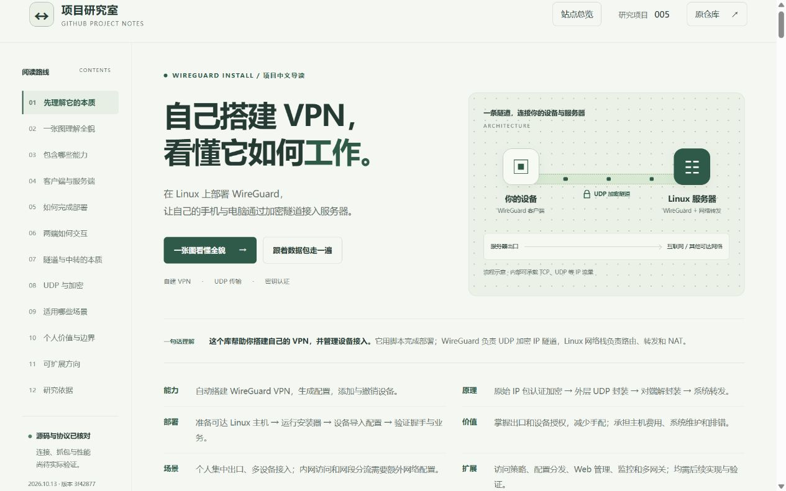

# 中文理解网页发布验证

日期：2026-10-14（Asia/Shanghai）。本记录验证静态研究网页的公开发布；VPN 服务与客户端连接尚未实测。

## 发布对象

- [在线理解网页](https://yydshly.github.io/1013_codex_project/005-wireguard-install/)
- [站点总览](https://yydshly.github.io/1013_codex_project/)
- [完整理解原理图](https://yydshly.github.io/1013_codex_project/005-wireguard-install/assets/understanding-map.svg)
- 首次内容提交：[393ea14b713595e994fe5a3ed46bcfab08d91e34](https://github.com/yydshly/1013_codex_project/commit/393ea14b713595e994fe5a3ed46bcfab08d91e34)。
- [GitHub Actions 构建与部署运行](https://github.com/yydshly/1013_codex_project/actions/runs/38433870276)：build 和 deploy 均成功。
- 上游研究版本：`hwdsl2/wireguard-install` 的 `3f428774e61c95bca60d1e7b80f0c768ca2c6137`，MIT 许可证。

页面明确说明库的能力是帮助个人在 Linux 服务器上搭建自己的 WireGuard VPN。12 个章节覆盖安装管理能力、客户端与服务端职责、部署方法、UDP 加密 IP 隧道、Linux 路由与 NAT、使用场景、个人价值、边界和六个扩展方向。开篇提供六项摘要，站点索引完整保留九项分项摘要。

首页引导图和详情页沿用本次研究生成的完整 SVG 理解总览图；图中区分安装配置阶段、双向隧道通信和业务访问过程，解释内部 TCP / UDP 与外部 UDP、HTTPS 的 TLS 范围及网关转发。图为源码与协议的教学解释，不是抓包或运行数据。

首次资源与交互验证成功后，才填写 `project.json` 的正式 `demo_url`，并补充本记录、截图和已验证状态摘要；这些发布记录与索引更新通过后续提交同步。

## 公开资源核对

实际请求以下 10 项资源，全部返回 HTTP 200。HTML、CSS、JavaScript、SVG 与首次发布提交的对应文件 SHA-256 一致；生成的首页与构建清单同本次完整站点构建快照一致。原始结果与逐项哈希见 [publication-2026-10-14.json](./publication-2026-10-14.json)。记录使用 UTC 时间，换算为北京时间属于 2026-10-14。

| 资源 | 结果 |
| --- | --- |
| 站点首页 | HTTP 200，内容哈希一致 |
| 005 理解网页 | HTTP 200，内容哈希一致 |
| 005 styles.css | HTTP 200，内容哈希一致 |
| 005 app.js | HTTP 200，内容哈希一致 |
| 005 详情页 understanding-map.svg | HTTP 200，内容哈希一致 |
| 首页 previews/005-wireguard-install.svg | HTTP 200，与完整原理图一致 |
| 001 Infinite Bookshelf 入口 | HTTP 200，内容哈希一致 |
| 002 Production Agentic RAG Course 入口 | HTTP 200，内容哈希一致 |
| 007 Hermes Jev Skills 入口 | HTTP 200，内容哈希一致 |
| site-build.json | HTTP 200，内容哈希一致，包含上述四个静态演示 |

正式构建从已跟踪文件收集完整站点。使用独立发布工作区验证项目 005 与根索引；未把其他尚未提交的研究项目或工具改动混入本次发布。

## 页面与交互验证

本地使用 Windows、Python 3.10.11 和 HTTP 静态预览，公网使用 Codex 内置浏览器验证。

- 在 1280px、390px 和 320px 视口检查布局，页面无横向溢出；窄屏原理图在自己的容器内滚动。
- 检查 12 个章节的唯一 ID、锚点与本地资源；SVG XML 有效，两处原理图内容相同。
- 公网页面的开篇六项摘要、详情页 SVG 加载和六个扩展方向展示正常。
- 公网点击第三步通信演示，显示客户端加密与服务端验证解密；切换普通 DNS / UDP 示例后，内部业务协议显示 UDP。
- 公网使用“站点总览”与“理解与演示”往返，首页项目行完整显示九项摘要，扩展导航跳转正确。
- 浏览器检查时没有 JavaScript 错误或警告。
- 索引一致性、JavaScript 语法与差异格式检查通过；现有单元测试运行 32 项，31 项通过，1 项因 Windows 当前用户不能创建符号链接跳过。首次 GitHub Actions 在 Ubuntu 上的构建与部署也均成功。

截图来源：2026-10-14 的正式项目网址，1280 × 800 视口；对应首次内容发布提交。截图是实际网页展示，图示不代表已运行的 VPN。

## 未验证事项

没有实际安装 WireGuard VPN、生成真实接入凭据、修改本机网络或连接客户端。真实握手、业务往返、抓包、DNS / IPv6、断线行为、容量与性能仍需按 [实验计划](../README.md) 复现。分流、访问策略、配置分发、Web 管理 / API、观测和多网关是后续设计方向，网页展示不表示安装器已实现这些能力。
