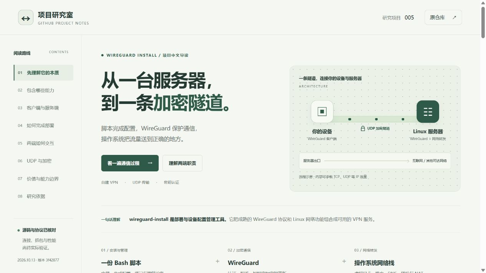
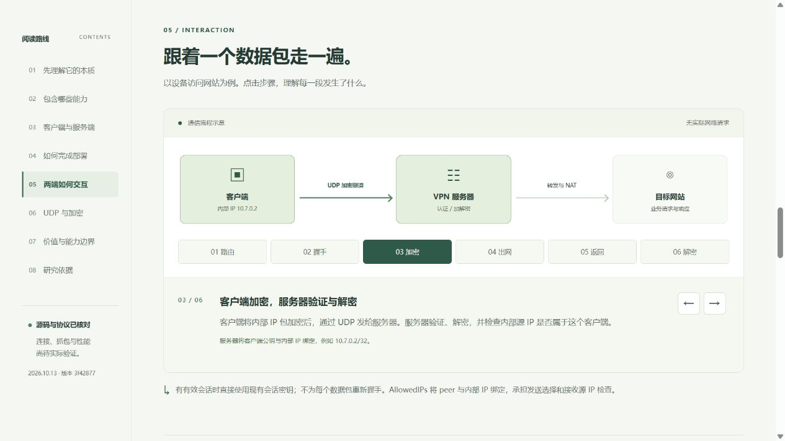
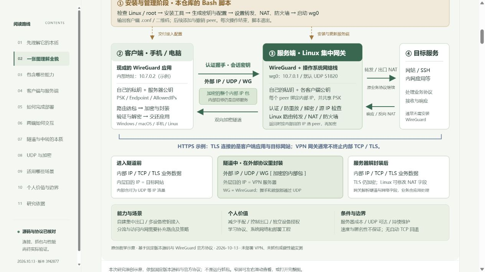

# Web 演示说明

本目录提供 WireGuard Install 的中文研究导读网页，已完成本地 HTTP 预览验证，尚未发布线上站点，`demo_url` 保持为空。

## 内容与交互

- 12 个阅读章节：本质与六项摘要、总览原理图、能力归属、两端职责与配置、部署、运行交互、隧道中转本质、协议与加密、使用场景、个人价值与边界、可扩展方向、研究依据。
- 原创矢量图 `assets/understanding-map.svg`：汇总安装管理阶段、客户端 / 服务端 / 目标服务、双向 UDP 隧道、三种包形态、HTTPS 的 TLS 范围，以及能力、场景、个人收益和维护条件。图中文字均为可缩放矢量，可打开完整图；窄屏支持图内横向滚动与键盘滚动。
- 补充“中转解析”的三个层次：WireGuard 隧道认证解密、Linux 路由与 NAT、应用协议处理；区分隧道通信与业务通信。
- 场景按覆盖范围注明默认可用或需要补充配置；个人价值与服务器费用、信任边界、维护投入对应说明。
- 六步通信演示：路由、握手、加密、出网、返回、解密；可直接选择步骤，或用前后按钮切换。
- TCP 网页与普通 UDP DNS 示例切换，比较内部业务包与外部 UDP 隧道。
- 可展开的能力边界说明、桌面阅读导航、移动端快速导航和固定版本来源链接。

演示不发送 VPN 流量，不生成密钥，不管理服务器。它解释此前的源码研究，实际连接、抓包与性能仍待验证。

## 文件、依赖与运行

网页由 `index.html`、`styles.css`、`app.js` 与 `assets/understanding-map.svg` 组成。使用原生 HTML / CSS / JavaScript，无框架、无外部字体或脚本、无第三方依赖、无后端、无环境变量，无需安装与构建。

本次预览使用 Python 3.10.11。在仓库根目录运行：

```powershell
python -m http.server 8769 --bind 127.0.0.1 --directory projects/005-wireguard-install/web
```

然后访问 `http://127.0.0.1:8769/`。结束预览可在该终端按 Ctrl+C。浏览器自动化验证使用 HTTP；未在内置浏览器中验证 `file:` 方式。

## 发布路径

正式发布遵循 [Web 部署约定](../../../docs/deployment.md)，访问前缀为 `/1013_codex_project/005-wireguard-install/`。

本页全部资源使用相对路径，章节使用 hash 锚点；`../` 返回站点总览。仓库 GitHub Actions 将上述文件与 `assets/` 中的原理图收集至临时 `site-dist/005-wireguard-install/`，无需框架构建；临时站点产物不入库。发布并验证实际地址后才更新 `demo_url`。

## 已执行验证

| 项目 | 结果 |
| --- | --- |
| 本地 HTTP 返回与资源 | 页面、样式、脚本返回成功 |
| JavaScript 语法 | Node.js 语法检查通过 |
| 六步通信演示 | 各步骤标题、唯一选中状态、前后按钮与端点显示正常 |
| 键盘操作 | 通过 Enter 操作下一步，状态正确更新 |
| 协议示例 | 普通 DNS / UDP 与网页 / TCP 可双向切换 |
| 折叠说明 | 原有 FAQ 和新增隧道 / 代理 / 二层 / 中继对照可展开 |
| 总览图 | SVG 成功加载；实际检查客户端、服务端、封装、TLS 边界和价值区可读 |
| 图表滚动 | 窄屏图与表格在容器内横向滚动；总览图可用方向键滚动 |
| 响应式布局 | 默认桌面视口、390px 和 320px 窄屏检查；无页面横向溢出 |
| 浏览器运行日志 | 检查时无 JavaScript 错误或警告 |
| 元信息与索引 | 更新索引并执行现有校验与单元测试 |

网页检查不等于 VPN 实测。页面数据与拓扑均为教学示意。

2026-10-13 本轮检查：本地 HTML、CSS、JavaScript 与 SVG 均返回 HTTP 200；HTML 的 11 个章节、唯一 ID、锚点和本地资源检查通过；SVG XML 与可访问标题 / 描述有效。索引检查、JavaScript 语法及差异格式检查通过。现有测试运行 32 项，31 项通过，1 项因 Windows 当前用户不能创建符号链接跳过。

本轮补充沿用固定研究 commit；引用项目源码、WireGuard 官方概念、协议和工具手册。使用场景、个人价值、NAT 后可见范围与代理对照属于工程解释，页面中标明与运行实测的区别。

## 截图







来源：本次本地网页预览的浏览器截图，2026-10-13；对应安装脚本研究版本 `3f428774e61c95bca60d1e7b80f0c768ca2c6137`。架构图和通信流程为本次研究整理。
