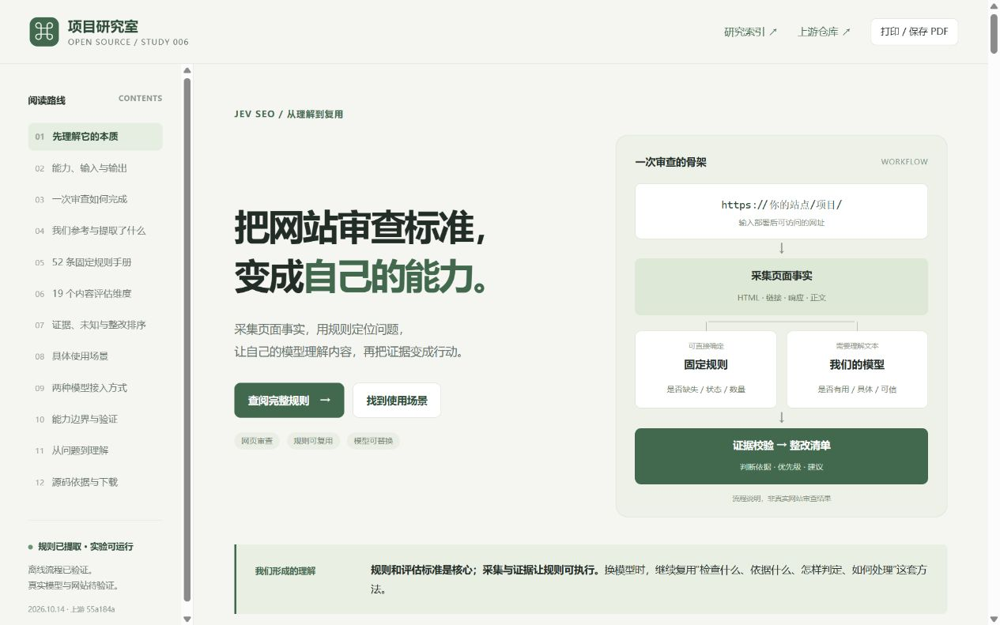
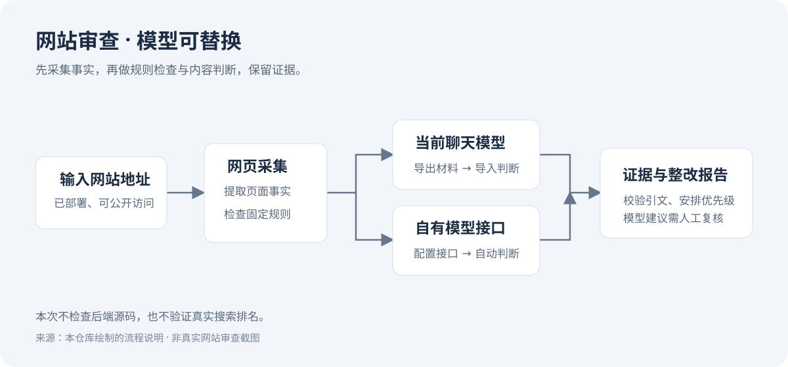
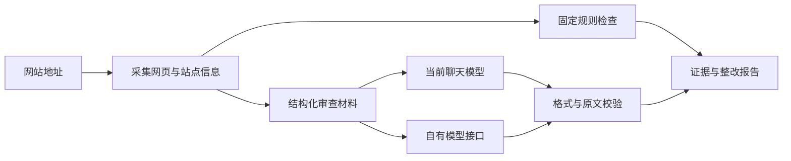

# 006 · Jev SEO：网页质量检查规则与自有模型审查框架

**核心参考价值是针对公开网页前端可见质量的检查规则与内容评估标准，适合作为网页质量检查的基础框架。还需要另外补充实际交互、手机布局、无障碍、业务功能和后端检查。**

它侧重 SEO、页面结构、抓取设置、链接与内容质量。已经提取出一个可运行的实验：输入部署后的网址，采集网页，检查 52 条固定规则，再让当前聊天模型或自有模型按 19 个评估维度理解内容，输出带证据、优先级和工作量的整改清单。

最值得复用的不只是规则名称，而是“检查什么、需要哪些材料、如何触发或评分、怎样解释和处理”的方法。价值在于形成可复用、可定制、可核对的检查清单，将审查标准与模型供应商分开。对我们而言，可用于自己网页的发布复核、内容改进和模型比较，再逐步形成更完整的质量检查流程；真实效果、复核时间和成本仍需验证。

[返回项目索引](../../README.md) · [上游仓库](https://github.com/AgriciDaniel/jev-seo) · [在线导读与规则手册](https://yydshly.github.io/1013_codex_project/006-jev-seo/) · [网页源码](web/index.html) · [使用说明](experiments/README.md) · [来源与改动](experiments/SOURCE.md)

## 完整理解网页

[中文导读与规则手册](web/index.html) 用 12 个章节汇总这次讨论：本质与能力、输入输出、审查原理、参考来源与提取改动、52 条规则、19 个内容评估维度、证据与排序、8 类使用场景、两种模型接入、验证边界、常见疑问和标准下载。

规则可搜索、按领域和性质筛选、展开条件与说明。每条规则解释“检查什么、怎样触发、如何处理、什么时候需要结合上下文”，并链接固定版本源码；模型维度保留选项、评分档位和未知状态。场景明确输入、检查重点、输出、建议路线与限制。提供 [规则与标准 JSON](web/catalog.json)、[审查提示词](web/review-prompt.txt)，以及浏览器打印入口。

网页是研究导读与交互示意，不现场执行扫描或模型调用。实际审查用 `experiments/`。2026-10-14 已发布到 GitHub Pages，首页、下载文件与图片均 HTTP 200，资源与提交一致；公网规则检索及回跳已验证，手机布局已本地检查。运行方式见 [网页说明](web/README.md)，证据见 [展示验证记录](experiments/results/web-verification.md) 与 [公网发布记录](experiments/results/publication-2026-10-14.md)。

### 一张图汇总理解


图片来源：本仓库依据固定版本源码和已有实验整理内容，2026-10-14 使用内置 imagegen 生成。原图 PNG，941 × 1672；不是上游界面或真实审查报告。[下载原图](assets/04-jev-seo-understanding.png) · [生成提示词](experiments/results/understanding-image-prompt.txt)。网页首页可展开总览，下载区提供原图入口。

定制部分说明扩展方法：固定规则需要定义元信息并编写实际判断；语义规则需要明确问题、档位和证据要求，并补充报告映射。只新增规则名称不会自动执行，网页 JSON 也不是扫描配置；图中的定制例子不表示已经新增规则功能。

### 网页实际展示



截图来源：本仓库制作的网页，2026-10-14 本地浏览器实际截取；视口 1280 × 800，截图 1265 × 791；不是上游界面或 SEO 实测报告。另有 [规则详情截图](assets/02-rule-handbook.jpg) 和 [手机首页截图](assets/03-mobile-overview.jpg)。原 [流程示意图](assets/cover.svg) 保留供对照。

## 提取的到底是什么

关键是一套审查流程，而不是一个训练好的专用模型。原仓库将能直接计算的检查交给代码，将需要理解文本的问题交给 Jev 模型服务。我们保留采集、规则和评估标准，把模型调用换成可配置接口，同时支持把材料交给当前聊天模型。



图片来源：本仓库绘制的流程示意，说明本次实现，不是网站审查截图。

| 阶段 | 具体做什么 | 本次实现 |
| --- | --- | --- |
| 网页采集 | 读取 robots.txt、站点地图，再沿站内链接找页面 | 保留上游采集器，新增项目路径范围 |
| 信息提取 | 提取标题、描述、正文、链接、图片与结构化数据 | 保留上游解析器，修正连续中文正文被过滤的问题 |
| 固定规则 | 标题缺失、死链、noindex、canonical、图片 alt、响应头等 | 保留 52 条规则定义；按条件触发，不是每页都会触发 52 项 |
| 内容判断 | 内容是否有用、具体、可信，标题是否匹配，下一步是否明确等 | 使用上游问题与评分标准；模型提供判断、理由与原文引文 |
| 整改排序 | 结合严重程度、涉及页面、重要性与工作量安排先后 | 输出 P1/P2/P3、相对影响分、建议与证据 |

“我们的模型”替代的是**内容理解与判断这一层**。模型不能凭空访问网页；采集器先把材料提供给它。固定规则继续由代码检查，避免让模型猜标题是否缺失或链接是否返回 404。

## 怎样作为自己的网页质量标准

先明确页面用途和预期：作品集要让人理解项目，产品页要说明对象与功能，文章要回答读者问题。再把检查分成代码可确定的条件、模型按标准判断的内容，以及需要人工结合上下文决定的提示。标题长度、字数等经验阈值不等于质量合格线；测试站的 noindex、装饰图片的空 alt 可能符合用途。

固定规则定制需要扩展元信息和实际触发代码；语义标准需要增加问题、选项或档位、材料字段及报告映射。只添加规则名称不会执行检查，网页 JSON 只是手册。用包含正常、异常和证据不足情况的样例验证，再在真实网站复核误报、漏报和覆盖。

| 需要补充的检查 | 应另外验证什么 |
| --- | --- |
| 实际交互 | 导航、按钮、表单、错误状态与完整用户流程 |
| 手机布局 | 不同屏幕的排版、溢出、可点击区域和触控；viewport 检查不能替代实际查看 |
| 无障碍 | 键盘操作、焦点、可访问名称、对比度与辅助技术表现 |
| 业务功能 | 注册、提交、支付等业务流程，以及数据是否正确保存和返回 |
| 后端 | 源码、鉴权与权限、接口、数据库、日志和业务逻辑 |

这些补充项不应因规则未触发而被判定通过。当前实验提供基础检查与建议，不自动修改网站，不证明后端正确，也不保证搜索排名、流量或 AI 引用。

## 两种使用方式

**当前聊天模型：**生成审查材料包，让聊天模型读取材料，保存判断结果，再导入生成报告。无需另配模型接口；这条路径由当前会话完成，不是程序后台自动调用聊天模型。

**自有模型接口：**在本地配置地址、模型名称和密钥，程序逐项发送任务并保存结果。支持 OpenAI 兼容的 Chat Completions；可选择 JSON Schema、JSON 对象或文本模式，三种模式都会进行本地格式与引文校验。

```powershell
cd projects/006-jev-seo/experiments
python -m pip install -r requirements.txt

# 不访问网络的示例
python audit.py demo --with-example-judgments

# 地址需要换成你自己的公开网站地址
python audit.py collect https://your-name.github.io/your-project/ --out runs/my-site
```

后续聊天审查和接口审查步骤见 [实验使用说明](experiments/README.md)。采集结束即有规则报告，模型任务会明确显示“未评估”。

## 它检查哪里

检查的是**部署后能够访问的网站地址**。GitHub 仓库页面是源码托管入口；GitHub Pages 地址才是网站。网站部署在 GitHub Pages、其他静态平台或自己的服务器，采集流程相同。

默认限定输入路径。例如 `https://name.github.io/project/` 的内容审查只包含 `/project` 及其子路径，避免混入同域名其他项目。检查整个域名时使用 `--scope site`。根目录 robots/sitemap、域名探测和链接目标状态检查仍可能访问其他路径；这是页面内容范围，不是严格的网络请求路径限制。

通常直接访问网站，不需要先在 Google 搜索它。收录情况、真实排名与搜索流量需要额外数据，不能从这次报告推断。

## 实现原理



模型任务覆盖网站入口、单页和主题可能重叠的页面对。单页最多 13 个问题，网站层面 5 个问题；问题根据标题等信息是否存在调整。每页正文最多提供 6,000 字符，结果不能代表未提供的内容。

模型返回选项、0 到最后一档的评分或布尔值，附理由和原文引文。证据不足允许 `null`。引文必须原样存在于对应采集字段，否则拒绝结果。引文存在只证明来源可核对，不证明推理正确，因此模型结论始终标记“待人工复核”。

原 Jev 的类型化判断和概率阈值不能等价为普通模型自报的“置信度”。本次不制造概率，不声称复现原模型准确率。相对影响分仅用于排序，不是排名或流量预测。

## 研究版本与复现环境

| 项目 | 记录 |
| --- | --- |
| 上游 | AgriciDaniel/jev-seo，v0.1.1 |
| 固定 commit | `55a184a3b0d09565a4c84268f725a47784e62528`，提交日期 2026-09-22 |
| 许可 | MIT，Copyright © 2026 Agrici Daniel；已保留 [许可证](experiments/LICENSE.upstream) |
| 验证日期 | 2026-10-13 |
| 环境 | Windows，Python 3.10.11 |
| 已用依赖 | requests 2.33.1、beautifulsoup4 4.14.3、lxml 6.1.1 |
| 可选依赖 | 当前有 Playwright 1.59.0；采集器的真实网站动态渲染未验证 |
| 状态 | 研究中；实验已完成离线验证，静态导读已发布；真实网站审查与模型效果仍待验证 |

## 已验证与未验证

| 范围 | 结果与证据 |
| --- | --- |
| 解析、规则与报告 | 构造页面和模拟 HTTP 响应验证通过 |
| 路径隔离、站点地图筛选、范围外重定向内容 | 离线测试通过 |
| 连续中文保留 | 测试通过；原词数和标题词集没有中文分词，相关建议需核实 |
| 当前聊天模型 | 本次会话完成 3 个样例任务、28 项判断，导入校验通过；页面是虚构资料 |
| 接口模式 | 模拟成功、异常、截断、编造引文、请求上限与续跑测试通过；未调用真实模型接口 |
| 实验测试 | `python -m unittest discover -s tests -v`，27 项通过 |
| 导读网页展示 | 2026-10-14 本地浏览器验证搜索、筛选、详情、标准、场景和模型切换；桌面/手机无整页横向溢出 |
| 真实网站审查、PageSpeed、采集器动态渲染 | 本次未验证 |
| 后端源码、数据库、业务权限 | 不在网页审查范围内 |

运行结果放在被忽略的 `experiments/runs/`，不会将抓取资料、报告和构建产物入库。

## 边界与后续

提供采集、固定规则、内容审查、证据校验和本地 Markdown/HTML 报告。上游 DataForSEO 关键词/竞争数据、PDF/表格导出和 TypeSafe 专用客户端没有移植；可选 PageSpeed 入口检查保留为开关。没有 Search Console 接入，不检查真实收录或排名。

后端 500 响应、异常跳转等只能记录网站表现；寻找代码根因需要另外读取源码、接口或日志。扩展后端审查应新增这些输入，并使用另一套检查标准。

模型结论需要人工核实，尤其是删除或合并页面的建议；实验只生成建议。下一步是配置真实模型，选自己的小型网站，人工标注问题，比较误报、漏报和成本。

## 来源

固定版本：[采集器](https://github.com/AgriciDaniel/jev-seo/blob/55a184a3b0d09565a4c84268f725a47784e62528/jevseo/crawl.py)、[固定规则](https://github.com/AgriciDaniel/jev-seo/blob/55a184a3b0d09565a4c84268f725a47784e62528/jevseo/checks.py)、[模型问题与评估](https://github.com/AgriciDaniel/jev-seo/blob/55a184a3b0d09565a4c84268f725a47784e62528/jevseo/jev.py)。接口参考 [OpenAI Structured Outputs 官方说明](https://developers.openai.com/api/docs/guides/structured-outputs)。
