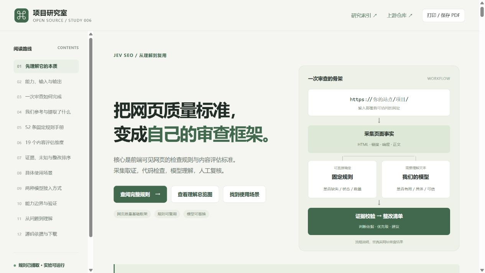

# Jev SEO 导读与规则手册公网发布

日期：2026-10-14。首次发布提交 [`8edf844d3830a0994805c5d57db461bdf8f8f492`](https://github.com/yydshly/1013_codex_project/commit/8edf844d3830a0994805c5d57db461bdf8f8f492)，[GitHub Pages 构建与部署运行](https://github.com/yydshly/1013_codex_project/actions/runs/38436528319)成功。实际访问和资源比对通过后，才填写项目 `demo_url`；在线入口和本记录随后提交并重新发布。

- [在线导读与规则手册](https://yydshly.github.io/1013_codex_project/006-jev-seo/)
- [站点总览](https://yydshly.github.io/1013_codex_project/)
- [实验源码与使用说明](https://github.com/yydshly/1013_codex_project/tree/main/projects/006-jev-seo/experiments)

## 已发布内容

摘要、研究文档和网页明确说明：核心是公开网页前端可见质量的检查规则与内容评估标准，适合作为**网页质量检查的基础框架**；仍需补充实际交互、手机布局、无障碍、业务功能和后端检查。能力、原理、参考与提取、规则定制、输入输出、两种模型接入、使用场景、价值、个人意义与验证边界均完整保留。

52 条固定规则、19 个模型维度与 8 类场景可查；引导图沿用我们生成的 `04-jev-seo-understanding.png`，首页索引使用同一图，详情页默认展开并提供原图入口。图的来源、生成日期与非实测属性明确标注。规则 JSON 是手册数据，定制执行仍需修改实验代码。

## 发布验证

| 验证范围 | 观察结果 |
| --- | --- |
| Pages 流程 | 构建、索引校验、工具测试、全部静态项目汇集、部署成功 |
| 项目资源 | HTML、CSS、app.js、catalog.js、catalog.json、提示词、MIT 许可证、总览 PNG 全部 HTTP 200 |
| 内容一致性 | 上述 8 个资源与首次发布提交的 Git blob 逐字节一致；首页预览 PNG 也与提交原图一致，共 9 个文件 |
| 首页摘要 | 基础框架定位、五项补充检查、完整摘要与项目入口均存在 |
| 保留已有项目 | 001、002、005、007 演示入口全部 HTTP 200；构建清单包含这四项及 006 |
| 公网浏览器 | 原图实际加载为 941 × 1672；初始 52 条规则，`noindex` 检索为 1 条，清除恢复 52 条；章节回跳成功 |
| 浏览器日志 | 检查时没有 error / warn |
| 发布版本本地布局 | 桌面 1280 × 720、手机 390 × 844 均无整页横向溢出；公网桌面亦无整页横向溢出 |
| 实验验证 | 27 项离线测试通过，覆盖构造采集数据、模型接口模拟、证据校验、导入和报告行为 |
| 仓库验证 | 32 项工具测试：31 项通过，Windows 符号链接测试 1 项跳过；索引、站点构建和 JavaScript 语法检查通过 |

总览图 SHA-256：`1d3f8cabb74e930cf9de0c04a8719d61fe4814a2a2ecf195e301665e7b9f56b5`。详情页与首页预览图均与该原图一致。

截图来源：本次在 Codex 内置浏览器实际访问公开网页后截取，JPEG 1265 × 712，视口 1280 × 720；原始字节未编辑。它展示本仓库制作的研究网页，不是上游运行截图或实际网站质量审查结果。

## 验证边界

发布的是静态导读和规则手册，GitHub Pages 不执行 Python 采集、不调用模型、不保存密钥。源码实验同时支持当前聊天模型的导出审查导入与自有兼容接口，真实调用和效果应另行验证。

公网访问验证说明页面已发布且资源正确，不能证明真实网站审查、模型准确率、动态渲染、PageSpeed、搜索排名或后端检查能力。之前的聊天结果是虚构页面的 3 个任务、28 项判断；完整交互及打印准备的既有范围见 [网页展示记录](web-verification.md)。未实际导出 PDF，未将资源 HTTP 可达等同于浏览器文件下载实测。
