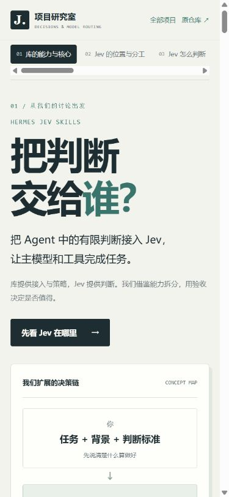
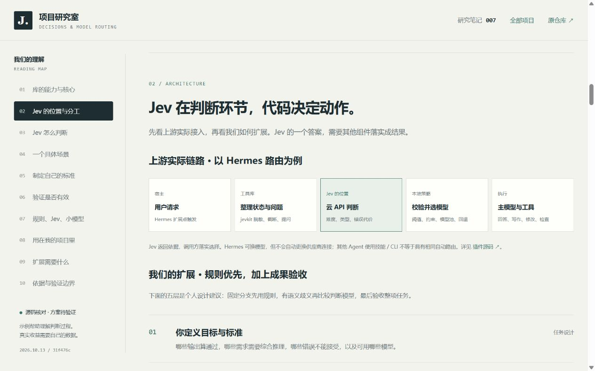

# Jev 与多模型路由 · 中文理解网页

十个章节：库的能力与核心、Jev 在上游架构中的位置、判断机制、具体场景、标准制定、价值验证、三种判断方式、个人项目、扩展基础与依据边界。开篇区分库、模型与我们的扩展；架构区分上游实现、个人设计、判断标准和路由策略。

## 交互与范围

- 四类新疆导览任务 × 本地规则 / Jev / 便宜小模型，展示预设分析。
- 六个条件可调整，示例策略显示尝试 A、暂用 B、补背景、保持默认模型。
- 默认阈值与替换说明可展开；支持下载 33 列 UTF-8 BOM 空白 CSV 验证表。
- 章节导航、手机横向目录、响应式和打印样式。
- 一张完整理解图，覆盖能力、机制、适用条件、标准制定与验证、扩展基础和个人实践；支持打开原图与下载。图片保存在 `web/assets/understanding-overview.png`，是本次讨论的 imagegen 生成图，非上游截图。

这是教学网页，无真实模型接口、后端、自动代码修改或评测结果。示例策略不是上游默认路由的精确复制。

## 运行与部署

`index.html`、`styles.css`、`app.js` 为原生网页，无依赖、外部字体和环境变量。本次以 Windows / Python 3.10.11 运行 HTTP 预览。在仓库根目录运行：

```powershell
python -m http.server 8771 --bind 127.0.0.1 --directory projects/007-hermes-jev-skills/web
```

访问 `http://127.0.0.1:8771/`；Ctrl+C 停止。内置浏览器只允许 HTTP / HTTPS，本次未验证直接打开文件的方式。预览结束后停止临时服务；重新访问时需再次启动。全部资源为相对路径，章节用 hash，统一部署前缀为 `/1013_codex_project/007-hermes-jev-skills/`。遵循 [部署约定](../../../docs/deployment.md)。当前交付本地网页，尚未部署公网，`demo_url` 为空。

本地构建预演：

```powershell
python scripts/build_site.py --project 007-hermes-jev-skills --output site-jev-preview
```

生成目录为临时产物，不入库。正式构建只包含已跟踪文件，需提交、发布并验证后再填在线地址。

## 本次验证（2026-10-13）

| 检查 | 结果 |
| --- | --- |
| HTTP 页面与资源、JavaScript 语法 | 返回成功、Node.js 语法检查通过 |
| 四任务 × 三方式 | 12 个组合正确更新内容与路由，每组唯一选中 |
| 标准调整 | 依赖、综合、风险、背景不足、未知、非表达、恢复默认显示预期分支 |
| CSV 下载 | 实际下载成功；33 列，含版本、标准、验收、完整费用与工时 |
| 折叠说明与键盘操作 | 可展开；按钮与条件可用键盘操作 |
| 响应式 | 默认桌面、390px / 320px，无页面横向溢出；窄屏交互可用，宽表格内部滚动 |
| 浏览器日志 | 检查时无 JavaScript 错误或警告 |
| 静态汇集子路径 | 构建成功；项目页、CSS、JS、索引预览图均返回 HTTP 200 |
| 元信息、索引与现有测试 | 索引校验通过；32 项测试完成，31 通过，1 因 Windows 符号链接不可用跳过 |

以上检查不证明真实模型路由的效果。2026-10-14 补充库的能力、实际架构、七步标准设置、六项扩展基础与十二项索引摘要。新版再次通过 12 个示例组合、7 个标准分支、33 列 CSV 实际下载与浏览器日志检查；1280px 桌面、390px / 320px 窄屏无页面横向溢出，10 个章节锚点有效，总览 PNG 正常加载。公网验证结果另记，不能用本地检查替代。

## 截图






来源：2026-10-14 新版本地浏览器截图。研究 commit `31f476cac49713b6bf88c00d42382542e1c36965`。真实判断效果、模型能力、总费用与返工收益待实测。
