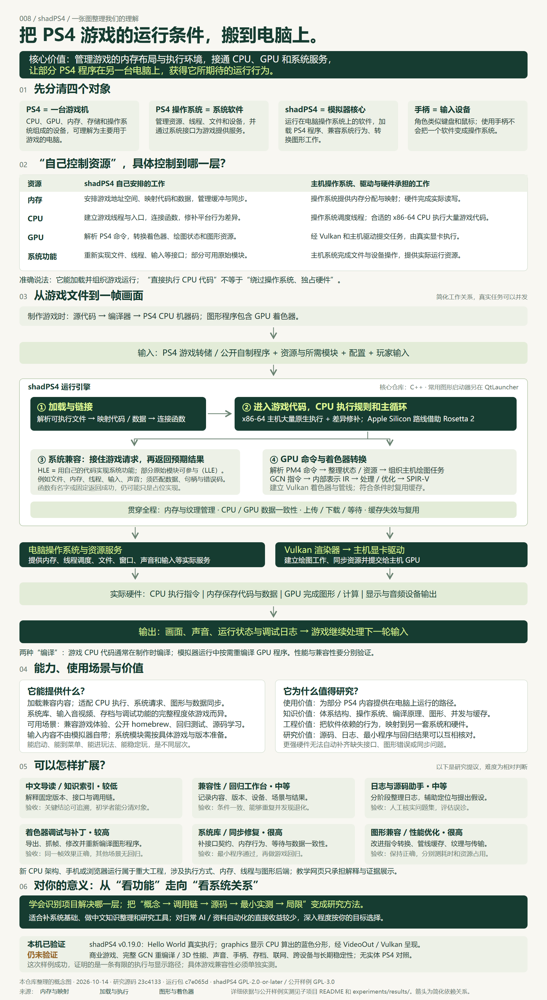
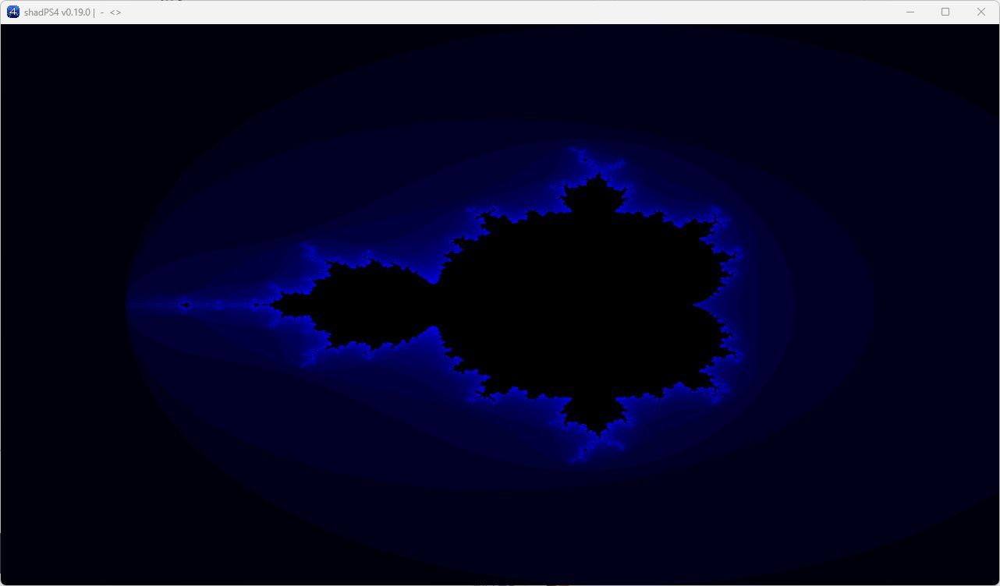

# 008 · shadPS4：PS4 模拟原理、系统知识与实践价值研究

> 执行共同的指令，补齐不同的运行环境。结合源码、中文导读和公开 PS4 自制程序的本机运行证据，理解 shadPS4 的能力、机制、价值与局限。

[返回总索引](../../README.md#项目索引) · [原仓库](https://github.com/shadps4-emu/shadPS4) · [网页源文件](./web/index.html) · [网页运行说明](./web/README.md) · [实际运行报告](./experiments/results/runtime-verification.md)

## 研究对象与版本

| 项目 | 内容 |
| --- | --- |
| 研究日期 | 2026-10-14 |
| 静态源码研究 commit | `23c41333822fe8eca4c609b43119180af63ae4ac` |
| 实际运行包 | 官方 shadPS4 v.0.19.0 / Windows SDL |
| 运行日志中的 commit | `c7e065d1b415be16c23e260a21f1dd8bbfc4cb57`，与研究 commit 分开记录 |
| 上游许可证 | 源码 SPDX 为 GPL-2.0-or-later，根 LICENSE 提供 GPL v2 文本 |
| 公开样例 | OpenOrbis v0.5.3 hello_world / graphics，commit `6929bafac0b565692ed61e66032a79185ee9cf65`，GPL-3.0 |
| 状态 | 研究中；公开自制程序完成最小本机复现，商业游戏与完整渲染尚未验证 |
| 网页 | 原生静态 HTML / CSS / JavaScript；公网尚未部署，demo_url 为空 |

## 总览图与真实运行画面



来源：本仓库根据固定源码与本机公开样例证据整理的概念图，非上游截图或精确执行时序。[可放大 SVG](./assets/comprehensive-map.svg) · [高清 PNG](./assets/comprehensive-map.png) · [图的来源](./assets/comprehensive-map.source.json) · [简化执行流程](./assets/understanding-map.svg)。



来源：2026-10-14 本机 Windows 目标窗口实拍，1282×752，未拼接或重绘。分形像素由 guest CPU 计算，再经 VideoOut 与 Vulkan 显示；不能当作商业游戏、3D 或 GCN 重编译证据。[截图来源记录](./assets/openorbis-graphics-live.source.json)。

## 从我们讨论中的疑问开始

PS4 是索尼 PlayStation 4 游戏机，是含有 CPU、GPU、内存、存储和操作系统的整台设备，可以理解为主要为游戏设计的电脑。PS4 的操作系统是其中管理资源与提供接口的软件。PS4 游戏是面向该平台制作的程序和资源；即使同一游戏也有电脑版，两种版本仍可能依赖不同运行环境。手柄是输入设备，角色类似键盘、鼠标，不决定操作系统。“SP4”是此前讨论中的误写。

shadPS4 是电脑上的模拟器。它加载 PS4 程序，提供游戏期待的系统行为并转换图形工作。仓库是模拟器核心；普通用户的图形启动器位于独立 QtLauncher 项目。

CPU、GPU、操作系统和编译器的通用分工，是理解基础；这个库的具体原理是：利用能执行的共同指令，接替系统服务，转换图形任务，并保证数据与执行顺序正确。

### “自己控制内存、CPU、GPU”的准确含义

shadPS4 是运行在电脑操作系统上的模拟器核心。它管理游戏的内存布局与执行环境，接通主机计算能力，加载并组织 PS4 程序运行。其核心价值是兼容游戏期待的行为：内存、CPU、系统调用和图形规则需要一起成立。普通应用也能使用硬件资源，模拟器的区别在于为另一平台的程序提供这套运行条件。

| 资源 | 模拟器自己组织的工作 | 实际资源由谁提供 |
| --- | --- | --- |
| 内存 | 游戏地址空间、代码/数据映射、缓冲与同步 | 主机操作系统提供分配与映射，硬件进行读写 |
| CPU | 建立线程与入口、连接函数、修补平台差异 | 主机操作系统调度，合适的 x86-64 CPU 执行大量游戏指令 |
| GPU | PS4 命令、着色器、状态与资源转换 | 经 Vulkan 和主机驱动提交，由真实 GPU 执行 |
| 系统服务 | 按 PS4 接口处理文件、线程、输入等请求 | 主机操作系统完成实际文件、设备与资源操作；部分原始模块可参与 |

因此，“直接执行大量 CPU 机器码”不意味着绕过操作系统或独占硬件。它也没有替代整台 PS4 的硬件和完整系统；具体兼容程度仍需按程序、版本和环境实测。

## 能力、输入输出与使用边界

输入为兼容游戏转储或自制可执行程序、必要的系统模块、配置与玩家操作。核心支持按游戏编号或 ELF 路径启动。输出包括画面、声音和调试日志；源码还包含输入、存档、截图及多个系统库，但目录或函数存在不等于行为完整实现。

官方主要提供 Windows、Linux、macOS 使用路线，仓库描述也列 FreeBSD。当前 macOS 指南要求 macOS 26、Apple Silicon 与 Rosetta 2，不支持 Intel Mac。最低要求包括至少 4 核 6 线程、2.5GHz 以上且支持 x86-64-v3 的 CPU、8GB 内存、2GB 显存及 Vulkan 1.3 与所需扩展。这些门槛不保证大型游戏流畅。

官方 README 展示 Bloodborne、Dark Souls Remastered、Red Dead Redemption 等案例。它们是上游成果，不是我们本机的商业游戏实测。兼容记录需同时核对 CUSA、游戏更新版本、模拟器版本和操作系统。

| 官方状态 | 含义 |
| --- | --- |
| playable | 没有主要运行问题 |
| ingame | 进入玩法，但仍可能有严重画面、声音、卡住或崩溃问题 |
| menus | 只能到菜单 |
| boots | 有音画输出但到不了菜单 |
| nothing | 无有效输出或启动失败 |

适合兼容内容体验、公开 homebrew、兼容性测试、底层系统学习。按官方要求，游戏与系统模块从自己拥有的内容取得。本项目没有 Sony 系统模块或商业游戏文件。

依据：[固定版 README](https://github.com/shadps4-emu/shadPS4/blob/23c41333822fe8eca4c609b43119180af63ae4ac/README.md)、[官方入门](https://github.com/shadps4-emu/shadPS4/wiki/I.-Quick-start-%5BUsers%5D)、[兼容报告](https://github.com/shadps4-compatibility/shadps4-game-compatibility)。Wiki 和兼容列表可能继续更新。

## 原理与源码调用链

| 环节 | 通俗解释 | 固定源码中的依据 |
| --- | --- | --- |
| 加载与链接 | 把代码和数据放好，找到入口，把游戏需要的函数连接起来 | emulator.cpp 的 LoadModule / Execute；module.cpp 的 LoadModuleToMemory；linker.cpp 的重定位与 RunMainEntry |
| CPU 执行 | 在合适的 x86-64 主机上原生执行大量游戏代码，并修补环境差异 | linker.cpp 中 x86-64 入口跳转；cpu_patches.cpp / tls.cpp |
| 系统兼容 | 接住 PS4 文件、内存、线程、输入等请求，使用主机资源，再返回预期结果 | core/libraries/；例如 sceKernelOpen / Read / Write |
| GPU 命令处理 | 理解游戏让 PS4 显卡做什么，组织主机绘图工作 | gnmdriver.cpp → amdgpu/liverpool.cpp → renderer_vulkan |
| 着色器重编译 | 把 GCN 显卡程序转换成内部表示，处理和优化，再输出 SPIR-V | recompiler.cpp 的 TranslateProgram；vk_pipeline_cache.cpp 的 EmitSPIRV 与主机 shader module |
| 数据与同步 | 让 CPU、GPU 看到正确数据，正确安排上传、下载、失效和等待 | core/memory.cpp、buffer_cache、texture_cache、vk_scheduler.cpp |
| 呈现与继续 | 主机驱动与显卡完成工作并显示，游戏继续下一轮 | VideoOut、Vulkan 呈现与主机窗口 |

HLE 是重新实现原系统功能；官方称部分原始模块直接使用的路线为 LLE，两者可以协作。接口须遵守路径、标志、数据格式、句柄、调用约定与错误码等契约。部分函数仍是固定返回的占位实现，np_auth.cpp 中存在 STUBBED 示例，因此不能把函数存在推断为完整联网或 PSN 支持。

PS4 与 x86-64 电脑共享指令基础，但调用约定、线程局部存储、部分指令和异常行为仍需适配；Apple Silicon 借助 Rosetta 2。同一 CPU 指令集不能代替系统与图形兼容。

游戏 CPU 程序在制作时已经编译；模拟器在运行时按需转换 GPU 着色器。缓存复用条件满足的着色器和管线，新代码、状态或特化仍可能触发准备。真实任务可能重叠执行；教学步骤并不是精确时间轴。

性能描述速度，兼容性描述行为是否正确。更强硬件不能自动补齐缺失接口、错误转换或同步差异。

### 固定源码链接

所有源码链接基于 `23c41333822fe8eca4c609b43119180af63ae4ac`：

- [emulator.cpp](https://github.com/shadps4-emu/shadPS4/blob/23c41333822fe8eca4c609b43119180af63ae4ac/src/emulator.cpp)
- [module.cpp](https://github.com/shadps4-emu/shadPS4/blob/23c41333822fe8eca4c609b43119180af63ae4ac/src/core/module.cpp)
- [linker.cpp](https://github.com/shadps4-emu/shadPS4/blob/23c41333822fe8eca4c609b43119180af63ae4ac/src/core/linker.cpp)
- [cpu_patches.cpp](https://github.com/shadps4-emu/shadPS4/blob/23c41333822fe8eca4c609b43119180af63ae4ac/src/core/cpu_patches.cpp)
- [file_system.cpp](https://github.com/shadps4-emu/shadPS4/blob/23c41333822fe8eca4c609b43119180af63ae4ac/src/core/libraries/kernel/file_system.cpp)
- [liverpool.cpp](https://github.com/shadps4-emu/shadPS4/blob/23c41333822fe8eca4c609b43119180af63ae4ac/src/video_core/amdgpu/liverpool.cpp)
- [recompiler.cpp](https://github.com/shadps4-emu/shadPS4/blob/23c41333822fe8eca4c609b43119180af63ae4ac/src/shader_recompiler/recompiler.cpp)
- [vk_pipeline_cache.cpp](https://github.com/shadps4-emu/shadPS4/blob/23c41333822fe8eca4c609b43119180af63ae4ac/src/video_core/renderer_vulkan/vk_pipeline_cache.cpp)
- [buffer_cache.cpp](https://github.com/shadps4-emu/shadPS4/blob/23c41333822fe8eca4c609b43119180af63ae4ac/src/video_core/buffer_cache/buffer_cache.cpp)
- [np_auth.cpp](https://github.com/shadps4-emu/shadPS4/blob/23c41333822fe8eca4c609b43119180af63ae4ac/src/core/libraries/np/np_auth.cpp)

流程概述另见 [官方 Emulator Design](https://github.com/shadps4-emu/shadPS4/wiki/VI.-Emulator-Design-%5BDevs%5D)。

## 本机公开示例复现

用户没有自有商业游戏转储，明确选择公开示例。本次采用 OpenOrbis 官方 v0.5.3 的 ELF 与 create-fself 转换工具，生成 PS4 OELF/SELF 后运行。没有使用 Sony SDK 或系统模块。

| 检查 | 结果 |
| --- | --- |
| 官方模拟器 ZIP SHA-256 | 与发布资产摘要完全匹配 |
| CLI --help | 退出 0 |
| CLI --version | 此版本不支持；版本与 commit 从启动日志取得 |
| hello_world | guest 主线程输出 Hello World 和 2 秒休眠后的 Done 文本 |
| graphics | 注册 1920×1080 帧缓冲，进入绘图循环并显示分形 |
| 初次启动 | Vulkan 设备创建 ErrorOutOfHostMemory，stderr 含 Mesa D3D12 错误 |
| 后续成功组合 | 进程级 NVIDIA 驱动筛选，记录条件而不声称已经隔离单一根因 |
| 停止方式 | 样例本来无限循环，观察后主动结束测试进程 |

实际链路是：**公开程序 → 加载/链接 → guest CPU 计算像素 → HLE 内存与 VideoOut → Vulkan 呈现**。Mandelbrot 像素由样例 CPU 函数计算，未覆盖 GCN 重编译或商业游戏 3D 渲染。

环境：Windows 11、i9-13980HX、16GB RAM、RTX 4070 Laptop、NVIDIA 576.28、Vulkan 1.4.303。成功组合在进程内设置 `VK_LOADER_DRIVERS_SELECT=*nv*`，没有更改系统驱动。

从仓库根目录复现（首次下载约 200 MB）：

```powershell
python projects/008-shadps4/experiments/run_public_example.py --prepare-only
python projects/008-shadps4/experiments/run_public_example.py --sample hello_world --seconds 5 --driver-select "*nv*"
python projects/008-shadps4/experiments/run_public_example.py --sample graphics --driver-select "*nv*"
```

graphics 持续运行，关闭窗口或 Ctrl+C 停止；可加 `--seconds 10`。其他 GPU 需调整或省略筛选。下载、二进制、配置、缓存和新日志都位于忽略的 experiments/runtime/，不入库。

[完整原生实测](./experiments/results/runtime-verification.md) · [JSON](./experiments/results/runtime-verification.json) · [上游样例源码与许可](./experiments/third_party/OpenOrbis/)

## 网页与教学演示

网页共十一章，包含概念、能力、机制、交互、实测、基础价值、个人意义、扩展、实践及源码词典。

- 可下载 SVG / PNG 完整一图总览，汇总资源控制边界、能力、原理、价值、扩展及实测范围，另保留简化执行流程。
- 攻击输入、读取模型、新光照三种请求，各有七步说明、当前阶段和轨迹。
- 相关系统接口缺失、着色器转换失败两类条件，在对应阶段停止，无法继续伪装完成。
- 浏览器角色画面仅作教学，未读取或执行 PS4 文件，未显示虚构性能数据。
- 缓存复用教学、三题理解核对、二十二列 UTF-8 BOM CSV 空白实测表。
- 原生截图、实际日志节选、运行条件与复现步骤；上游官方游戏案例保留来源。
- 键盘、手机、减少动画与打印支持；相对资源路径适配独立静态子路径。

网页无后端和模型接口，不能在浏览器里启动原生模拟器。公网尚未部署，demo_url 保持空。[运行说明](./web/README.md)。

## 价值与对你的意义

| 领域 | 具体学习问题 | 可迁移方法 |
| --- | --- | --- |
| 体系结构 | 同一指令集为何仍有差异 | 分辨指令、ABI 与执行环境 |
| 操作系统 | 如何加载程序、提供资源并返回结果 | 接口契约、资源管理、错误处理 |
| 编译器 | 如何从 GCN 转成 SPIR-V | 解码、控制流、IR、优化与目标代码 |
| 图形学 | 为什么纹理、阴影或几何出错 | 沿管线、格式与数据状态定位 |
| 并发与缓存 | 两种处理器何时看到新数据 | 同步、等待和失效 |
| 软件工程 | 怎样证明修复有效 | 固定版本、最小复现、前后证据和回归 |

针对你当前的 GitHub 研究、中文导读、AI 和资料工具目标：它能补充一个系统工程样本，帮助辨认项目到底解决哪一层；建立概念、调用链、源码证据、运行实验和局限的研究方法。对 C++、系统、图形或编译器目标价值较高，对日常资料整理、种植知识和 AI 自动化的直接收益较少，可先完成一次最小实验再决定是否深入。这是基于仓库内容的判断，不假设你的职业。

可把固定源码与日志纳入可追溯研究助手，模型用于查找和提出假设，诊断须核对源码和实测。本页没有实现或验证这种 AI 功能。

## 可扩展方向与验收

以下是研究提议，区别于上游已完成能力。

| 方向 / 难度 | 成果 | 验收 |
| --- | --- | --- |
| 中文索引，较低 | 固定版本接口、术语和调用链 | 结论有来源，读者分清对象和路径 |
| 回归工作台，中等 | 内容、条件、版本、阶段和画面对比 | 相同测试可重复，能发现版本退化 |
| 日志助手，中等 | 分阶段日志、源码链接和复现建议 | 真实问题集评估误诊，不把 stub 当完整支持 |
| 着色器调试，较高 | 导出、抓帧、修改与补丁 | 同场景效果正确，其他场景无退化 |
| 系统库/同步，很高 | 契约、错误码、内存和等待修复 | 最小程序先验证，再做多场景回归 |
| 图形/性能，很高 | 指令、缓存、纹理和传输改进 | 保持正确，分别测帧时间、编译、内存和冷热缓存 |

上游已有 [着色器补丁说明](https://github.com/shadps4-emu/shadPS4/blob/23c41333822fe8eca4c609b43119180af63ae4ac/documents/patching-shader.md)，配置名需与实际版本核对。手机、浏览器或新 CPU 架构支持牵涉执行、内存、线程和后端，是重大工程。

建议学习路线：固定一个公开样例 → 确认加载 → 跟踪文件或内存请求 → 观察第一份图形工作 → 做最小改动与回归。网页是记录和理解入口，原生模拟器承担真实执行。

## 已验证与未验证

已核对固定源码；公开 Hello World 与 graphics 本机成功。网页完整流程、下载、响应式、资源与截图分别记于 [网页验证](./experiments/results/web-verification.md) / [JSON](./experiments/results/web-verification.json)。总索引按 project.json 自动生成。

完整总览图已输出 SVG 与 1800×3290 PNG；实际渲染检查了 116 处文字和 24 个内容区域，没有文字越界，见 [图的验证](./experiments/results/diagram-verification.json)。网页 11 项检查通过。本次发布从远端已提交状态单独准备，仅收录本项目研究文件与已跟踪项目，避免把其他尚未完成的本地研究一起发布。

未验证：商业游戏、GCN 重编译、3D 性能、声音、手柄、存档、联网、实体 PS4 对照、跨 GPU 和长时间稳定性；尚未公网部署。一次简单样例成功不能替代这些验证。

## 来源与许可

shadPS4 源码归原项目及贡献者；OpenOrbis 样例原文件、版权和完整 GPL-3.0 文本保留在 experiments/third_party/OpenOrbis/。下载的程序和工具链不入库。讲解文字、SVG 和浏览器教学代码为本仓库整理；官方视频仅链接原出处。游戏与 Sony 系统模块的权利不由模拟器开源许可覆盖。
