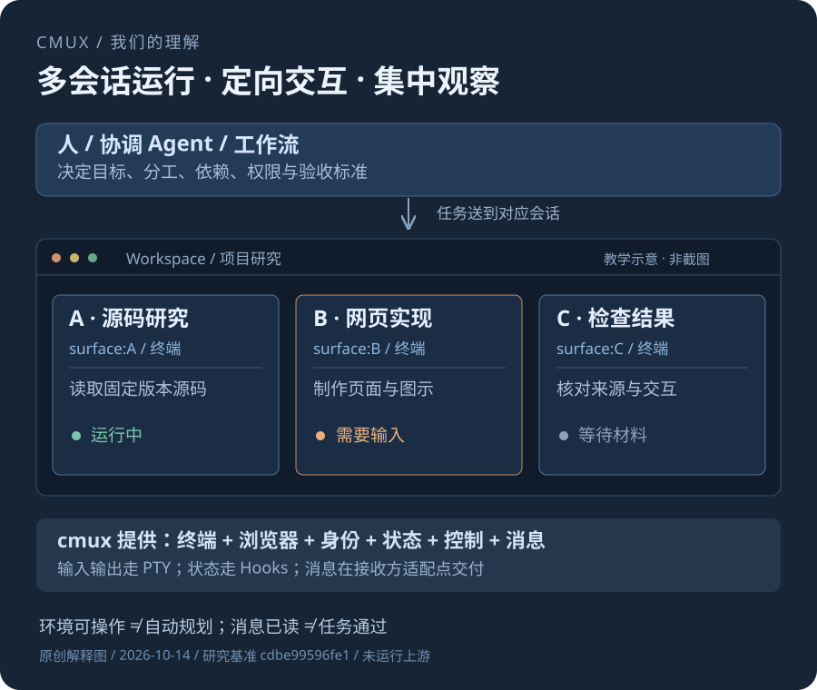
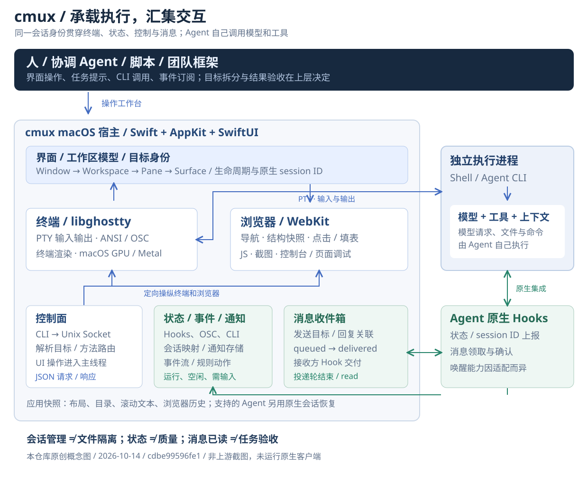

# 009 · cmux：一个人控制多个 Agent 的工作台与实现原理

> cmux 的本质是把多个现有 Agent 会话放进一个工作台，分屏展示、独立交互、定向控制，让它们并行工作，实现一个人同时管理和控制多个 Agent 的能力。它通过真实终端、会话身份、状态、通知、控制与消息提供操作环境；任务拆分、依赖与验收由人、协调 Agent 或规则决定。

[返回总索引](../../README.md#项目索引) · [上游仓库](https://github.com/manaflow-ai/cmux) · [网页源码](./web/index.html) · [运行网页](./web/README.md) · [验证记录](./experiments/results/verification.md)

## 研究范围与版本

| 信息 | 记录 |
| --- | --- |
| 日期 | 2026-10-14 |
| cmux 基准 | [`cdbe99596fe13784ec5ea24d2e1c720a8f67f5cb`](https://github.com/manaflow-ai/cmux/commit/cdbe99596fe13784ec5ea24d2e1c720a8f67f5cb) |
| Ghostty 子模块 | `manaflow-ai/ghostty` / `cb1ef7091cdef0b581ee2cbd83742b653253523e` |
| 文档时间 | 源码链接固定 commit；官网滚动文档在研究日查阅，可能继续变化 |
| 上游平台 | 桌面客户端 macOS；README 另描述 iOS beta 与 Cloud 入口 |
| 研究环境 | Windows、Python 3.10.11、Node.js 22.15.0、Codex 内置浏览器 |
| 本次实现 | 原创中文静态网页、SVG 图示、浏览器内教学模型与验证脚本 |
| 上游运行 | 未运行；未登录 Agent 或调用模型 |
| 状态 | 源码分析与本地教学页完成；上游运行待验证，元信息为 `researching` |
| 公网 | 未部署；`demo_url` 保持空字符串 |

## 理解图与截图来源

### 一张图汇总我们的完整理解

以“承接 Agent 工具 → 统一 UI 展示和交互 → 多会话并行与定向控制”为主线，汇集上下层分工、原生宿主与独立 Agent、四条路径、操作效果、能力、接入方式、使用场景、对我的意义、扩展方向与验收边界。高清尺寸 **2400 × 3700**；模型与工具由 Agent 执行，规划和验收由更高层决定。

[下载高清 PNG](./assets/07-complete-understanding.png) · [下载可编辑 SVG](./assets/07-complete-understanding.svg) · [图中文字](./assets/07-understanding-content.txt) · [绘制源码](./experiments/draw-complete-understanding.py)

图像生成服务两次请求均网络失败，最终图使用 Pillow 与同步 SVG 根据研究内容直接绘制，不是 AI 生成结果或上游截图。保留图像尝试的 [提示词记录](./assets/07-image-prompt.txt) 作为制作过程依据；未使用需要 API 密钥的 CLI 备用方式。网页 `#understanding` 展示同一张完整图，并提供原图查看及下载。

### 简版总览与架构详图

根据固定版本代码与文档直接绘制，示例角色与内容为教学用途。不是作者产品截图，不表示本机运行了三个 Agent。[保存总览图](./assets/01-understanding-overview.svg)。

表达概念数据流，不是逐文件依赖图。[保存架构图](./assets/02-architecture.svg)。网页实际截图存于 `assets/03-web-desktop.jpg`、`assets/04-web-workbench.jpg` 和 `assets/05-web-mobile.jpg`，记录本仓库教学页效果，非上游客户端。

## 我们的核心理解

1. 把多个现有 Agent 会话放进一个工作台，分屏展示、独立交互、定向控制，让它们并行工作，使一个人能同时管理和控制多个 Agent。Agent 使用自己的模型、工具、账号与上下文。
2. 一个 Agent 通常绑定到一个终端 Surface；多会话可以分屏、分组、并行执行、定向交互与集中观察。
3. 输入输出、状态、程序化控制、协作消息是不同通道，共用会话定位信息。
4. 可按目标管理对话和投递任务。为什么选某个 Agent、任务如何拆、依赖和验收是什么，来自人、协调者或团队策略。
5. 状态不等于质量；read 不等于任务通过；Workspace 不等于文件隔离；恢复布局不等于保存所有进程现场。

上游 [README](https://github.com/manaflow-ai/cmux/blob/cdbe99596fe13784ec5ea24d2e1c720a8f67f5cb/README.md) 强调可组合的终端、浏览器、通知、工作区、分屏和 CLI。我们据此理解其工作环境职责，避免把它描述为通用模型运行时。

## 能力、输入与输出

| 能力 | 输入与机制 | 输出与收益 |
| --- | --- | --- |
| 终端宿主 | Shell / Agent CLI、PTY 双向字节流 | 可交互终端、提示与输出 |
| 分组与分屏 | Window、Workspace、Pane、Surface | 多会话布局、定位与切换 |
| 状态与通知 | 原生 Hooks、OSC 9 / 99 / 777、CLI | 运行、空闲、需输入、通知环与未读提示 |
| 控制面 | CLI 或 Socket JSON 请求、目标 ID | 创建 / 选择 / 关闭、输入、屏幕读取与状态设置 |
| 浏览器 | WebKit、元素定位与控制请求 | 导航、快照、点击、填表、JS、截图和调试信息 |
| 消息 | 目标、发送者、正文、回复关系与接收 Hook | 收件箱与 queued / delivered / read / failed |
| 团队适配 | Claude teams 原有 tmux 请求 | 原生工作区与分屏、输入与输出读取 |
| 事件与规则 | 生命周期 / Hook / 通知事件、匹配规则 | 实时流、JSONL、notify / rpc / run / webhook |
| 恢复 | 版本化应用快照、原生 Agent session ID | 布局与支持的 Agent 原生命令恢复 |
| 远程接入 | SSH、tmux 与 CLI relay | 在本地观察与控制远程运行环境 |

cmux 的输出主要是环境、状态与控制结果；代码、文档、测试报告等实际成果由 Agent 产出，idle 不会让成果自动合格。

## 架构与实现原理

**原生宿主：** Swift / AppKit / SwiftUI 管理 UI 和模型；libghostty 提供终端核心，WebKit 提供浏览器，macOS 图形路径使用 GPU / Metal。cmux 是独立应用，同时固定了 `manaflow-ai/ghostty` 子模块，不能简化为与 Ghostty 源码毫无关联。[Terminal 宿主](https://github.com/manaflow-ai/cmux/blob/cdbe99596fe13784ec5ea24d2e1c720a8f67f5cb/Sources/GhosttyTerminalView.swift)。

**PTY 输入输出：** 建立伪终端并启动 Shell / CLI 子进程，输入写向进程，输出回到解析与渲染；ANSI 处理颜色、光标和全屏等，OSC 可载通知。模型、文件和命令仍由 Agent 执行，终端输出不提供模型全部内部推理或真实任务百分比。[Ghostty Exec.zig](https://github.com/manaflow-ai/ghostty/blob/cb1ef7091cdef0b581ee2cbd83742b653253523e/src/termio/Exec.zig)。

**对象身份：** Window → Workspace → Pane → Surface。工作区是侧栏组织单元，Pane 是分屏区域，Surface 是终端 / 浏览器页签。终端注入 `CMUX_WORKSPACE_ID`、`CMUX_SURFACE_ID`、`CMUX_TERMINAL_LIFECYCLE_ID`、`CMUX_SOCKET_PATH`，Hooks 再关联原生 session ID、目录与可用进程信息。终端兼容不等于丰富适配。[环境实现](https://github.com/manaflow-ai/cmux/blob/cdbe99596fe13784ec5ea24d2e1c720a8f67f5cb/Packages/macOS/CmuxTerminalCore/Sources/CmuxTerminalCore/SurfaceValues/TerminalSurfaceCmuxContextEnvironment.swift)、[Hooks](https://github.com/manaflow-ai/cmux/blob/cdbe99596fe13784ec5ea24d2e1c720a8f67f5cb/docs/agent-hooks.md)。

**控制平面：** CLI 经本地 Unix Socket 发送 `id / method / params` JSON 请求，协调器解析方法、稳定目标与引用，再路由到应用能力，UI 状态操作走主线程。请求形状不能笼统称为严格标准 JSON-RPC 2.0。浏览器也经控制面操作，不必模拟桌面鼠标。[API](https://cmux.com/docs/api)、[协调器](https://github.com/manaflow-ai/cmux/blob/cdbe99596fe13784ec5ea24d2e1c720a8f67f5cb/Packages/macOS/CmuxControlSocket/Sources/CmuxControlSocket/Coordinator/ControlCommandCoordinator.swift)、[浏览器自动化](https://cmux.com/docs/browser-automation)。

**通知与事件：** 通知入口用有界异步队列交给应用侧消费，定位所属工作区与 Surface。事件带 process-local `seq` 和 `boot_id`，支持过滤、有限重放与 JSONL；重启或重放缺口后需刷新快照。[通知入口](https://github.com/manaflow-ai/cmux/blob/cdbe99596fe13784ec5ea24d2e1c720a8f67f5cb/Sources/GhosttyDesktopNotificationIngress.swift)、[事件](https://github.com/manaflow-ai/cmux/blob/cdbe99596fe13784ec5ea24d2e1c720a8f67f5cb/docs/events.md)。

**自动化：** 已有 notify、rpc、run、webhook 动作、限频、并发限制与触发链防循环。扩展应增加具体任务策略，不应把事件框架误列为完全缺失。[Automations](https://github.com/manaflow-ai/cmux/blob/cdbe99596fe13784ec5ea24d2e1c720a8f67f5cb/docs/automations.md)。

**恢复：** 重建布局、目录、尽力保存的滚动文本和浏览器历史；支持的 Agent 用原生 session ID 恢复。不是 arbitrary 进程内存检查点。本地 tmux / zellij 可跨 cmux 退出持有进程，但不能跨机器断电；本机离线继续工作需在线远程宿主。[Session restore](https://cmux.com/docs/session-restore)。

## 多 Agent 交互与消息

直接输入：选择目标终端，文本 / 按键经 PTY 进入 CLI 原有交互流程。

协作消息：发送者经 `cmux agent message` 或 Socket 指定目标，文本先存储，再由接收方 Hooks 在支持的时机加入上下文，不把队友消息打进人的草稿。消息记录目标、发送者、回复与状态。[Agent messages](https://github.com/manaflow-ai/cmux/blob/cdbe99596fe13784ec5ea24d2e1c720a8f67f5cb/docs/agent-messages.md)。

| 情况 | Claude Code | Codex |
| --- | --- | --- |
| 空闲 | 后台 asyncRewake Hook 轮询并可唤醒 | 不能主动唤醒，等待人的下一提示 |
| 执行中 | 支持的下一交付点接收 | 下一提示或即将停止的 Hook 交付，必要时继续当前轮 |
| 等人回答 / 权限 / 计划 | 暂缓直到人处理 | 暂缓直到人处理 |
| 无界面批处理 | `claude -p` 不接收 / 等待 | `codex exec` 不接收 / 领取；部分 Hook-only 启动方式未覆盖 |

queued → delivered → read；排队中关闭接收可转 failed。read 表示投递轮结束或手工标记，不是任务验收。协议含 claim、lease、ack，避免过期轮询器错领和旧确认。

本版本正文为有长度与控制字符限制的文本；SSH 消息限同一远程会话，不能远程给本地 Agent 发；Cloud VM 消息未支持。支持矩阵不能推广到所有 Agent。收件箱回复实际实现见 [AgentInboxProjection](https://github.com/manaflow-ai/cmux/blob/cdbe99596fe13784ec5ea24d2e1c720a8f67f5cb/Sources/AgentInbox/AgentInboxProjection.swift)。

## 分派、团队与完成边界

按目标一对一会话管理是理解入口，但 Workspace 能有多个 Surface。分派分为“上层决定谁做什么”和“工作环境送达并承载执行”。cmux 擅长后者，可以接团队框架。

`cmux claude-teams` 把临时 tmux shim 放到 PATH 前部，Claude 的创建窗口、分屏、send-keys、capture-pane、select / kill 被映射为 cmux 原生操作。协调策略仍来自 Claude Code teams。[官方说明](https://cmux.com/docs/agent-integrations/claude-code-teams)。

[Agent fan-out RFC](https://github.com/manaflow-ai/cmux/blob/cdbe99596fe13784ec5ea24d2e1c720a8f67f5cb/docs/agent-fan-out-rfc.md) 标为 proposed。其父操作、子运行、聚合状态和稳定重试是提案，不能当成已完成的通用调度。Draft 的 session tracking 规范同样不能单凭文档等同全部实现。

多 Agent 修改代码另需目录 / Git worktree、分支和合并策略，界面分组不解决文件冲突。结果需独立检查标准、测试与人接受。

## 场景、个人价值与扩展

工作台可以让一个 Agent 执行时，人继续安排另一个任务；待输入、权限和检查结果通过状态与提醒返回人的注意力。目标价值是减少找窗口、等待、漏看和搬运材料，把一个人的注意力集中到分派、回应与验收，便于组织更多独立任务。

并行研究多个库、网页实现与检查、远程长任务、自有 Agent 流程是合适的参考场景。收益来自减少找会话、漏看待输入和材料搬运，不是增强底层模型智能。

你目前使用 Windows，架构与流程学习有即时价值，原生客户端直接使用需要 Mac。只有一个 Agent 或当前工具已够用时，不必为了分屏增加层次。与项目 007 路由思路可组合：路由判断选择谁，工作台负责承载交互，任务契约负责验收；这是我们的扩展设计。

验证收益可比较实际任务的定位 / 回应时间、漏看、搬运次数、返工、最终通过率、总耗时与所有调用费用。当前没有这种实测，不声称已节约时间和费用。

可扩展任务契约、依赖与模型选择、通用适配能力声明、材料与产物、worktree / 合并、交付检查、费用记录、Windows 宿主。已有控制、消息、事件与规则可作基础。原型容易，终端协议、海量输出、会话代际、输入草稿、权限等待、可靠交付、恢复和主线程仍有工程工作。

后续路线：一种 CLI 的会话可见可控 → 一种真实 Hook 消息适配 → 任务 / 产物 / 验收闭环 → 按痛点增加路由、隔离、并发和远程。当前未实现这些服务。

整体实现思路是复用已有 Agent 工具和模型：先承接独立进程及终端输入输出，用稳定会话 ID 汇集 UI、状态、提醒、控制与消息，再在上层补目标、角色、依赖、限并发、失败升级、工作树与成果检查。cmux 提供操作基础，个人工作流应从反复出现、可检验的任务逐步建立。

## 既有研究对照

| 时间与记录 | 本地位置 | 关系与验证范围 |
| --- | --- | --- |
| 2026-08-07 cmux 控制技能 | `E:/0807_codex_project/davidondrej-skills-study/docs/skill-dispatch-implementation-guide.md` | 外部工具的定位 / 操作流程，未运行技能 |
| 2026-08-29 Intelligent Terminal | `E:/0829_codex_project/projects/intelligent-terminal-capability-summary/README.md` | Windows 终端上 Agent 工作流；最小安装检查后卸载，未登录 Agent |
| 2026-09-06 Multica | `F:/codex_project/0906_codex_project/projects/004-multica/README.md` | 任务与运行组织；未跑真实后端 / 模型 |
| 2026-09-10/11 Munder Difflin | `F:/codex_project/0911_codex_project/projects/011-munder-difflin/README.md` | 多角色、任务与文件消息；未运行上游 |
| 2026-10-09 Octogent | `F:/codex_project/1008_codex_project/projects/007-octogent/README.md` | 工作台、上下文与终端树；截图和教学页，未复现真实协作 |

用于理解定位，不是性能排名。网页保留既有公开研究入口；本次新增系统源码分析与理解展示。

## 本次实现与验证

原生 HTML / CSS / JavaScript，无框架、CDN、后端或模型接口。完整理解总图、十章正文、20 个证据入口、简版总览与架构详图、模拟工作台、能力筛选、四条路径切换、消息实验、价值判断与下载。

[运行方式](./web/README.md)；[实际验证](./experiments/results/verification.md)。上游 macOS、真实 Agent / 模型、Hook / 恢复、Cloud / 移动均未复现。网页只演示文档校准的概念。

## 许可证与来源

基准 [LICENSE](https://github.com/manaflow-ai/cmux/blob/cdbe99596fe13784ec5ea24d2e1c720a8f67f5cb/LICENSE) 声明主体 GPL-3.0-or-later。`web/`、`workers/ci-artifacts/`、`workers/iroh-v2/`、`workers/presence/`、`services/iroh-relay-minter/`、`cmux-tui/relays/cloudflare-do/` 有 BUSL-1.1，生产使用含自托管按其声明需要商业许可。第三方各按自身许可，实际复用按文件核对。

本项目没有移植上游源码或复制官方图片；图示与教学代码为本仓库原创。上游 server 的 `web/` 与本研究自己的 `web/` 不是同一个目录，本研究没有部署上游 server。
