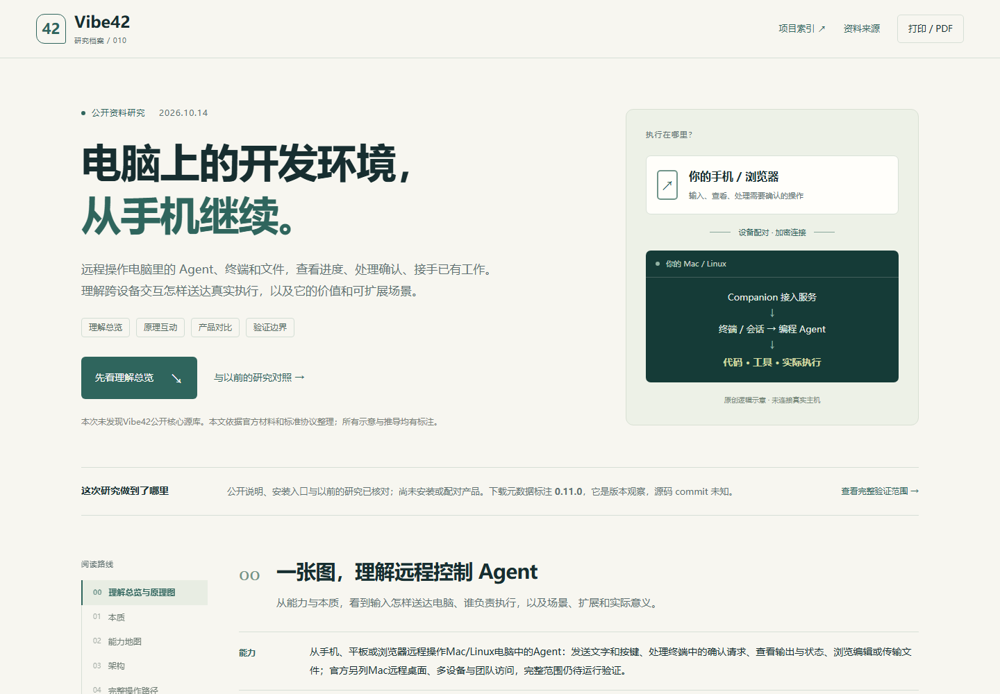
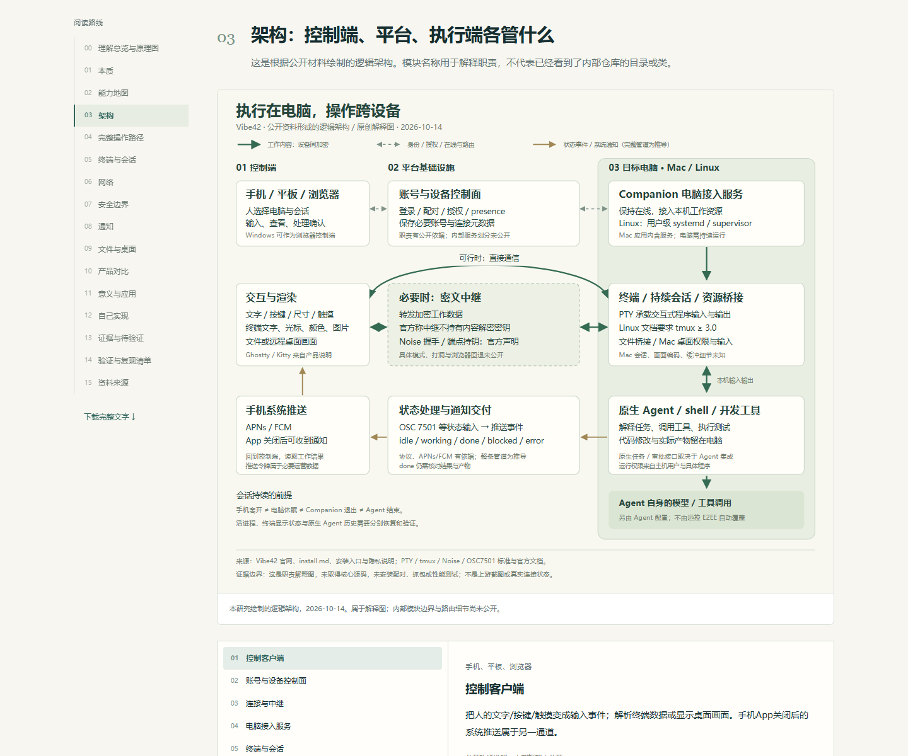
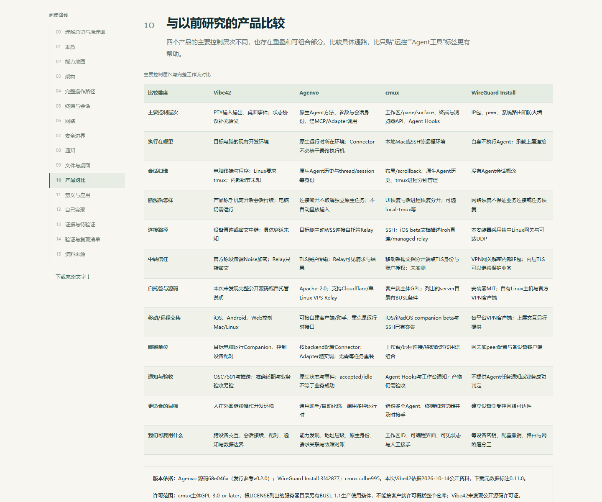
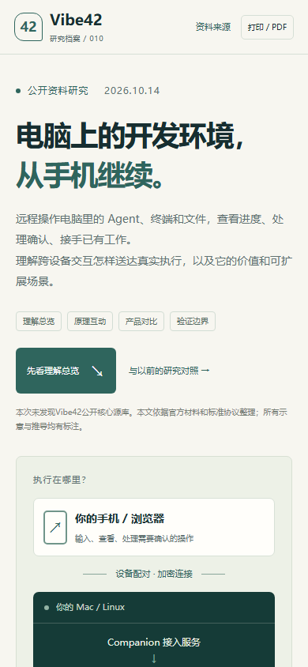
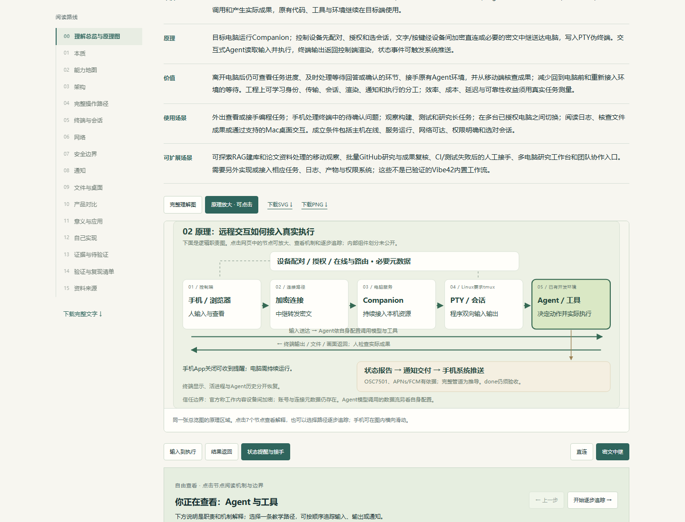
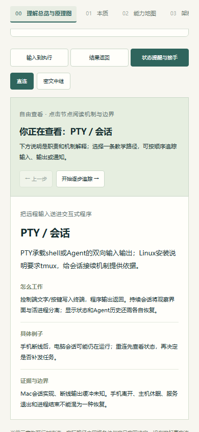

# 010 · Vibe42：Agent远程控制能力、原理与价值研究

> Vibe42让人从手机、平板或浏览器远程操作Mac/Linux电脑中的Agent、终端和文件。电脑运行Companion接入服务，设备完成配对与授权，输入经加密直连或密文中继送入PTY会话；Agent按自身配置调用模型与工具，输出和状态返回给人。价值是离开电脑后仍能查看进度、处理确认、接手已有任务和核查成果，并提供连接、会话与执行分工的工程参考。适用于远程开发、长任务观察、多电脑工作入口；可探索研究/RAG任务接续、结构化Agent接口、恢复诊断、团队权限和产物验收。扩展为研究建议，真实产品运行与收益尚未实测。

[返回总索引](../../README.md#项目索引) · [官方产品网站](https://vibe42.ai/) · [研究网页源码](./web/index.html) · [网页运行说明](./web/README.md) · [验证记录](./experiments/results/verification.md)

[已验证的公开网页](https://yydshly.github.io/1013_codex_project/010-vibe42/#understanding) · [公网发布记录](./experiments/results/publication.md)

## 研究基线与来源

| 信息 | 本次记录 |
| --- | --- |
| 研究日期 | 2026-10-14，Asia/Shanghai |
| 研究对象 | Vibe42 产品；以前称 Vibe X。不是已取得公开源码的开源库 |
| 最初入口 | https://vibe42.ai/zh-HANS#features；以可读取官网和官方资料核对 |
| 研究版本 | 官网/安装/隐私等公开资料的当日查阅；下载元数据标注 0.11.0，未安装 |
| 原仓库与源码 commit | 官方 GitHub 组织 https://github.com/vibe42-ai 本次无公开仓库；没有可填写的源码 commit |
| 上游源码许可证 | 未发现公开源码许可证；project.json 对应字段留空，不默认视为 MIT 或其他开源许可 |
| 本地环境 | Windows / PowerShell；Python 标准库生成静态研究材料；浏览器验收环境见验证记录 |
| 状态 | researching：公开资料与研究网页；未安装、配对或复现真实产品 |
| 演示入口 | [公开理解网页](https://yydshly.github.io/1013_codex_project/010-vibe42/)；静态研究页，真实产品尚未复现 |
| 素材与许可 | 原创文字、HTML/CSS/JS和架构SVG；没有复制产品截图、二进制或上游源码 |

## 0. 一张图总结我们的理解

图片说明：本研究原创，2026-10-14，非产品截图。网页使用同一SVG底图，可放大原理、点击7个节点、追踪3条路径和切换直连/中继；下载图为静态解释图。

**能力：** 从手机、平板或浏览器远程操作Mac/Linux电脑中的Agent：发送文字和按键、处理终端中的确认请求、查看输出与状态、浏览编辑或传输文件；官方另列Mac远程桌面、多设备与团队访问，完整范围仍待运行验证。

**本质：** 为已有开发环境提供跨设备操作与观察入口。Vibe42送达输入、呈现结果并组织连接与通知；Agent自身负责理解任务、选择模型、决定工具调用和产生实际成果，原有代码、工具与环境继续在目标端使用。

**原理：** 目标电脑运行Companion；控制设备先配对、授权和选会话，文字/按键经设备间加密直连或必要的密文中继送达电脑，写入PTY伪终端。交互式Agent读取输入并执行，终端输出返回控制端渲染，状态事件可触发系统推送。

**价值：** 离开电脑后仍可查看任务进度、及时处理等待回答或确认的环节、接手原有Agent环境，并从移动端核查成果；减少回到电脑前和重新接入环境的等待。工程上可学习身份、传输、会话、渲染、通知和执行的分工；效率、成本、延迟与可靠性收益须用真实任务测量。

**使用场景：** 外出查看或接手编程任务；手机处理终端中的待确认问题；观察构建、测试和研究长任务；在多台已授权电脑之间切换；阅读日志、核查文件成果或通过支持的Mac桌面交互。成立条件包括主机在线、服务运行、网络可达、权限明确和选对会话。

**可扩展场景：** 可探索RAG建库和论文资料处理的移动观察、批量GitHub研究与成果复核、CI/测试失败后的人工接手、多电脑研究工作台和团队协作入口。需要另外实现或接入相应任务、日志、产物与权限系统；这些不是已验证的Vibe42内置工作流。

[下载PNG](./assets/understanding-overview.png) · [原理交互网页](./web/index.html#understanding) · [详细三端架构图](./assets/architecture.svg)

### 使用场景

- **外出接手开发：** 查看电脑里的编程任务，处理等待回答或审批的请求。 主机在线；选对会话；对具体操作作确认。
- **长任务观察：** 测试、构建或研究继续运行，手机查看进度与结果。 断网、休眠、重启要分别测试；通知不代替验收。
- **多电脑入口：** 从一个设备切换已有工作电脑和开发环境。 授权、会话身份、路径与目录必须明确。
- **成果核查与协作：** 阅读日志、浏览文件，按权限共享访问或通过Mac桌面接手。 真实编辑冲突、团队权限和桌面体验尚未验证。

### 可扩展方向（本研究建议）

- **结构化 Agent 适配：** 增加任务/历史/审批ID、事件和精确中断；借鉴Agenvo。
- **恢复与故障对账：** 稳定会话ID、输出补齐、重连后先查状态，避免重复写操作。
- **授权与可观察性：** 设备撤销、访问范围、脱敏日志和诊断；明确内容与元数据边界。
- **任务与产物验收：** 连接测试报告、代码改动、研究文件与人的验收记录。
- **研究工作流衔接：** 探索接入RAG、cmux工作区与统一模型入口，各层独立验收。
- **平台与部署扩展：** 探索自建主机与中继，更多平台、权限和移动体验。

### 意义与成立条件

- **直接价值：** 人在外面也能接手电脑任务，减少回到电脑前的等待。
- **工程参考：** 学习身份、连接、会话、渲染、通知与执行的职责划分。
- **对我们的意义：** 让GitHub研究与长任务有移动入口，并保留可追溯成果。
- **实际收益条件：** 依赖在线主机、连接质量与正确会话；效率、费用与可靠性须测量。

这些内容来自既有公开资料研究与明确标注的工程建议。图中的逻辑组件不代表内部源码目录；原产品安装、连接、恢复、安全、通知和性能尚未独立验证。

## 1. 本质：执行留在电脑，操作跨越设备

Vibe42 提供的是已有开发环境的远程入口。理解它，先把人、连接服务、终端和 Agent 的职责分开。

人通过控制端表达意图或输入操作；电脑里的 Agent 按自己的能力处理请求、修改文件、调用开发工具。Vibe42 将两端的交互送达并显示回来。编程能力来自被连接的 Agent，远程接入能力来自 Vibe42。

你前面说的“在运行 Agent 的电脑装一个客户端，再由手机通过适配器交互”，整体连接关系成立。精确术语是：手机/浏览器是控制客户端，电脑上的 Companion 是接入服务。这里的桥接主要围绕通用终端和桌面，不需要先假定存在针对每一种 Agent 的原生 API Adapter。

从工程角度，本产品把远程终端、设备身份、连接协调、会话接续、移动端输入与渲染、状态通知、文件和桌面能力组织成一个跨设备工作流。每个环节可用成熟机制实现，产品价值来自这些环节在真实网络和设备上能否稳定配合。

本次官网 GitHub 组织未列出公开仓库。因此这里收录的是产品公开资料研究：能确认安装与使用机制，能解释标准协议的工作方式；对内部模块划分、穿透算法、视频编码和恢复实现，只给出带依据的推导或待查问题。

| 对象 | 主要职责 | 工作在哪里发生 |
| --- | --- | --- |
| 你与控制端 | 文字、按键、审批操作、阅读输出 | 手机、平板或浏览器 |
| Companion | 接入电脑资源并保持可连接 | 目标 Mac / Linux |
| 终端与会话 | 承载 shell、程序输入输出和存活进程 | 目标电脑；Linux 文档要求 tmux |
| 编程 Agent | 理解任务、决定动作、执行工具 | 已有 Agent 环境；模型调用取决于其配置 |
| 平台控制与中继 | 设备授权、连接路由、必要时转发密文 | Vibe42 基础设施 |

依据：[Vibe42 官网](https://vibe42.ai/)、[官方安装与故障排查说明](https://vibe42.ai/install.md)、[Vibe42 官方 GitHub 组织](https://github.com/vibe42-ai)。

## 2. 能力地图：输入、输出与适用范围

把“能连接任何 Agent”拆成可观察的能力，避免把终端兼容、任务语义和自动化能力混在一起。

通用终端首先解决“这个程序能够被显示和操作”。结构化创建任务、读取原生历史、按 turn 精确中断、自动回答审批等能力，还取决于 Agent 自身接口及上层集成。产品的广泛终端兼容性不能单独证明这些语义能力。

平台分工要看方向：Mac 和 Linux 可以作为被控制的电脑；iOS、Android 和浏览器是操作入口。官方安装说明明确 Windows 当前不能运行 Companion，但 Windows 浏览器可以控制已有的其他电脑。本研究机就是 Windows，尚未具备真实主机端复现条件。

| 能力 | 你提供什么 | 得到什么 | 公开边界 |
| --- | --- | --- | --- |
| 远程终端 | 文字、快捷键、终端操作 | 程序输出与交互界面 | 开发者说明完整 PTY；内部协议未公开 |
| 接着原有工作 | 选择电脑与终端会话 | 继续查看或操作正在运行的程序 | 断开手机与退出电脑进程要分别考虑 |
| 文件与产物 | 浏览、预览、编辑、传输操作 | 电脑上的文件与工作结果 | 没有核对所有文件类型、大小上限和冲突策略 |
| Mac 远程桌面 | 触摸、鼠标、键盘操作 | 桌面画面与远端输入反馈 | 安装说明要求屏幕录制/辅助功能权限；Linux桌面未确认 |
| 多设备与多电脑 | 设备配对、工作机选择 | 跨设备工作入口 | 配额、套餐和正式可用范围以控制台为准 |
| 任务状态与通知 | 程序报告状态或相应适配 | 工作完成/需要介入的提醒 | 官网列 OSC 7501、APNs/FCM；完整适配矩阵未公开 |
| 移动端终端体验 | 触屏输入、中日韩文本、图片内容 | 字体、光标、控制序列与图片显示 | 官网列 Ghostty、GPU 和 Kitty；性能指标未实测 |
| 团队共享 | 成员身份、角色与电脑授权 | 团队访问和共享入口 | 产品列角色能力；真实权限粒度未测试 |

依据：[Google Play 开发者应用说明](https://play.google.com/store/apps/details?id=ai.vibecafe.x)、[Vibe42 官网](https://vibe42.ai/)、[官方安装与故障排查说明](https://vibe42.ai/install.md)。

## 3. 架构：控制端、平台、执行端各管什么

这是根据公开材料绘制的逻辑架构。模块名称用于解释职责，不代表已经看到了内部仓库的目录或类。

控制端将人的输入编码成可传输事件，并把收到的终端数据或桌面画面呈现出来。平台控制面负责账号、设备、授权、在线状态和连接路由。执行端 Companion 接入本机终端与资源，Agent 则继续使用本机工具链和文件。

将控制面与数据面分开，有助于理解隐私：登录、配对、授权、在线状态属于控制信息；终端内容、文件和桌面画面属于工作数据。官方称工作数据在设备之间端到端加密；控制平台仍然需要一些账号和连接元数据。

将会话管理与渲染分开，有助于理解连续性：手机屏幕上显示的内容可以被关闭；电脑上的会话进程可以仍然运行。之后重新连接，需要重新附着或恢复观察，是否补齐断线期间的输出以及怎样处理屏幕尺寸变化，属于需要进一步验证的实现细节。

| 逻辑模块 | 公开依据 | 内部仍未确认 |
| --- | --- | --- |
| 移动/Web控制端 | 官方客户端和应用说明 | 平台代码语言、框架、跨端共享比例 |
| 账号/设备控制面 | 隐私政策中的配对、角色、presence和连接记录 | 数据库结构、API、授权撤销传播时机 |
| 连接与中继层 | 直连优先、加密中继、排查出站HTTPS/QUIC | 打洞策略、路径选择、流复用、浏览器回退 |
| 电脑Companion | 安装文档与入口脚本 | 核心源码、资源隔离、事件和会话持久化 |
| PTY/会话层 | 应用列PTY；Linux要求tmux | Mac实现、tmux调用方式、断线输出缓冲 |
| 终端渲染层 | 官网列Ghostty和Kitty | 确切集成API、协议覆盖、移动性能 |
| 文件/桌面桥接 | 产品说明与Mac权限要求 | 传输冲突策略、画面采集和编解码实现 |

依据：[官方安装与故障排查说明](https://vibe42.ai/install.md)、[Vibe42 隐私政策](https://vibe42.ai/privacy)、[Vibe42 官网](https://vibe42.ai/)。

## 4. 一次操作的完整路径

以“从手机让电脑里的 Agent 运行测试”为例，逐层看输入、执行和结果属于谁。页面中的步骤和终端输出均为教学构造。

先安装与授权目标电脑，让控制端确认它是允许访问的设备；再选择正确会话。连接建立后，输入经过认证和加密到达目标端，写入终端。终端中的 Agent 读到请求后，才决定怎样运行测试。结果经终端输出返回，手机负责显示。

需要确认时，你从手机输入同意或其他内容，通常与在本机终端操作相似。若底层是通用终端，传入的按键、文字和程序当前界面共同决定实际效果；结构化审批ID、请求关联和幂等执行需要专门协议支持。

连接恢复时应先查看当前状态，再决定要不要再次发送操作。例如第一次测试已经开始，只是结果尚未传回，盲目重发可能创建第二次运行。相同问题也存在于发布、提交、删除或支付等写操作，因此可靠恢复不仅是让网络重新连上。

1. **配对并选机：** 目标机安装Companion并获授权；手机或浏览器选择允许访问的电脑。 还没有向Agent发送业务任务。
2. **建立通道：** 平台完成连接协调；设备间建立加密通道。能直连时直连，需要时走中继。 具体握手模式与路由算法尚未公开。
3. **送入终端：** 控制端提交构造示例：请运行测试并说明结果。输入送入电脑终端。 通用终端事件本身不等同原生task/turn方法。
4. **Agent执行：** Agent读取请求，决定运行测试，使用自己的项目目录、工具和模型配置。 模拟输出并非真实测试结果。
5. **显示结果：** 文字、颜色和光标控制序列返回；控制端绘制终端。若为桌面模式，则显示画面。 回到同一会话与补齐输出需要实际验证。
6. **状态与验收：** 状态报告可触发提醒；用户阅读结果并核对代码与测试。 done/退出成功均不能单独证明用户目标完成。

依据：[Linux PTY 手册](https://man7.org/linux/man-pages/man7/pty.7.html)、[官方安装与故障排查说明](https://vibe42.ai/install.md)。

## 5. 终端与会话：输入输出、存活与恢复

PTY、tmux、终端渲染和 Agent 历史是不同层次，分别解决不同问题。

PTY 提供一对双向通道。一端由接入程序读写，另一端表现为真实终端，供 shell 与交互式程序使用。输入可包含普通文字和控制字符；输出可包含文字、颜色、光标移动、清屏和其他控制序列。控制端需要解析并呈现这些序列，而不只是显示一串文本。

因此，终端通道可以承载测试程序、git、shell 脚本和多种编程 Agent。图像还可以通过终端图片协议传输。通道的通用性是广泛兼容的基础，但对终端控制序列的覆盖、中文输入法、粘贴、组合键、窗口尺寸同步仍需逐项测试。

Linux 安装说明要求 tmux。tmux 能让会话在观察界面分离后继续运行，再由新观察者附着。这为接续机制提供直接依据，但尚不能据此断言 Vibe42 的全部终端都用相同方式管理，或 Mac 的会话实现与 Linux 一样。

持久化至少有三种含义：活进程继续存在，关闭界面后能继续运行；显示状态恢复，重开应用后能恢复标签、目录和滚动记录；Agent 原生历史续接，用其会话ID恢复任务上下文。它们需要不同的数据和生命周期管理，电脑重启尤其不能由“断线会话存活”直接覆盖。

| 事件 | 执行端通常会怎样 | 重新连接后要确认什么 |
| --- | --- | --- |
| 手机App关闭/手机短暂断网 | 电脑仍运行时，会话可持续；这是产品声明 | 是否恢复到同一会话、输出是否完整 |
| 切换Wi-Fi与蜂窝网络 | 需要恢复认证通道或切换路径 | 输入是否重复、丢失，终端尺寸是否改变 |
| 电脑屏幕锁定 | 与机器休眠不同；官网展示Mac远程解锁 | 权限、画面与系统策略；未实测 |
| 电脑进入休眠 | 计算和网络连接可能暂停，属于系统机制推导 | 唤醒后服务、会话和连接能否恢复 |
| Companion退出 | 远程入口中断；独立会话能否存活依实现 | 服务重启后的会话重新发现 |
| Agent退出/机器重启 | 活进程已经结束或消失 | 原生历史续接、检查点或重新启动策略 |

依据：[Linux PTY 手册](https://man7.org/linux/man-pages/man7/pty.7.html)、[tmux 官方仓库](https://github.com/tmux/tmux)、[Kitty 图片协议](https://sw.kovidgoyal.net/kitty/graphics-protocol/)、[Google Play 开发者应用说明](https://play.google.com/store/apps/details?id=ai.vibecafe.x)。

## 6. 网络：连接建立、直连和中继

“免配置”是用户体验目标；背后仍需要身份、授权、路由和可用传输路径。

公开材料确认存在设备配对、连接路由、直接设备通信与中继路径。安装排查要求关注目标机的出站 HTTPS/QUIC 访问。这些足以说明平台封装了连接基础设施，但尚不足以确认其完整 NAT 穿透算法、端口策略或每个平台的具体传输栈。

从可实现的系统设计推导，控制平台通常保存设备身份和可连接状态，协调两端尝试建立连接。直连可减少中转；在网络不允许直连时，让两端分别到达可用中继，由中继转发消息。这里的“通常”是方案解释，不是 Vibe42 核心源码结论。

无论通过哪条路径，都需要处理重连、超时、流量控制和网络变化。快速恢复终端输出、避免无意重放输入、保护桌面交互延迟，是产品工程的实际难点。全球节点、120Hz 或毫秒重连等宣称不能代替在真实网络上测量的延迟、吞吐和耗电。

| 路径 | 数据经过哪里 | 可观察优势与代价 |
| --- | --- | --- |
| 直连 | 控制端 ↔ 目标电脑 | 减少中转；可行性取决于两端网络 |
| 中继 | 控制端 ↔ relay ↔ 目标电脑 | 增加网络可达性；带宽、延迟和运营资源受中继影响 |
| 控制面 | 设备 ↔ 账号/授权/连接平台 | 管理在线与授权；需要元数据，不能视为完全离线系统 |

依据：[Vibe42 官网](https://vibe42.ai/)、[官方安装与故障排查说明](https://vibe42.ai/install.md)、[Vibe42 隐私政策](https://vibe42.ai/privacy)。

## 7. 安全边界：内容密文与连接元数据

把登录认证、设备授权、工作内容加密和执行权限分开理解，才能准确评价“端到端加密”。

官网明确使用 Noise 握手，并称密钥留在设备端。Noise 是可实例化为不同模式与算法组合的密码协议框架：握手通过公钥相关运算建立秘密，再使用派生密钥保护传输内容。这个框架说明如何建立加密通道；具体模式、算法组合和密钥轮换仍需产品源码或技术说明确认。

按官方隐私声明，终端、文件和屏幕内容不在其服务器留存，中继不能解密工作数据。与此同时，平台记录账号、设备、授权、在线状态和连接元数据，以及通知/计费所需记录。工作内容不留存与运营数据留存可以同时成立。

设备配对建立“谁可以访问谁”的关系；加密建立“路径上的中转方能否读取内容”的边界；电脑上的进程权限决定“已经连接的人或程序可以做什么”。三者不能互相替代。端点上已经可见的明文、执行环境的权限和 Agent 调用的工具，仍应按本机运行时检查。

Agent 若调用外部模型，代码或上下文可能按 Agent 自身配置发送到模型服务商。本产品远程链路的保护范围应单独评价，不能据此推出整个开发流程没有外部模型请求。

本次没有实施网络抓包、密钥验证、撤销测试或安全审计，所以能记录官方设计声明及其合理含义，尚不能给出“已经独立证明”的安全结论。

依据：[Noise Protocol Framework](https://noiseprotocol.org/noise.html)、[Vibe42 隐私政策](https://vibe42.ai/privacy)、[Vibe42 官网](https://vibe42.ai/)。

## 8. 通知：状态来自哪里，手机为什么可以关闭

状态报告与消息推送是两段不同的流程。状态由程序或适配产生，推送由系统通知通道交付。

官网列出 OSC 7501。这个协议让终端程序报告 idle、working、done、blocked、error 等状态；blocked 可以携带 permission、question 或 auth 等介入类型。协议表达状态，并不规定产品必须怎样弹出通知。

由此可以设计：电脑端观察状态变化，将必要事件交给通知服务；服务通过 APNs 或 FCM 通知手机。平台隐私政策确认保存推送令牌及必要通知记录。因为通知通过操作系统的渠道交付，手机客户端无需一直维持自己的前台网络连接。完整内部事件管道仍未公开。

通用终端中的任意程序都可以显示，但准确报告“需要审批”“正在执行某个阶段”，需要程序主动上报或可靠适配。还要分别处理重复事件、通知限频、已在当前会话中阅读的结果，以及状态恢复。官网没有公开所有 Agent 的适配与通知准确率。

done 表示程序报告了一项工作完成，error 表示程序报告失败。无论来自 OSC 还是原生接口，任务状态都应配合产物和验证结果判断：进程退出成功、Agent停止输出与用户目标真正达成都属于不同证据。

| 状态 | 含义 | 用户通常需要做什么 |
| --- | --- | --- |
| working | 程序正在运行 | 等待或查看进度 |
| blocked | 需要用户审批、回答或登录 | 回到正确会话处理具体请求 |
| done | 某项结果已准备好 | 阅读输出、核对产物与验收 |
| error | 程序报告失败并停止 | 查看错误并决定修复或重试 |
| idle | 等待下一条指令 | 发送新任务或结束会话 |

依据：[OSC 7501 Program Status Protocol](https://www.superlogical.com/rex/docs/build/program-status)、[Vibe42 隐私政策](https://vibe42.ai/privacy)、[Vibe42 官网](https://vibe42.ai/)。

## 9. 文件与桌面：另两类数据通道

终端、文件和桌面可以共用身份与网络基础，但负载、控制语义和验收方式各有差异。

文件浏览、预览、编辑和传输在产品资料中有说明。一个可实现的文件桥接会把操作送到目标端执行，再返回目录、文件内容或数据块；路径处理、大小限制、权限、编辑冲突和中断续传都需要设计。这里描述的是实现问题清单，尚未确认 Vibe42 的具体策略。

Mac 远程桌面的安装说明要求屏幕录制与辅助功能权限。据此和官网演示，可以推导出画面采集 → 编码传输 → 客户端显示，以及输入事件 → 目标端操作的两条通路。所用屏幕捕获接口、视频编码、码率控制与权限处理细节仍未公开。

桌面画面与终端数据有不同代价：桌面持续传送图像，更依赖带宽和视频解码；终端主要传文字和控制序列，但对交互延迟、字形和输入法更敏感。CPU/GPU用量、温度、输入延迟与手机耗电需要以实际任务、网络和设备测试。

本次只确认官方展示 Mac 桌面控制，没有把 Linux 远程桌面或 Windows 被控主机能力补写成已支持。

依据：[官方安装与故障排查说明](https://vibe42.ai/install.md)、[Google Play 开发者应用说明](https://play.google.com/store/apps/details?id=ai.vibecafe.x)、[Vibe42 官网](https://vibe42.ai/)。

## 10. 与以前研究的产品比较

四个产品的主要控制层次不同，也存在重叠和可组合部分。比较具体通路，比只贴“远控”“Agent工具”标签更有帮助。

Agenvo 在以前的研究中已有固定源码快照，重点是让通用助手经 MCP 调用不同原生运行时。Connector 内的 Adapter 将方法与参数转成运行时 API/CLI，并保留原生会话身份。它支持自托管 Relay，但 Relay 可看到请求和结果。

cmux 此前已有009子项目研究；本次对照固定官方快照补充比较。它管理工作区、终端、浏览器和 Agent 事件，同时存在 SSH 与 iOS companion beta。因此它的用途与 Vibe42 在移动接续上有交集，不能简单写成仅本地工具。移动传输架构文档是文档证据，本研究未验证发布实现。

WireGuard Install 以前研究的是配置部署脚本。WireGuard 保护 IP 传输，安装器配置 peer、路由、转发和NAT；远程终端、Agent方法、任务通知仍由上层应用提供。这个集中网关方案在服务器处解密VPN内的IP包，内层HTTPS等可以继续保护应用内容。

三者可与远程工作系统组合，但不能由共享某个机制推出产品完全相同。Noise 同属密码协议背景，并不能证明 Vibe42 采用了 WireGuard 的握手模式或完整VPN数据协议。

| 比较维度 | Vibe42 | Agenvo | cmux | WireGuard Install |
| --- | --- | --- | --- | --- |
| 主要控制层次 | PTY输入输出、桌面事件；状态协议补充语义 | 原生Agent方法、参数与会话身份，经MCP/Adapter调用 | 工作区/pane/surface、终端与浏览器API、Agent Hooks | IP包、peer、系统路由和防火墙 |
| 执行在哪里 | 目标电脑的现有开发环境 | 原生运行时所在环境；Connector不必等于最终执行机 | 本地Mac或SSH等远程环境 | 自身不执行Agent；承载上层连接 |
| 会话归谁 | 电脑终端与程序；Linux要求tmux；内部细节未知 | 原生Agent历史与thread/session等身份 | 布局/scrollback、原生Agent历史、tmux进程分别管理 | 没有Agent会话概念 |
| 断线后怎样 | 产品称手机离开后会话持续；电脑仍需运行 | 连接断开不取消独立原生任务；不自动重放输入 | UI恢复与活进程恢复分开；可选local-tmux等 | 网络恢复不保证业务连接或任务恢复 |
| 连接路径 | 设备直连或密文中继；具体穿透未知 | 目标侧主动WSS连接自托管Relay | SSH；iOS beta文档描述Iroh直连/managed relay | 本安装器采用集中Linux网关与可达UDP |
| 中转信任 | 官方称设备端Noise加密；Relay只转密文 | TLS保护传输；Relay可见请求与结果 | 移动架构文档分开端点TLS身份与账户授权；未实测 | VPN网关解密内部IP包；内层TLS可以继续保护业务 |
| 自托管与源码 | 本次未发现完整公开源码或自托管说明 | Apache-2.0；支持Cloudflare/单Linux VPS Relay | 客户端主体GPL；列出的server目录有BUSL条件 | 安装器MIT；自有Linux主机与官方VPN客户端 |
| 移动/远程交集 | iOS、Android、Web控制Mac/Linux | 可接自建客户端/助手，重点是运行时接口 | iOS/iPadOS companion beta与SSH已有交集 | 各平台VPN客户端；上层交互另行提供 |
| 部署单位 | 目标电脑运行Companion，控制设备配对 | 按backend配置Connector；Adapter随实现；无需每任务重装 | 工作台/远程连接/移动配对按用途组合 | 网关加peer配置与各设备客户端 |
| 通知与验收 | OSC7501与推送；准确适配与业务验收另验 | 原生状态与事件；accepted/idle不等于业务成功 | Agent Hooks与工作台通知；产物仍需验收 | 不提供Agent任务通知或业务成功判定 |
| 更适合的目标 | 人在外面继续操作开发环境 | 通用助手/自动化统一调用多种运行时 | 组织多个Agent、终端和浏览器并及时接手 | 建立设备间受控网络可达性 |
| 我们可复用什么 | 跨设备交互、会话接续、配对、通知与数据边界 | 能力发现、地址层级、原生身份、请求关联与故障对账 | 工作区ID、可编程界面、可见状态与人工接手 | 每设备密钥、配置撤销、路由与网络层分工 |

固定对比基线：Agenvo `68e046a5d8691054f8c134d85ae051988bae3dff`（源码快照；v0.2.0仅发行参考）；WireGuard Install `3f428774e61c95bca60d1e7b80f0c768ca2c6137`；cmux `cdbe99596fe13784ec5ea24d2e1c720a8f67f5cb`。cmux对应已有009研究；本次比较对照固定官方快照和官网，移动传输设计与实际发布行为仍分别标明证据范围。

cmux许可：根LICENSE默认为GPL-3.0-or-later，但列出的server目录采用BUSL-1.1，并有生产使用、包括自托管的商业授权条件。复制或部署前须按具体目录核对。Vibe42未发现公开源码许可证。

以前记录：[Agenvo既有研究网页](https://yydshly.github.io/1009_codex_project/016-agenvo/)、[WireGuard README](../005-wireguard-install/README.md)、[cmux既有研究](../009-cmux/README.md)。

依据：[Agenvo 固定版本架构](https://github.com/Xuanwo/agenvo/blob/68e046a5d8691054f8c134d85ae051988bae3dff/design/architecture.zh-CN.md)、[Agenvo 固定版本安全说明](https://github.com/Xuanwo/agenvo/blob/68e046a5d8691054f8c134d85ae051988bae3dff/SECURITY.zh-CN.md)、[cmux 固定版本 README](https://github.com/manaflow-ai/cmux/blob/cdbe99596fe13784ec5ea24d2e1c720a8f67f5cb/README.md)、[cmux 官方移动入口](https://cmux.com/)、[cmux local-tmux 说明](https://github.com/manaflow-ai/cmux/blob/cdbe99596fe13784ec5ea24d2e1c720a8f67f5cb/docs/local-tmux.md)、[cmux 移动传输架构文档](https://github.com/manaflow-ai/cmux/blob/cdbe99596fe13784ec5ea24d2e1c720a8f67f5cb/docs/iroh-app-transport-architecture.md)、[WireGuard 官方协议](https://www.wireguard.com/protocol/)、[WireGuard Install 固定脚本](https://github.com/hwdsl2/wireguard-install/blob/3f428774e61c95bca60d1e7b80f0c768ca2c6137/wireguard-install.sh)。

## 11. 对我们有什么用：选入口，也学习分工

选择取决于想从手机继续操作、让助手自动调用，还是给多个任务建立可观察的工作环境。

对当前Windows研究机，Vibe42主机端尚不是立即可复现的选择。若已有Mac/Linux实验机，Windows浏览器可以作为入口；若只是研究工程设计，这次材料足以拆分连接、会话、渲染和通知职责。

可以设想自己的研究流程：RAG索引在Linux机运行，手机读取进度并处理请求；网页实验在另一会话中构建，你回到电脑再核对截图和文档。减少等待和检查状态的收益是合理目标，实际节省时间、遗漏确认次数、恢复失败率仍要记录才能证明。

更值得复用的是层次划分：远程连接解决能到达，终端解决能操作，原生接口解决结构化调用，工作区解决能管理，产物验收解决结果是否成立。把这几层组合，才能形成自己的研究与自动化工作流。

| 你的目标 | 优先借鉴什么 | 成立条件 |
| --- | --- | --- |
| 离开电脑后查看/继续开发 | Vibe42的跨设备终端与交互入口 | 目标机在线、平台支持、已配对，真实移动体验达标 |
| 自建助手统一调用多种Agent | Agenvo的能力发现、Adapter和原生身份 | 原生接口可用，权限和业务验收明确 |
| 一处组织多个Agent与网页实验 | cmux的工作区、对象ID、Hooks和控制API | macOS等条件满足；远程/移动能力另行验证 |
| 访问自己的服务器或内网服务 | WireGuard的设备密钥与网络路由 | 服务器可达，路由/返回路径/防火墙配置正确 |
| 持续整理GitHub研究证据 | 独立任务状态、来源与产物验收 | 需要自己补上研究版本、日志、截图和文档归档流程 |

依据：[官方安装与故障排查说明](https://vibe42.ai/install.md)、[Agenvo 固定版本架构](https://github.com/Xuanwo/agenvo/blob/68e046a5d8691054f8c134d85ae051988bae3dff/design/architecture.zh-CN.md)、[cmux 固定版本 README](https://github.com/manaflow-ai/cmux/blob/cdbe99596fe13784ec5ea24d2e1c720a8f67f5cb/README.md)、[WireGuard 官方协议](https://www.wireguard.com/protocol/)。

## 12. 自己实现：分阶段建立可验收的系统

以下是本研究提出的实现路线，不是 Vibe42 的真实源代码或已完成复刻。先解决一个确定场景，再扩充协议和平台。

最小版本可以只做一个Linux主机和一个浏览器入口；原生手机、直接穿透和桌面视频可后续加入。开发中可以使用普通的受控远程通道验证业务链路，但“完成远程访问”与“达到端到端加密、免配置和全球连接的产品能力”需要分别验收。

通用终端路线提供广泛兼容。如果目标是助手自动创建任务、读原生历史、响应某项审批并精确中断，应增加类似Agenvo的运行时Adapter与结构化事件。两种入口可以共存，统一设备身份、原生会话ID和任务验收记录。

实现前先定义威胁模型、会话生命周期、允许操作和恢复语义。特别说明中继是否可信、浏览器端密钥怎样持有、设备丢失怎样撤销、主机服务按谁的权限执行，以及重连后哪些操作允许重试。生产方案应使用成熟组件并进行独立审核，本研究没有提供可部署远控后端。

| 阶段 | 实现范围 | 关键验收 |
| --- | --- | --- |
| 01 本机终端闭环 | 接入服务创建PTY，网页终端发送输入、呈现输出与尺寸变化 | 交互式程序、Ctrl+C、中文输入、粘贴、退出与权限正确 |
| 02 持续会话 | 加入tmux或独立会话管理，控制端可离开再接续 | 手机断网不杀进程；恢复到正确会话；输出与输入不混线 |
| 03 授权与远程路由 | 设备身份、一次性配对、撤销、账号/授权服务与中继 | 陌生设备不能操作；授权撤销生效；连接目标身份可验证 |
| 04 内容端到端加密 | 采用有审阅依据的密码库/协议，定义密钥、握手和加密消息格式 | 中继不持有内容密钥；篡改被拒绝；计数/重连/密钥生命周期正确 |
| 05 连接可靠性 | 路径选择、网络切换、心跳、重连、缓冲与流量控制 | 多种NAT和蜂窝环境；无重复写操作；恢复时间可测 |
| 06 状态和通知 | 程序主动状态报告、适配、系统推送、去重与限频 | 等待审批/完成/失败可区分；关闭App可达；通知不泄露多余内容 |
| 07 文件与桌面 | 路径权限、编辑冲突/断点；画面捕获、编码和远程输入 | 越权/冲突/中断处理；真实交互延迟与资源消耗 |
| 08 多平台与运营 | 跨端输入体验、系统权限、升级、团队访问和观测 | 不同平台行为一致；升级不丢身份；故障诊断可用 |

依据：[Linux PTY 手册](https://man7.org/linux/man-pages/man7/pty.7.html)、[tmux 官方仓库](https://github.com/tmux/tmux)、[Noise Protocol Framework](https://noiseprotocol.org/noise.html)、[Agenvo 固定版本架构](https://github.com/Xuanwo/agenvo/blob/68e046a5d8691054f8c134d85ae051988bae3dff/design/architecture.zh-CN.md)。

## 13. 已知、推导与待验证：避免把概念当实测

每项结论都有证据层次。官方声明确认“产品怎样描述自己”；标准协议说明“这种机制怎样工作”；运行验证才能确认具体实现的行为。

价格、额度和免费政策不在这里固定为购买结论：官网首页与安装说明对免费/计划要求的表达存在差异，应由使用时的账号控制台确认。研究重点是架构与可验证能力，不以抓取的一次价格展示作长期承诺。

未确认项包括：主机/客户端语言与框架、源码许可证、Noise具体模式、NAT打洞策略、浏览器传输回退、Mac会话管理、文件冲突/续传、视频编解码、通知适配矩阵、性能和撤销行为。没有证据时不补全为某个熟悉技术栈。

| 容易混淆的说法 | 本研究的准确表述 |
| --- | --- |
| 没有后台，所以电脑也不必运行服务 | 手机客户端可以关闭；目标电脑的Companion承担持续接入 |
| 官网说不会改shell，所以安装完全没有变动 | 当前安装说明和脚本涉及PATH/shell文件；与官网笼统说法存在范围差异，实际安装变更需检查 |
| 零留存等于平台不保存任何数据 | 官方区分工作内容与账号、设备、连接、通知和计费数据 |
| 支持所有Agent等于全都有原生任务接口 | 通用终端兼容与原生任务语义应分别验证 |
| 手机断线、电脑休眠、进程退出都是会话不断 | 分别测试观察通道、系统运行、接入服务和原生历史恢复 |
| 下载版本就是研究过对应源码commit | 0.11.0来自下载元数据；未安装、无公开源码commit |
| 有Noise，所以底层就是WireGuard | Noise是协议框架，不能推出具体产品的VPN/传输实现 |
| cmux纯本地；Agenvo每任务装适配器 | cmux已有远程/移动交集；Agenvo Adapter属于Connector实现，部署不按任务重复 |
| 状态done或进程退出0等于用户目标完成 | 需要阅读产物、检查结果并按业务验收 |
| 设计文档存在等于功能已发布 | 对cmux移动运输设计和未来方案分别标明证据状态 |

依据：[官方安装与故障排查说明](https://vibe42.ai/install.md)、[官方安装入口脚本](https://get.vibe42.app/install.sh)、[Vibe42 隐私政策](https://vibe42.ai/privacy)、[Vibe42 官方 GitHub 组织](https://github.com/vibe42-ai)、[官方客户端下载元数据](https://vibe42.ai/downloads/api/meta)、[cmux 移动传输架构文档](https://github.com/manaflow-ai/cmux/blob/cdbe99596fe13784ec5ea24d2e1c720a8f67f5cb/docs/iroh-app-transport-architecture.md)。

## 14. 验证范围与下一次复现清单

本次完成的是公开资料核对与研究网页制作。所有交互面板是本地教学示意，未连接真实Agent、账号或主机。

复现实验应按最小权限、单台主机与单个终端开始。先记录主机系统、产品版本、Agent版本、会话名称、测试动作与观察结果，再扩展网络故障、设备切换和多会话。不要在研究材料中保存密钥、配对码、推送令牌或私人终端内容。

对连续性分别记录：手机关闭后程序是否运行；恢复是否仍为同一会话；断线输出是否补齐；已发送操作是否重复；休眠/重启后如何恢复。对安全分别记录：未配对设备拒绝、撤销后现有/新连接行为、内容加密范围和元数据可见范围。

对通知记录到达时间、重复/漏发、所携带内容，以及人工处理后状态是否更新。对桌面和终端记录输入延迟、网络条件、CPU/GPU与耗电。把记录与用户目标验收并列，才能从“功能存在”推进到“对我们有用”。

| 事项 | 本次状态 | 独立验证需要什么 |
| --- | --- | --- |
| 官网、安装说明、脚本、隐私与元数据 | 已只读核对，记录日期和部分响应哈希 | 复查文档变更与发布说明 |
| 以前研究记录与固定源码来源 | Agenvo/WireGuard已对照；cmux本次补充官方文档 | 运行条件和当前版本需另验 |
| 原产品安装与配对 | 未运行 | Mac/Linux主机、账号、授权与可用计划 |
| PTY交互与会话恢复 | 只解释机制；未测Vibe42 | 中文、快捷键、粘贴、断网、休眠、重启 |
| 直连、中继、加密和撤销 | 官方说明；未抓包/审计 | 受控网络、多种路径、授权撤销与协议验证 |
| 推送、文件和远程桌面 | 产品资料；未运行 | 真机通知、权限、文件冲突和桌面延迟 |
| 研究页面与静态子路径 | Chromium桌面/手机浏览器验收通过；见本地验证记录 | 其他浏览器、真机和辅助技术需另验 |
| 公网发布 | 静态研究网页已发布并实际访问验证 | 见独立发布记录；真实产品验证仍需另行执行 |

依据：[官方安装与故障排查说明](https://vibe42.ai/install.md)、[Vibe42 隐私政策](https://vibe42.ai/privacy)。

## 15. 证据登记与资料版本

当前公开网页不是固定源码版本。部分响应哈希与版本观察保存在 [source_records.json](./experiments/source_records.json)。哈希针对本次收到的UTF-8文本，用于对照文档变更，不是应用签名验证，也不代表后端版本。没有把完整第三方网页或安装文档复制入库。

| 层次 | 结论 | 说明 |
| --- | --- | --- |
| 公开依据 | 电脑运行Companion | 安装说明明确电脑端服务及systemd/supervisor管理。 |
| 公开依据 | Linux要求tmux 3.0+ | 这是安装前提；Mac实现不能由此直接推定。 |
| 公开依据 | 完整PTY与会话接续 | 开发者应用说明；尚未实际运行。 |
| 公开依据 | 直连或加密中继 | 官网公开产品路径；穿透细节未公开。 |
| 公开依据 | Noise与设备端密钥 | 官网说明握手框架；具体模式未知。 |
| 公开依据 | 内容不留存、运营元数据存在 | 隐私政策分别列出内容与账号/连接记录。 |
| 公开依据 | Mac/Linux主机、Windows浏览器控制 | 官方安装说明区分Computer与Device。 |
| 公开依据 | OSC7501状态协议 | 状态语义有官网及协议文档依据；完整通知管道未知。 |
| 公开依据 | 下载元数据标注0.11.0 | 只读元数据响应，不代表源码commit或安装验证。 |
| 实现推导 | 控制面与数据面逻辑拆分 | 依据公开职责整理；不是内部服务目录。 |
| 实现推导 | 桌面采集、编码与逆向输入 | 依据Mac权限和展示推导；具体接口/编码未知。 |
| 实现推导 | 恢复时应先查看再重发 | 通用网络与任务执行语义分析；不是产品默认策略证明。 |
| 我们的建议 | 自己的最小远程工作系统 | 本研究提出的阶段路线，尚未实现后端。 |
| 我们的建议 | 原生Adapter与通用终端共存 | 借鉴Agenvo形成的集成建议。 |
| 尚未验证 | NAT穿透、路径选择和浏览器回退 | 无公开核心源码或完整协议细节；未测。 |
| 尚未验证 | 每种Agent的状态适配 | 通用兼容不自动说明原生状态准确性。 |
| 尚未验证 | 运行、安全与性能效果 | 未安装配对、抓包、测量延迟或耗电。 |
| 尚未验证 | 完整源码许可证与自托管方案 | 官方GitHub本次无公开仓库；未知保持未知。 |

## 16. 网页与可维护文件

- `web/index.html`：预渲染完整研究内容，不依赖外部CDN。
- `web/styles.css`、`web/app.js`：响应式阅读、模块说明、六步示意、故障条件、路由切换和证据筛选。
- `web/assets/understanding-overview.svg`与同名PNG：完整理解图；研究目录assets内的同图用于索引与下载。
- `web/assets/architecture.svg`：保留详细三端架构图。
- `experiments/build_overview.py`：总览、节点机制和路径讲解内容；网页与静态图共用底图。
- `web/data/research-notes.txt`、`web/data/evidence.json`：完整研究文字与结构化证据；下载不包含凭据。
- `experiments/build_research.py`：研究材料的单一内容源与生成工具；不会连接产品。
- `experiments/results/verification.md`：本次页面验收与尚未验证事项。

### 网页截图（本次本地研究页）

这些截图来自本研究原创静态页面的Chromium验收，非Vibe42运行界面。原生架构SVG另有下载入口。

## 17. 来源与致谢

- **Vibe42 官网**：[原文](https://vibe42.ai/)。产品定位、Ghostty、直连/中继、Noise 与状态协议；属于官方说明。
- **官方安装与故障排查说明**：[原文](https://vibe42.ai/install.md)。Companion、Mac/Linux 条件、tmux、systemd/supervisor、设备配对、权限与网络排查。
- **官方安装入口脚本**：[原文](https://get.vibe42.app/install.sh)。只读检查下载、安装入口、用户 shell 文件和 PATH；未执行安装。
- **Vibe42 隐私政策**：[原文](https://vibe42.ai/privacy)。工作内容、设备密钥、账号与连接元数据、授权和推送令牌的边界。
- **官方客户端下载元数据**：[原文](https://vibe42.ai/downloads/api/meta)。本次响应标注 macOS/iOS/Android 0.11.0；没有安装或验证其发布包。
- **Vibe42 官方 GitHub 组织**：[原文](https://github.com/vibe42-ai)。本次查看没有公开仓库；不能据此确认内部源码、全部依赖或开源许可证。
- **Google Play 开发者应用说明**：[原文](https://play.google.com/store/apps/details?id=ai.vibecafe.x)。完整 PTY、文件浏览/编辑、会话接续与设备授权的产品声明。
- **Linux PTY 手册**：[原文](https://man7.org/linux/man-pages/man7/pty.7.html)。伪终端两端、双向输入输出、控制字符与前台进程组。
- **tmux 官方仓库**：[原文](https://github.com/tmux/tmux)。终端复用、分离后持续运行与重新附着；是机制说明，不是 Vibe42 内部源码。
- **Noise Protocol Framework**：[原文](https://noiseprotocol.org/noise.html)。握手、公钥协商与加密传输；具体模式和算法组合需另行确认。
- **OSC 7501 Program Status Protocol**：[原文](https://www.superlogical.com/rex/docs/build/program-status)。idle/working/done/blocked/error、用户介入类型与上报语义。
- **Kitty 图片协议**：[原文](https://sw.kovidgoyal.net/kitty/graphics-protocol/)。终端图片传送与显示的协议机制。
- **Agenvo 固定版本架构**：[原文](https://github.com/Xuanwo/agenvo/blob/68e046a5d8691054f8c134d85ae051988bae3dff/design/architecture.zh-CN.md)。对应以前研究的 68e046a：Relay、Connector、Adapter 与原生运行时。
- **Agenvo 固定版本安全说明**：[原文](https://github.com/Xuanwo/agenvo/blob/68e046a5d8691054f8c134d85ae051988bae3dff/SECURITY.zh-CN.md)。自托管边界、Relay 的内容可见性与原生权限。
- **cmux 固定版本 README**：[原文](https://github.com/manaflow-ai/cmux/blob/cdbe99596fe13784ec5ea24d2e1c720a8f67f5cb/README.md)。工作区、终端、浏览器与 Agent 控制；本次补充对比。
- **cmux 官方移动入口**：[原文](https://cmux.com/)。本次官网提供 iOS/iPadOS companion beta，不能把 cmux 简化成纯本地工具。
- **cmux local-tmux 说明**：[原文](https://github.com/manaflow-ai/cmux/blob/cdbe99596fe13784ec5ea24d2e1c720a8f67f5cb/docs/local-tmux.md)。UI 恢复、tmux 活进程与原生 Agent session 的不同生命周期。
- **cmux 移动传输架构文档**：[原文](https://github.com/manaflow-ai/cmux/blob/cdbe99596fe13784ec5ea24d2e1c720a8f67f5cb/docs/iroh-app-transport-architecture.md)。文档说明 Iroh/QUIC、端点身份与账户配对；未进行运行验证。
- **cmux 根许可证**：[原文](https://github.com/manaflow-ai/cmux/blob/cdbe99596fe13784ec5ea24d2e1c720a8f67f5cb/LICENSE)。主体 GPL-3.0-or-later；列出的服务器目录另受 BUSL-1.1 条件约束。
- **WireGuard 官方协议**：[原文](https://www.wireguard.com/protocol/)。IP 包的认证、握手、UDP 加密封装；不提供 Agent 业务界面。
- **WireGuard Install 固定脚本**：[原文](https://github.com/hwdsl2/wireguard-install/blob/3f428774e61c95bca60d1e7b80f0c768ca2c6137/wireguard-install.sh)。以前研究的部署、peer 配置、转发、NAT 和防火墙。

本仓库研究解释图与网页为原创整理。标准协议用于说明机制，产品资料用于记录官方声明。没有取得公开源代码时，语言、框架、算法、数据结构与具体性能保持未知。
