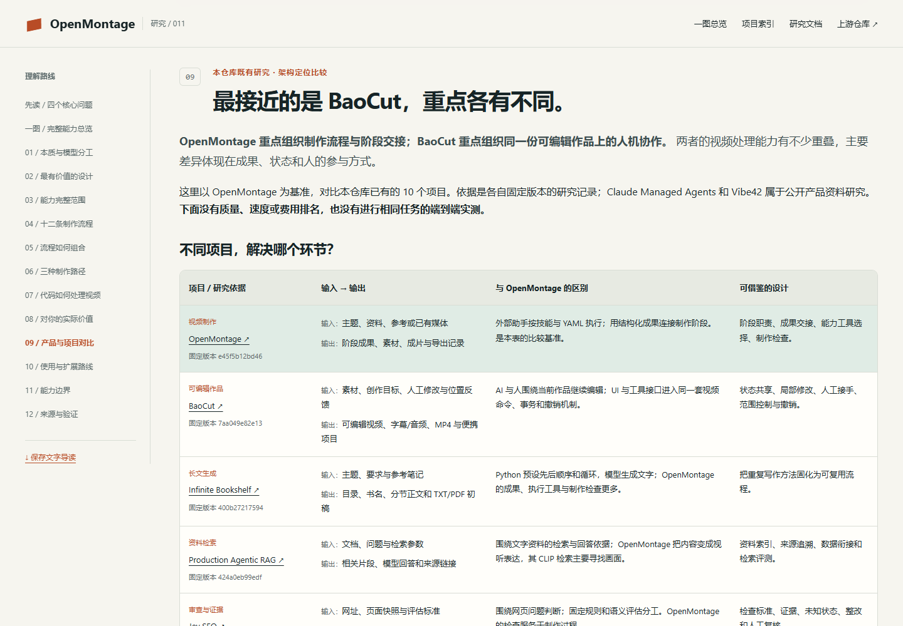
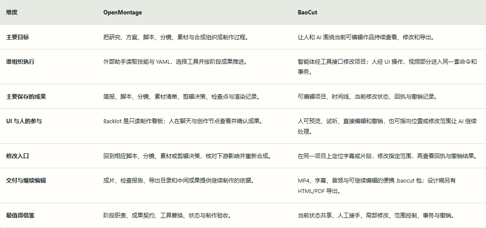
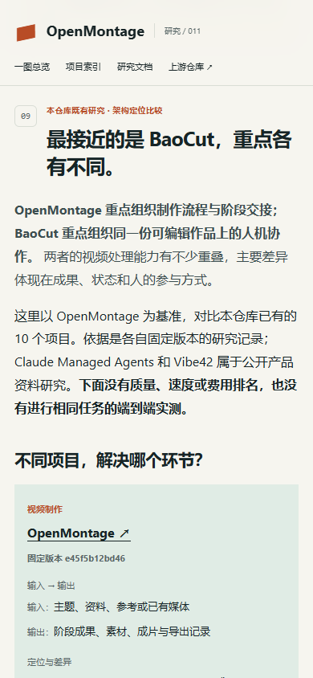
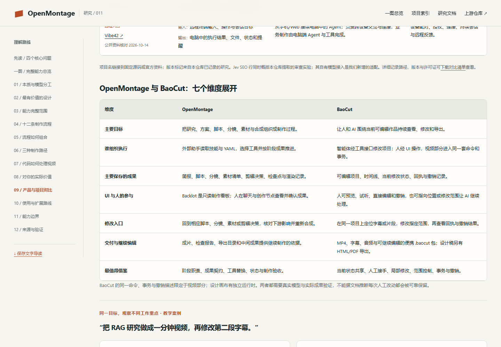
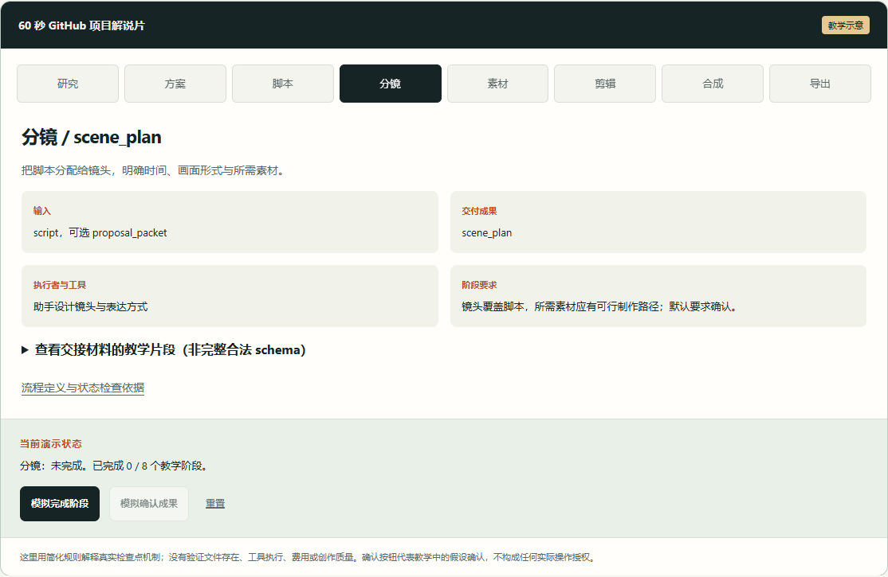
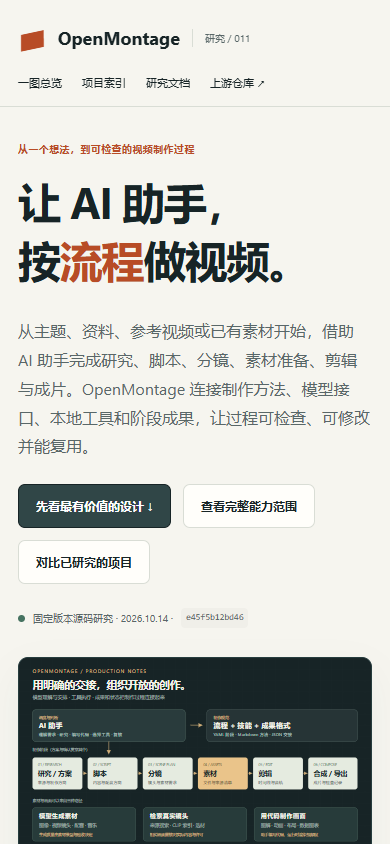
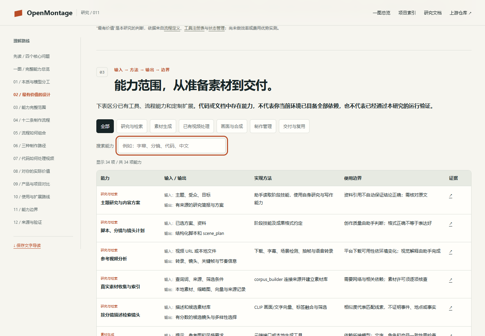

# 本地网页与研究整理验证

日期：2026-10-14（Asia/Shanghai）。研究 commit：`e45f5b12bd46440b04f3675af9a77d0718e6a254`。

## 已完成范围

| 检查 | 实际结果 |
| --- | --- |
| 目录生成 | 成功：34 项能力、12 条制作流程、27 项来源；HTML、README 和文字导读一致 |
| 源码路径 | 27 项来源路径均存在于固定 commit 的递归目录记录；各项阅读范围分别标注 |
| 项目元信息 | 元信息与总索引校验通过：`researching`、固定版本、许可证、18 项摘要、原创完整图 PNG 预览；公开入口在实际发布后登记 |
| 本地站点构建 | `python scripts/build_site.py --project 011-openmontage --output site-openmontage-preview` 成功，构建仅含指定项目 |
| 浏览器检查 | 20 组检查通过，详细结果见 `web-verification.json` |
| 核心导读与首页摘要 | 四项导读与元信息对应；首页完整保留18项分项摘要及完整图入口，没有截断或折叠 |
| 完整能力图 | SVG / PNG 2200×4753，34 项能力与12条流程全部包含；实际字体边界无超出，四段原尺寸画面人工检查通过 |
| 完整图网页入口 | `#understanding` 图像完整加载；实际点击 PNG/SVG 下载及原尺寸查看通过 |
| 静态内容 | 34 行能力、12 张流程卡、27 项来源，全部本地锚点存在且 ID 唯一 |
| 新增项目对比 | 11 行包含 OpenMontage 基准与 10 个既有项目；来源和版本对应 JSON，BaoCut 对照有七个维度 |
| 对比导出 | 实际点击 JSON 下载，文件与目录数据一致；文字导读包含完整比较、案例、组合边界和依据链接 |
| 手机对比 | 390 / 320 px 下逐项目显示，11 项全部可见，无页面横向溢出；关闭 JS 和本地文件阅读仍保留比较表 |
| 资源与下载 | 项目子路径、CSS、JS、SVG、JSON、文字导读和返回首页均 HTTP 200；TXT 的类型正确 |
| 能力筛选 | 六类分类数量正确，关键词匹配、零结果提示、清空恢复全部通过 |
| 路径解释 | 模型生成、真实镜头、代码画面切换与选中状态通过 |
| 教学状态 | 跳过前序被阻断，五个确认门等待模拟确认，八阶段完成和重置通过；不调用真实制作工具 |
| 响应式 | 1440、1024、768、390、320 px 视口无页面横向溢出，图片加载完整 |
| 无脚本阅读 | 禁用 JavaScript 后能力表、流程卡、正文与来源仍在页面中 |
| 浏览器错误 | 正式检查无脚本／控制台错误；页面无自动外部请求 |
| 本地文件阅读 | 直接打开 `web/index.html` 时正文、图片、能力筛选与阶段交互通过，不依赖预览服务器 |
| 语法与修改格式 | `node --check projects/011-openmontage/web/app.js` 与 `git diff --check` 通过 |
| 仓库工具测试 | `python -m unittest discover -s tests -v`：35 项，34 项通过、1 项跳过；当前 Windows 用户不支持符号链接，相关测试跳过 |

环境：Windows、Python 3.10.11、Node.js 22.15.0、已安装 Chrome 154.0.8037.99、已有 Playwright 运行时。Chrome headless 用于实际页面操作；390 px 为视口模拟，不是真实手机设备实测。

首轮检查发现浏览器默认请求 `/favicon.ico` 返回 404；增加相对子路径 SVG 图标后重新验证，正式记录通过。手工查看桌面首屏、阶段交接与手机截图，确认正文、按钮、图示与布局正常。

## 仓库总索引的历史情况与本次结果

已执行 `python scripts/update_index.py` 与 `python scripts/update_index.py --check`。创建 011 时总索引已新增入口；最新摘要的再次生成因同一工作区其他正在编辑项目的元信息校验失败而停止：最初为 `013-claude-managed-agents` 缺少预览，随后为 `015-free-claude-code` 的 `assets/understanding-overview.svg` 缺失。工作区还曾同时存在两个 015 编号目录。

本研究未修改其他项目编号、占位资源或元信息来绕过检查。2026-10-14 完整总览图更新时，上述临时问题已由工作区其他编辑解除；本次执行 `python scripts/update_index.py` 与 `--check` 均通过，根索引已展示新完整图与摘要。35 项仓库测试再次运行，34 通过、1 因 Windows 符号链接限制跳过。

## 完整能力图补充验证

新图包含七个阅读层次：输入、组织、六类能力、底层实现、十二种效果、输出与扩展；并附核心价值和验证边界。以已有 `research.json` 为目录来源，新增原创 SVG 绘制与 PNG 渲染器。生成与渲染记录见 `ability-map-verification.json`。

四段检查截图 `assets/map-*-qa.png` 为同一幅图的原尺寸渲染片段，逐段查看，确认标题、34 项条目、实现标签、案例输入输出及来源说明均可读，没有文字溢出。PNG 与 SVG 的内容一致；新图是固定版本研究理解，不代表运行真实制作工具。浏览器网页测试仍检查原有筛选、路径、阶段交接和响应式，并新增完整图加载、两种文件实际下载与原尺寸查看。

## 实际截图



来源：2026-10-14，本地 Chrome 1440×1000 实际网页截图；比较根据既有研究，未执行上游横向实验。



来源：本地 Chrome 对静态对照表的实际截图；图中能力不是本次运行结果。



来源：本地 Chrome 390×844 视口模拟截图，未使用真实手机设备。



来源：本仓库原创网页的本地 Chrome 截图，1440×1000；非上游产品运行截图。



来源：本地教学交互的实际页面截图，浏览器状态不代表真实模型执行。



来源：本地 Chrome 390×844 视口模拟截图。



来源：本地 Chrome 桌面截图，展示固定源码归纳。

## 未验证事项

没有安装或运行上游完整系统，没有请求图片、视频、TTS 等付费服务，没有运行 GPU 模型或生成真实视频。中文发音、翻译、口型、角色连续性、素材许可逐项核查、真实费用、质量、效率和可靠恢复仍待试验。网页没有公开部署，`demo_url` 为空；固定 GitHub 来源链接依据已读取的版本，未将最终网页 QA 当作全部外部链接实时可达性检查。

新增产品比较基于各自已有固定版本与公开资料记录，不代表对最新功能的重新审计。11 行版本和来源与 `comparison.json` 一一对应；未对所有外部来源 URL 做本次实时可达性测试。没有生成真实比较样片、测试人工修改保留、互导项目或接通 RAG → 制作 → 编辑系统，也没有质量、速度或费用排名。总索引与 35 项仓库工具测试在此次补充后重跑通过，其中一项符号链接测试因 Windows 条件跳过。

## 重新运行

```powershell
python projects/011-openmontage/experiments/build_research_catalog.py
python scripts/update_index.py
python scripts/update_index.py --check
python -m unittest discover -s tests -v
python scripts/build_site.py --project 011-openmontage --output site-openmontage-preview
python -m http.server 8791 --bind 127.0.0.1 --directory site-openmontage-preview
```

浏览器验证命令见 `experiments/README.md`。静态服务仅供本地预览；网页不需要模型 API 或密钥。
