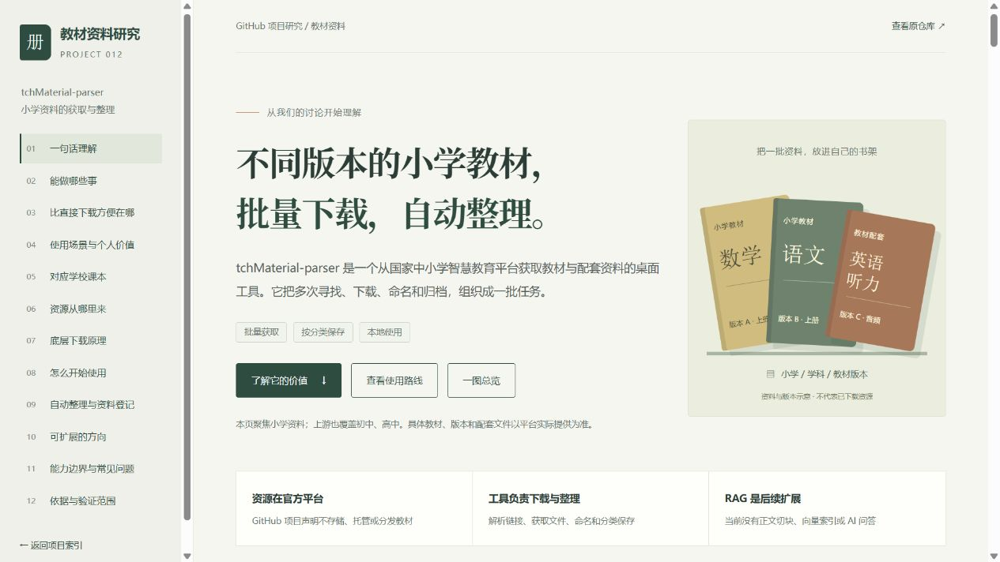
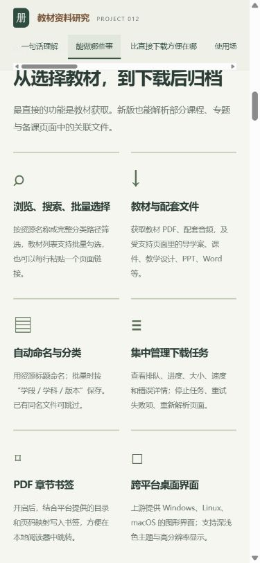
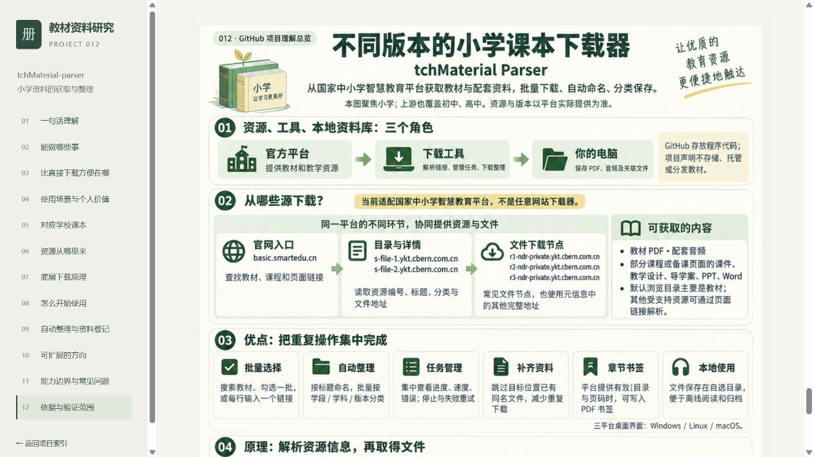

# 2026-10-14 网页发布与验证

## 内容与发布范围

发布到本仓库 GitHub Pages 的独立项目路径。主线是不同版本小学教材与配套资料的批量获取、自动命名、分类保存和失败处理；上游也覆盖初中、高中。

根索引完整展示 16 项摘要：定位与本质、能力、资料范围、下载源、原理、输入、输出、整理与可靠性、比直接下载方便、价值与意义、当前使用场景、对你的价值、可扩展场景、扩展实现路线、学校用书与版权、研究与验证。网页十二个章节保留现有交互，另补六项扩展场景及实现前提。

引导图沿用用户指定的 understanding-summary.png，未重新生成。原图、网页图与首页引导图的 SHA-256 为 `073535223b514c5578fa6369dca8a5ed9ae73289e9233ad4d682fca420ba5dc1`。图片是本仓库理解整理，不是上游运行或教材下载截图。

## 发布准备

- 从远端最新主分支 d3ac4b8 的独立工作树开始，只新增项目 012 并由工具生成根索引；没有纳入共享工作区里未完成的其他项目或工具修改。
- 索引生成及 --check 通过；JavaScript 语法通过；仓库 35 项测试完成，34 通过、1 因 Windows 符号链接权限跳过。
- 正式默认构建汇集 10 个静态演示，保留此前 9 个入口。
- 首页和项目页的本地文件、锚点与唯一 ID 检查通过，16 项摘要完整存在，引导图与指定原图一致。
- 详细结果：[publication-preflight.json](./publication-preflight.json)。

## 发布状态

- 内容提交：[4d40a06c72d223dd60140e531f69a044744bcaca](https://github.com/yydshly/1013_codex_project/commit/4d40a06c72d223dd60140e531f69a044744bcaca)。
- [Pages 构建与部署](https://github.com/yydshly/1013_codex_project/actions/runs/38512370698)：success；[索引与工具验证](https://github.com/yydshly/1013_codex_project/actions/runs/38512370726)：success。
- [在线理解网页](https://yydshly.github.io/1013_codex_project/012-tchmaterial-parser/)与[总索引](https://yydshly.github.io/1013_codex_project/)已实际访问。
- 首次 18 个公网地址通过：项目页、CSS、JS、PNG、SVG、图标、首页引导图、首页、构建清单与此前 9 个网页入口；项目资源与上述提交的 Git 内容一致，首页与构建快照一致，16 项摘要完整存在。结果见 [publication-http-first.json](./publication-http-first.json)。
- 25 项公网浏览器检查通过：四场景、六步原理、六项版本勾选与重置、RAG 折叠说明、17 列空白 CSV 实际下载、指定原 PNG 下载及哈希、六项扩展场景、键盘选择、桌面 / 390px / 320px 无横向溢出、原图显示、首页 16 项摘要与引导图、返回与进入、浏览器无警告错误。结果见 [public-web-verification.json](./public-web-verification.json)。
- 在上述成功后登记 demo_url，登记提交：[dd312b54a573d4d7b68a3ccd4b2d64c05b005a8a](https://github.com/yydshly/1013_codex_project/commit/dd312b54a573d4d7b68a3ccd4b2d64c05b005a8a)。
- [登记后的 Pages 工作流](https://github.com/yydshly/1013_codex_project/actions/runs/38512835233)与[独立索引验证](https://github.com/yydshly/1013_codex_project/actions/runs/38512835203)均 success。再次核对 18 个公网地址，全部 HTTP 200 且对应内容一致；首页 16 项最终摘要完整保留，9 个已有网页入口保持可访问。证据见 [publication-http-final.json](./publication-http-final.json)。
- 后续只补充发布证据的提交不改变网页静态资源；此处按入口登记提交记录内容一致性，不把后续文档提交误写成首次内容发布版本。

## 公网实拍

来源：2026-10-14，Codex 内置浏览器访问已部署 HTTPS 网页的实际截图；不是上游程序界面。

## 验证边界

静态网页不保存平台凭据、不调用下载后端、不下载真实教材、不连接模型。源码核对与公开小学资源元数据样本已记录；上游安装和登录后端到端下载、音频与真实书签、全平台覆盖、学校教材一致性、更新与未来 RAG 效果仍未实测。
