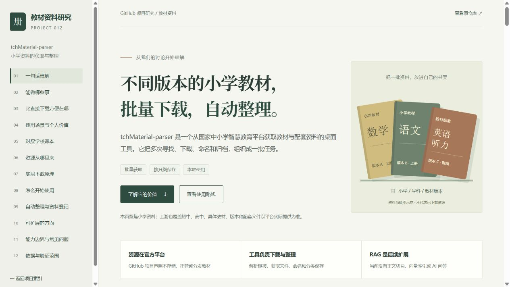
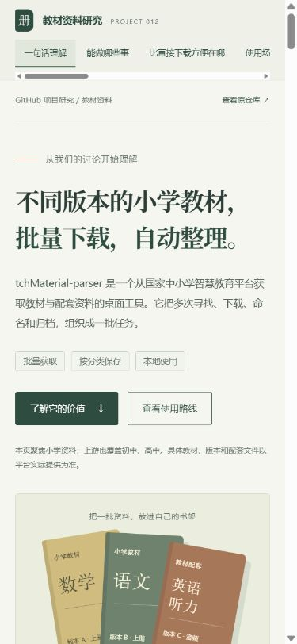
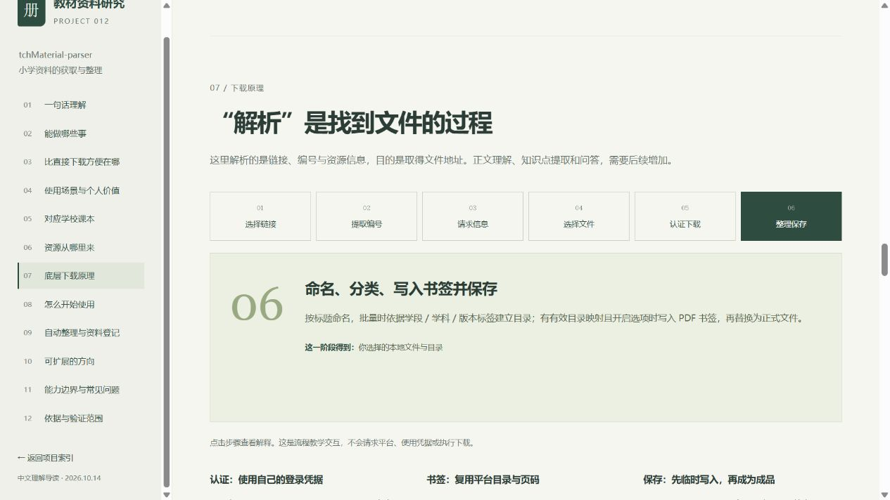

# 验证记录

日期：2026-10-14（Asia/Shanghai）。

研究固定版本：244170e17bf8bc97401f65e04d261533d252572a。2026-10-14 读取远端 HEAD，确认与首次源码研究一致。研究时最新发行版 v4.4；不将主分支的后续书签修复视为已经进入该发行包。

## 环境与范围

Windows，Python 3.10.11，Node.js v22.15.0，本地 HTTP 服务与 Codex 内置浏览器。网页为原生 HTML / CSS / JavaScript。

本次执行只读公开元数据请求和本仓库网页检查，没有安装或运行上游应用，没有使用账号凭据，没有下载 PDF 或音频，也没有连接任何模型或 RAG 后端。

## 源码与公共数据

| 检查 | 结果 | 依据 |
| --- | --- | --- |
| 研究版本与许可 | 远端 HEAD 为固定 commit；源码许可证为 MIT | git ls-remote、固定源码 LICENSE |
| 目录与资源范围 | 默认 fetch_resource_list 只加载教材；其他资源可以由部分解析分支处理 | catalog.py、api.py |
| 下载与整理 | 查到三线程、有限重试、临时文件、自动标题命名、分类路径和已有文件跳过 | download_panel.py |
| 认证与书签 | 查到三项凭据与 HMAC-SHA256 签名、目录树及页码映射写入书签 | auth.py、network.py、bookmarks.py |
| 教材版本目录 | HTTP 200，索引含四个目录分片 | metadata-probe.json |
| 一个目录分片 | HTTP 200，找到小学分类记录 | part_100.json |
| 一个小学教材详情 | HTTP 200，含源 PDF、ebook_mapping 与小学 / 统编版 / 一年级 / 上册等标签 | 见下方样本 |

样本：

- 标题：（根据2022年版课程标准修订）义务教育教科书·道德与法治一年级上册。
- 编号：bdc00134-465d-454b-a541-dcd0cec4d86e。
- 请求：[公开详情 JSON](https://s-file-1.ykt.cbern.com.cn/zxx/ndrv2/resources/tch_material/details/bdc00134-465d-454b-a541-dcd0cec4d86e.json)。
- 结果：[metadata-probe.json](./metadata-probe.json)。

这个样本只证实公开资源信息可读取，不能据此认定实际文件可下载、文件完整、配套书签有效或与某学校教材一致。

## 网页与构建

| 检查 | 结果 |
| --- | --- |
| JavaScript 语法 | Node.js --check 通过 |
| 指定子项目静态汇集 | build_site.py --project 012-tchmaterial-parser --output site-tchmaterial-preview 成功 |
| 本地文件和锚点 | 两个 HTML 页面所引用的本地文件与锚点有效，ID 无重复 |
| SVG | 首页引导图、详情总览图和图标 XML 可解析 |
| 七个 HTTP 地址 | 全部返回 200：索引、项目页、CSS、JS、总览 SVG、favicon SVG、索引预览 SVG |
| 四个使用场景 | 分别切换并确认标题与选中状态 |
| 六步原理 | 分别切换并确认步骤编号和解释标题 |
| 版本清单 | 六项勾选显示 6 / 6，保留未自动验证说明；重置返回 0 / 6 |
| CSV 下载 | 实际下载成功；UTF-8 BOM，17 列，表头加一行空记录；不含凭据字段 |
| 键盘交互 | Tab / Enter 可选择场景，内容正确更新 |
| 桌面、390px / 320px | 页面宽度与可视宽度一致，无页面横向溢出；窄屏表格内部滚动 |
| 章节与返回入口 | 章节链接定位对应内容；项目页返回预览索引后可重新进入 |
| 折叠说明 | 常见问题可展开，RAG 说明可见 |
| 浏览器日志 | 检查时无 error / warn |
| 仓库测试 | 35 项完成：34 通过，1 因当前 Windows 用户不能创建符号链接而跳过 |

静态结果：[static-check.json](./static-check.json)。实际下载的空白 CSV：[blank-registry.csv](./blank-registry.csv)。

此前在共享工作区执行索引检查时，曾被其他在建项目的重复编号与缺失预览图阻塞。2026-10-14 发布准备改为基于远端最新版本的独立工作树，仅收录本项目，重新生成根索引并通过 --check；保留所有已提交网页，没有修改其他在建项目或绕过校验。总索引为本项目展示 16 项完整摘要，并沿用本次 PNG 理解图。

仅运行检查不代表公开发布。发布流程先保持 demo_url 为空，待公开访问与文件校验成功后登记入口；本轮结果另见 publication-2026-10-14.md。

## 图片

来源：2026-10-14 本地构建预览的浏览器截图，非上游桌面程序。

来源：同上；手机视口 390 × 844。

来源：同上；选择第六步“整理保存”。操作只改变教学解释，不执行下载。

原创 SVG 理解图保存在 assets 与 web/assets，内容相同；它是解释图，不是运行结果截图。

## 全面理解图补充

2026-10-14 根据用户要求新增一张全面 PNG 总览图，主标题为“不同版本的小学课本下载器”。涵盖三个角色、官网下载源与资源服务器、可获取内容、六项优点、六步原理、意义与价值、使用场景、边界及扩展路线；同时说明上游也覆盖初中、高中。

- 使用内置 imagegen 新生成，原图 1086 × 1448；保留原 SVG，不覆盖旧图。依据与完整提示词见 [infographic-prompt.md](../infographic-prompt.md)。
- 通过工具返回的图片检查标题、正文、服务器地址、角色关系、边界和布局；没有把图示当作真实教材下载结果。
- 更新项目预览元信息、README 与网页图片；网页提供完整 PNG 下载和原 SVG 简图下载。
- 原图、网页副本、静态汇集副本和索引预览副本的 SHA-256 一致；PNG 头、尺寸、图片引用、下载链接及静态汇集入口检查通过，见 [infographic-check.json](./infographic-check.json)。
- 当时再次运行仓库测试：34 通过，1 因 Windows 符号链接权限跳过。共享工作区的总索引仍被其他项目缺失预览图阻塞；本轮独立发布工作树已通过索引检查。
- 本次浏览器尝试检查用户打开的 file:// 网页被协议策略拒绝，未改用其他浏览器方式绕过；新增图的网页引用只进行了静态校验。上述桌面、手机及交互实拍对应此前原 SVG 版本。

## 未验证事项

- 上游程序安装、启动和三个操作系统的实际运行。
- 账号凭据获取、过期与平台授权后的完整文件下载。
- 配套音频可播放、真实书签、特殊 PDF 与完整性检查效果。
- 网络限流、长时间批次、停止清理与真实失败恢复。
- 平台所有小学教材覆盖、学校具体修订版本与配套课程进度。
- RAG、OCR、正文检索、自动版本更新、断点续传；当前仅为扩展建议。
- 本记录的图片为本地预览；公开部署与公网网页验证另见本轮发布记录，不证明真实教材下载有效。

此前对另一条八年级语文元数据的成功读取只作为初期探索；本子项目以本次保存的小学样本记录为依据。
