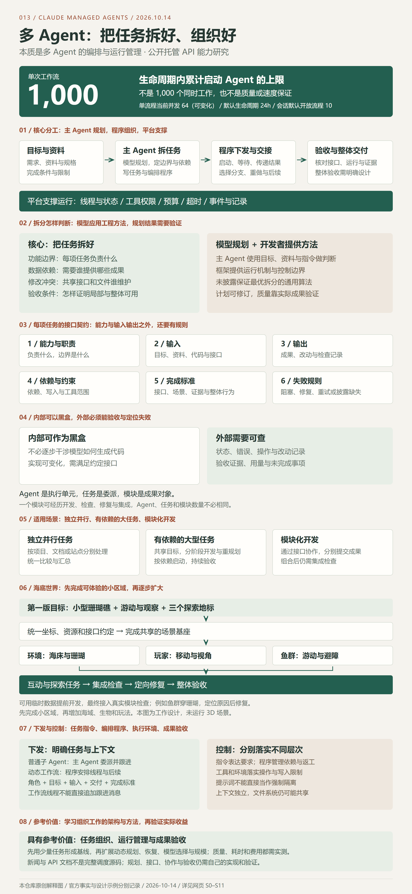

# 013 · Claude Managed Agents：多 Agent 编排、运行管理与参考价值研究

> 本质是多 Agent 的编排与运行管理。单次工作流累计启动 Agent 上限为 1000；主 Agent 依靠模型规划拆分任务，程序安排执行。核心是做好任务拆分、接口、依赖和验收，适用于并行、大型和模块化任务；内部实现可黑盒，状态与成果证据应可检查。

[在线理解网页](https://yydshly.github.io/1013_codex_project/013-claude-managed-agents/) · [返回总索引](../../README.md#项目索引) · [官方文档](https://platform.claude.com/docs/en/managed-agents/overview) · [网页源文件](./web/index.html) · [网页运行说明](./web/README.md) · [验证与实验](./experiments/README.md)

## 研究对象与结论

研究对象是 Anthropic 的 Claude Managed Agents 托管 API 服务，重点是动态工作流及多 Agent 机制。讨论入口为 [MIXED 新闻](https://mixed-news.com/en/claude-managed-agents-dynamic-workflows-1000-agents-permission-policies/)。该文章没有提供完整调度源码，不能将其直接归为 Claude Code 内部功能或可下载的开源库。

我们的核心理解是：将大任务划分、分派并执行，按依赖交接、汇总结果，再管理进度、权限、预算、超时和失败。动态工作流的特点是主 Agent 根据任务编写编排程序，由平台后台执行；普通子 Agent 的后续工作则由主 Agent 持续安排。机制依据见网页来源 S1、S2、S3。

它具有架构与工程方法上的参考价值：模型提出计划，程序组织执行，按任务明确证据与验收。新闻本身技术深度有限，不能由此推断底层实现简单。可靠拆分、文件协作、状态恢复和收益评测仍值得深入研究。

## 能力、原理、价值与扩展摘要

与根索引及网站首页一致，完整保留以下 18 项说明；详细机制和两个教学案例见后文与网页。

| 问题 | 完整说明 |
| --- | --- |
| 定位 | Anthropic 面向开发者提供的 Claude Managed Agents 托管 API 服务；本次研究动态工作流与子 Agent 协作。新闻是讨论入口，官方文档是行为依据；未公开完整调度源码，不能将其直接等同于 Claude Code 内部功能或可下载的开源库。 |
| 能力 | 本质是多 Agent 的编排与运行管理：配置角色与工具，把任务分派给独立上下文中的执行 Agent，支持并行、阶段、结果交接、分支、循环及失败处理；通过事件观察线程与流程，管理权限、预算和生命周期。它提供组织执行的能力，具体业务成果由模型、工具与任务设计决定。 |
| 原理 | 主 Agent 根据目标、资料和指令使用模型进行规划，编写编排程序；服务端后台运行程序，按阶段启动工作线程，传入上下文，收集结果并选择后续或修订。普通子 Agent 则由主 Agent 委派与继续跟进。各线程对话独立，沙箱文件共享，文件协作仍需约束。 |
| 输入 | 业务目标、参考资料或代码、Agent 的模型与职责、可用工具、运行环境，以及任务边界、接口、依赖、预算和验收条件。对大型任务，先明确最小交付、共同规格和接口；例如海底世界先约定坐标、单位、事件和可玩的最小区域。 |
| 输出 | 研究报告、代码模块或其他业务成果，以及阶段与线程事件、工具操作、失败信息和用量。接收结果后仍要核对来源、检查实际产物与集成行为；工作流 completed 只表示程序运行结束，不保证每个任务成功或最终成果通过验收。 |
| 核心价值 | 把大型目标组织成可执行、可交接、可验收的工作，减少持续分派、等待和汇总的人工操作，并把规划与运行管理的职责分开。上千规模体现容量；最值得借鉴的是任务拆分、依赖调度、状态管理和结果验收的架构思路，数量本身不能证明更聪明、更快或更便宜。 |
| 对我们的意义 | 将本仓库的 GitHub 项目研究标准做成重复使用的流程：独立分析与复现、核查版本和源码依据、整理实验及未验证项，再由单一步骤汇总文档和更新索引。把人的精力放到目标、判断与验收；减少重复操作的效果仍需用真实研究任务测量。 |
| 适用场景 | 独立并行的多项目研究、文档分析和批量检查；依赖清楚的大型开发任务；通过稳定接口协作的模块化迁移与集成。海底世界按规格、基座、环境／玩家／鱼群、互动／任务、集成修复组织。小任务、强共享状态或需要频繁交换未稳定上下文的任务应先验证单 Agent。 |
| 规模上限 | 1000 是单次工作流生命周期内累计启动 Agent 的上限，不是 1000 并发。当前文档列出单流程同时工作的线程数为 64，默认生命周期 24 小时、同会话最多 10 个开放流程；这些作用域不同，部分数值不是长期 API 保证。普通子线程还受独立限制，不能混用数字。 |
| 拆分判断 | 主要依赖主模型结合目标、资料、指令与工程约束规划。我们的判断方法是功能边界、数据依赖、修改冲突和交付验收：先统一规格，再拆成有明确输入输出的阶段与任务。框架提供执行和管理机制，公开资料没有披露保证最优架构或最佳任务拆分的通用算法。 |
| 任务接口 | 每份任务单明确六项：能力与职责、输入、输出、依赖约束、完成标准和失败规则。Agent 是执行单元，任务是一次委派，模块是成果对象；一个模块可以经历开发、复核、修复和集成多个任务，一个 Agent 也可处理不同阶段，三者不必一一对应。 |
| 黑盒边界 | 内部模型生成与模块实现可以按黑盒使用，主 Agent 不必干涉每一步。外部必须能观察状态、错误、工具操作、文件改动和验收证据；接口兼容不等于业务正确。写入范围和操作权限需要程序、工具或环境落实，提示词声明不能替代强制隔离。 |
| 下发与控制 | 普通子 Agent 接收主 Agent 的任务和后续消息；动态工作流由编排程序安排线程、交接结果和选择后续。工具策略控制调用，预算控制消耗，事件显示状态；工作流内部线程不能按普通子 Agent 任意跟进或单独停止。停止流程需确认结束事件，程序结束后仍要验收产物。 |
| 可扩展场景 | 可参考扩展为批量项目研究流水线、RAG 支撑的证据整理、大型产品与海底世界模块开发、模型路由与专家分工、跨项目迁移、独立质量复核、人工确认及运行看板、版本更新后的增量重跑。网页逐项说明工作流程、输入输出、实现前提和验收指标；这些是后续设计方向，未自动接入现有项目。 |
| 扩展前提 | 稳定任务契约和依赖图、统一来源与版本字段、明确工具权限和目录归属、可恢复状态及可观察失败、单 Agent 基线与评测任务集。新增模型、RAG、运行看板或人工复核都需要真实接口与测试，不能只加角色名称；扩大规模前确认协调、费用和复核成本有收益。 |
| 自建路线 | 先做结构化任务与固定调度器，用三个同类任务、独立结果目录和单一汇总步骤验证闭环；随后补依赖、重试、恢复、权限、预算和证据复核，最后考虑动态规划、编排程序与多模型。网页提供自建 JSON 任务格式示例，但没有执行器，也不是官方 API 配置。 |
| 资料深度 | 新闻帮助了解能力，官方文档指导服务配置和运行行为；两者不能替代完整调度源码、故障实验与自己的工程设计。概念归纳可以简洁，可靠拆分、共享文件协作、失败恢复、观测和价值评测仍有工程深度。本次依据公开行为研究，未审计闭源内部实现。 |
| 边界与验证 | 截至 2026-10-14 核对官方资料，提供 17 章中文导读、18 项完整摘要、沿用的 SVG／PNG 总览、海底世界依赖交互、三种并行流程及任务格式示例。网页验证与上游能力验证分别记录：教学数据不调用真实 Agent，未运行 3D 世界，质量、速度、成本收益及底层完整实现未实测。 |

## 本轮讨论形成的完整理解

1. **规模与价值**：1000 是单次工作流生命周期内累计启动 Agent 的上限，不是 1000 个同时工作；当前文档列出的单流程并发值为 64，且可变化。最大的参考价值在编排与运行管理方法，数量不能证明质量或速度。
2. **拆分与规划**：主 Agent 使用模型能力，结合目标、资料、指令和工程约束进行规划。框架提供运行机制；公开资料没有披露保证最优软件架构的通用拆分算法。
3. **判断方法**：我们归纳为功能边界、数据依赖、修改冲突、交付与验收。先统一规格与接口，再把大目标拆成阶段和可验收任务；这属于设计方法，不是官方固定模板。
4. **下发与控制**：普通子 Agent 接收主 Agent 的任务和后续消息；动态工作流由编排程序安排线程、交接结果和选择后续。任务指令、程序约束、工具执行和成果验收分别承担控制职责。
5. **任务接口与黑盒**：明确能力、输入、输出、依赖约束、完成标准和失败规则。内部生成与实现可按黑盒使用，状态、错误、操作、改动和验收证据仍要可查。
6. **Agent、任务与模块**：Agent 是执行单元，任务是一次委派，模块是成果对象。一个模块可经历开发、检查、修复与集成多个任务，三者数量不必相同。
7. **适用范围**：独立的批量项目研究可以并行；海底世界等大型项目需要依赖管理与持续集成；模块化开发通过接口协作，组合后仍需验证整体行为。
8. **实现边界**：提示词中的写入范围不是强制隔离，共享文件需要协作规则。真实限制要落实到程序、工具或执行环境；收到“完成”报告仍需验收。

海底世界案例先定义一个能游动、观察鱼群、找到三个地标的小型珊瑚礁区域；完成场景基座后，按接口开发环境、玩家与鱼群，再接入互动和任务。教学案例假设集成发现鱼群坐标单位转换错误，定位后修复受影响链路，再进行整体验收和扩展。案例未生成或运行 3D 世界。

| 信息 | 本次记录 |
| --- | --- |
| 编号与类型 | `013` / `source_type: website`，公开产品资料研究 |
| 官方来源 | https://platform.claude.com/docs/en/managed-agents/overview |
| 资料核对日期 | 2026-10-14，北京时间 |
| 功能时间点 | 官方记录动态工作流于 2026-10-09 进入 Beta |
| 研究版本 | 官方资料的本次核对日期；未获取底层源码 commit |
| 上游开源许可证 | 未确认；`source_ref` 与 `source_license` 保持为空 |
| 状态 | `researching`：资料研究与已发布导读，尚未运行上游服务 |
| 公开网址 | [多 Agent 编排与运行管理理解网页](https://yydshly.github.io/1013_codex_project/013-claude-managed-agents/)，已经发布并实际访问验证 |

## 网页内容

网页完整保留我们的理解，按十七个问题组织：

1. 本质与核心结论：多 Agent 编排、运行管理与参考价值。
2. 研究对象：新闻文章、托管 API 服务和本仓库导读的区别。
3. 运行原理：主 Agent 持续分派与编排程序安排后续的区别。
4. 能力与输入输出：阶段、并行、工具、事件及规模限制。
5. 控制边界：角色、工具、启动、停止、观察、预算与自托管范围。
6. 任务拆分：模型与框架的分工、工程方法、边界与依赖。
7. 任务接口：六项契约、黑盒边界、Agent / 任务 / 模块区别。
8. 下发控制：任务单、委派机制及指令、程序、工具、验收层次。
9. 大型任务：海底世界六个阶段、六份任务单、依赖与集成修复。
10. 并行任务：项目研究的正常、失败重试、证据不足三种教学流程。
11. 使用条件：独立并行、大型任务、模块化开发及适用边界。
12. 对本仓库的价值：研究方法复用及与 RAG、路由、写作项目衔接。
13. 资料深度：概念参考、API 使用和完整自建实现分别判断。
14. 自建路线：结构化任务、固定调度、状态、恢复、验收，以及八种扩展场景的输入输出、实现前提和价值验证。
15. 价值验证：相同任务下比较证据、覆盖、核查时间、耗时与费用。
16. 理解核对：保留本次讨论的十二个主要问题。
17. 依据与验证范围：十二条来源，事实、理解和模拟分开标示。

交互包括协作方式切换、三种并行教学流程、海底世界阶段与任务单切换、章节导航、问答展开、SVG / PNG 总览和任务模板下载。无需外部脚本、字体或图片，核心正文关闭 JavaScript 仍可阅读。

## 理解总览图



来源：本仓库直接绘制的 1200 × 2600 SVG，结合官方资料与讨论，用浏览器导出 2400 × 5200 PNG。不是实际运行截图。可下载 [高清 PNG](./assets/understanding-overview.png) 或 [可缩放 SVG](./assets/understanding-overview.svg)；网页使用相同副本；本次发布沿用既有图像，首页以同一高清 PNG 作为引导图，没有重新生成图。图片来源、桌面与手机截图及验证证据见 [本地验证记录](./experiments/results/verification.md)。

## 自建参考与实际价值

我们建议先用三个同类项目形成最小研究流程。每个执行任务同时承担项目分析和实验，写入独立结果目录；验收步骤核对来源、固定版本、源码位置与实验记录；最后由一个步骤汇总文档和更新索引。

[自建任务模板](./web/data/research-plan.example.json) 包含任务依赖、并发、重试、写入范围和证据要求。它是本仓库的格式示例，没有执行器，也不是 Anthropic API 配置。字段限制必须由自建程序真正实现。

可以借鉴 002 RAG 的资料检索、007 模型路由的判断标准和 001 写作项目的报告组织方式。实际衔接需要统一来源字段、任务接口、模型接入与验收方法。这是扩展方向，并非现有功能或已验证效果。

## 环境与本地查看

本次环境：Windows / PowerShell，Python 3.10.11、Node.js 22.15.0。网页使用原生 HTML、CSS、JavaScript，Python 只用于静态构建和本地服务，Node.js 用于语法检查；不需要安装网页依赖或填写模型密钥。

在仓库根目录执行：

```powershell
python scripts/build_site.py --project 013-claude-managed-agents --project 001-infinite-bookshelf --project 002-production-agentic-rag-course --project 007-hermes-jev-skills --output site-claude-agents-preview
python -m http.server 8793 --bind 127.0.0.1 --directory site-claude-agents-preview
```

访问 `http://127.0.0.1:8793/013-claude-managed-agents/`。统一部署子路径为 `/1013_codex_project/013-claude-managed-agents/`。已按统一站点发布，[公网入口](https://yydshly.github.io/1013_codex_project/013-claude-managed-agents/) 已验证；实际发布遵循 [部署约定](../../docs/deployment.md)。

也可直接用浏览器打开 `web/index.html` 阅读和操作教学演示；“全部项目”和跨项目链接需要上述静态构建与本地服务。

## 公网发布

2026-10-14，内容提交 `42f8398f0db99b0f8870ff42ccbc9bc7ddcde1b1` 的 [GitHub Pages 工作流](https://github.com/yydshly/1013_codex_project/actions/runs/38514399743) 成功。首次 19 个公开地址全部 HTTP 200，内容与提交或构建输出一致，18 项摘要和原高清引导图保留，已有 10 个静态演示入口仍可访问。

已在公开网页操作机制切换、六阶段海底世界、六份任务接口、三种研究流程、问答、文件下载、手机键盘控制和首页回跳，并检查六种宽度。网页为静态教学展示，不执行真实托管任务。完整范围与正式入口登记后的结果见 [发布验证](./experiments/results/publication-2026-10-14.md)。

## 验证范围与后续实验

已核对公开产品文档并整理本次讨论。网页验证单独记录在 [verification.md](./experiments/results/verification.md)，不能作为托管服务实测证据。

创建时的重复编号阻塞已在当前仓库中解除，本轮重新更新索引并记录检查结果。历史情况与当前验证见验证记录。

尚未执行：真实 Managed Agents 调用、多 Agent 与单 Agent 对比、运行成本测量、质量优势验证、自建调度器和工具接入。后续实验优先覆盖失败披露、证据缺失、重复执行、停止与恢复，再决定是否增加动态编排或扩大 Agent 数量。

## 来源与使用

官方事实与各自依据在网页 S1–S11 中逐项关联；S0 是讨论入口的新闻。关键来源包括 [多 Agent 编排](https://platform.claude.com/docs/en/managed-agents/multiagent-orchestration)、[工作流运行](https://platform.claude.com/docs/en/managed-agents/workflow-runs)、[线程](https://platform.claude.com/docs/en/managed-agents/session-threads)、[权限](https://platform.claude.com/docs/en/managed-agents/permission-policies)、[预算](https://platform.claude.com/docs/en/managed-agents/budgets)和[适用指南](https://claude.com/resources/articles/building-multi-agent-systems-when-and-how-to-use-them)。文档持续更新，使用前重新核对功能与限制。

没有复制上游程序或品牌素材。网页、流程模拟、任务模板与解释图由本仓库编写。当前仓库未设置统一开源许可证，不把官方产品的公开资料等同于开放底层实现。
