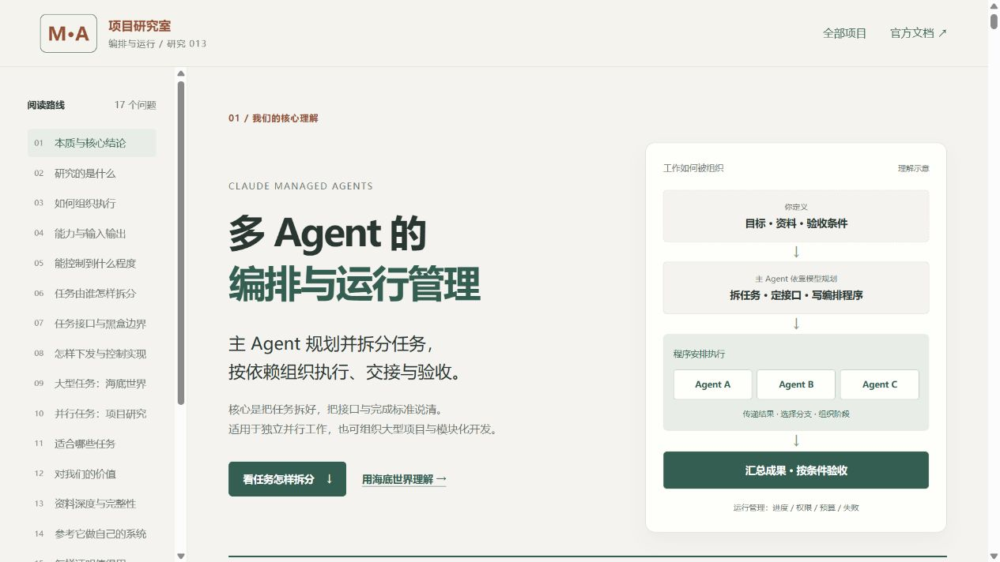
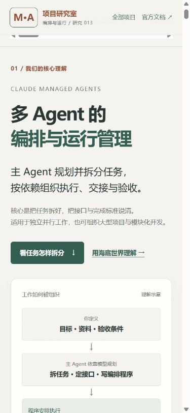

# Claude Managed Agents 理解网页 · 公网发布验证

公开入口：[多 Agent 编排与运行管理](https://yydshly.github.io/1013_codex_project/013-claude-managed-agents/)；[站点总览](https://yydshly.github.io/1013_codex_project/)。日期为 2026-10-14，北京时间。

## 已发布的内容

17 章导读、18 项完整摘要和八种扩展场景，明确回答能力、原理、价值与个人意义、适用与可扩展场景、输入输出、拆分、下发、黑盒边界、控制、自建路线与验证范围。保留并行研究及海底世界依赖、失败修复的教学交互。

能力概括为多 Agent 的编排与运行管理；主模型负责规划拆分，程序安排依赖、任务分派与交接，平台支撑线程与运行控制。1000 明确标为单次工作流累计启动上限，不是同时并发。资料定位为托管 API 服务的公开文档研究，未声称已获得完整调度源码。

首页引导图沿用本次讨论已有的 2400 × 5200 PNG；详情页使用同一绘图的 SVG，并提供 SVG、PNG 下载。没有重新生成或修改图内内容。PNG SHA-256 为：

```text
136537eb21199cb206756c9f8ac7928debf1dbc60afc95fb788900d815c494e4
```

Git 会规范化文本资源的换行符，公开 SVG、HTML、CSS、JS、JSON 均按实际提交 blob 核对，而不是把本机的 Windows 换行差异误判为内容变化。

## 首次内容发布

| 项目 | 实际结果 |
| --- | --- |
| 内容提交 | [`42f8398f0db99b0f8870ff42ccbc9bc7ddcde1b1`](https://github.com/yydshly/1013_codex_project/commit/42f8398f0db99b0f8870ff42ccbc9bc7ddcde1b1) |
| 发布工作流 | [38514399743](https://github.com/yydshly/1013_codex_project/actions/runs/38514399743)，构建与部署均成功 |
| 本机仓库检查 | 索引、JavaScript 语法、静态资源与锚点通过；35 项工具测试中 34 项通过，1 项因当前 Windows 用户不能创建符号链接而跳过 |
| 远端构建 | Linux / Python 3.12，索引验证、35 项工具测试、全站静态构建与 Pages 部署成功 |
| 公开资源 | 19 个地址 HTTP 200，SHA-256 与提交 blob 或同次构建输出一致；见 [初次资源检查](./publication-http-initial.json) |
| 原有入口 | 默认构建保留 001、002、005、006、007、008、009、010、011、012，共 10 个原有静态演示，逐一 HTTP 200 且内容一致 |
| 发布范围 | 增加 013，站点合计 11 个静态演示；004 无静态网页，仍在仓库研究索引中 |

公网资源检查包括首页、构建清单、013 HTML / CSS / JS / SVG / PNG / JSON、首页引导图和十个原有详情入口。[检查脚本](../check_publication.py)使用公开 HTTP 请求和 Git blob，不调用模型或控制浏览器。

## 公网浏览器检查

使用 Codex 内置浏览器实际操作 HTTPS 公开站点，共 13 组检查通过，详情见 [publication-browser.json](./publication-browser.json)。

| 范围 | 已观察结果 |
| --- | --- |
| 两种协作方式 | 普通子 Agent 与动态工作流切换后，解释内容与选中状态同步 |
| 海底世界六阶段 | 规格、基座、模块并行、互动、集成失败与修复均可切换；失败阶段 3 项局部通过、鱼群失败，最后阶段 6 项示例通过 |
| 六个任务接口 | 每个模块分别展示能力、输入、输出、依赖约束、验收与失败处理六个字段 |
| 三种研究流程 | 正常 5 步、失败重试 7 步、补证据 7 步均可结束并重置；证据不足时实际显示“待补证据”和“未提供实验记录” |
| 问答及扩展 | 黑盒问答可展开；八种扩展场景入口与表格有效 |
| 下载 | SVG、PNG、JSON 三份文件成功下载；PNG 哈希与原图一致 |
| 布局 | 320、390、760、768、1024、1440 像素宽度均无整页横向溢出，手机扩展表格可局部横向滑动 |
| 手机操作 | Space 切换集成失败阶段，Enter 选择鱼群任务，状态与六个字段正确 |
| 首页摘要 | 完整展示 18 项说明，来源标记为产品网站与公开资料研究 |
| 引导图和回跳 | 首页 PNG 实际加载为 2400 × 5200，原图入口及项目详情回跳有效 |
| 浏览器错误 | 检查时没有捕获到控制台错误 |

桌面、手机实际公开网页截图见 [图片来源说明](../../assets/README.md)。以下是公开网页的桌面默认视口与手机首屏，不是上游产品界面或多 Agent 实测：





## 正式入口登记

首次部署及公网检查成功后，才填写 `project.json` 的 `demo_url`，随后运行索引生成器并提交入口和验证记录。

| 项目 | 正式登记后的实际结果 |
| --- | --- |
| 登记提交 | [`31df444e218b51d64b85faf137f6a5adf62c7b41`](https://github.com/yydshly/1013_codex_project/commit/31df444e218b51d64b85faf137f6a5adf62c7b41) |
| 对应工作流 | [38515132055](https://github.com/yydshly/1013_codex_project/actions/runs/38515132055)，构建与部署均成功；Linux 上 35 项工具测试全部通过 |
| 再次访问 | 19 个地址再次全部 HTTP 200，与正式登记提交 blob 或构建输出一致；见 [最终资源检查](./publication-http-final.json) |
| 说明与原图 | 18 项摘要、八种扩展场景与原 PNG 哈希均通过，10 个已有入口保留 |
| 交互覆盖 | 登记仅更新元信息和研究、发布记录，HTML / CSS / JS / 图像 / JSON 教学文件与已经完成 13 组浏览器验证的内容提交相同，没有重复运行不受改动影响的全部交互 |

本轮将最终资源检查和本段结果提交回远端。证据提交只补发布记录，不改变已经验证的静态页面与引导图；工作流运行状态可在仓库 Actions 查看。

## 实际验证边界

本次完成研究网页发布和静态交互验证，没有创建 Managed Agents 会话、调用模型或执行真实多 Agent 任务；海底世界没有生成或运行 3D 场景。八种扩展是设计方向，需要接入实际模型、检索、工具、状态和业务系统后分别验证。

未验证真实权限、预算、停止、超时与恢复语义，未证明多 Agent 相比单 Agent 在质量、时间或费用方面有优势。产品限制依据核对日期的官方资料，可能随 Beta 变化；源码 commit 与上游开源许可证未确认。发布网页不改变这些边界。

本次在独立发布工作副本完成提交，仅收录本项目与生成的根索引、部署记录，没有将共享工作区中其他尚未提交的研究项目一并发布。
