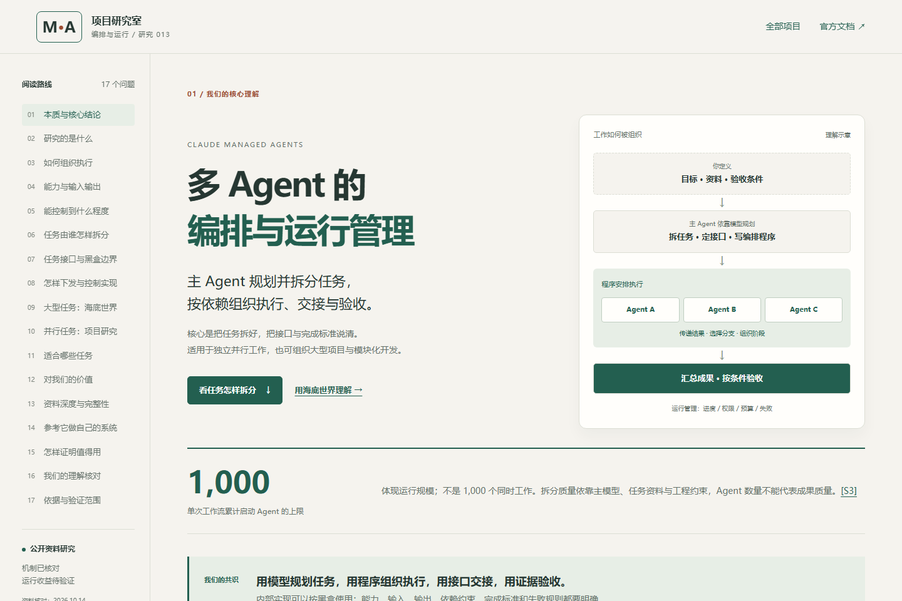
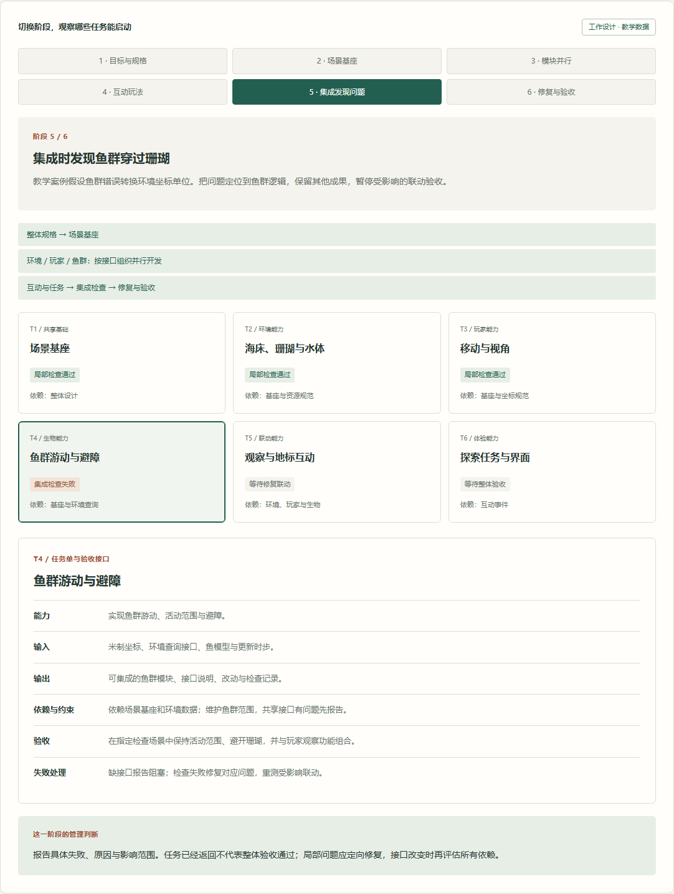

# 本地网页验证 · 2026-10-14 · 发布前的完整理解更新

后续公网发布和本轮新增摘要、扩展场景的检查见 [发布验证](./publication-2026-10-14.md)。下面保留发布前的本地结果和历史过程。

本记录只验证 013 的静态研究网页与原创解释图，不验证 Claude Managed Agents 的运行能力、研究质量或费用优势。没有调用模型、创建托管会话、执行真实多 Agent 任务或运行 3D 海底世界。

## 环境与范围

- Windows / PowerShell；Python 3.10.11、Node.js 22.15.0。
- 使用本机已有的 Playwright 与 Chromium，浏览器版本见 [browser-checks.json](./browser-checks.json)。
- 本地地址：`http://127.0.0.1:8793/013-claude-managed-agents/`，验证时返回 HTTP 200。
- 静态构建包含 013、001、002、007，用于检查本页资源与组合思路中的站内链接。
- `site-claude-agents-preview/` 是被忽略的本地构建目录；没有提交依赖、密钥或构建输出。未发布公网网页，`demo_url` 为空。

## 已通过

| 检查 | 实际结果 |
| --- | --- |
| 静态构建 | `scripts/build_site.py` 的显式四项目构建成功；013 的 HTML、CSS、JS、SVG 与 JSON 均被收集 |
| 浏览器功能 | [检查脚本](../check_web.cjs)的 22 项检查全部通过；报告见 [browser-checks.json](./browser-checks.json) |
| 导航与来源 | 17 个章节、12 个问答、12 条来源，ID 唯一，页内锚点有效，本地资源与项目链接返回 HTTP 200 |
| 机制切换 | 动态工作流与普通子 Agent 的解释、限制与按钮状态同步变化 |
| 正常流程 | 5 步可完成，最终按钮停止推进，重置回到第 1 步 |
| 失败与补证据 | 两种 7 步流程都呈现预期中间状态，可完成、可重置，切换情况从头开始 |
| 问答与下载 | 十二个问答可展开与收起；SVG、PNG 与 JSON 下载成功，JSON 标明 `example_only: true` |
| 拆分与黑盒 | 模型规划、六项任务契约、Agent / 任务 / 模块区别及强制隔离边界均存在 |
| 海底世界阶段 | 六个阶段可以切换；依赖等待、临时数据开发、局部检查、集成失败与最终示例验收状态符合设计 |
| 模块任务单 | 六个模块可分别查看，每份任务单都包含能力、输入、输出、依赖约束、验收和失败处理 |
| 键盘操作 | Enter 可选择鱼群任务，Space 可切换阶段，按钮选中状态同步 |
| 响应式布局 | 320、390、760、768、1024、1440 像素宽度均无整页横向溢出；手机上的表格使用局部横向滑动 |
| 手机操作 | 并行流程和模式切换可用；海底世界阶段与任务单切换可用 |
| 无 JavaScript | 核心结论、17 章正文、12 条来源、流程说明与默认鱼群任务接口仍可阅读 |
| 浏览器错误 | 未发现脚本异常或控制台错误 |
| JavaScript 语法 | `node --check web/app.js` 通过 |
| 根索引与元信息 | `update_index.py` 更新成功，`--check` 通过；全仓元信息可加载，013 已被收录，公网地址保持为空 |
| 图片与任务模板 | SVG 是合法 XML，SVG / PNG 两种网页副本与来源文件一致；JSON 可解析，依赖没有循环或未知任务。见 [static-checks.json](./static-checks.json) |
| 总览图导出 | [导出脚本](../export_overview.cjs)检查画布与面板中的文字边界，通过后导出 2400 × 5200 PNG；见 [diagram-checks.json](./diagram-checks.json) |
| 仓库工具测试 | `python -m unittest discover -s tests -v` 共运行 35 项：34 项通过，1 项因当前 Windows 用户无法创建符号链接而跳过 |

桌面与手机首屏、并行流程、海底世界任务组织，以及总览图上下部分已查看。网页没有整页横向溢出，图内文字没有越出面板。手机元素长截图含固定的跳转焦点提示；桌面任务组织截图隐藏了元素外部的固定页头，正文与教学状态未修改。图片来源说明见 [assets/README.md](../../assets/README.md)。





## 历史阻塞与本轮处理结果

首次创建时，其他在建项目曾导致全仓校验失败，其中重复编号报错为：

```text
Index validation failed: Duplicate id or slug: 015-rea
```

当时同时存在两个 015 项目，本任务没有改名、移走或修改它们。本轮开始时，当前仓库已经是 `015-rea` 与 `016-free-claude-code`，重复编号不再存在。重新通过脚本更新根索引，并确认检查通过，没有手动编辑自动索引区域。

本轮同时通过全仓元信息加载、013 资料与图片一致性检查，以及仓库工具测试。根索引已收录更新后的完整理解摘要与总览图。

创建阶段优先尝试了 `scripts/new_project.py`，当时因另一在建项目 012 的预览文件尚未写完而失败；之后检查目标不存在，复制项目模板创建 013，再填写研究内容与元信息。没有绕过元信息校验来修改根索引。

## 预览交接范围

本轮自动交互与截图检查使用本地 HTTP 地址。完成后尝试操作用户已有的 `file:` 预览，被浏览器工具的 URL 安全策略拒绝，该工具只允许 HTTP / HTTPS；没有用其他浏览器或接口绕过限制。源文件和图像已经更新，现有本地标签页由用户手动刷新。此次拒绝不影响已经完成的网页功能检查。

## 重跑本地检查

在仓库根目录构建并启动本地服务：

```powershell
python scripts/build_site.py --project 013-claude-managed-agents --project 001-infinite-bookshelf --project 002-production-agentic-rag-course --project 007-hermes-jev-skills --output site-claude-agents-preview
python -m http.server 8793 --bind 127.0.0.1 --directory site-claude-agents-preview
```

在另一终端运行以下命令；需要已有 Playwright 和可用的 Chromium。第三个位置参数可传本机现有 Playwright 包目录，未传时使用正常的模块查找。

```powershell
node projects/013-claude-managed-agents/experiments/check_web.cjs http://127.0.0.1:8793/013-claude-managed-agents/
node --check projects/013-claude-managed-agents/web/app.js
python scripts/update_index.py
python scripts/update_index.py --check
python -m unittest discover -s tests -v
```

修改 SVG 后，可以先运行 `node projects/013-claude-managed-agents/experiments/export_overview.cjs` 导出 PNG，再构建预览。导出脚本的第一个位置参数可传现有 Playwright 包目录。依赖目录不入库。

## 未验证

未启动上游服务，未获取底层完整调度源码或 commit，未确认上游开源许可证。未验证真实权限、预算、停止、超时与恢复行为，也未证明多 Agent 相对单 Agent 的质量、速度或成本收益。JSON 是我们的设计格式，没有调度器；网页中的并行流程、海底世界模块、失败与补证据都是固定教学案例。

后续真实实验按 [实验方案](../README.md) 执行。产品事实依据记录在网页 S0–S11，功能与限制可能随 Beta 变化，使用前重新核对官方文档。
