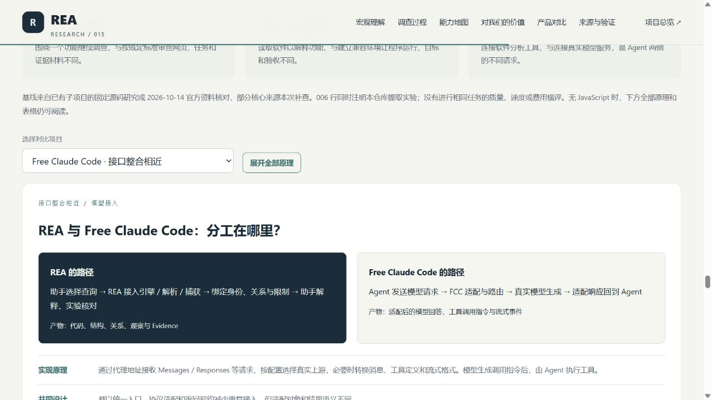

# 015 · REA：逆向工具管理、软件调查与证据组织

> 宏观理解：把软件分析工具接到 AI 助手，统一调用和整理证据，再围绕具体问题逐步调查。反汇编是其中一部分，应用结构、资源、网络与运行行为也在研究范围内。

[返回总索引](../../README.md#项目索引) · [原 GitHub 仓库](https://github.com/morluto/rea) · [网页源文件](./web/index.html) · [网页使用说明](./web/README.md) · [来源映射](./references/source-map.md) · [验证记录](./experiments/results/verification.md)

## 研究版本与范围

| 信息 | 内容 |
| --- | --- |
| 编号 | 015-rea |
| 原项目 | morluto/rea，Reverse Engineer Anything |
| 研究日期 | 2026-10-14（Asia/Shanghai） |
| 固定 commit | ebaaa79ca02bde4a73013a2a9a781d0b07a57ee4 |
| 固定源码 package.json | 6.4.0；不代表与 npm 6.4.0 文件相同 |
| 上游许可证 | MIT，Copyright (c) 2026 morluto；原文保存在 [upstream-LICENSE](./assets/upstream-LICENSE.txt) |
| 研究状态 | researching：完成文档与部分核心源码核对，尚未运行上游 |
| 本地研究环境 | Windows、PowerShell、Python 3.10.11、Node.js 22.15.0 |
| 上游运行时要求 | Node.js 22.x ≥22.19、24.x ≥24.11 或 26+，以及 npm；部分操作要求更高或额外工具 |
| 公网演示 | 未部署，demo_url 保持空字符串 |

本机已核对的 Node.js 22.15.0 低于该源码声明的支持版本。本研究没有安装、登记或运行 REA，也没有把网页检查当作真实软件分析验证。

## 我们的完整理解摘要

以下十四项摘要同步用于项目元信息、仓库索引、站点首页和网页导读。沿用本次讨论的完整总图，能力依据和验证范围按固定研究版本记录。

<!-- UNDERSTANDING_START -->
### 本质与定位

REA 是面向 AI 的软件调查中间层：管理逆向工具的选择、调用、目标身份和会话，适配不同引擎或材料格式，同时实现自己的解析、关系追踪与比较。它通过 CLI / MCP 把这些动作交给助手；“管理工具”在这里指接入和组织调查能力，安装所需外部引擎仍需分别完成。

### 能力是什么

读取原生二进制的函数、汇编和伪代码；分析 JavaScript / Electron 的模块、路由与 IPC；处理 .NET、Android、Flutter / HarmonyOS、固件和资源；观察浏览器、进程与运行现场；读取崩溃、网络、信号、WASM、EVM 和 SQLite 等材料。本导读用 18 个模块覆盖 37 项阅读分类，平台和动作范围分别核对。

### 原理是什么

CLI 和 MCP 共享应用层流程：先识别材料与目标，再选择合适的提供者；外部引擎反汇编 / 反编译，REA 内置解析器处理语法与格式，观察工具提供运行记录。应用层构建关系或比较结果，并连同来源、位置、身份、覆盖和未知返回 Evidence；AI 根据结果选择下一次查询，调查因此可以反复推进。

### 价值是什么

把分散的软件分析能力变成助手可调用、结果可回查的一套工作方式。对我们而言，可补充发布包和运行材料的研究、减少跨工具搬运、解释跨层功能，并积累结论、源码位置、实验和失败原因。定位是否更快、解释是否更准、整体成本是否下降，需要与直接读源码或手工分析做同条件对照。

### 可扩展场景

可继续建设研究证据库、中文导读与 RAG 检索，开展源码 / 发布包对照、双版本变化研究、旧格式兼容与局部实现验证；也可为新架构或专有格式增加提供者，或把 REA 接入 Agent 工作台。网页展开八种建议场景，逐项列出材料、模块、实施方式、产物和验收；这些整合尚未实现。

### 输入与输出

输入一个明确问题、对应版本的程序 / 安装包 / 脚本 / 记录或观察目标，以及主机、引擎、范围和场景参数。输出函数与代码、模块与资源结构、调用或跨层关系、观察或比较材料，以及目标哈希、工具版本、来源位置、限制和未知。解释与局部实现由助手完成，可靠性再由人和实验检查。

### 工具怎样分工

Ghidra / Hopper / IDA 面向机器码；Babel AST / ASAR 与 Wakaru 面向脚本和产物；JADX / Apktool / adb 面向 Android；CDP / Playwright / V8 Inspector / Frida 面向现场观察或受控执行；Binwalk / Unblob、pwntools、TShark、sigrok、WABT、EVMole 等分别处理固件、ELF、网络、信号和特定字节码。REA 把这些不同结果连接到同一调查问题。

### 完整流程怎样串起

以导出按钮为例：限定版本与问题，盘点安装包和脚本，定位按钮入口，再追到 preload / IPC / 主进程和文件 API；遇到原生边界才补原生查询，静态材料不够时再补运行或网络记录。保存证据和未知，解释一条功能链，编写局部实现，最后用相同输入比较输出、异常与边界；按需要返回前一步。

### 证据与验证

Evidence 保留材料身份、参数、提供者、原始与归一化结果、位置、关系、coverage、limits 与未知，并区分 observed、derived、inferred 的依据性质。哈希用于绑定材料；静态可达、实际执行、运行关联和因果解释分别判断。一个函数或一批样本通过，只支持所检查范围，完整软件重建仍需更广的行为验证。

### 已有使用场景

适合研究软件某个功能的内部实现、查找旧格式与接口、解释版本变化、定位故障、恢复局部算法以及保存旧软件。原生、Electron 和网站三组六步教学解释同一调查方法。公开 Notion、DX-Ball 和 TH04 案例可供阅读，但本仓库未重跑这些案例；网站前端记录也无法直接提供服务端内部源码。

### 与其他项目如何组合

REA 提供软件材料查询；RAG 提供已存资料检索；FCC 适配真实模型请求；Jev 指引帮助选择动作；Managed Agents 组织任务运行；cmux / Vibe42 提供人操作会话的入口。可以按需要组合，但要明确主机访问、工具协议、模型能力、状态、材料格式与验收。职责上的互补关系不表示已有现成接口。

### 从哪里开始

先选择一个有源码可对照的 JavaScript / Electron 小应用，只调查搜索、复制或导出中的一个功能。固定源码、产物和环境，先只读产物并记录推断，再打开源码核查；需要时补观察，最后做小范围输出对照。记录定位时间、错误、遗漏、人工复核、配置成本与模型用量，再决定是否扩展工具链。

### 已有产品的差异

Jev SEO 围绕网页标准审查，shadPS4 围绕兼容环境执行，FCC 围绕模型接口接入；REA 围绕未知的软件问题取材料和追关系。RAG、Jev 指引、任务编排、会话工作台与视频创作分别解决其他层的问题。网页保留十项职责、输入、机制、输出和验收对比，未做同任务的质量、耗时或费用横评。

### 研究成果与成立条件

固定 REA commit ebaaa79c，保留 MIT 许可，完成文档和核心源码核对；网页含十四项理解摘要、原有十三章、18 模块总图、37 项分类、三组六步教学、十项产品对比和八种扩展建议。沿用本次讨论的高清 PNG / SVG。真实 REA、引擎和复现尚未运行；Node、JDK、平台与商业引擎条件各有要求，网页发布只交付静态研究内容。
<!-- UNDERSTANDING_END -->

## 一张图：完整工具、能力、原理与流程


[高清 PNG](./assets/toolchain-overview.png) · [可缩放 SVG](./assets/toolchain-overview.svg) · [图中数据与固定版本](./web/data/toolchain-overview.json) · [制作依据](./references/toolchain-figure.md)

本次总图明确 REA 的本质：逆向分析工具的管理与适配，加上自有格式解析、关系追踪和证据接口。它把底层结果提供给 AI 继续调查，最终由人和受控实验验证。18 个阅读模块完整覆盖现有 37 项分类；模块数不等于上游 MCP 工具数。

图由本仓库在 2026-10-14 直接绘制，2400 × 6858，同一内容输出 PNG 与 SVG；不是上游运行截图。原简图保留在 assets/understanding-overview.svg。

<details>
<summary>展开完整工具、原理、材料交接与来源表</summary>

<!-- TOOLCHAIN_START -->
| 模块 | 工具 | 原理 | 返回材料 | 串接 | 范围 | 固定依据 |
| --- | --- | --- | --- | --- | --- | --- |
| 01 · 原生二进制与专用架构 | Ghidra / Hopper / IDA；PSP 用 ghidra-allegrex 扩展 | 字节解码为指令；重建控制与数据关系，按引擎能力生成伪代码。 | 函数、汇编、伪代码、字符串、调用与引用。 | 原生库 / .node → 本模块；结果接回功能链。 | DOS / raw / MIPS / PSP / RISC-V 是有范围的 Ghidra 路线。 | [native-investigation.md](https://github.com/morluto/rea/blob/ebaaa79ca02bde4a73013a2a9a781d0b07a57ee4/docs/native-investigation.md)、[ghidra-dos.md](https://github.com/morluto/rea/blob/ebaaa79ca02bde4a73013a2a9a781d0b07a57ee4/docs/ghidra-dos.md)、[raw-binary.md](https://github.com/morluto/rea/blob/ebaaa79ca02bde4a73013a2a9a781d0b07a57ee4/docs/raw-binary.md)、[ghidra-mips.md](https://github.com/morluto/rea/blob/ebaaa79ca02bde4a73013a2a9a781d0b07a57ee4/docs/ghidra-mips.md)、[ghidra-psp.md](https://github.com/morluto/rea/blob/ebaaa79ca02bde4a73013a2a9a781d0b07a57ee4/docs/ghidra-psp.md)、[ghidra-riscv.md](https://github.com/morluto/rea/blob/ebaaa79ca02bde4a73013a2a9a781d0b07a57ee4/docs/ghidra-riscv.md) |
| 02 · JavaScript / Electron 静态分析 | REA 内置 Babel AST / ASAR；Wakaru | 解析语法树与产物，构建模块、路由、IPC 图；Wakaru 另做可读模块恢复。 | 入口、跨层候选、source map、子图与版本关系。 | 从入口追到 preload / IPC；原生边界交给 01。 | 静态图不证明执行；Wakaru 恢复限 Linux x64。 | [javascript-artifact-reconstruction.md](https://github.com/morluto/rea/blob/ebaaa79ca02bde4a73013a2a9a781d0b07a57ee4/docs/javascript-artifact-reconstruction.md)、[javascript-application-workflows.md](https://github.com/morluto/rea/blob/ebaaa79ca02bde4a73013a2a9a781d0b07a57ee4/docs/javascript-application-workflows.md)、[javascript-recovery.md](https://github.com/morluto/rea/blob/ebaaa79ca02bde4a73013a2a9a781d0b07a57ee4/docs/javascript-recovery.md)、[javascript-runtime-reconciliation.md](https://github.com/morluto/rea/blob/ebaaa79ca02bde4a73013a2a9a781d0b07a57ee4/docs/javascript-runtime-reconciliation.md) |
| 03 · 网页读取与受控浏览器场景 | Chrome 系浏览器 · CDP / Playwright | CDP 读取已有页面；主动场景导航、操作、等待并捕获所选状态。 | DOM、脚本、可见请求、截图与场景比较。 | 捕获脚本 → 02；网络记录 → 14 / 15。 | 附加前活动无法补出；前端观察不提供后端源码。 | [browser-observation.md](https://github.com/morluto/rea/blob/ebaaa79ca02bde4a73013a2a9a781d0b07a57ee4/docs/browser-observation.md)、[browser-scenario-contract.md](https://github.com/morluto/rea/blob/ebaaa79ca02bde4a73013a2a9a781d0b07a57ee4/docs/browser-scenario-contract.md) |
| 04 · Node / Electron 运行关联 | V8 Inspector / CDP；Electron + Playwright | 观察加载脚本与上下文；主动运行 Electron 可获取窗口、IPC 等状态。 | 运行来源、脚本、窗口与所选事件。 | 运行 Evidence + 静态图 → REA 关联，保留两种依据。 | 被动附加和主动启动效果不同；关联不等于因果。 | [electron-observation.md](https://github.com/morluto/rea/blob/ebaaa79ca02bde4a73013a2a9a781d0b07a57ee4/docs/electron-observation.md)、[javascript-runtime-observation.md](https://github.com/morluto/rea/blob/ebaaa79ca02bde4a73013a2a9a781d0b07a57ee4/docs/javascript-runtime-observation.md) |
| 05 · .NET 与 NativeAOT | REA 内置 PE/CLI；可选 ghidra-nativeaot / Ghidra | 读元数据和 CIL；AOT 另读受支持 RTR / MethodTable，或使用扩展恢复。 | 类型、签名、CIL、原生声明与有限 AOT 元数据。 | P/Invoke / 虚槽目标 → 01；保留来源与地址依据。 | AOT 不是普通 CIL；内置 AOT 限 x64 PE / RTR 9.1。 | [managed-code-analysis.md](https://github.com/morluto/rea/blob/ebaaa79ca02bde4a73013a2a9a781d0b07a57ee4/docs/managed-code-analysis.md)、[ghidra-nativeaot.md](https://github.com/morluto/rea/blob/ebaaa79ca02bde4a73013a2a9a781d0b07a57ee4/docs/ghidra-nativeaot.md) |
| 06 · Android 代码、工程与资源 | JADX headless + JDK / JEB MCP / Apktool | JADX 反编译代码；JEB 提供工程分析；Apktool 解码 Manifest 与资源。 | 类、方法、引用、声明、字符串和资源信息。 | 设备取得 APK → 本模块；原生 .so → 01。 | 混淆与动态路径需补证；工具版本与许可证自备。 | [android-analysis.md](https://github.com/morluto/rea/blob/ebaaa79ca02bde4a73013a2a9a781d0b07a57ee4/docs/android-analysis.md)、[jeb-analysis.md](https://github.com/morluto/rea/blob/ebaaa79ca02bde4a73013a2a9a781d0b07a57ee4/docs/jeb-analysis.md)、[apktool-resource-analysis.md](https://github.com/morluto/rea/blob/ebaaa79ca02bde4a73013a2a9a781d0b07a57ee4/docs/apktool-resource-analysis.md) |
| 07 · Android 设备与材料获取 | adb（已有模拟器或真实设备） | 通过 adb 查询设备和进程，获取日志、截图、包与文件。 | 包 / 进程状态、日志、dump、截图与 APK。 | APK → 06；日志或原生组件 → 后续分析。 | REA 不自动创建模拟器；操作可能改变设备与文件。 | [adb-device-analysis.md](https://github.com/morluto/rea/blob/ebaaa79ca02bde4a73013a2a9a781d0b07a57ee4/docs/adb-device-analysis.md) |
| 08 · Flutter 与 HarmonyOS 初步结构 | REA 内置 APK / ELF / ZIP / snapshot 解析 | Flutter 读 Dart AOT 符号、头部与字符串投影；鸿蒙按包路径投影组件。 | 构建来源、摘要、URI 候选和有限应用图。 | 发现原生组件 → 01；保留结构覆盖与未知。 | 不恢复任意 Dart 源码；鸿蒙当前不解读 Ark 业务。 | [flutter-analysis.md](https://github.com/morluto/rea/blob/ebaaa79ca02bde4a73013a2a9a781d0b07a57ee4/docs/flutter-analysis.md)、[harmony-analysis.md](https://github.com/morluto/rea/blob/ebaaa79ca02bde4a73013a2a9a781d0b07a57ee4/docs/harmony-analysis.md) |
| 09 · 固件、安装包与资源 | Binwalk / Unblob；REA ZIP / ASAR / plist | 识别区域与容器，按支持格式提取；建立文件清单和 Apple bundle 结构。 | 区域、提取文件、摘要、资源与组件身份。 | ELF / PE → 01；JS → 02；APK → 06。 | 固件工具限 Linux；加密、专有格式可能无法提取。 | [firmware-analysis.md](https://github.com/morluto/rea/blob/ebaaa79ca02bde4a73013a2a9a781d0b07a57ee4/docs/firmware-analysis.md)、[apple-application-analysis.md](https://github.com/morluto/rea/blob/ebaaa79ca02bde4a73013a2a9a781d0b07a57ee4/docs/apple-application-analysis.md) |
| 10 · ELF 布局与 Go 构建事实 | pwntools / pyelftools / Unicorn；REA Go 读取 | 读 ELF 布局与保护候选（可含局部指令模拟）；Go 读取嵌入的编译器 / 模块记录。 | 布局、静态保护候选、模块和构建设置。 | 地址 / 符号 → 01；用构建事实限定版本。 | ELF 适配限 Linux x64；静态候选不证明运行状态。 | [binary-diagnostics.md](https://github.com/morluto/rea/blob/ebaaa79ca02bde4a73013a2a9a781d0b07a57ee4/docs/binary-diagnostics.md)、[go-binaries.md](https://github.com/morluto/rea/blob/ebaaa79ca02bde4a73013a2a9a781d0b07a57ee4/docs/go-binaries.md) |
| 11 · 已保存的 Linux 崩溃记录 | pwntools；可选 GDB + pwndbg | 按 core 与 ABI 解析线程寄存器、信号及 notes；可补调试映射候选。 | 崩溃时刻材料、线程状态和映射依据。 | 异常地址 → 01，结合指令、调用关系再查根因。 | 读取历史 core；没有完整现场或因果结论保证。 | [recorded-crashes.md](https://github.com/morluto/rea/blob/ebaaa79ca02bde4a73013a2a9a781d0b07a57ee4/docs/recorded-crashes.md) |
| 12 · 受控进程运行与行为比较 | 原生 PTY / 进程监督；REA 场景与比较 | 启动指定命令，安排输入与等待，记录终端、退出及所选文件状态。 | 交互记录、退出状态、文件观察与运行差异。 | 原程序 / 自己实现，用相同条件做局部对照。 | 新捕获支持 Linux / macOS；进程管理不是沙箱。 | [process-capture.md](https://github.com/morluto/rea/blob/ebaaa79ca02bde4a73013a2a9a781d0b07a57ee4/docs/process-capture.md) |
| 13 · 动态插桩 | Frida Node 绑定 + 适用的目标端环境 | 附加或启动进程，在目标内运行调用者脚本，由脚本决定观测内容。 | 设备 / 进程发现、脚本消息与生命周期记录。 | 观测函数或数据 → 与 01 / 02 的位置和关系核对。 | 脚本具有实际执行效果；目标端依赖需自行准备。 | [frida-instrumentation.md](https://github.com/morluto/rea/blob/ebaaa79ca02bde4a73013a2a9a781d0b07a57ee4/docs/frida-instrumentation.md) |
| 14 · 历史网页网络记录 | REA HAR / SAZ / qlog 读取；mitmdump | 解码已有会话记录与可用载荷；原生 mitmproxy 格式由适配解码。 | 请求、响应、载荷、来源位置与 API 候选。 | 端点 / 消费者线索 → 02；包层记录 → 15。 | mitmdump 路线限 Linux；未记录数据不能恢复。 | [web-network-captures.md](https://github.com/morluto/rea/blob/ebaaa79ca02bde4a73013a2a9a781d0b07a57ee4/docs/web-network-captures.md) |
| 15 · 网络包字段与 PCAP 摘要 | Wireshark · TShark / capinfos | 按协议解码保存的包，筛字段与重复值；汇总端点、DNS、SNI 等。 | 字段、过滤结果、协议分布与请求摘要。 | 接口与时序线索 → 应用代码或受控实验核对。 | 字段适配限 Linux；摘要范围与主机条件另查文档。 | [packet-captures.md](https://github.com/morluto/rea/blob/ebaaa79ca02bde4a73013a2a9a781d0b07a57ee4/docs/packet-captures.md)、[pcap-analysis.md](https://github.com/morluto/rea/blob/ebaaa79ca02bde4a73013a2a9a781d0b07a57ee4/docs/pcap-analysis.md) |
| 16 · 已录制的逻辑信号 | sigrok-cli + libsigrokdecode | 按采样通道、协议和解码器选项解释已有信号记录。 | 协议注释、样本区间与诊断。 | 信号含义 ↔ 固件代码 01 / 09，需另做对照。 | 当前适配限 Linux；不负责未录制信号或实时采集。 | [signal-recordings.md](https://github.com/morluto/rea/blob/ebaaa79ca02bde4a73013a2a9a781d0b07a57ee4/docs/signal-recordings.md) |
| 17 · WebAssembly 字节码 | WABT · wasm-validate / wasm-objdump / wasm2wat | 校验模块，读取节和导入导出，将字节码解码为 WAT。 | 校验、模块结构、精确接口形式与 WAT。 | 导入 / 导出边界 → 调用它的 JS 图 02。 | 不执行模块；WAT 不是原始 C / Rust 源码。 | [wasm-artifacts.md](https://github.com/morluto/rea/blob/ebaaa79ca02bde4a73013a2a9a781d0b07a57ee4/docs/wasm-artifacts.md) |
| 18 · EVM 字节码与 SQLite 存储 | EVMole；Node.js 原生 SQLite | EVM 推断分派接口；SQLite 读取数据库 / WAL 的 schema 与所选表行。 | 选择器 / 参数候选；表、列、索引与数据样本。 | 接口 / 数据结构线索 → 应用调用与业务验证。 | EVM 适配限 Linux x64；SQLite 需 Node 24.15+ / 26+。 | [evm-bytecode.md](https://github.com/morluto/rea/blob/ebaaa79ca02bde4a73013a2a9a781d0b07a57ee4/docs/evm-bytecode.md)、[sqlite-databases.md](https://github.com/morluto/rea/blob/ebaaa79ca02bde4a73013a2a9a781d0b07a57ee4/docs/sqlite-databases.md) |
<!-- TOOLCHAIN_END -->

</details>

## 1. 我们的宏观理解

REA 的定位是软件调查工具。它把已有软件分析工具与自己的解析、追踪、比较能力，做成 AI 助手可调用的统一接口。

| 角色 | 负责的工作 | 结果 |
| --- | --- | --- |
| 底层分析工具 | 反汇编、反编译、格式解析、浏览器或进程捕获 | 指令、伪代码、结构或观察材料 |
| REA | 工具接入、请求与生命周期、产物解析、追踪比较、证据保留 | 可继续查询和核查的结果 |
| AI 助手 | 按问题选择动作，解释结果，继续追问，编写实现 | 带依据的解释与待验证实现 |
| 人与实验 | 核对来源，对照原程序和复现，检查异常及边界输入 | 范围明确的验证记录 |

“把反汇编能力汇总整理”的理解抓住了接入与整理，但范围偏窄：JavaScript、.NET、网站、资源、网络记录和运行行为也有入口。实际调查围绕具体问题逐步进行。

REA 增强的是获得、组织和使用软件证据的能力。模型质量、底层引擎、材料完整性和验证方法仍决定实际结果。

### 补充共识：我们说的“接入与整理”，具体增加了什么？

我们的理解可以进一步写成：**REA 将软件分析能力组织成可调用的调查动作，并让返回材料带上身份、来源、关系与未知项；助手据此提出下一次查询，解释结果，再由实验核对。**

“反汇编工具加步骤，再汇总结果”抓住了一部分，但还需补上三点：分析对象包括脚本、资源、网络和运行观察；REA 自己也做解析、关系构建与比较；后续调查由助手按具体问题推进，不只是把一次输出排成报告。

| 增加的能力 | 对实际调查的意义 |
| --- | --- |
| 动作可以调用 | 助手可以要求读一个函数、找引用、查模块或捕获所选记录，再根据结果继续查 |
| 材料形成结构 | 将文件摘要、提供者、位置、关系和限制放在对应结果中，避免只留下无法回查的解释 |
| 调查可以继续 | 在兼容会话中保留 Evidence，再查看、追踪或比较；不是必须一次把全软件全部读完 |
| 结论可以复核 | 分开事实、推导和假设，记录仍需源码对照或运行测试的部分 |

不同材料的处理方式也不同：**反汇编**把机器字节解释为指令；**反编译**从指令等表示恢复伪代码；**JavaScript 解析**读取语法和产物结构；**运行观察**记录所选条件下发生的事。它们分别提供不同依据，不能统一理解为“恢复原始源码”。

以“导出按钮怎样保存文件”为例，助手先确认材料版本，再找入口和跨层关系，按需要取得原生函数或运行记录，最后写出解释或局部实现。只有拿到能支持该路径的具体证据，才可以对这个目标下结论；只有同条件对照过结果，才可以报告对应范围的复现验证。

对我们最可复用的设计，是把**模型理解、工具能力、状态管理和结果验收**分清。增加工具接口扩大可取材料的范围；更强的模型有助于解释；两者都要接受材料覆盖和行为验证的约束。

依据：[项目定位](https://github.com/morluto/rea/blob/ebaaa79ca02bde4a73013a2a9a781d0b07a57ee4/README.md)、[JavaScript 共享流程](https://github.com/morluto/rea/blob/ebaaa79ca02bde4a73013a2a9a781d0b07a57ee4/src/application/javascript/JavaScriptApplicationService.ts)、[Evidence 结构](https://github.com/morluto/rea/blob/ebaaa79ca02bde4a73013a2a9a781d0b07a57ee4/src/domain/evidence.ts)、[会话与比较契约](https://github.com/morluto/rea/blob/ebaaa79ca02bde4a73013a2a9a781d0b07a57ee4/docs/mcp-contracts.md)。

## 2. 输入、输出与调查过程

输入包括一个明确的问题和对应版本的本地材料或可观察目标；参数还可能包括提供者、动作、捕获范围和条件。

典型过程：明确问题 → 确认版本与文件身份 → 定位入口 → 跟踪关系与边界 → 解释和局部复现 → 对照验证。新证据可能使调查返回前一步或增加实验。

输出包括代码或结构、调用关系、运行或历史观察，以及身份、工具信息、位置、证据链接、限制和未知项。助手使用这些材料形成解释或自己的实现。

网页有三个固定教学流程：

1. **Electron 导出：** 从产物和模块定位入口，追踪 preload / IPC / 主进程等候选关系，再对照文件结果。
2. **原生局部计算：** 结合伪代码、指令、调用者和常量，重建一个函数，再比较相同输入的输出。
3. **网站搜索：** 区分被动观察与主动场景，研究可见前端与请求，保留后端内部未知。

教学流程没有分析真实目标，不能作为某个应用实际具有这些路径的证明。

## 3. 源库能力清单

按固定版本的 README 目标表和专题文档整理。条目数量是本研究的分类，不是上游 MCP 工具数量。文档或实现存在与主机运行通过分开记录。

<!-- CAPABILITY_TABLE_START -->
| 能力 | 输入 | 输出 | 条件 | 边界 | 固定来源 |
| --- | --- | --- | --- | --- | --- |
| 原生二进制 | EXE、DLL、ELF、Mach-O 或引擎支持的目标。 | 伪代码、汇编、字符串、符号、调用与引用；部分引擎提供控制流、类型与数据流。 | Hopper、Ghidra 或 IDA；主机、架构与格式范围按提供者确定。 | 反编译结果需结合指令和调用关系检查；原始注释、变量名与完整源码不能保证恢复。 | [来源](https://github.com/morluto/rea/blob/ebaaa79ca02bde4a73013a2a9a781d0b07a57ee4/docs/native-investigation.md) |
| 离线 ELF 布局 | 本地 ELF 文件。 | 节、段、原始符号、重定位及静态保护机制候选。 | Linux x64；自行提供 pwntools。 | 布局和静态保护候选不能证明真实运行状态或全部漏洞。 | [来源](https://github.com/morluto/rea/blob/ebaaa79ca02bde4a73013a2a9a781d0b07a57ee4/docs/binary-diagnostics.md) |
| Go 构建信息 | 包含 Go 构建信息的 ELF、PE 或薄 Mach-O。 | 编译器版本、模块、替换项和构建设置。 | 内置静态读取；不要求安装 Go。 | 构建元信息不会直接给出完整 Go 业务源码。 | [来源](https://github.com/morluto/rea/blob/ebaaa79ca02bde4a73013a2a9a781d0b07a57ee4/docs/go-binaries.md) |
| Linux 崩溃记录 | 已保存的 Linux core / 崩溃材料。 | 原始 notes、各记录线程的寄存器与信号，及可选映射候选。 | Linux x64；pwntools；可选 GDB / pwndbg。 | 记录反映被保存的时刻；根因仍需结合代码和实验判断。 | [来源](https://github.com/morluto/rea/blob/ebaaa79ca02bde4a73013a2a9a781d0b07a57ee4/docs/recorded-crashes.md) |
| 进程行为与对照 | 指定可执行程序、参数、交互和捕获条件。 | 终端输出、交互、退出、文件系统观察及两次运行的比较。 | Linux / macOS；原生 PTY；明确实验目标。 | 会运行所选程序；进程管理与清理不构成安全沙箱，有限记录不能证明所有行为等价。 | [来源](https://github.com/morluto/rea/blob/ebaaa79ca02bde4a73013a2a9a781d0b07a57ee4/docs/process-capture.md) |
| Frida 插桩 | 设备或进程选择，以及自行编写的插桩脚本。 | 设备和进程发现、附加或启动会话、脚本消息及生命周期记录。 | 可选 Frida Node 绑定及适用的目标端环境；真实验证记录主要为 Linux。 | 脚本在目标进程中执行并具有其权限；不自动安装目标端 Frida server，不保证所有设备兼容。 | [来源](https://github.com/morluto/rea/blob/ebaaa79ca02bde4a73013a2a9a781d0b07a57ee4/docs/frida-instrumentation.md) |
| JavaScript / Electron 产物 | 应用目录、ASAR、脚本及所选辅助清单或 source map。 | 模块、导入、入口、路由候选、IPC、原生扩展关系和应用图。 | Node.js 和 npm；静态分析无需原生反编译引擎。 | 语法和可达关系不能证明路径执行；动态属性、动态调用、解析失败与缺失材料保留未知。 | [来源](https://github.com/morluto/rea/blob/ebaaa79ca02bde4a73013a2a9a781d0b07a57ee4/docs/javascript-artifact-reconstruction.md) |
| 功能与语义追踪 | 已完成的应用 Evidence 和路由、字符串、API、模块、IPC 等种子。 | 可达子图、终点路径、语义关系、原生分析交接和未知项。 | 先取得兼容的应用分析证据；CLI 和 MCP 共用流程。 | 在已有图上推导；不会因追踪自动运行应用，静态解析到的调用不等于实际发生。 | [来源](https://github.com/morluto/rea/blob/ebaaa79ca02bde4a73013a2a9a781d0b07a57ee4/docs/javascript-application-workflows.md) |
| JavaScript 可读源码恢复 | 打包脚本及可选关联 chunk。 | 派生的可读模块、转换报告、文件摘要和引擎信息。 | Linux x64；Wakaru ^1.13.0（文档验证 1.14.0）及 prlimit。 | 不执行所选应用代码；原始变量名、任意运行等价性及所有打包格式的支持仍有边界。 | [来源](https://github.com/morluto/rea/blob/ebaaa79ca02bde4a73013a2a9a781d0b07a57ee4/docs/javascript-recovery.md) |
| 网站被动观察 | Chrome 系浏览器的本地 CDP 地址与选定页面。 | 页面结构、脚本、网络观察、可选截图，以及部分来源和事件信息。 | 自行启动可调试浏览器；明确页面和来源范围。 | 附加前的网络活动不可补全；被动接口不提供通用页面执行，也不能看到后端内部源码。 | [来源](https://github.com/morluto/rea/blob/ebaaa79ca02bde4a73013a2a9a781d0b07a57ee4/docs/browser-observation.md) |
| 浏览器受控场景 | 声明的浏览器、起始地址、动作、等待条件与捕获选择。 | 每一步状态、可选 DOM / 截图 / 事件 / 网络材料及场景比较。 | 可用浏览器；REA 通过 Playwright 启动或连接。 | 会导航和交互；需显式等待业务完成，背景工作和缺失捕获仍可能未知。 | [来源](https://github.com/morluto/rea/blob/ebaaa79ca02bde4a73013a2a9a781d0b07a57ee4/docs/browser-scenario-contract.md) |
| Electron 运行观察与场景 | 已有 CDP 页面，或指定 Electron 可执行文件和应用入口。 | 被动页面与脚本观察；主动场景可关联应用、窗口、WebContents、IPC 和动作。 | 被动模式需本地 CDP；主动模式需 Electron 和 Playwright。 | 被动观察不点击或执行渲染代码；主动模式会运行应用，二者权限与证据来源不同。 | [来源](https://github.com/morluto/rea/blob/ebaaa79ca02bde4a73013a2a9a781d0b07a57ee4/docs/electron-observation.md) |
| .NET 程序集 | 本地 PE/CLI 程序集。 | 元数据、类型、签名、CIL 方法、原生调用声明和跨构建比较。 | 内置静态提供者；额外 C# 重建与验证另需相应工具。 | 不加载程序集、不观察 CLR 内部；NativeAOT 是另一类原生目标，不能按普通 CIL 恢复方法。 | [来源](https://github.com/morluto/rea/blob/ebaaa79ca02bde4a73013a2a9a781d0b07a57ee4/docs/managed-code-analysis.md) |
| WASM 产物 | 本地 WebAssembly 文件。 | 校验、节、精确 import / export WAT 形式与解码 WAT。 | 自行提供 WABT 1.0.42。 | 解码 WAT 不是原始高级语言源码；静态检查不执行模块或获取网络材料。 | [来源](https://github.com/morluto/rea/blob/ebaaa79ca02bde4a73013a2a9a781d0b07a57ee4/docs/wasm-artifacts.md) |
| EVM 字节码 | 本地原始字节或十六进制载体。 | 分派选择器、字节偏移、推断参数及可变性。 | Linux x64；离线 EVMole 分析适配。 | 接口推断不是完整 Solidity 还原，也不证明链上部署行为。 | [来源](https://github.com/morluto/rea/blob/ebaaa79ca02bde4a73013a2a9a781d0b07a57ee4/docs/evm-bytecode.md) |
| SQLite 数据库 | 本地数据库及 WAL 快照。 | 表、列、索引、视图、触发器与所选普通表数据。 | Node.js 24.x ≥24.15 或 26+；原生 SQLite 范围和资源限制。 | 数据库结构不能独立证明应用业务逻辑；扩展和虚拟表等能力按文档范围确定。 | [来源](https://github.com/morluto/rea/blob/ebaaa79ca02bde4a73013a2a9a781d0b07a57ee4/docs/sqlite-databases.md) |
| 历史网页网络记录 | HAR、Fiddler Everywhere SAZ；支持配置下的 mitmproxy 和 qlog。 | 请求、响应、可用载荷、来源位置及派生 API 表面。 | HAR / SAZ 离线读取；mitmproxy 原生解码需 Linux mitmdump；qlog 见专门配置。 | 已有记录无法补出缺失载荷、服务器源码或未发生的请求；路径模板是推断。 | [来源](https://github.com/morluto/rea/blob/ebaaa79ca02bde4a73013a2a9a781d0b07a57ee4/docs/web-network-captures.md) |
| 记录包字段解码 | 保存的包记录、字段、过滤和 decode-as 规则。 | 所选字段、重复值、记录位置和解码诊断。 | Linux；TShark 4.x 和 prlimit。 | 只解释所选记录与解码范围；加密或未保存内容不会凭空恢复。 | [来源](https://github.com/morluto/rea/blob/ebaaa79ca02bde4a73013a2a9a781d0b07a57ee4/docs/packet-captures.md) |
| PCAP 摘要 | 保存的网络包文件。 | 端点、DNS、TLS SNI、协议分布与 HTTP 请求。 | 自行提供 tshark 与 capinfos；文档真实验证为 Linux。 | 网络摘要和端点信息不能直接确定应用内部实现。 | [来源](https://github.com/morluto/rea/blob/ebaaa79ca02bde4a73013a2a9a781d0b07a57ee4/docs/pcap-analysis.md) |
| 逻辑信号记录 | 已保存的逻辑分析仪 / 信号材料和解码配置。 | 解码器注释、样本区间和诊断。 | Linux；sigrok-cli 0.7.2 和 prlimit。 | 分析录制材料；设备实时采集和未录制信号不由此能力保证。 | [来源](https://github.com/morluto/rea/blob/ebaaa79ca02bde4a73013a2a9a781d0b07a57ee4/docs/signal-recordings.md) |
| Android APK | 本地 APK。 | Manifest 声明、类、反编译方法与引用。 | Linux / macOS / Windows x64；headless JADX 和完整 JDK。 | 混淆、原生库和运行时路径需要继续调查；APK 静态分析不等于设备运行验证。 | [来源](https://github.com/morluto/rea/blob/ebaaa79ca02bde4a73013a2a9a781d0b07a57ee4/docs/android-analysis.md) |
| Android 设备与模拟器 | adb 可连接的目标设备及所选操作。 | 设备、包、进程、日志、dump、截图与 APK / 文件传输。 | 自行提供 adb；设备连接、目标选择及适用权限。 | 操作可具有设备和文件变更效果；不是全部 Android UI 或系统行为的自动复原。 | [来源](https://github.com/morluto/rea/blob/ebaaa79ca02bde4a73013a2a9a781d0b07a57ee4/docs/adb-device-analysis.md) |
| JEB 项目 | 已由 JEB 打开的工程与 MCP 服务。 | 工程单元、产物摘要及类型 / 方法伪代码。 | 自行启动 JEB MCP；配置 REA_JEB_MCP_URL；合法可用的 JEB 环境。 | 能力由 JEB 会话和引擎决定；REA 不提供商业工具许可证。 | [来源](https://github.com/morluto/rea/blob/ebaaa79ca02bde4a73013a2a9a781d0b07a57ee4/docs/jeb-analysis.md) |
| Android 资源 | APK 资源与 manifest。 | 解码 manifest、字符串表、语言区域和版本事实。 | 自行提供 Apktool 启动器。 | 资源信息不包含完整运行逻辑或所有业务代码。 | [来源](https://github.com/morluto/rea/blob/ebaaa79ca02bde4a73013a2a9a781d0b07a57ee4/docs/apktool-resource-analysis.md) |
| Flutter APK 来源信息 | 本地 Flutter APK。 | Dart snapshot 哈希、各 ABI 库摘要和引擎构建来源。 | 内置 APK 静态解析。 | 这些是构建来源与身份信息；不等于恢复完整 Dart 应用源码。 | [来源](https://github.com/morluto/rea/blob/ebaaa79ca02bde4a73013a2a9a781d0b07a57ee4/docs/flutter-analysis.md) |
| 固件区域与提取 | 本地固件镜像。 | 区域、提取结果、文件摘要及后续原生分析交接。 | Linux；Binwalk / Unblob。 | 识别与提取不保证解开所有加密、专有格式或完整设备行为。 | [来源](https://github.com/morluto/rea/blob/ebaaa79ca02bde4a73013a2a9a781d0b07a57ee4/docs/firmware-analysis.md) |
| 安装包、资源与 Apple 应用结构 | 所支持的目录、归档、ASAR、IPA、应用包或其他资源。 | 文件清单、摘要、资源提取、plist 及 Apple bundle 结构投影。 | 基础清单和格式解析按适配器；DMG 挂载等操作有主机要求。 | 清单与结构投影不证明入口执行；格式支持和提取覆盖须看具体输出。 | [来源](https://github.com/morluto/rea/blob/ebaaa79ca02bde4a73013a2a9a781d0b07a57ee4/docs/apple-application-analysis.md) |
| Node / Electron 被动运行观察 | 已运行的 V8 Inspector 目标、本地端点与目标 ID。 | 已加载脚本、执行上下文、来源位置及观察范围。 | 自行启动可调试 Node / Electron；附加指定的本地目标。 | 不恢复暂停目标、不执行任意 JS、不停止调用者进程；脚本加载不证明某个函数已执行。 | [来源](https://github.com/morluto/rea/blob/ebaaa79ca02bde4a73013a2a9a781d0b07a57ee4/docs/javascript-runtime-observation.md) |
| JavaScript 静态与运行关联 | 已有静态应用图及浏览器、Electron 或 Inspector Evidence。 | 保留不同依据类别的来源匹配、运行节点和未关联项。 | 输入需通过语义与材料身份核查；无需另行访问文件或浏览器。 | 没有观察到不等于未执行；关联不等于因果证明，也不把运行记录变成完整静态图。 | [来源](https://github.com/morluto/rea/blob/ebaaa79ca02bde4a73013a2a9a781d0b07a57ee4/docs/javascript-runtime-reconciliation.md) |
| Dart AOT 结构与字符串投影 | Flutter APK 与所选 ABI 的 libapp.so。 | 导出 snapshot 区段、头部、哈希、package / dart URI 与标识符候选。 | 内置静态 ELF / snapshot 解析；所选布局与符号需受支持。 | 字符串候选不是带类型的类或函数；覆盖可能部分，不提供任意 Dart AOT 源码还原。 | [来源](https://github.com/morluto/rea/blob/ebaaa79ca02bde4a73013a2a9a781d0b07a57ee4/docs/flutter-analysis.md) |
| HarmonyOS 包清单与应用图 | ZIP 结构的 HAP、HSP 或根级 APP 包与清单证据。 | 精确组件路径、摘要、打包模型提示和路径依据的 N-API 假设。 | 内置 ZIP 读取与清单图投影，不需鸿蒙 SDK。 | 目前仅清单和路径投影；不解读 Ark 业务逻辑、manifest 语义、签名或真实原生调用。 | [来源](https://github.com/morluto/rea/blob/ebaaa79ca02bde4a73013a2a9a781d0b07a57ee4/docs/harmony-analysis.md) |
| 16 位 DOS MZ / COM | DOS MZ 可执行文件或明确选择的 COM 镜像。 | 16 位反汇编、反编译、装载映射及受支持范围的验证结果。 | Ghidra 12.1.x 与兼容 JDK；文档实测 Linux x64 / macOS arm64。 | 不模拟 DOS 运行语义；格式与映射覆盖有边界，Windows PE P0 不覆盖 DOS。 | [来源](https://github.com/morluto/rea/blob/ebaaa79ca02bde4a73013a2a9a781d0b07a57ee4/docs/ghidra-dos.md) |
| 无头部原始二进制 | 原始字节、明确 CPU 家族和文件偏移 0 的映射地址。 | 依据指定解释产生的函数、指令、分析配置与装载映射验证。 | Ghidra；支持文档所列 x86、x64、ARM、ARM64、6502；Windows P0 仅 raw 6502。 | 架构和入口由调用者提供；不从 .bin 后缀猜测，也不模拟设备或证明 ABI。 | [来源](https://github.com/morluto/rea/blob/ebaaa79ca02bde4a73013a2a9a781d0b07a57ee4/docs/raw-binary.md) |
| MIPS ELF 专用分析 | 符合指定 ELF32、端序、ISA / ABI 声明的 MIPS 目标。 | 固定处理器解释下的指令、伪代码、符号、装载与配置证据。 | Ghidra；标准、遗留和 MIPS16 路线各有单独准入条件。 | 识别 MIPS 家族不代表支持所有变体；不运行固件，Windows P0 不准入 MIPS。 | [来源](https://github.com/morluto/rea/blob/ebaaa79ca02bde4a73013a2a9a781d0b07a57ee4/docs/ghidra-mips.md) |
| PSP / Allegrex 静态 ELF | 满足专用配置的 PSP 小端 ELF32 ET_EXEC 文件。 | Allegrex 指令、函数与扩展身份绑定的分析结果。 | Linux x64、Ghidra 与自行提供的兼容 ghidra-allegrex 扩展。 | 是有限静态 ELF 路线；不涵盖 PRX / PBP、VFPU 全部语义或 PSP 游戏运行。 | [来源](https://github.com/morluto/rea/blob/ebaaa79ca02bde4a73013a2a9a781d0b07a57ee4/docs/ghidra-psp.md) |
| RISC-V ELF 专用分析 | 符合双浮点 ABI 声明的小端 ELF32 / ELF64 ET_EXEC。 | RV32 / RV64 固定语言解释、函数材料、原始声明和分析配置。 | Ghidra 12.1.4 与兼容 JDK；按文档支持的主机和标志准入。 | 不支持任意 RISC-V 变体、raw 镜像或所有 ELF 类型；不模拟启动与固件运行。 | [来源](https://github.com/morluto/rea/blob/ebaaa79ca02bde4a73013a2a9a781d0b07a57ee4/docs/ghidra-riscv.md) |
| NativeAOT 元数据恢复 | 已准入 Ghidra 会话的 x64 PE / .NET 8 RTR 9.1 snapshot。 | 受支持的 MethodTable、虚槽、冻结字符串、派生内存及来源。 | 内置只读解析；更广的数据库恢复另需 Linux Ghidra 扩展 JAR。 | 派生元数据不是原始 C#；Windows P0 不写入重建字节，方法地址关联仍需核查。 | [来源](https://github.com/morluto/rea/blob/ebaaa79ca02bde4a73013a2a9a781d0b07a57ee4/docs/ghidra-nativeaot.md) |
<!-- CAPABILITY_TABLE_END -->

本清单同时补充专题中的 DOS、raw、MIPS、PSP、RISC-V、NativeAOT、Dart AOT、鸿蒙清单和静态运行关联。清单不宣称全部格式、平台或引擎具有相同功能。

## 4. 原理与实现架构

CLI 和 MCP 是两个入口，共用应用层流程。提供者适配器负责引擎协议、格式读取或捕获；领域层保存证据、关系与比较语义；契约层规定输入输出。

| 源码位置 | 作用 |
| --- | --- |
| src/cli、src/main | 命令行与 MCP 启动 |
| src/server | 工具注册、请求转换、结果投影 |
| src/application | 共享分析、追踪与调查工作流 |
| src/ghidra、src/hopper、src/ida、bridge/ | 原生引擎适配与桥接 |
| src/browser、src/artifacts、src/dotnet 等 | 浏览器观察、产物读取和格式解析 |
| src/domain、src/contracts | Evidence、身份、关系、比较与输入输出契约 |

核对的 JavaScriptApplicationService.ts 校验输入、调用产物重建、整理应用图和 Electron 信息，再创建并哈希证据。JavaScriptApplicationEvidence.ts 绑定摘要、参数、提供者、限制和来源。

跨层追踪消费已完成的应用 Evidence，从节点、路由、字符串、API、IPC、模块或原生导出出发。图查询不会自动执行应用或启动原生提供者。REA 自身有解析和关系分析逻辑；机器码深度分析仍主要依靠所选引擎。

### 六种调查指引

上游通过 MCP prompts 提供调查起点；它们不自行添加、移除或调用工具。

| 指引 | 用途 | 组织方式 |
| --- | --- | --- |
| `investigate_feature` | 调查一个功能 | 从候选入口继续寻找函数和支持依据。 |
| `compare_application_versions` | 比较应用版本 | 对照发布产物，按需要补静态与运行材料。 |
| `verify_reconstruction` | 核查局部复现 | 检查有限规格与保留的比较证据。 |
| `trace_crash` | 追踪异常 | 将症状与静态路径及可选进程记录关联。 |
| `audit_residual_unknowns` | 审核剩余未知 | 检查未知项及支持其解决的证据。 |
| `prepare_bounded_process_capture` | 准备受控运行 | 先明确输入、交互、时间与捕获范围。 |

Skill 是工作指引，MCP 是工具接口，REA 包与引擎是实现条件，助手据问题继续选择动作。[固定来源](https://github.com/morluto/rea/blob/ebaaa79ca02bde4a73013a2a9a781d0b07a57ee4/docs/mcp-prompts.md)。

## 5. 证据与未知项

核心 Evidence 包含目标与 SHA-256、提供者与版本、操作与参数、原始和归一化结果、confidence、authority、位置、链接、限制与关系覆盖信息。

| 类型 | 含义 | 注意 |
| --- | --- | --- |
| observed | 指定材料或实验中直接观察的事实 | 只支持对应范围 |
| derived | 对已有材料整理或推导的结果 | 方法、身份与覆盖仍需检查 |
| inferred | 含假设的判断或关系 | 不是正确率评分，也不代表已证实 |

哈希帮助绑定材料，不保证结论正确。静态可达不证明执行；一次执行不证明全部输入；同时发生不等于因果。未知或不完整覆盖下的空列表不能直接证明不存在行为。

MCP 会话可保留证据，再分页查看或导出证据包。查询应使用准确的当前会话或兼容导入材料身份；关闭目标和会话的规则需按运行契约核对。

上游重建义务清单强调：静态应用图产生候选验证义务；依赖、权限、未知和未完成验证可能阻止关闭义务。有限功能验证不能推出完整应用等价。

## 6. 使用场景与公开案例

适合功能学习、兼容迁移、版本差异、故障调查、软件保存与授权安全研究。

| 场景 | 问题 | 最后核对 |
| --- | --- | --- |
| 功能学习 | 搜索、复制、导出怎样跨层实现 | 来源是否支持解释 |
| 兼容迁移 | 旧格式、算法或接口如何工作 | 正常、异常、边界样本 |
| 版本研究 | 两个发布包或方法有何变化 | 身份和覆盖可比，行为影响可验证 |
| 故障调查 | 哪个输入触发异常 | 能否重现、定位、验证修复 |
| 局部重建 | 旧程序中一个函数能否恢复 | 原输入输出和相应工具链 |

公开案例：

- [Notion 剪贴板](https://rea.tools/showcase/notion/)：从页面 API 经 preload、IPC 到主进程的富剪贴板写入。
- [DX-Ball 声道计算](https://rea.tools/showcase/dx-ball/)：作者报告一个函数通过 3,205 个原始 x86 对照用例并匹配 63 字节编译结果；范围是该函数。
- [TH04 子弹环](https://rea.tools/showcase/th04/)：恢复 16 位 DOS 角度计算，并与历史编译器输出比较。

本研究阅读公开说明，未独立重跑；网站可能更新，固定 README 保存了当时的摘要和入口。

## 7. 对我们的价值

以下是结合本仓库的判断，收益未实测：

1. **工具价值：** 研究安装包、打包或编译产物、多层功能和运行行为时，增加分析材料。
2. **方法价值：** 将来源、版本、验证和未验证约定落实到每条结论。
3. **积累价值：** 保存链路、实现、样本与失败原因，形成自己的案例与验证资料。

清晰源码的小项目，直接阅读和运行通常更省事。REA 的额外收益主要来自复杂材料、跨层追踪、运行信息和统一证据；配置与维护也有成本。

评测记录定位时间、错误推断、遗漏、来源支持程度、人工复核时间、样本结果，以及模型用量、引擎资源、工具费用和维护投入。

## 补充研究：与已有产品的差异与原理

本次在已有研究中选择十个相关项目。按相似点看：Jev SEO 同样取材后分析，shadPS4 同样面对编译软件，Free Claude Code 同样统一接口；其余项目帮助区分知识检索、判断、编排、会话控制与创作。对照采用各子项目已经记录的研究版本，不能当作全部产品最新版本的同任务效果评测。



截图来源：2026-10-14 本次新增比较网页的实际浏览器画面。[全部对比概览](./assets/04-comparison-overview.jpg) · [手机对比画面](./assets/06-comparison-mobile.jpg)。

先比较一个具体问题：“我想研究并复现软件的导出功能。”

| 相关能力 | 能帮助做什么 | 仍需由其他环节完成 |
| --- | --- | --- |
| REA | 查询实现、关系和观察材料，保留证据 | 助手解释与编写实现，实验核对行为 |
| Jev SEO | 检查相关网站页面是否满足规则与内容标准 | 软件内部实现与后端根因需其他材料 |
| shadPS4 | 在特定兼容范围中运行 PS4 程序 | 局部功能解释与复现需要分析与对照 |
| Free Claude Code | 让 Agent 使用所选真实模型服务 | 模型需要接收证据，Agent 需要执行分析工具 |
| RAG / Jev / 编排 / 工作台 | 检索已有记录、选择动作、组织任务和让人控制会话 | 每个实际调查仍需要材料、工具与验收 |

<!-- COMPARISON_START -->
| 项目与位置 | 回答的问题 | 工作路径 | 主要输出 | 与 REA 的差异 |
| --- | --- | --- | --- | --- |
| [Jev SEO](../006-jev-seo/README.md) · 网站审查 | 这个网站有哪些可核查的质量问题？ | 采集网页 → 解析页面事实 → 固定规则 / 语义判断 → 报告与复核 | 页面事实、规则问题、模型判断、整改排序 | REA 沿具体功能继续查代码、关系与运行记录；Jev SEO 对页面应用预先明确的审查标准。两者分析目标与底层材料不同。 |
| [shadPS4](../008-shadps4/README.md) · 兼容执行 | 这个 PS4 程序能否在电脑上正确运行？ | 加载与链接 → CPU 执行 / 系统兼容 → GPU 命令与着色器转换 → 运行画面与日志 | 运行画面、声音及调试日志，受兼容范围限制 | REA 读取与观察程序，帮助解释局部功能；shadPS4 提供程序赖以运行的兼容环境。着色器重编译服务于执行，不等于恢复原始高级语言源码。 |
| [Free Claude Code](../016-free-claude-code/README.md) · 模型接入 | 现有 Agent 怎样使用另一个真实模型服务？ | Agent 发送模型请求 → FCC 适配与路由 → 真实模型生成 → 适配响应回到 Agent | 适配后的模型回答、工具调用指令与流式事件 | FCC 连接模型侧，REA 连接软件分析工具侧。FCC 转发工具定义或调用结果，不等于亲自执行 Ghidra / REA 查询；两者也不提供模型训练。 |
| [Production Agentic RAG Course](../002-production-agentic-rag-course/README.md) · 资料检索 | 已有资料中哪些内容支持这个研究问题？ | 解析切块与索引 → 关键词 / 向量检索 → 问题与片段交给模型 → 回答与来源核查 | 命中文档片段、模型回答和来源链接 | REA 从软件材料取得并组织新证据；RAG 检索已经入库的材料。检索不能代替读取二进制，REA 也不会自动建成本课程的文档知识库。 |
| [Hermes Jev Skills](../007-hermes-jev-skills/README.md) · 有限判断 | 当前状态下应该选择哪个合法的后续动作？ | 组织状态与问题 → Jev 返回有限判断 → 本地校验与策略选择 → 模型 / 工具执行并验收 | 选择、评分或是否判断，供策略使用 | REA 提供可供调查的事实材料；Jev Skills 提供选择后续动作的方法。REA 的 observed / derived / inferred 表示依据类型，不能当作 Jev 的概率或正确率评分。 |
| [Claude Managed Agents](../013-claude-managed-agents/README.md) · 任务编排与运行管理 | 多个 Agent 怎样按依赖协作、交接并完成任务？ | 分派任务或生成工作流 → 后台按阶段运行 → 交接与汇总成果 → 观察、控制与验收 | 线程成果、阶段与运行状态、事件及用量 | Managed Agents 组织多 Agent 任务；REA 组织单次或持续的软件分析材料与提供者。REA 的目标 / Evidence 会话不能等同为通用多 Agent 调度器。 |
| [cmux](../009-cmux/README.md) · 会话工作台 | 一个人怎样看清并控制多个现有 Agent 会话？ | 定位 Workspace / Surface → PTY 输入输出 → 控制接口与事件路由 → 展示、通知与人工接手 | 可交互终端 / 网页、通知与会话控制结果 | cmux 负责人操作与观察会话，REA 负责结构化软件分析。终端中可以运行 REA CLI，但工作台本身不因此获得全部分析提供者。 |
| [Vibe42](../010-vibe42/README.md) · 远程操作入口 | 离开电脑后怎样继续操作已有 Agent 环境？ | 配对与授权 → 加密直连或中继 → Companion 向 PTY 送达输入 → 输出、文件与通知返回 | 远程可见的终端结果、文件、状态与提醒 | Vibe42 把人连接到远端会话，REA 把 Agent 连接到软件分析能力。远程入口不会自动安装或配置远端 Ghidra / REA。 |
| [OpenMontage](../011-openmontage/README.md) · 视频制作流程 | 怎样把创意和资料逐阶段制作成视频？ | 阶段化简报与脚本 → 分镜与工具选择 → 素材生成 / 搜索 / 代码画面 → 合成、检查与交付 | 脚本、分镜、素材、剪辑决策、成片与过程记录 | REA 围绕未知的软件问题收集证据；OpenMontage 围绕作品目标交接制作成果。共同的工具接入模式不代表分析规则能直接变成视频验收。 |
| [BaoCut](../014-baocut/README.md) · 人机协作编辑 | 人和 AI 怎样持续修改同一份可编辑作品？ | 读取当前项目 → 人通过 UI / AI 通过工具 → 命令与事务修改 → 回执、预览、撤销与再编辑 | 可编辑视频 / 设计稿、变更回执及导出文件 | REA 主要积累调查依据，BaoCut 主要修改创作状态。证据保留与编辑事务 / 撤销的用途不同；REA 某些操作也可执行或改变目标，不能笼统视为全只读。 |

### REA 与 Jev SEO

**实现原理：** 先采集公开页面；代码计算可直接检查的规则，模型判断文本含义，再按标准整理整改建议。006 的提取实验另增加任务、格式与原文引文校验。

**共同设计：** 都需要先取得材料，把代码可计算的事实与模型推断分开，并保留证据和覆盖。

**关键差异：** REA 沿具体功能继续查代码、关系与运行记录；Jev SEO 对页面应用预先明确的审查标准。两者分析目标与底层材料不同。

**选择依据：** 审查标题、链接、内容与整改优先级时参考 Jev SEO；调查按钮内部调用和跨层实现时参考 REA。

**证据边界：** 网页症状不能直接证明后端代码根因；006 自有模型适配属于本仓库提取实验，不等于上游 Jev 默认协议。

**实际验证：** 006 离线提取实验通过；真实网站采集与模型接口未实测。REA 未运行上游。

基线：55a184a3b0d0；[本仓库研究](../006-jev-seo/README.md)；[jevseo/checks.py](https://github.com/AgriciDaniel/jev-seo/blob/55a184a3b0d09565a4c84268f725a47784e62528/jevseo/checks.py)、[jevseo/jev.py](https://github.com/AgriciDaniel/jev-seo/blob/55a184a3b0d09565a4c84268f725a47784e62528/jevseo/jev.py)。

### REA 与 shadPS4

**实现原理：** 安排代码、内存和入口；在合适 x86-64 主机执行大量原生指令，通过系统接口兼容和 GCN → IR → SPIR-V / Vulkan 图形转换延续程序行为。

**共同设计：** 都要理解二进制、调用约定、版本与平台边界，并用实际行为检查结论。

**关键差异：** REA 读取与观察程序，帮助解释局部功能；shadPS4 提供程序赖以运行的兼容环境。着色器重编译服务于执行，不等于恢复原始高级语言源码。

**选择依据：** 研究函数怎样计算时用软件分析路线；让兼容 PS4 内容在电脑运行时研究模拟器路线。

**证据边界：** 识别或读懂指令不能让程序自动在另一平台运行；能显示一个样例也不证明完整系统或全部游戏兼容。

**实际验证：** 008 真实执行过公开 homebrew；商业游戏、完整 GCN 转换与实体主机对照仍有未验证项。REA 未运行上游。

基线：23c41333822f；[本仓库研究](../008-shadps4/README.md)；[src/emulator.cpp](https://github.com/shadps4-emu/shadPS4/blob/23c41333822fe8eca4c609b43119180af63ae4ac/src/emulator.cpp)、[src/shader_recompiler/recompiler.cpp](https://github.com/shadps4-emu/shadPS4/blob/23c41333822fe8eca4c609b43119180af63ae4ac/src/shader_recompiler/recompiler.cpp)。

### REA 与 Free Claude Code

**实现原理：** 通过代理地址接收 Messages / Responses 等请求，按配置选择真实上游，必要时转换消息、工具定义和流式格式。模型生成调用指令后，由 Agent 执行工具。

**共同设计：** 都以统一入口、协议适配和返回契约减少重复接入，但适配对象和结果语义不同。

**关键差异：** FCC 连接模型侧，REA 连接软件分析工具侧。FCC 转发工具定义或调用结果，不等于亲自执行 Ghidra / REA 查询；两者也不提供模型训练。

**选择依据：** 更换 Agent 的模型供应商时参考 FCC；增加可查的软件材料和分析工具时参考 REA。

**证据边界：** 协议连通不能保证模型正确理解证据或选对工具；不能把工具名称、免费额度与模型能力混为一谈。

**实际验证：** 016 已核对核心源码，未实测真实代理、模型与费用。REA 未运行上游。

基线：74d4ccfde724；[本仓库研究](../016-free-claude-code/README.md)；[src/free_claude_code/api/routes.py](https://github.com/Alishahryar1/free-claude-code/blob/74d4ccfde724f7416fa2a728d594d704dddc7c94/src/free_claude_code/api/routes.py)、[src/free_claude_code/application/routing.py](https://github.com/Alishahryar1/free-claude-code/blob/74d4ccfde724f7416fa2a728d594d704dddc7c94/src/free_claude_code/application/routing.py)。

### REA 与 Production Agentic RAG Course

**实现原理：** 将文档建成可检索片段，查询时用关键词、向量和混合检索找材料，再让模型据此回答；Agentic 路线另加相关性判断与改写。

**共同设计：** 都让模型有材料可依，并要求记录来源、版本、位置与覆盖。

**关键差异：** REA 从软件材料取得并组织新证据；RAG 检索已经入库的材料。检索不能代替读取二进制，REA 也不会自动建成本课程的文档知识库。

**选择依据：** 查已保存的项目研究时参考 RAG；需要进一步取得函数、关系和运行记录时参考 REA。

**证据边界：** 被检索到或有链接不证明回答被原文支持。REA Evidence 入库需要结构化适配，未知项与依据类别不能被丢弃。

**实际验证：** 002 已读核心源码，未运行完整 RAG 服务，Agentic 链路有已记录缺口。与 REA 尚未集成。

基线：424a0eb99edf；[本仓库研究](../002-production-agentic-rag-course/README.md)；[src/services/opensearch/client.py](https://github.com/jamwithai/production-agentic-rag-course/blob/424a0eb99edf841994f2a9a053912b489d2a94ff/src/services/opensearch/client.py)、[src/services/agents/agentic_rag.py](https://github.com/jamwithai/production-agentic-rag-course/blob/424a0eb99edf841994f2a9a053912b489d2a94ff/src/services/agents/agentic_rag.py)。

### REA 与 Hermes Jev Skills

**实现原理：** Jev 对提供的状态做有限语义判断；本地策略结合阈值、模型池、能力和回退选择动作；生成与执行由主模型和工具承担。

**共同设计：** 都要把输入范围、推断、策略和执行分开，不能用模型的判断替代材料核查。

**关键差异：** REA 提供可供调查的事实材料；Jev Skills 提供选择后续动作的方法。REA 的 observed / derived / inferred 表示依据类型，不能当作 Jev 的概率或正确率评分。

**选择依据：** 频繁且会改变后续动作的语义分支可研究有限判断；需要查更多软件证据时先用分析工具。

**证据边界：** 没有输入给判断器的项目事实不会自动被看见；选择标签正确也不证明整个任务通过。

**实际验证：** 007 未调用真实 Jev / 执行模型；个人策略质量与总成本未验证。REA 未运行上游。

基线：31f476cac497；[本仓库研究](../007-hermes-jev-skills/README.md)；[README.md](https://github.com/kerpopule/hermes-jev-skills/blob/31f476cac49713b6bf88c00d42382542e1c36965/README.md)。

### REA 与 Claude Managed Agents

**实现原理：** 普通子 Agent 由主 Agent 继续分派；动态工作流由主 Agent 写编排程序，平台在后台按程序组织执行与结果交接。官方 API 资料不公开全部实现细节。

**共同设计：** 都要管理状态、身份、生命周期、失败和边界，运行完成还需要成果验收。

**关键差异：** Managed Agents 组织多 Agent 任务；REA 组织单次或持续的软件分析材料与提供者。REA 的目标 / Evidence 会话不能等同为通用多 Agent 调度器。

**选择依据：** 批量独立研究和长任务依赖管理时参考编排；每个软件调查任务内部再按环境选择分析工具。

**证据边界：** 并行规模和任务状态不证明质量提升；共享文件与权限、冲突、失败披露仍需设计。

**实际验证：** 013 是官方资料研究，未调用真实服务；与 REA 的跨主机或托管接入未验证。

基线：官方资料 · 2026-10-14；[本仓库研究](../013-claude-managed-agents/README.md)；[官方资料](https://platform.claude.com/docs/en/managed-agents/multiagent-orchestration)、[官方资料](https://platform.claude.com/docs/en/managed-agents/workflow-runs)。

### REA 与 cmux

**实现原理：** 原生 UI 组织工作区与分屏；终端通过 PTY 连接 CLI 进程，控制请求和事件按身份路由。各 Agent 使用自己的模型、工具与上下文。

**共同设计：** 都通过稳定目标身份、接口和状态减少操作混乱，目标语义分别是会话与软件材料。

**关键差异：** cmux 负责人操作与观察会话，REA 负责结构化软件分析。终端中可以运行 REA CLI，但工作台本身不因此获得全部分析提供者。

**选择依据：** 多会话集中观察与定向交互时参考 cmux；会话中的 Agent 查软件时使用合适的分析接口。

**证据边界：** 工作区不等于文件隔离，状态不等于成果合格；必须核对平台与具体 Agent 的适配。

**实际验证：** 009 已核对源码，未运行上游；REA 在这些 Agent 会话中的真实接入未验证。

基线：cdbe99596fe1；[本仓库研究](../009-cmux/README.md)；[README.md](https://github.com/manaflow-ai/cmux/blob/cdbe99596fe13784ec5ea24d2e1c720a8f67f5cb/README.md)、[docs/agent-hooks.md](https://github.com/manaflow-ai/cmux/blob/cdbe99596fe13784ec5ea24d2e1c720a8f67f5cb/docs/agent-hooks.md)。

### REA 与 Vibe42

**实现原理：** 手机 / Web 操作送达电脑中的 Companion 与 PTY，会话继续在目标端运行。连接和展示由产品处理，实际任务由电脑中的 Agent 与工具执行。

**共同设计：** 都要正确定位目标、保持连接或会话生命周期，并明确实际执行发生在哪台机器。

**关键差异：** Vibe42 把人连接到远端会话，REA 把 Agent 连接到软件分析能力。远程入口不会自动安装或配置远端 Ghidra / REA。

**选择依据：** 外出查看或接手续作时参考远程入口；主机中的软件分析仍需相应工具与材料。

**证据边界：** 当前是公开资料核对，没有底层源码可审查；链路、平台、权限与可靠性不能由网页导读证明。

**实际验证：** 010 未安装或配对真实产品；与 REA 的真实接续、费用和可靠性未验证。

基线：官方资料 · 2026-10-14；[本仓库研究](../010-vibe42/README.md)；[官方资料](https://vibe42.ai/)。

### REA 与 OpenMontage

**实现原理：** 助手依据技能和流程定义推进任务；工具注册、阶段成果、检查点和费用约定组织视频制作，模型服务、检索与渲染各负其责。

**共同设计：** 都可以拆分模型、工具、数据、状态与验收，保留中间材料以支持继续工作。

**关键差异：** REA 围绕未知的软件问题收集证据；OpenMontage 围绕作品目标交接制作成果。共同的工具接入模式不代表分析规则能直接变成视频验收。

**选择依据：** 制作研究讲解视频时参考制作流程；解释软件内部实现时先取得可核查证据。

**证据边界：** 工具评分或流程完成不保证成片效果；跨产品项目格式和素材接口仍需适配。

**实际验证：** 011 未运行完整上游制作与真实模型；REA 研究成果到视频的自动衔接尚未实现。

基线：e45f5b12bd46；[本仓库研究](../011-openmontage/README.md)；[docs/ARCHITECTURE.md](https://github.com/calesthio/OpenMontage/blob/e45f5b12bd46440b04f3675af9a77d0718e6a254/docs/ARCHITECTURE.md)、[lib/checkpoint.py](https://github.com/calesthio/OpenMontage/blob/e45f5b12bd46440b04f3675af9a77d0718e6a254/lib/checkpoint.py)。

### REA 与 BaoCut

**实现原理：** 视频编辑中，人通过 UI、AI 通过工具接口进入项目命令与事务；共享当前可编辑状态，用户可检查、接手和撤销。设计画布另有自身的运行模块。

**共同设计：** 都使领域工具成为可调用动作，并用当前状态和明确返回值支持后续操作。

**关键差异：** REA 主要积累调查依据，BaoCut 主要修改创作状态。证据保留与编辑事务 / 撤销的用途不同；REA 某些操作也可执行或改变目标，不能笼统视为全只读。

**选择依据：** 研究人工接手、局部修改、预览与撤销时参考 BaoCut；研究调查依据与剩余未知时参考 REA。

**证据边界：** 可编辑不等于模型始终正确保留人工意图；视频事务不能直接套到独立设计画布，也不能直接套到分析证据。

**实际验证：** 014 已核对固定文档，未运行上游编辑器与真实模型；与 REA 尚未集成。

基线：7aa049e82e13；[本仓库研究](../014-baocut/README.md)；[README.zh-Hans.md](https://github.com/JimLiu/baocut/blob/7aa049e82e1367da013b7aba80f0b79033fa04ad/README.zh-Hans.md)、[docs/product/product-design.md](https://github.com/JimLiu/baocut/blob/7aa049e82e1367da013b7aba80f0b79033fa04ad/docs/product/product-design.md)。
<!-- COMPARISON_END -->

### 共同设计相近，处理的对象不同

这些项目常见的组合方式是“具体能力 → 适配器或工具接口 → 助手、流程或人操作 → 结构化结果与检查”。工程难点不止接口转发，还包括数据与目标身份、状态生命周期、失败恢复、来源边界和验收。

最关键的分界是：REA 接软件分析工具；FCC 接真实模型；Jev 提供有限判断；Managed Agents 管任务执行；cmux / Vibe42 管会话控制与送达；RAG 从已入库资料找依据；OpenMontage / BaoCut 组织制作或修改可编辑成果。它们位于不同位置，可以分别参考。

### 我们可以怎样组合：研究方案，尚未实现

以单个有源码可对照的 JavaScript / Electron 小应用开始，先验证 REA 取得材料、助手解释与原程序对照这条最短路径。若跨多个任务，才增加任务结构、独立结果目录和统一验收；若已有大量核查过的记录，再做证据检索。

一种候选职责结构：

```text
人 ── 可选会话 / 远程入口 ── Agent 或任务执行框架
                               ├─ 模型请求 ── 可选 FCC ── 真实模型
                               ├─ 软件查询 ── REA ── 分析工具 / 解析 / 观察
                               └─ 已存资料查询 ── 可选 RAG
            可选有限判断支持动作选择；人和受控实验检查最终结论
```

这是职责草图，不表示十个产品已经能直接串接。需要分别适配主机与材料访问、工具调用协议、模型能力、权限、状态、费用和证据格式；RAG 路线还需 Evidence 到可检索文档的转换，保留版本、依据类别、位置、限制和实验范围。云端托管 Agent 不能凭引用一个本地路径就访问电脑中的 REA 和材料。

优先验证的问题是：相同输入下，结论能否追到来源，关键未知是否被披露，复现行为是否通过对照，以及整体耗时、返工和费用是否改善。接口连通、程序退出或流程完成分别记录，不能替代成果合格。

对照数据与详细来源见 [comparisons.json](./web/data/comparisons.json) 与 [比较依据](./references/comparison-map.md)。

## 8. 扩展方向

**官方路线：** 原生架构、类型与间接调用；跨层静态与运行联系；混淆托管代码和原生边界；进程、协议、文件系统、恢复与构建差异；按需求增加提供者。

**本仓库建议，尚未实现：**

- 研究证据库：结论、版本、位置、实验、未知结构化。
- 与项目 002 的 RAG 衔接：复核后入库，保留来源和版本。
- 源码与产物对照：比较文档、源码和发布包事实。
- 版本变化研究：保存材料并验证功能影响。
- 复现评测：保存样本、环境、输出和剩余验证义务。

软件调查 → 整理复核 → 知识库 / RAG → 检索和中文导读 → 复现实验，是建议建设方向，非现成集成。

### 八种可扩展场景：实施与验收方案

以下为本仓库建议，尚未实现。各方案说明需要哪些材料、如何选模块、形成什么结果以及如何验收。

<!-- EXTENSION_SCENARIOS_START -->
#### 研究证据库与中文导读

**输入材料：** 固定版本的软件材料、分析结果、源码位置、实验记录与未知项。

**模块交接：** 任一适用模块 → Evidence → 人工复核。

**实施方式：** 建立项目、材料、结论、位置与实验的关联模型；按目标哈希和工具版本保存证据包，文档引用具体证据。

**输出成果：** 可回查的中文解释、实现案例、失败记录与验证清单。

**如何验收：** 抽查结论能否返回原材料；新证据出现后能否标记旧结论失效。

#### 与 RAG 研究库衔接

**输入材料：** 经过复核的 Evidence 和研究文档，含来源、版本与适用范围。

**模块交接：** REA 分析 / 观察 → 证据转换 → 项目 002 检索流程。

**实施方式：** 把证据转换成可检索片段，保留哈希、位置、依据类型、限制和实验范围；按版本过滤，回答同时返回来源。

**输出成果：** 围绕具体软件功能的检索结果与带依据回答。

**如何验收：** 检查检索命中、引用正确率和版本串用；未知材料应继续调查。

#### 源码、文档与发布包对照

**输入材料：** 同一版本的源码、构建设置、文档与实际安装包。

**模块交接：** 资源 / 安装包 → JS / 托管 / 原生分析 → 源码核查。

**实施方式：** 围绕一个声明或功能逐层建立映射，记录源码到产物的位置对应与优化、裁剪、混淆造成的差异。

**输出成果：** 声明、实现和交付内容之间的差异说明及对应位置。

**如何验收：** 对照可重复构建或原程序行为；不能只凭字符串证明功能实际生效。

#### 双版本变化与迁移评估

**输入材料：** 两个版本的同类材料、相同场景输入和可比环境。

**模块交接：** 结构 / 函数关系比较 → 必要的运行 / 网络对照。

**实施方式：** 先比较身份、模块、路由或函数，再筛出与目标功能有关的变化，用同样输入检查输出和异常。

**输出成果：** 有来源的变化列表、受影响路径与迁移验证样本。

**如何验收：** 区分解析差异、构建差异和行为差异，标记不可比与未覆盖项。

#### 旧格式兼容与局部实现

**输入材料：** 旧程序、格式样本、一个明确功能的输入与输出。

**模块交接：** 包 / 固件提取 → 原生 / JS / .NET → 实验对照。

**实施方式：** 找到读取、编码或计算路径，写独立的局部实现，保留正常、异常和边界样本；无需以完整应用为首个目标。

**输出成果：** 格式说明、局部实现、样本集与可复现比较记录。

**如何验收：** 比较相同输入下的字节、返回值、错误和副作用；逐项记录适用范围。

#### 故障调查与修复核查

**输入材料：** 崩溃 core、日志、进程信息、对应版本二进制和复现场景。

**模块交接：** Linux core / ELF / 进程记录 → 原生定位 → 受控复现。

**实施方式：** 把线程、寄存器、模块映射和代码位置关联起来，提出可验证的故障解释，再在受控条件下复现与核查修复。

**输出成果：** 故障候选链路、依据、复现步骤与修复检查记录。

**如何验收：** 运行关联须经重复实验支持，修复后检查正常和异常场景。

#### 新增架构或专有格式提供者

**输入材料：** 目标格式规范、可解析样本、底层引擎或自有解析器。

**模块交接：** 提供者适配 → 应用动作 → Evidence / 关系模型。

**实施方式：** 按当前接口适配请求、输出、身份、错误、生命周期与能力范围；引擎支持和 REA 查询契约分别验证。

**输出成果：** 有明确支持矩阵的新目标入口和一致证据格式。

**如何验收：** 检查解析准确性、位置、错误与覆盖；准备支持和不支持的样本。

#### 接入 Agent 工作台与评测流程

**输入材料：** 已有 Agent、模型服务、REA 主机、授权材料与任务验收规则。

**模块交接：** 工作台 / 任务执行 → Agent → REA；模型请求和资料检索各走自己的接口。

**实施方式：** 先跑通单任务，再按需要加入 cmux / Vibe42、任务编排、模型适配或 RAG；隔离状态和权限，记录动作与成果。

**输出成果：** 可操作的研究任务、证据包、复现实验和质量 / 时间 / 成本记录。

**如何验收：** 先验证访问与协议，再验收结果质量；队列完成或接口连通不等于调查成功。
<!-- EXTENSION_SCENARIOS_END -->

## 9. 推荐使用路线

先选一个有源码可对照的 JavaScript / Electron 小应用，只调查搜索、复制或导出之一。保留版本和摘要，先只分析产物，再核查入口与关系，记录错误和未知；需要时补运行观察，最后小范围复现对照。

原生目标需要合适引擎。Windows Ghidra 在固定文档中为实验性只读 P0：Windows 10+ x64、固定本地 NTFS 目标与临时卷、Ghidra 12.1.x 和兼容完整 64 位 JDK。目标与操作有限，不能推出 Windows 全功能对等支持。

上游命令示例（本研究未执行）：

~~~powershell
# 用自己的目标替换；@latest 是 npm 发布包
npx -y rea-agents@latest analyze-javascript-application "D:/apps/example" --json

# 设置所选客户端的 MCP 与指引，会改变客户端配置
npx rea-agents setup
~~~

Skill 是调查指引，MCP 是调用接口，REA 包提供实现，外部引擎提供特定条件。安装指引不等于安装所有引擎。

固定安装文档记载，作者 2026-10-11 核对的 npm 发布版为 6.4.0，发布 commit 是 a56f7bb668ab23fec8d33f7af353ac7ed2fe1895。本研究没有独立检查 npm 最新版；主分支的同名版本号也不证明文件相同。

## 10. 边界与常见误解

- 伪代码、WAT、模块和资源用途不同，原始注释、变量名、完整项目与任意运行等价性不能保证。
- 混淆、动态调用、缺失材料、环境条件和解析限制可能产生未知。
- 浏览器可见请求不提供后端内部源码，附加前活动不可补出。
- 分析通常在本地；工具结果交给云助手后受模型服务的数据处理方式约束。
- 主动进程、浏览器、Electron、Frida 与 adb 有实际效果；生命周期管理不是沙箱。
- 主分支、发布包、指引和服务可能不一致，单平台验证不能推广为全部平台。
- 自有代码为 MIT，第三方材料各有许可；商业工具需自行合法获得。
- 完整重建仍需覆盖 UI、状态、数据、异常、依赖和环境，局部匹配不能推出全局完成。

## 11. 本仓库网页与验证

无依赖的 HTML / CSS / JavaScript，包含十四项完整理解摘要、十三章、八种扩展方案、37 项能力分类、三组逐步教学、十个已有项目的机制对比、能力领域 / 方式 / 关键词筛选、固定来源、FAQ、静态回退、下载与打印样式。没有后端、模型、上传或真实分析调用。

experiments/build_guide.py 从能力 JSON 和教学内容生成重复条目及下载文本，关闭 JavaScript 也可读全部能力与完整教学流程。网页运行见 [web/README.md](./web/README.md)。

网页已完成本地资源、搜索筛选、教学步骤、下载和 390 × 844 布局检查；公共工具 35 项测试完成，1 项跳过，其余通过。

验证详情见 [verification.md](./experiments/results/verification.md)。截图是本仓库网页实拍，非 REA 或目标应用分析截图。公开发布并验证之前 demo_url 保持为空。

## 来源与后续事项

固定链接见 [source-map.md](./references/source-map.md)。能力条目各有专题依据，完整工具与参数以运行契约和实际服务发现为准。

- [x] 固定版本、许可证、宏观定位与核心证据源码核对
- [x] 完整能力、原理、场景、价值、扩展和边界
- [x] 中文网页、原创理解图与下载材料
- [ ] 在满足要求的主机运行 REA
- [ ] 用有源码可对照的目标评测真实收益
- [ ] 验证选定引擎、场景与功能复现
- [ ] 在统一站点公开发布并验证
