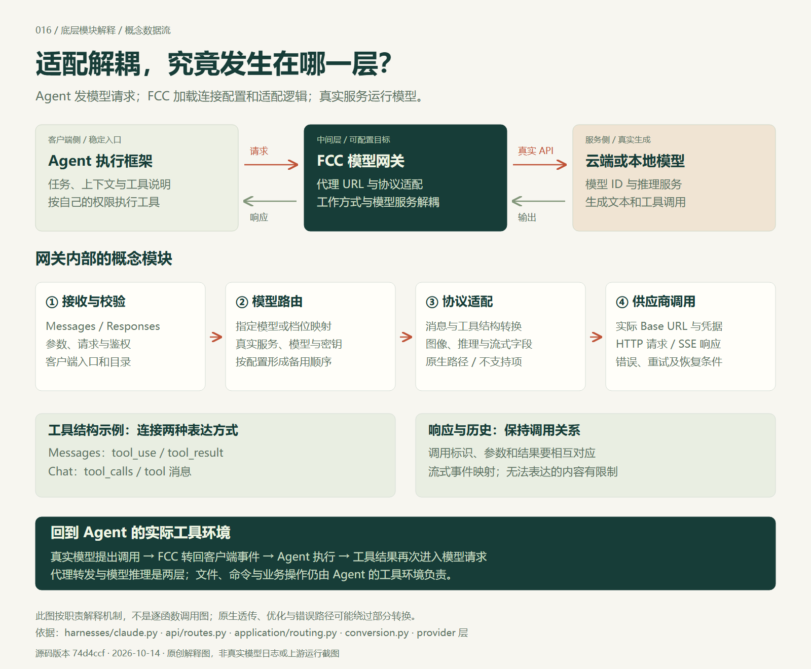

# 016 · Free Claude Code：统一模型入口与协议适配研究

> 能力是统一模型接入、消息与工具协议适配、流式响应转换及配置路由；原理是在 Agent 与真实模型之间增加网关，转发请求并返回兼容响应；价值是接入解耦，让工作方式和模型服务分别选择。可扩展到多模型编程、写作与报告、资料问答、网页审查、任务路由及团队入口，组合需要另行适配和验证。沿用我们的完整引导图，并提供底层图、旧项目对比与评测路线；真实质量和总成本仍待实测。

[返回总索引](../../README.md#项目索引) · [原仓库](https://github.com/Alishahryar1/free-claude-code) · [在线网页](https://yydshly.github.io/1013_codex_project/016-free-claude-code/) · [本地网页](./web/index.html) · [网页说明](./web/README.md) · [实验记录](./experiments/README.md)

## 研究概览

| 信息 | 内容 |
| --- | --- |
| 编号与研究日期 | 016 / 2026-10-14 |
| 原作者与仓库 | Alishahryar1 / free-claude-code |
| 固定版本 | `74d4ccfde724f7416fa2a728d594d704dddc7c94`，提交于 2026-10-13 10:07:12 UTC；2026-10-14 再次读取 main，仍为此版本 |
| 上游许可证 | `AGPL-3.0-only`，依据固定版本 LICENSE 与 pyproject.toml |
| 状态 | 研究中：核心源码已核对，提供全面中文网页；上游与真实模型尚未实测 |
| 本次产物 | 六步请求模拟、Agent / 模型切换、备用条件、适配解耦总结、旧项目对比、两张原创 PNG / SVG、放大阅读、评测 CSV 与源码证据 |
| 上游环境 | pyproject.toml 要求 Python `==3.14.7`，使用 uv；本次未安装上游依赖或运行安装器 |
| 网页环境 | 原生 HTML / CSS / JavaScript，无第三方运行或构建依赖，不发送模型请求 |
| 发布状态 | 已部署并验证：https://yydshly.github.io/1013_codex_project/016-free-claude-code/；静态网页发布与真实模型运行分别记录 |

## 能力、原理、价值与可扩展场景

| 核心问题 | 清晰摘要 |
| --- | --- |
| 能力是什么 | 在编程 Agent 与真实模型之间提供统一网关，集中配置服务与模型，适配消息、工具与响应格式，处理流式事件、配置路由、重试和符合恢复条件的备用；集成入口围绕模型通路展开。 |
| 原理是什么 | Agent 指向共用代理 API 地址 → FCC 接收、解析真实目标与转换协议 → 调用云端或本地模型 → 转回客户端响应 → Agent 实际执行工具 → 工具结果进入下一轮。模型由实际服务运行，库文件夹不是模型请求地址。 |
| 价值是什么 | 用接口适配实现接入解耦，让任务执行框架与模型供应商分别选择，减少重复配置、接入和迁移；为同任务模型评测、成本比较与故障备选建立共同入口。 |
| 可扩展场景是什么 | 多模型编程工作台、长文与报告、农业资料或技术手册问答、网页内容审查、按任务选择云端或本地模型、小团队统一入口；任务判断、检索、工作流、权限与验收仍需分别建设。 |
| 价值如何验证 | 固定任务、资料、工具环境、模型版本与验收标准，比较完成率、事实与引用准确性、工具失败、人工返工、耗时、真实调用费用和维护成本。接通接口只是起点。 |

## 理解总览图


图片由本仓库直接绘制 SVG 后用浏览器渲染为 PNG，1600 × 2460；未使用上游 UI 或素材。[完整 PNG](./assets/understanding-overview.png) · [可缩放 SVG](./assets/understanding-overview.svg)。网页提供放大与下载；实拍及检查见 [验证记录](./experiments/results/verification.md)。



[底层 PNG](./assets/gateway-internals.png) · [底层 SVG](./assets/gateway-internals.svg)，1600 × 1320。图以职责归纳模块，原生、优化和错误路径有条件分支。

## 补充理解：核心是适配解耦

共用代理地址是入口，协议适配是机制，模型服务可替换是价值。客户端保持支持的调用方式，FCC 集中处理真实服务地址、凭据、模型 ID、格式与失败状态；由此减少每个 Agent 分别适配服务的重复工作。

解耦发生在接入层，不能把不同模型看作完全等价。客户端要支持代理配置；模型的工具能力、图像、上下文和输出行为仍需匹配。实际生成质量由模型与资料决定，权限和工具操作由 Agent 环境负责。

对我们而言，可以分别建设任务判断、模型调用、工具执行和验收记录。已有工具已直接支持唯一所需模型时，新增代理的收益需要与维护工作比较。免费额度来自服务商或本地方案，网关本身不产生新的模型能力或配额。

## 本质与三个地址概念

**准确表述：给 Agent 配置统一代理 API 地址，由 FCC 适配接口，并把请求转发给你配置的真实模型服务；再把响应交回 Agent。**

“公共地址”指共用入口，通常运行在本机，并不要求公网。API 地址与库安装文件夹、模型权重路径不同。FCC 加载配置和适配逻辑，模型通常运行在供应商或你自己的推理服务中；Ollama 等本地方案的模型由对应推理服务加载。

```text
用户目标 → Agent（上下文与工具定义）→ FCC（解析目标、适配）
        → 真实模型（回答或工具调用）→ FCC（适配响应）
        → Agent（按权限执行工具）→ 工具结果再次交给模型
```

| 名称 | 指向什么 | 谁使用 |
| --- | --- | --- |
| 代理 API 地址 | FCC 提供的本地或受控网络接口 | Agent 把请求发到这里 |
| 真实服务地址 | 供应商 API 或本地推理服务 | FCC 调用模型服务 |
| 库文件夹路径 | 安装代码、资源与配置文件的位置 | 操作系统与启动程序 |

改变地址是入口配置；实现还包含消息、工具和流式转换、目录、路由、恢复及集成管理。模型无需加载进 FCC。

## 三方职责、输入与输出

| 角色 | 输入与职责 | 输出与边界 |
| --- | --- | --- |
| Agent | 接收目标，组织任务、上下文与工具定义，按权限处理模型提出的工具调用 | 文件、命令结果、对话与任务成果；执行权限由客户端及环境决定 |
| FCC | 接收模型请求、路由规则、真实地址与凭据，解析目标、适配协议、转发并处理失败 | 客户端可识别的文本、调用与事件；不训练模型，不自动建设领域知识库 |
| 真实模型 | 接收适配后的问题、资料和工具说明，理解、推理、生成内容与调用指令 | 回答和工具指令；知识、长上下文及工具质量取决于实际模型和输入 |

例如 `Claude Code → FCC → DeepSeek`：保留 Claude Code 的任务执行框架，由 DeepSeek 提供实际生成能力。Claude Code 是工具，Claude 是模型系列；工具名称不代表某一模型的能力或额度。

## 原理与核心链路

1. `harnesses/claude.py` 的 `claude_proxy_values` 把 `ANTHROPIC_BASE_URL` 指向代理 URL；启动器使用原有客户端程序。
2. `api/routes.py` 接收 `/v1/messages` 或 `/v1/responses` 请求，另有模型目录及 token 计数入口。
3. `application/routing.py` 根据直接模型引用或预设档位映射选择真实目标，按配置形成有序备用列表。
4. 协议不同时，适配消息角色、工具定义、参数、结果、图像与推理字段；兼容原生协议可以走透传路径。
5. provider 层调用真实服务，处理字段差异与流式响应。生成发生在供应商或本地推理服务。
6. FCC 把响应交回 Agent，Agent 按权限执行工具，把结果带进下一轮请求。任务可能经历多轮往返。

### 协议与兼容条件

主要入站生成协议是 Anthropic Messages 和 OpenAI Responses；自定义上游配置支持 `openai_chat`、`openai_responses`、`anthropic_messages`。FCC 能调用 OpenAI 兼容上游，与它对客户端开放哪些协议，是两件事。

**已有 Chat Completions 应用不能只改地址就假定可用。** 当前核心路由没有通用 `/v1/chat/completions` 入站生成入口，需要调整客户端或增加适配。

工具名称、输入结构、标识、参数与结果都要保持一致。接口能表达工具调用，不等于模型能稳定选对工具和填对参数；图像、推理、上下文和部分内容块也有兼容差异。转换代码对不能表达的部分设有限制。

## 能力汇总

| 能力 | 已有支持与作用 | 条件或未验证事项 |
| --- | --- | --- |
| 统一服务配置 | 真实地址、凭据、模型、推理设置和自定义协议 | 模型与调用资格由实际服务决定 |
| 模型目录与选择 | 让兼容客户端选择代理公开的模型 | 发现模型不等于适合编程 |
| 消息与工具适配 | 转换调用、参数、结果与历史 | 模型调用质量与权限仍需验证 |
| 流式、图像和推理字段 | 处理兼容字段或原生接口 | 不支持的模型不会因此获得能力 |
| 直接选择与档位映射 | 按配置解析实际目标 | 不等于自动判断最优模型 |
| 重试、备用与恢复 | 部分失败后尝试有序备用目标 | 已输出内容和工具状态可能要求停止 |
| 五类辅助请求优化 | 额度探测、命令前缀、标题、建议、文件路径可本地处理或跳过 | 取决于开关；固定或估算 usage 不是供应商账单 |
| 浏览器 Codex 会话 | 启动本机 app-server，管理会话与事件 | 执行环境要持续运行 |
| 编程工具和 IDE 入口 | 文档列出 11 类工具及集成 | 未逐一实测兼容性 |
| 消息、语音和输出压缩 | 文档描述 Telegram / Discord、Whisper / NIM、RTK / Headroom | 外部组件需单独配置与验证 |

研究版本文档列出 61 个供应商；本研究未逐一确认模型、地区、免费资格、条款和实时额度。浏览器会话内切换执行框架被文档列为后续支持，不记作已实现。

`core/stream_recovery.py` 根据输出状态、工具调用、结构化结果和恢复条件，选择 restart、continue、handoff 或 stop。部分情况必须停止；原生接口也可能受备用目标兼容性约束。重试与备用请求可能到达多个供应商并消耗用量。

## 免费、真实成本与资料去向

- 免费来自供应商试用或免费档位，受数量、速率、地区、有效期与用途约束；FCC 不产生新额度。
- 付费 API 与订阅仍按对应服务计费和限定用途，凭据与套餐不能自动互换。
- 本地模型仍有硬件、内存、电力、速度与维护成本。
- README 的“1.3B+ free tokens”“up to 90% lower token usage”是项目方描述；本研究未证明个人额度或节省比例。
- 本地代理不等于全部资料留在本机：云端模型接收实际发送的上下文和工具结果；其他工具与外部服务的去向仍需分别确认。

比较单位应为完成任务的总成本：真实调用费用、重试和备选、人工返工、耗时及运行维护。不要用代理的本地估算或固定 usage 代替真实账单。

## 场景与对你的价值

适合经常换模型而保持 Agent 工作方式、同任务模型对比、低成本小任务实验、本地服务接入、故障备选及电脑持续运行时的远程入口。

只用一个模型、客户端已经原生支持它且没有统一管理或备用需求时，新增代理的收益可能有限。复杂编码与多轮工具任务，要按完成率和核查结果选择模型。

对你最有意义的三点：理解执行、连接与模型的分工；减少重复接入；建立自己的模型评测资料。

| 现有项目 | 可探索的衔接 | 仍需建设和验证 |
| --- | --- | --- |
| [007 模型判断](../007-hermes-jev-skills/README.md) | 判断层选模型，FCC 执行调用 | 映射、能力约束、预算与路由收益 |
| [001 长文写作](../001-infinite-bookshelf/README.md) | 比较生成模型、复用配置 | 协议适配、大纲、资料、上下文和编辑 |
| [006 网站审查](../006-jev-seo/README.md) | 替换模型评估环节 | 采集、规则、证据复核和结构化验收 |
| [002 RAG](../002-production-agentic-rag-course/README.md) | 生成入口或知识库工具 | 导入、解析、索引、检索、引用与协议 |

这些衔接是后续方向，尚未改动其他项目。建议一个工具、两个模型、五类任务先建立基线，再决定是否作为常用基础设施。

## 与既有项目的差异

最接近的旧研究是 [FreeLLMAPI](https://yydshly.github.io/0911_codex_project/008-freellmapi/)，固定版本 `83562ad360a65d80b6319297fee4cd47dc5a2ff3`。两者主干都是 Agent / 应用 → 模型网关 → 真实模型 → 返回。

| 维度 | FCC / 74d4ccf | FreeLLMAPI / 83562ad |
| --- | --- | --- |
| 实现重点 | 编程 Agent 的兼容、启动与集成、工具和流式适配 | 个人模型资源、额度和调用状态调度 |
| 主要入站协议 | Messages / Responses | Chat Completions / Messages / Responses 等 |
| 目标选择 | 直接模型、档位映射与有序备用配置 | 能力筛选、优先级或动态评分，结合额度选择模型与密钥 |
| 动态依据 | 主路由主要依配置，失败按恢复条件处理 | 历史可靠性、速度、目录能力、额度余量与限流 |
| 聊天流式恢复 | 检查输出和工具状态，判定重启、继续、交接或停止 | 所读主要路径在输出提交前争取回退，提交后通常报告流错误并停止回退 |
| 补充参考价值 | 编程工具协议兼容、原生会话与恢复状态机 | 额度账本、在途占用、动态评分、缓存与可选融合 |

FreeLLMAPI 的可靠性包含 Beta 后验与 Thompson Sampling；该评分基于调用表现和目录资源，不等于任务正确率。Jev 则先判断任务难度、类型与风险，再由本地策略选执行模型。两种判断可以研究性组合，实际接口与收益仍待验证。

| 项目 | 所在层与底层机制 |
| --- | --- |
| FCC / FreeLLMAPI | Agent → 模型服务；模型 API、协议适配、路由与调用状态 |
| [Agenvo](https://yydshly.github.io/1009_codex_project/016-agenvo/) | 上层助手 → 原生 Agent；MCP、Relay、Connector / Adapter 与原生接口，保留会话身份 |
| [Hermes Jev](../007-hermes-jev-skills/README.md) | 任务语义判断 → 本地策略 → 执行模型；有限问题、阈值与能力约束 |
| [cmux](../009-cmux/README.md) / [Vibe42](../010-vibe42/README.md) | 人 → 会话工作台或远程入口 → Agent；终端、PTY、会话定位、控制或加密传输 |

固定依据：[FreeLLMAPI 评分](https://github.com/tashfeenahmed/freellmapi/blob/83562ad360a65d80b6319297fee4cd47dc5a2ff3/server/src/services/scoring.ts)、[流式管线](https://github.com/tashfeenahmed/freellmapi/blob/83562ad360a65d80b6319297fee4cd47dc5a2ff3/docs/en/architecture/03-streaming-pipeline.md)、[Agenvo 架构 / 68e046a](https://github.com/Xuanwo/agenvo/blob/68e046a5d8691054f8c134d85ae051988bae3dff/design/architecture.zh-CN.md)、[Jev 路由 / 31f476c](https://github.com/kerpopule/hermes-jev-skills/blob/31f476cac49713b6bf88c00d42382542e1c36965/jevkit/route.py)。这些结论沿用此前核对的固定版本，不作为当前性能排名；没有统一运行验证。

## 扩展与使用路线

已有支持：配置自己的服务地址、凭据、协议和模型 ID。新增方向：任务语义路由、能力与预算约束、真实用量和结果记录、知识库工具、团队身份和隔离、兼容性回归。新增方向需另行实现，不能写成上游现成功能。

### 可扩展成哪些应用

| 场景 | FCC 提供的基础 | 上层仍需补齐 | 验收重点 |
| --- | --- | --- | --- |
| 多模型编程工作台 | 同一 Agent 连接多个模型服务，配置映射与备用 | 任务分类、仓库环境、工具权限、模型能力检查和代码验收 | 完成率、测试结果、返工、耗时与总费用 |
| 写作与专题报告 | 可替换的起草、改写与总结生成入口 | 与项目 001 衔接协议；大纲、资料、上下文、引用和编辑流程 | 事实正确率、长文一致性、引用依据和编辑时间 |
| 农业资料或技术手册问答 | RAG 生成服务或 Agent 检索后的模型调用 | 与项目 002 衔接；导入、切块、索引、检索、版本与引用核查 | 检索命中、可核查回答、错误率和更新效果 |
| 网页质量与内容审查 | 相同页面材料的模型评估与模型比较 | 项目 006 采集和规则、结构化输出及人工复核；其 Chat Completions 客户端还需调整接口 | 问题准确率、误报漏报、整改后复核与成本 |
| 按任务选择云端或本地模型 | 配置多个目标并执行统一调用 | 借鉴项目 007 增加任务判断与策略，检查上下文、工具、资料去向和预算 | 质量、速度、总成本与实际调用目标是否符合约束 |
| 小团队共用模型入口 | 多个兼容客户端共用服务配置与协议适配基础 | 身份、租户隔离、凭据托管、额度、限流、审计、运维及 AGPL 要求 | 配置工作减少量、故障处理时间、费用归属和权限结果 |

这些是组合方向，尚未实现或统一实测。FCC 负责模型接入；任务判断决定用谁，Agent 与应用组织执行，检索系统提供资料，评测负责验收。资料敏感性策略若加入，必须核对实际发送目标和备用目标，不能仅凭“本地代理”推断数据留在本机。

### 从最小闭环到自己的基础设施

实际路线：选工具与合法服务 → 按固定文档安装启动 → 读取真实代理地址 → 配置真实目标 → 连接客户端 → 核对问答与文件工具闭环 → 比较五类任务 → 再验证中断与备用条件。本次未运行安装器或真实服务。

五类任务为源码解释、小脚本编写、错误修复、文档整理、小功能修改。各模型用相同资料与独立副本，记录版本、配置、标准、完成率、工具失败、返工、耗时和费用。空白表见 [CSV](./web/data/evaluation-template.csv)，没有预填结果。

## 固定版本源码证据

所有链接固定到研究 commit。获取方式为 GitHub 公开仓库读取工具；blob SHA、行数与符号位置保存在 [source-evidence.json](./references/source-evidence.json)，不复制上游实现。

| 文件 | 支持的研究内容 | 来源 |
| --- | --- | --- |
| `README.md` | 供应商、入口、免费与集成描述 | [源码](https://github.com/Alishahryar1/free-claude-code/blob/74d4ccfde724f7416fa2a728d594d704dddc7c94/README.md) |
| `src/free_claude_code/harnesses/claude.py` | 客户端代理地址 | [源码](https://github.com/Alishahryar1/free-claude-code/blob/74d4ccfde724f7416fa2a728d594d704dddc7c94/src/free_claude_code/harnesses/claude.py) |
| `src/free_claude_code/api/routes.py` | 主要生成入口 | [源码](https://github.com/Alishahryar1/free-claude-code/blob/74d4ccfde724f7416fa2a728d594d704dddc7c94/src/free_claude_code/api/routes.py) |
| `src/free_claude_code/application/routing.py` | 配置式模型路由 | [源码](https://github.com/Alishahryar1/free-claude-code/blob/74d4ccfde724f7416fa2a728d594d704dddc7c94/src/free_claude_code/application/routing.py) |
| `src/free_claude_code/core/anthropic/conversion.py` | 消息与工具转换 | [源码](https://github.com/Alishahryar1/free-claude-code/blob/74d4ccfde724f7416fa2a728d594d704dddc7c94/src/free_claude_code/core/anthropic/conversion.py) |
| `src/free_claude_code/config/custom_providers.py` | 自定义三种 API 格式 | [源码](https://github.com/Alishahryar1/free-claude-code/blob/74d4ccfde724f7416fa2a728d594d704dddc7c94/src/free_claude_code/config/custom_providers.py) |
| `src/free_claude_code/application/execution.py` | 备用执行 | [源码](https://github.com/Alishahryar1/free-claude-code/blob/74d4ccfde724f7416fa2a728d594d704dddc7c94/src/free_claude_code/application/execution.py) |
| `src/free_claude_code/core/stream_recovery.py` | 恢复条件 | [源码](https://github.com/Alishahryar1/free-claude-code/blob/74d4ccfde724f7416fa2a728d594d704dddc7c94/src/free_claude_code/core/stream_recovery.py) |
| `src/free_claude_code/api/optimization_handlers.py` | 五类请求优化 | [源码](https://github.com/Alishahryar1/free-claude-code/blob/74d4ccfde724f7416fa2a728d594d704dddc7c94/src/free_claude_code/api/optimization_handlers.py) |
| `src/free_claude_code/runtime/codex_app_server.py` | 原生浏览器会话 | [源码](https://github.com/Alishahryar1/free-claude-code/blob/74d4ccfde724f7416fa2a728d594d704dddc7c94/src/free_claude_code/runtime/codex_app_server.py) |
| `pyproject.toml` | 运行时与许可证 | [源码](https://github.com/Alishahryar1/free-claude-code/blob/74d4ccfde724f7416fa2a728d594d704dddc7c94/pyproject.toml) |


## 本次实践与验证范围

网页为原创研究导读与固定教学模拟，不启动 FCC、Agent 或模型，不提交密钥、执行命令或产生真实计费。正文、证据链接和总览图不依赖在线模型，原理演示需要 JavaScript。

网页与仓库校验记录在 [verification.md](./experiments/results/verification.md)。静态网页检查只能证明本次产物可读可用；真实安装、接入、额度、工具质量、恢复、费用和任务收益仍待实测。

公网发布记录见 [publication-2026-10-14.md](./experiments/results/publication-2026-10-14.md)。沿用我们的引导图和底层图；公开资源与已提交文件逐字节一致，桌面、手机、教学流程、大图阅读与下载已核对，其他十二个已发布入口仍可访问。

上游是独立项目，非 Anthropic 官方项目。改造与引用应遵循 `AGPL-3.0-only`，托管或分发方案应纳入许可证要求。本网页未复制上游 UI、图片、权重或实现代码，示意请求为原创。本仓库未设统一许可证，不能把上游许可自动套用到所有研究内容。

## 后续

- [ ] 隔离环境复现固定版本，记录 Agent / FCC / 模型版本。
- [ ] 两种服务跑通问答、工具、图像与流式请求。
- [ ] 五类任务配对评测真实成本、返工与质量。
- [ ] 验证断流和备用，不重复执行有副作用的工具。
- [x] 按仓库站点独立路径发布并验证，再填写 demo_url。

[固定源码树](https://github.com/Alishahryar1/free-claude-code/tree/74d4ccfde724f7416fa2a728d594d704dddc7c94) · [许可证](https://github.com/Alishahryar1/free-claude-code/blob/74d4ccfde724f7416fa2a728d594d704dddc7c94/LICENSE)
