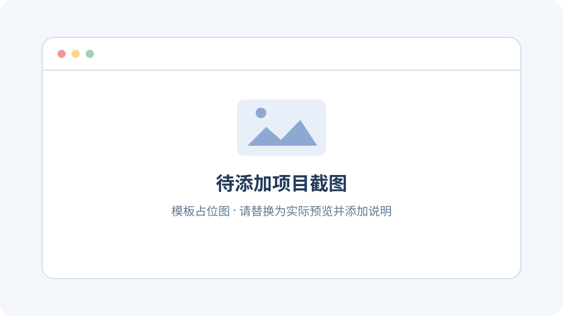

# {{ID}} · {{NAME}}

> {{SUMMARY}}

[返回总索引](../../README.md#项目索引) · [原 GitHub 仓库]({{SOURCE_URL}}) · [实验代码](./experiments/) · [Web 演示说明](./web/)

## 项目概览

| 信息 | 内容 |
| --- | --- |
| 研究编号 | `{{ID}}` |
| 原仓库 | {{SOURCE_URL}} |
| 研究版本 / commit | 待记录；确认后同步填写 `project.json` 的 `source_ref` |
| 上游许可证 | 待查证；确认后同步填写 `source_license` |
| 当前状态 | 待研究；首页展示以 `project.json` 的 `status` 为准 |
| 在线演示 | 未部署；可访问后填写 `project.json` 的 `demo_url` |

## 图片预览

**图片说明：** 当前是模板占位图。研究后替换为实际截图，说明画面展示的功能、截图来源和对应版本；同时更新 `project.json` 的 `preview` 与 `preview_caption`。

## 为什么研究这个项目

- 项目解决的问题：待补充。
- 值得学习的设计或实现：待补充。
- 本次研究目标与范围：待补充。

## 环境与运行复现

### 研究环境

记录操作系统、运行时、依赖版本、原仓库 tag 或 commit，以及复现日期。

### 运行步骤

按实际执行顺序补充安装、配置和启动命令；环境变量提供 `.env.example`，示例值使用占位内容。

### 验证记录

| 功能或步骤 | 验证结果 | 证据 / 备注 |
| --- | --- | --- |
| 待补充 | 未验证 | 待补充 |

## 源码与实现分析

- 目录结构与主要入口：待补充。
- 核心流程、数据流或关键模块：待补充。
- 值得复用的设计及适用条件：待补充。
- 已知限制与待确认问题：待补充。

## 更多截图与说明

将截图放在 `assets/`，按顺序命名，例如 `01-overview.png`、`02-workflow.png`。每张图附上功能说明、来源与对应版本。

## 本仓库的实践与改动

实验代码放在 `experiments/`，演示代码放在 `web/`。补充相对原项目的改动、运行方式与验证结果。

## 研究结论

- 收获与可复用部分：待补充。
- 适用场景与限制：待补充。
- 后续研究方向：待补充。

## 待办

- [ ] 确认研究版本和上游许可证
- [ ] 完成运行复现与验证记录
- [ ] 整理核心实现分析
- [ ] 添加实际截图与说明
- [ ] 按需要制作并部署 Web 演示
- [ ] 更新元信息、研究结论和总索引

## 来源与致谢

原项目：{{SOURCE_URL}}。引用的代码、图片与资料遵循原作者的许可；补充实际使用的资料链接与相关说明。
